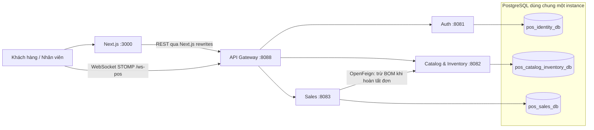

# Smart POS & KDS

**Hệ thống Quản lý Nhà hàng và Gọi món Thông minh**

Đồ án chuyên ngành · Trường Đại học Sài Gòn · Khoa Công nghệ Thông tin
Nhóm **262701-DACN-08-Nhom2B** · Học phần **841476**, nhóm/lớp **03**
Giảng viên hướng dẫn: **ThS. Trần Đình Nghĩa**

Smart POS & KDS số hóa quy trình phục vụ nhà hàng: khách gọi món qua QR tại bàn, bếp xử lý từng món trên KDS, thu ngân thanh toán trên POS, quản lý theo dõi thực đơn, kho, công thức định lượng (BOM), khách hàng và khuyến mãi.

- Repository: [poromvp/Smart-POS](https://github.com/poromvp/Smart-POS).
- Cơ sở thiết kế: [Báo cáo tiến độ lần 1](docs/academic/DACN_08_Nhom2B_BC_01.docx).
- Liên hệ: **Lê Quang Kiệt**, MSSV **3123410180**, quangkietle382@gmail.com / 3123410180@sv.sgu.edu.vn.
- **Cập nhật ngày 13/11/2026**, đối chiếu mã nguồn tại commit `c7c85eb` và cấu hình trong checkout hiện tại. Đây là mô tả hiện thực; lần cập nhật tài liệu này không chạy lại toàn bộ hệ thống hoặc bộ test.

## Mục lục

1. [Phạm vi và tiến độ](#1-phạm-vi-và-tiến-độ)
2. [Thành viên và phân công](#2-thành-viên-và-phân-công)
3. [Kiến trúc và công nghệ](#3-kiến-trúc-và-công-nghệ)
4. [Cấu trúc mã nguồn](#4-cấu-trúc-mã-nguồn)
5. [Thiết lập môi trường](#5-thiết-lập-môi-trường)
6. [Tài khoản kiểm thử](#6-tài-khoản-kiểm-thử)
7. [API và kịch bản demo](#7-api-và-kịch-bản-demo)
8. [Kiểm thử](#8-kiểm-thử)
9. [Giới hạn và công việc còn lại](#9-giới-hạn-và-công-việc-còn-lại)
10. [Tài liệu và bàn giao](#10-tài-liệu-và-bàn-giao)

## 1. Phạm vi và tiến độ

Phạm vi đồ án phục vụ **01 cửa hàng mì cay độc lập** trong 12 tuần. Quản lý chuỗi, giao hàng, tính lương và kế toán là hướng phát triển sau; giao diện có mục chi nhánh không đồng nghĩa đã hỗ trợ vận hành đa chi nhánh.

| Hạng mục                         | Hiện trạng trong mã nguồn                                                                                                       | Giới hạn cần lưu ý                                                                                        |
| -------------------------------- | ------------------------------------------------------------------------------------------------------------------------------- | --------------------------------------------------------------------------------------------------------- |
| Gọi món QR                       | Menu, biến thể/tùy chọn, giỏ hàng, tạo đơn và thêm món vào đơn đang hoạt động qua API                                           | Bàn được truyền qua URL; chưa có cơ chế token QR có chữ ký để chứng minh quyền truy cập bàn               |
| Đăng nhập và RBAC                | Frontend gọi Auth thật, nhận access token, refresh qua cookie, tải `/api/auth/me`; điều hướng và kiểm soát giao diện theo quyền | Quyền phía giao diện phải đi cùng kiểm tra backend; không dùng các tài khoản email mô phỏng của README cũ |
| POS                              | Đọc đơn, nhận thông báo realtime, gọi API checkout; có xử lý khách hàng, voucher và điểm                                        | VietQR/chuyển khoản do nhân viên xác nhận, chưa có đối soát ngân hàng tự động                             |
| KDS                              | Nhận `/topic/kds`, cập nhật trạng thái từng dòng món qua API                                                                    | POS và KDS có polling dự phòng mỗi **60 giây**, không còn mô tả polling 5 giây                            |
| Kho và BOM                       | Quản lý nguyên liệu, công thức, nhập hàng, điều chỉnh và lịch sử kho; Sales gọi Catalog qua OpenFeign                           | **Trừ kho khi hoàn tất đơn/checkout**, không phải lúc bắt đầu chế biến                                    |
| Chống trừ kho lặp                | Catalog kiểm tra `orderCode` + `SALE_DEDUCT` sau khi khóa nguyên liệu; Sales xử lý trường hợp đã trừ                            | Chưa phải giao dịch phân tán nguyên tử hoặc Saga hoàn chỉnh                                               |
| Khách hàng, khuyến mãi, thống kê | Có API và giao diện, tích/đổi điểm, điều kiện voucher và thống kê bán hàng                                                      | Cần đối chiếu báo cáo test theo đúng phiên bản nghiệm thu                                                 |
| Kiểm thử                         | Unit/integration backend, 8 file test frontend, 6 file E2E Playwright và GitHub Actions                                         | Có bộ test không đồng nghĩa mọi chức năng đã được nghiệm thu                                              |

Nguồn chính: [Auth context](frontend/src/lib/auth-context.tsx), [POS](frontend/src/app/pos/page.tsx), [KDS](frontend/src/app/kds/page.tsx), [OrderServiceImpl](backend/services/sales-service/src/main/java/com/smartpos/sales_service/service/impl/OrderServiceImpl.java), [InventoryServiceImpl](backend/services/catalog-inventory-service/src/main/java/com/smartpos/cataloginventory/service/impl/InventoryServiceImpl.java).

## 2. Thành viên và phân công

Danh sách thành viên lấy theo trang hành chính của báo cáo lần 1. Phân công dưới đây được cập nhật theo thông tin thành viên cung cấp; những nhiệm vụ chưa rõ và tỷ lệ đóng góp cần nhóm xác nhận bổ sung.

| MSSV       | Thành viên        | Vai trò / phạm vi công việc                         | Đóng góp thực tế lần 2 |
| ---------- | ----------------- | --------------------------------------------------- | ---------------------- |
| 3123410180 | Lê Quang Kiệt     | Nhóm trưởng; nhiệm vụ lập trình cụ thể chờ xác nhận | Chờ nhóm xác nhận      |
| 3123410015 | Đỗ Trần Huy Bảo   | Chờ xác nhận phạm vi công việc                      | Chờ nhóm xác nhận      |
| 3123410194 | Nguyễn Hoàng Lập  | Frontend — phần gọi món bằng QR (QR Ordering)       | Chờ nhóm xác nhận      |
| 3123410242 | Nguyễn Trọng Nhân | Lead Frontend                                       | Chờ nhóm xác nhận      |
| 3123410179 | Lâm Tuấn Kiệt     | Chờ xác nhận phạm vi công việc                      | Chờ nhóm xác nhận      |

Nhóm cần bổ sung người phụ trách Backend, CSDL và các module còn lại, đồng thời xác nhận tỷ lệ đóng góp thực tế với **tổng bằng 100%**. Chưa gán thêm KDS, bộ đếm hoặc cảnh báo trễ vào phân công của Nguyễn Hoàng Lập khi chưa được xác nhận. Không tự chuyển mức 20%/người của lần 1 sang giai đoạn lập trình. Đề tài hiện không có phân hệ AI/IoT.

## 3. Kiến trúc và công nghệ

### 3.1. Ba service nghiệp vụ và API Gateway



| Thành phần        | Trách nhiệm                                                                                                  |
| ----------------- | ------------------------------------------------------------------------------------------------------------ |
| Auth              | Tài khoản, vai trò, quyền, JWT, refresh token và phiên đăng nhập                                             |
| Catalog–Inventory | Danh mục, món/biến thể/tùy chọn, nguyên liệu, BOM, nhà cung cấp, nhập và trừ kho                             |
| Sales             | Đơn hàng, trạng thái từng món KDS, thanh toán, khách hàng, khuyến mãi, điểm và thống kê                      |
| Gateway           | Định tuyến HTTP/WebSocket, JWT, lọc header, CORS, rate limit, correlation ID và circuit breaker cho đọc menu |

Mỗi service sở hữu database riêng về mặt logic; cả ba database hiện chạy trong **cùng một container PostgreSQL**, nên vẫn chia sẻ tài nguyên và điểm lỗi hạ tầng. Các ứng dụng Spring Boot chạy riêng. POS/KDS/Admin là các giao diện nghiệp vụ, không phải ba microservice bổ sung. Module [shared](backend/shared) là thư viện dùng chung, không phải dịch vụ chạy độc lập.

Địa chỉ service được cấu hình bằng URL/biến môi trường; cấu hình hiện tại không dùng Eureka. Gateway dùng WebFlux; nghiệp vụ được triển khai trong các service Spring Boot với Spring Data JPA.

### 3.2. Giao tiếp, bảo mật và xử lý lỗi

- Frontend chuyển REST request qua [Next.js rewrites](frontend/next.config.mjs) tới Gateway. Gateway bỏ prefix `/catalog` hoặc `/sales` trước khi chuyển tiếp tới API tương ứng.
- [Gateway JWT filter](backend/gateway/src/main/java/com/smartpos/gateway/filter/JwtAuthenticationFilter.java) kiểm tra Bearer JWT cho route được bảo vệ, loại các header định danh/nội bộ được xử lý bởi filter khỏi request bên ngoài và gắn `X-User-Id`, `X-User-Role`, `X-User-Name`, `X-User-Permissions` từ token. Catalog/Sales kiểm tra quyền nghiệp vụ. Các cổng nội bộ cần được giới hạn truy cập khi triển khai.
- Sales gọi `POST /api/inventory/deduct` trực tiếp tới Catalog bằng [InventoryClient](backend/services/sales-service/src/main/java/com/smartpos/sales_service/client/InventoryClient.java). [Feign interceptor](backend/services/sales-service/src/main/java/com/smartpos/sales_service/client/FeignTraceAndInternalInterceptor.java) truyền correlation ID, ngữ cảnh người dùng và `X-Internal-Secret`.
- Sales phát `/topic/orders`, `/topic/kds`, `/topic/tables/{tableNumber}` **sau khi transaction commit**. [STOMP interceptor](backend/services/sales-service/src/main/java/com/smartpos/sales_service/security/StompAuthChannelInterceptor.java) kiểm tra JWT/quyền cho topic nhân viên; topic theo bàn cho phép ẩn danh. Frontend dùng [WebSocket manager](frontend/src/lib/websocket.ts); POS/KDS tải lại dữ liệu khi có sự kiện và polling dự phòng 60 giây.
- [Gateway config](backend/gateway/src/main/resources/application.yml) đặt connect timeout 5 giây, response timeout 15 giây. Circuit breaker `catalogMenuCB` áp dụng cho **GET menu**, không bao phủ toàn bộ API hoặc lời gọi Feign. Rate limit hiện lưu trong bộ nhớ từng Gateway instance: mặc định 15 request đăng nhập/phút và 30 request tạo đơn/phút.
- `X-Correlation-Id` hỗ trợ đối chiếu log qua các service; đây chưa phải hệ thống distributed tracing đầy đủ.

### 3.3. Luồng đơn hàng và nhất quán dữ liệu

1. Khách tạo đơn qua Gateway; Sales lưu đơn và các dòng món trong database Sales.
2. Sau commit, Sales phát sự kiện STOMP để POS/KDS tải lại dữ liệu.
3. Bếp cập nhật trạng thái **từng dòng món**. Bước này không tự trừ nguyên liệu.
4. Khi checkout/hoàn tất đơn, Sales gọi Catalog trừ BOM, xử lý điểm/voucher và lưu trạng thái đơn. Checkout đặt thanh toán `PAID`, đơn `COMPLETED` và các dòng món `SERVED`.
5. Catalog tính nguyên liệu cần, khóa các dòng nguyên liệu, kiểm tra trùng mã đơn và tồn kho trước khi trừ; ghi lịch sử `SALE_DEDUCT`. Món không có công thức có thể không phát sinh lượng trừ, nên demo BOM cần chuẩn bị công thức thực tế.
6. Sales có optimistic locking bằng `@Version`. Khi Catalog báo lỗi, Sales chuyển thành lỗi nghiệp vụ; trường hợp thông báo đã trừ kho được xem là đã xử lý để tiếp tục hoàn tất.

**Giới hạn:** transaction JPA tại Sales không rollback được transaction đã commit ở Catalog. Nếu Catalog trừ xong nhưng Sales commit thất bại vẫn cần cơ chế khôi phục/đối soát. Chống trừ lặp hiện dựa vào mã đơn và nhận diện thông báo lỗi; chưa có Saga, transactional outbox hoặc giao dịch phân tán hoàn chỉnh. Thời điểm trừ kho hiện tại khác thiết kế ban đầu “bắt đầu chế biến → trừ BOM”.

### 3.4. Công nghệ khai báo

| Thành phần        | Phiên bản/công nghệ                                                | Nguồn                                                                                           |
| ----------------- | ------------------------------------------------------------------ | ----------------------------------------------------------------------------------------------- |
| Backend           | Java 21, Spring Boot 4.1.1, Spring Cloud 2025.1.3                  | [Parent POM](backend/pom.xml)                                                                   |
| Gateway           | Spring Cloud Gateway Server WebFlux, Resilience4j                  | [Gateway POM](backend/gateway/pom.xml)                                                          |
| Giao tiếp/backend | OpenFeign, Spring Data JPA, WebSocket/STOMP                        | [Sales POM](backend/services/sales-service/pom.xml)                                             |
| Xác thực          | Spring Security, JJWT 0.13.0                                       | [Auth POM](backend/services/auth-service/pom.xml)                                               |
| API docs          | springdoc-openapi 3.1.0 tại Auth/Sales                             | [Sales POM](backend/services/sales-service/pom.xml)                                             |
| Frontend          | Next.js ^16.3.5, React ^19.2.8, TypeScript ^6.0.3, Tailwind ^4.3.3 | [package.json](frontend/package.json)                                                           |
| Database          | PostgreSQL 16-alpine, pgAdmin 4                                    | [Compose](docker-compose.yml)                                                                   |
| Kiểm thử          | JUnit/Mockito, H2, JaCoCo, Node test runner, Playwright            | [Backend POM](backend/pom.xml), [E2E package](e2e/package.json)                                 |
| Môi trường CI     | JDK 21, Node.js 22; Maven wrapper khai báo 3.10.0                  | [Workflow](.github/workflows/e2e.yml), [Wrapper](backend/.mvn/wrapper/maven-wrapper.properties) |

Đây là phiên bản trong repository, không phải xác nhận dependency đã resolve/build trên mọi máy. Dùng lockfile khi cài npm; nếu build lỗi dependency, kiểm tra log và tính tương thích của bộ phiên bản.

## 4. Cấu trúc mã nguồn

```text
Smart-POS/
├── backend/
│   ├── pom.xml, mvnw, mvnw.cmd
│   ├── shared/
│   ├── gateway/
│   └── services/
│       ├── auth-service/
│       ├── catalog-inventory-service/
│       └── sales-service/
├── frontend/                 # Next.js và unit tests
├── e2e/                      # Playwright, fixtures, page objects, script chạy local
├── init-scripts/             # SQL 01–05: tạo DB, seed, migration Sales/Auth
├── database/dbdiagram       # Thiết kế dữ liệu
├── docs/
│   ├── academic/            # Báo cáo học phần
│   ├── architecture/        # Đặc tả, sơ đồ, wireframe
│   ├── services/            # Tài liệu từng service
│   └── testing/             # Kế hoạch và báo cáo kiểm thử
├── .github/workflows/e2e.yml
├── .env.example
├── docker-compose.yml       # PostgreSQL + pgAdmin
├── docker-compose.full.yml  # PostgreSQL + pgAdmin + Gateway
└── docker-compose.e2e.yml   # PostgreSQL riêng cho E2E, cổng 5434
```

## 5. Thiết lập môi trường

### 5.1. Chuẩn bị

Cài Git, Docker Desktop/Engine với Compose v2, JDK 21 và Node.js 22 theo môi trường CI. Có thể dùng Maven cài sẵn hoặc wrapper tại backend. Các lệnh dưới chạy bằng PowerShell ở thư mục gốc repository.

```powershell
git clone https://github.com/poromvp/Smart-POS.git
cd Smart-POS
if (-not (Test-Path .env)) { Copy-Item .env.example .env }
```

Nếu đã có checkout thì bỏ qua bước clone. [.env.example](.env.example) đã có biến PostgreSQL, pgAdmin, Auth, JWT, internal secret, URL service và Gateway. Đồng bộ thông tin đăng nhập DB giữa Docker và backend; các giá trị mặc định chỉ phục vụ phát triển cục bộ.

**Lưu ý `PORT`:** mẫu env đặt `PORT=8088`; Gateway và Sales đều đọc biến này. Nếu nạp nguyên mẫu cho Sales mà không đổi lại, Sales sẽ chiếm cổng Gateway. Trong terminal Sales phải đặt `PORT=8083`, terminal Gateway đặt `PORT=8088` như bên dưới.

Backend chạy ngoài Docker không tự đọc `.env`. Trong **mỗi terminal backend**, nạp biến trước khi chạy:

```powershell
Get-Content .env | ForEach-Object {
    if ($_ -match '^\s*([A-Za-z_][A-Za-z0-9_]*)=(.*)$') {
        [Environment]::SetEnvironmentVariable($matches[1], $matches[2].Trim(), 'Process')
    }
}
```

Đoạn nạp trên dùng cho định dạng đơn giản `KEY=VALUE`, không có nháy hoặc comment cuối dòng. Auth/Gateway/Sales phải dùng chung `JWT_SECRET`; Sales/Catalog phải dùng chung `INTERNAL_SERVICE_SECRET`.

### 5.2. Database và migration

```powershell
docker compose up -d
docker compose ps
docker compose logs postgres
```

Compose mặc định chỉ chạy PostgreSQL và pgAdmin, **chưa khởi động frontend/backend**. PostgreSQL hiện map cả cổng host 5433 và 5432; cần bảo đảm hai cổng này không bị ứng dụng khác chiếm.

Khi volume còn trống, PostgreSQL chạy lần lượt:

1. [01-init-all-databases.sql](init-scripts/01-init-all-databases.sql): tạo ba database và schema ban đầu.
2. [02-seed-data.sql](init-scripts/02-seed-data.sql): seed danh mục/thực đơn.
3. [03-migration-sales-order-items.sql](init-scripts/03-migration-sales-order-items.sql): cập nhật dữ liệu dòng món.
4. [04-migration-sales-kds-and-version.sql](init-scripts/04-migration-sales-kds-and-version.sql): trạng thái KDS và version.
5. [05-migration-identity-db.sql](init-scripts/05-migration-identity-db.sql): `users.role_id`, `roles.is_system`, refresh token.

Auth, Catalog và Sales có initializer bổ sung dữ liệu khi khởi động theo điều kiện trong code. Vì vậy không dùng số bản ghi của riêng SQL seed để kết luận dữ liệu hiện có.

**Volume đã tồn tại không tự chạy lại các script mới.** Sao lưu và áp dụng migration phù hợp cho database cũ. Auth/Sales hiện mặc định `ddl-auto=update` (có biến `JPA_DDL_AUTO`); Catalog cũng cấu hình `update`. Hibernate update không thay thế quy trình migration có kiểm soát.

pgAdmin: `http://localhost:5050`, đăng nhập theo `PGADMIN_EMAIL`/`PGADMIN_PASSWORD`; đăng ký server host `postgres`, port `5432`, user/password theo `POSTGRES_*`. DBeaver trên máy host dùng `localhost:5433`.

### 5.3. Backend

Chuẩn bị parent POM và shared:

```powershell
.\backend\mvnw.cmd -f backend/pom.xml -N install
.\backend\mvnw.cmd -f backend/pom.xml -pl shared -am install -DskipTests
```

Mở bốn terminal riêng ở thư mục gốc, nạp env như mục 5.1 rồi chạy lệnh tương ứng:

```powershell
# Auth
$env:SPRING_PROFILES_ACTIVE = 'dev'
.\backend\mvnw.cmd -f backend/services/auth-service/pom.xml spring-boot:run
```

```powershell
# Catalog & Inventory
.\backend\mvnw.cmd -f backend/services/catalog-inventory-service/pom.xml spring-boot:run
```

```powershell
# Sales
$env:PORT = '8083'
.\backend\mvnw.cmd -f backend/services/sales-service/pom.xml spring-boot:run
```

```powershell
# Gateway
$env:PORT = '8088'
.\backend\mvnw.cmd -f backend/gateway/pom.xml spring-boot:run
```

Có thể thay wrapper bằng `mvn` nếu Maven đã cài. Auth mặc định profile `dev`; initializer hiện dùng biểu thức `dev | !test`, **không giới hạn chỉ profile dev**, nên cần rà lại chính sách seed trước khi triển khai ngoài môi trường học tập.

Tùy chọn chạy Gateway trong Docker bằng [docker-compose.full.yml](docker-compose.full.yml): file này vẫn chỉ có DB, pgAdmin và Gateway; ba service nghiệp vụ chạy trên host qua `host.docker.internal`. Không chạy thêm Gateway local cùng cổng hoặc đồng thời hai bộ Compose có cùng container name.

### 5.4. Frontend và địa chỉ demo

```powershell
cd frontend
npm ci
npm run dev
```

Mặc định Next.js chuyển API tới `http://localhost:8088`; WebSocket tới `ws://localhost:8088/ws-pos`. Nếu cần ghi đè, tạo `frontend/.env.local` với `API_GATEWAY_URL` và `NEXT_PUBLIC_WS_URL`, sau đó khởi động lại frontend.

| Thành phần                    | Địa chỉ                                                                                                                  |
| ----------------------------- | ------------------------------------------------------------------------------------------------------------------------ |
| Đăng nhập                     | http://localhost:3000/login                                                                                              |
| Gọi món bàn 01 / chỉ xem menu | http://localhost:3000/menu?table=01 · http://localhost:3000/menu                                                         |
| POS / KDS / Admin / phục vụ   | http://localhost:3000/pos · http://localhost:3000/kds · http://localhost:3000/admin · http://localhost:3000/order-taking |
| Gateway                       | http://localhost:8088                                                                                                    |
| Health                        | `http://localhost:8088/actuator/health`; các service tại cổng `8081`, `8082`, `8083` cũng có `/actuator/health`          |
| Sales health riêng            | http://localhost:8083/api/sales/health                                                                                   |
| Swagger Auth / Sales          | http://localhost:8081/swagger-ui/index.html · http://localhost:8083/swagger-ui/index.html                                |

Các địa chỉ chỉ hoạt động khi ứng dụng khởi động thành công. Để quét QR trên điện thoại cùng mạng, chạy frontend với `npm run dev -- --hostname 0.0.0.0`, dùng IP LAN trong URL QR và WebSocket, đồng thời cập nhật `allowedDevOrigins` trong [Next.js config](frontend/next.config.mjs). `localhost` trên điện thoại không trỏ về máy chạy backend.

## 6. Tài khoản kiểm thử

[LoginForm](frontend/src/components/auth/LoginForm.tsx) hiện dùng **username/password thật qua Auth API**, không còn đăng nhập bằng bảng email mô phỏng.

Theo [Auth initializer](backend/services/auth-service/src/main/java/com/smartpos/auth_service/config/DataInitializer.java), các tài khoản sau được tạo nếu username chưa tồn tại:

| Vai trò         | Username                              | Mật khẩu seed mặc định                       |
| --------------- | ------------------------------------- | -------------------------------------------- |
| ADMIN           | `admin`, `admin02`                    | `12345678`                                   |
| MANAGER         | `manager01`, `manager02`              | `12345678`                                   |
| CHEF            | `chef01`, `chef02`, `chef03`          | `12345678`                                   |
| CASHIER         | `cashier01`, `cashier02`, `cashier03` | `12345678`                                   |
| WAITER          | `waiter01`, `waiter02`, `waiter03`    | `12345678`                                   |
| PART_TIME       | `parttime01`                          | `12345678`                                   |
| CASHIER bị khóa | `locked_staff`                        | `12345678` — dùng kiểm thử từ chối đăng nhập |

`SEED_ADMIN_USERNAME` thay username quản trị chính; `SEED_ADMIN_PASSWORD` được dùng làm mật khẩu chung cho các tài khoản **mới tạo** trong initializer. Đổi biến này không đặt lại mật khẩu tài khoản đã tồn tại. Bảng mô tả seed, không xác nhận dữ liệu trong database riêng của từng máy.

Khách tại bàn không cần tài khoản. Quyền truy cập các phân hệ được tính theo vai trò/quyền từ backend; role tùy chỉnh có thể có nhiều workspace.

## 7. API và kịch bản demo

### 7.1. API chính qua Gateway

Các đường dẫn dưới gọi tại `http://localhost:8088`. Frontend gọi cùng đường dẫn qua Next.js proxy.

| Method và đường dẫn                                           | Chức năng                                             |
| ------------------------------------------------------------- | ----------------------------------------------------- |
| `POST /api/auth/login`                                        | Đăng nhập                                             |
| `POST /api/auth/refresh`                                      | Làm mới access token bằng cookie                      |
| `GET /api/auth/me`                                            | Lấy tài khoản và quyền hiện tại                       |
| `GET /api/catalog/products/menu`                              | Đọc thực đơn công khai                                |
| `GET /api/catalog/ingredients`                                | Đọc nguyên liệu, cần quyền                            |
| `GET /api/catalog/recipes/product/{productId}`                | Đọc BOM                                               |
| `POST /api/sales/orders`                                      | Tạo đơn, trả 201 khi thành công                       |
| `GET /api/sales/orders/{id}`                                  | Chi tiết đơn, cần quyền                               |
| `GET /api/sales/orders?tableNumber=01`                        | Tra cứu công khai theo bàn theo quy tắc Gateway/Sales |
| `POST /api/sales/orders/{id}/items`                           | Thêm món vào đơn                                      |
| `PATCH /api/sales/orders/{orderId}/items/{itemId}/kds-status` | Cập nhật trạng thái dòng món                          |
| `PATCH /api/sales/orders/{id}/status`                         | Cập nhật trạng thái đơn                               |
| `POST /api/sales/orders/{id}/checkout`                        | Thanh toán, hoàn tất, trừ BOM và xử lý điểm/voucher   |
| `POST /api/sales/orders/{id}/complete`                        | Hoàn tất đơn; không đồng nghĩa đối soát ngân hàng     |
| `PATCH /api/sales/orders/{id}/payment`                        | Cập nhật thông tin thanh toán                         |
| `POST /api/sales/orders/{id}/cancel`                          | Hủy đơn theo quy tắc nghiệp vụ                        |

API trừ kho liên dịch vụ là `POST http://localhost:8082/api/inventory/deduct`, do Sales gọi với thông tin xác thực nội bộ. Tham khảo [OrderController](backend/services/sales-service/src/main/java/com/smartpos/sales_service/controller/OrderController.java) và [Gateway routes](backend/gateway/src/main/resources/application.yml) cho payload, quyền và đường dẫn đầy đủ.

### 7.2. Demo 3–5 phút

1. Khởi động đủ ba service, Gateway, frontend và DB. Chuẩn bị món có BOM/biến thể/tùy chọn và đủ nguyên liệu; ghi tồn kho ban đầu.
2. Mở ba phiên trình duyệt: khách tại bàn, `chef01` trên KDS, `cashier01` trên POS.
3. Khách chọn món từ menu thật, gửi đơn; ghi mã đơn và kiểm tra response 201.
4. KDS nhận sự kiện realtime. Bếp cập nhật một dòng món và đối chiếu các dòng còn lại để minh họa xử lý theo món.
5. POS đọc đơn, chọn tiền mặt và checkout. Kiểm tra đơn `COMPLETED`, thanh toán `PAID`, tồn nguyên liệu giảm theo BOM và lịch sử `SALE_DEDUCT` có mã đơn tương ứng.
6. Tải lại POS/KDS để xác nhận dữ liệu lưu; kiểm tra thêm tình huống thiếu nguyên liệu hoặc checkout lặp trên dữ liệu thử riêng.

VietQR hiện có thao tác **“Xác nhận đã nhận chuyển khoản”** trong [PaymentQRModal](frontend/src/components/pos/PaymentQRModal.tsx); không trình bày thao tác này là webhook/đối soát ngân hàng tự động. Lưu video và log theo đúng commit demo.

## 8. Kiểm thử

### 8.1. Unit và integration

```powershell
# Tại thư mục gốc
.\backend\mvnw.cmd -f backend/pom.xml test
npm --prefix frontend ci
npm --prefix frontend test
npm --prefix frontend run lint
npm --prefix frontend run build
```

Backend có test Auth/RBAC, Gateway routing/filter/rate limit, Catalog/BOM/kho, Sales/checkout/concurrency, Feign và STOMP; có cấu hình H2 trong test. Kết quả với H2 không thay thế kiểm chứng PostgreSQL thực tế. Surefire/JaCoCo xuất báo cáo trong `target` của từng module.

[Frontend test script](frontend/package.json) hiện chạy **8 file**: bộ đếm KDS, tính giá, xử lý bàn, WebSocket manager, token manager, API interceptor, điều hướng đăng nhập và logic RoleGate.

### 8.2. E2E Playwright và CI

[E2E](e2e) có **27 ca khai báo trong 6 file spec**: Auth/RBAC; QR trên mobile; QR → KDS → POS → BOM; kho/BOM/nhập hàng; quản trị; Gateway/bảo mật/STOMP/concurrency. Playwright chạy một worker, project mobile QR và desktop Chromium; lưu trace, ảnh và video khi lỗi.

Chuẩn bị dependency:

```powershell
npm --prefix frontend ci
npm --prefix e2e ci
cd e2e
npx playwright install chromium
cd ..
```

Chạy trên stack E2E riêng bằng script có sẵn:

```powershell
powershell -File e2e/scripts/run-local-e2e.ps1
```

**Hành vi script:** mặc định xóa/tạo lại volume của Compose E2E, dùng PostgreSQL cổng **5434**, build và khởi động các ứng dụng, chạy test rồi dừng các tiến trình do script tạo. Các cổng 3000/8081/8082/8083/8088 cần trống. Dùng `-KeepDb` nếu cần giữ DB E2E; không dùng database chứa dữ liệu cần bảo toàn cho bộ test này. Trước khi chạy, bỏ biến `PORT=8088` được nạp chung từ mẫu env để Sales khởi động đúng cổng mặc định; kiểm tra lại các biến DB còn kế thừa trong terminal.

Khi đã có stack kiểm thử phù hợp đang chạy:

```powershell
npm --prefix e2e run typecheck
npm --prefix e2e run test:e2e
npm --prefix e2e run test:e2e:p0
npm --prefix e2e run report
```

[GitHub Actions](.github/workflows/e2e.yml) có workflow build toàn stack, chạy Playwright với DB riêng và upload report/trace/log. Việc có workflow chưa xác nhận lượt CI mới nhất đã thành công.

### 8.3. Tình trạng bằng chứng

- Lần cập nhật README này chỉ rà mã nguồn/cấu hình và báo cáo có sẵn, **không chạy lại test**.
- Log cục bộ ngày 10/11/2026 ghi backend `BUILD SUCCESS`; frontend ghi **37 test pass, 0 fail**. Đây là kết quả lịch sử, không bảo đảm checkout ngày 13/11 có cùng kết quả.
- Metadata E2E cục bộ `.last-run.json` ngày 13/11 ghi `passed`, danh sách lỗi rỗng. File này không ghi phạm vi ca chạy hoặc commit, nên không dùng riêng nó để khẳng định toàn bộ 27 ca đã pass.
- [Báo cáo 99 test](docs/testing/bao-cao-danh-gia-kiem-thu.md) là tài liệu đã có; bộ test hiện đã mở rộng. Khi nghiệm thu cần đính kèm report đầy đủ, thời gian, môi trường và commit của lượt chạy thay vì coi 99 là tổng hiện tại.

## 9. Giới hạn và công việc còn lại

| Nội dung                | Hiện trạng / việc cần làm                                                                                                               |
| ----------------------- | --------------------------------------------------------------------------------------------------------------------------------------- |
| Giá món từ client       | Sales vẫn dùng `basePrice`/`modifierTotal` từ request khi tạo/thêm món; cần kiểm tra giá từ Catalog phía server                         |
| Truy cập QR theo bàn    | Có kiểm tra dạng tham số bàn và phân biệt route công khai; chưa có token ký/phiên bàn chống giả mạo quyền truy cập                      |
| Thời điểm trừ BOM       | Đã tích hợp khi hoàn tất/checkout; cần thống nhất với yêu cầu ban đầu trừ lúc bắt đầu chế biến                                          |
| Nhất quán Sales–Catalog | Có khóa, kiểm tra trùng, xử lý lỗi và optimistic locking; cần cơ chế khôi phục khi một DB commit còn DB kia thất bại                    |
| Trạng thái đơn          | Có chặn sửa đơn đã hoàn tất/hủy; cần rà đầy đủ các chuyển trạng thái hợp lệ, không coi đây là state machine hoàn chỉnh                  |
| Thanh toán ngân hàng    | Có lưu thanh toán và xác nhận chuyển khoản thủ công; chưa có xác minh giao dịch ngân hàng tự động                                       |
| Vận hành                | Compose “full” chưa đóng gói cả ba service và frontend; rate limit nằm trong bộ nhớ từng Gateway; DB dùng chung instance                |
| Cấu hình                | Mẫu `PORT=8088` cần ghi đè ở Sales; seed Auth không chỉ giới hạn profile dev; cần quản lý secret và giới hạn cổng nội bộ khi triển khai |
| Nghiệm thu              | Cần báo cáo test gắn commit, kiểm đếm dữ liệu thật, video demo và xác nhận phân công/đóng góp                                           |

Các nhận xét trên dựa trên mã nguồn; không phải tất cả đều đã được tái hiện bằng kiểm thử runtime trong lần cập nhật này.

## 10. Tài liệu và bàn giao

- [Báo cáo lần 1](docs/academic/DACN_08_Nhom2B_BC_01.docx), [yêu cầu học phần](docs/academic/smartpos_required.pdf).
- [Thiết kế dữ liệu](database/dbdiagram), [sơ đồ](docs/architecture/diagrams), [wireframe](docs/architecture/ui/wireframes).
- [Đặc tả Sales–Catalog](docs/architecture/SALES_CATALOG_INTEGRATION_SPEC.md); đọc cùng code hiện tại vì thời điểm trừ kho đã khác thiết kế ban đầu.
- [Tài liệu Sales/frontend](docs/services/sales-service/bao-cao-kiem-tra-hoan-thanh-sales-va-frontend.md), [đánh giá Catalog](docs/services/catalog-inventory-service/CATALOG_INVENTORY_EVALUATION.md).
- [Kế hoạch E2E](docs/testing/ke-hoach-e2e-test.md), [kế hoạch unit/integration](docs/testing/ke-hoach-unit-test-va-integration-test.md), [báo cáo kiểm thử](docs/testing/bao-cao-danh-gia-kiem-thu.md).

Trước bàn giao, xác nhận phân công và tỷ lệ đóng góp tổng 100%; chạy lại từ checkout sạch; lưu kết quả test/UI/API/DB; chốt các giới hạn được chấp nhận và gắn link video/Public URL nếu có. README chưa xác nhận Public URL hoặc video demo đã được cung cấp.
