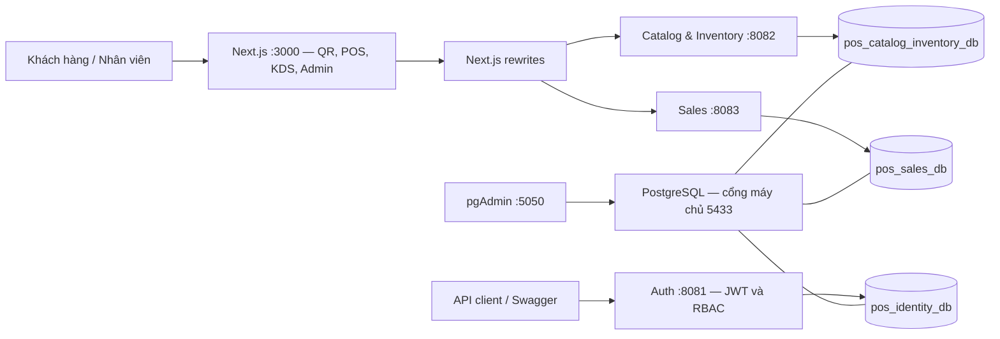

# Smart POS & KDS

**Hệ thống Quản lý Nhà hàng và Gọi món Thông minh**

Đồ án chuyên ngành · Trường Đại học Sài Gòn · Khoa Công nghệ Thông tin

Nhóm **262701-DACN-08-Nhom2B** · Học phần **841476**, nhóm/lớp **03**

Giảng viên hướng dẫn: **ThS. Trần Đình Nghĩa**

Smart POS & KDS số hóa quy trình phục vụ nhà hàng: khách gọi món qua QR tại bàn, nhân viên tiếp nhận đơn, bếp theo dõi chế biến trên KDS, thu ngân xử lý hóa đơn và quản lý theo dõi nguyên liệu theo công thức định lượng (BOM).

README mô tả mã nguồn hiện có và hướng dẫn chuẩn bị nghiệm thu tiến độ lần 2. **Có mã nguồn không đồng nghĩa đã kiểm thử đạt.** Các phần còn mô phỏng, chưa tích hợp hoặc chưa có minh chứng được ghi rõ bên dưới; chưa xác nhận hệ thống đạt toàn bộ điều kiện bàn giao.

- Repository: [poromvp/Smart-POS](https://github.com/poromvp/Smart-POS).
- Cơ sở phân tích và thiết kế: [Báo cáo tiến độ lần 1](docs/DACN_08_Nhom2B_BC_01.docx).
- Liên hệ: **Lê Quang Kiệt**, MSSV **3123410180**, quangkietle382@gmail.com / 3123410180@sv.sgu.edu.vn.

## Mục lục

1. [Phạm vi và tiến độ](#1-phạm-vi-và-tiến-độ)
2. [Thành viên và phân công](#2-thành-viên-và-phân-công)
3. [Kiến trúc và công nghệ](#3-kiến-trúc-và-công-nghệ)
4. [Cấu trúc mã nguồn](#4-cấu-trúc-mã-nguồn)
5. [Thiết lập môi trường](#5-thiết-lập-môi-trường)
6. [Tài khoản kiểm thử](#6-tài-khoản-kiểm-thử)
7. [API và kịch bản demo](#7-api-và-kịch-bản-demo)
8. [Kiểm thử sơ bộ](#8-kiểm-thử-sơ-bộ)
9. [Lỗi tồn đọng và đóng băng tính năng](#9-lỗi-tồn-đọng-và-đóng-băng-tính-năng)
10. [Checklist hồ sơ và bàn giao](#10-checklist-hồ-sơ-và-bàn-giao)

## 1. Phạm vi và tiến độ

Theo mục 1.1.3 của báo cáo lần 1, giai đoạn hiện tại phục vụ **01 cửa hàng mì cay độc lập**, trong thời gian đồ án 12 tuần. Quản lý chuỗi nhiều chi nhánh, giao hàng, tính lương và kế toán là hướng phát triển sau.

Thiết kế gồm 8 phân hệ: quản trị và ca làm việc; bàn và khu vực; thực đơn; bán hàng; KDS; thanh toán; khách hàng và khuyến mãi; kho và BOM. Bảng dưới đối chiếu với mã nguồn, chưa phải kết quả nghiệm thu chạy thực tế.

| Hạng mục | Thiết kế trong báo cáo lần 1 | Hiện trạng mã nguồn |
| --- | --- | --- |
| Gọi món QR | Chọn món, tùy chọn, gửi đơn theo bàn | Có menu, giỏ hàng và API tạo đơn; URL mang tham số `table`; chưa chứng minh xác thực token QR phía server |
| POS | Sơ đồ bàn, bán hàng, hóa đơn | Có giao diện; còn dữ liệu mô phỏng và menu dự phòng khi API lỗi |
| KDS | Điều phối theo trạm, cảnh báo trễ, WebSocket/STOMP | Có lấy đơn qua API, bộ đếm và cập nhật `READY`; tải lại mỗi 5 giây bằng polling |
| Thực đơn, kho, BOM | CRUD, nhập kho, định lượng, lịch sử biến động | Có controller/service và giao diện quản trị; cần kiểm thử với CSDL thật |
| Trừ kho khi chế biến | Tự trừ BOM lúc bắt đầu làm món | Có API trừ kho riêng; Sales chưa gọi trừ kho khi chuyển trạng thái |
| Thanh toán | Tiền mặt, VietQR, đối soát tự động | Có API cập nhật thanh toán; màn hình POS vẫn là demo, QR chưa kết nối |
| Tài khoản, phân quyền | Đăng nhập và RBAC | Backend có Auth/RBAC; đăng nhập frontend đang dùng tài khoản mô phỏng |
| Chức năng còn lại | Ca làm việc, CRM, khuyến mãi, gộp/tách hóa đơn, báo cáo | Cần rà soát và bổ sung minh chứng trước khi đánh dấu hoàn thành |

So với thiết kế lần 1, backend hiện khai báo Spring Boot **4.1.1**, frontend dùng **Next.js** trên React và CSDL đã chọn **PostgreSQL**. WebSocket/STOMP vẫn là kế hoạch tích hợp; chưa có Redux Toolkit trong dependency frontend.

## 2. Thành viên và phân công

Danh sách thành viên lấy theo trang hành chính của báo cáo lần 1. Phân công dưới đây được cập nhật theo thông tin thành viên cung cấp; những nhiệm vụ chưa rõ và tỷ lệ đóng góp cần nhóm xác nhận bổ sung.

| MSSV | Thành viên | Vai trò / phạm vi công việc | Đóng góp thực tế lần 2 |
| --- | --- | --- | --- |
| 3123410180 | Lê Quang Kiệt | Nhóm trưởng; nhiệm vụ lập trình cụ thể chờ xác nhận | Chờ nhóm xác nhận |
| 3123410015 | Đỗ Trần Huy Bảo | Chờ xác nhận phạm vi công việc | Chờ nhóm xác nhận |
| 3123410194 | Nguyễn Hoàng Lập | Frontend — phần gọi món bằng QR (QR Ordering) | Chờ nhóm xác nhận |
| 3123410242 | Nguyễn Trọng Nhân | Lead Frontend | Chờ nhóm xác nhận |
| 3123410179 | Lâm Tuấn Kiệt | Chờ xác nhận phạm vi công việc | Chờ nhóm xác nhận |

Nhóm cần bổ sung người phụ trách Backend, CSDL và các module còn lại, đồng thời xác nhận tỷ lệ đóng góp thực tế với **tổng bằng 100%**. Chưa gán thêm KDS, bộ đếm hoặc cảnh báo trễ vào phân công của Nguyễn Hoàng Lập khi chưa được xác nhận. Không tự chuyển mức 20%/người của lần 1 sang giai đoạn lập trình. Đề tài hiện không có phân hệ AI/IoT.

## 3. Kiến trúc và công nghệ

### 3.1. Kiến trúc hiện có



Ba database cùng chạy trong một container PostgreSQL. Frontend proxy tới Catalog và Sales qua [cấu hình Next.js](frontend/next.config.mjs); đăng nhập giao diện chưa tích hợp Auth API. Module [gateway](backend/gateway) mới có cấu hình Maven, chưa phải một gateway đang hoạt động. KDS dùng HTTP polling mỗi 5 giây.

### 3.2. Công nghệ và phiên bản

Đây là phiên bản **khai báo trong repository**, không phải xác nhận đã cài hoặc build thành công. Cài npm bằng lockfile để tái lập bộ dependency.

| Thành phần | Công nghệ / phiên bản | Nguồn |
| --- | --- | --- |
| Frontend | Next.js `^16.3.5`, React `^19.2.8` | [package.json](frontend/package.json) |
| Ngôn ngữ và giao diện | TypeScript `^6.0.3`, Tailwind CSS `^4.3.3` | [package.json](frontend/package.json) |
| Runtime frontend | Khuyến nghị Node.js 24 LTS và npm đi kèm; repo chưa pin runtime | [package-lock.json](frontend/package-lock.json) |
| Backend | Java 25, Spring Boot 4.1.1, Spring Data JPA | [POM gốc](backend/pom.xml) |
| Xác thực | Spring Security; JJWT 0.13.0 trong Auth | [POM Auth](backend/services/auth-service/pom.xml) |
| API docs | springdoc-openapi 3.1.0 trong Auth và Sales | [POM Sales](backend/services/sales-service/pom.xml) |
| CSDL | PostgreSQL `16-alpine` | [Docker Compose](docker-compose.yml) |
| Quản trị CSDL | pgAdmin 4, image đang dùng tag `latest` | [Docker Compose](docker-compose.yml) |
| Build Java | Maven; wrapper Auth khai báo 3.10.0 | [Maven Wrapper](backend/services/auth-service/.mvn/wrapper/maven-wrapper.properties) |
| Hạ tầng | Docker Engine/Desktop, Compose v2; chưa pin phiên bản | [Docker Compose](docker-compose.yml) |
| Đồng bộ KDS | REST polling 5 giây; WebSocket/STOMP dự kiến | [Màn hình KDS](frontend/src/app/kds/page.tsx) |

### 3.3. Địa chỉ cục bộ

| Thành phần | Địa chỉ |
| --- | --- |
| Đăng nhập | http://localhost:3000/login |
| Khách gọi món bàn 01 | http://localhost:3000/menu?table=01 |
| Menu chỉ xem | http://localhost:3000/menu |
| POS / KDS / quản trị | http://localhost:3000/pos · http://localhost:3000/kds · http://localhost:3000/admin |
| Auth / Catalog / Sales API | http://localhost:8081/api/auth · http://localhost:8082/api · http://localhost:8083/api |
| Swagger Auth / Sales | http://localhost:8081/swagger-ui/index.html · http://localhost:8083/swagger-ui/index.html |
| pgAdmin | http://localhost:5050 |
| PostgreSQL từ máy chủ | `localhost:5433` |

Các URL chỉ hoạt động sau khi dịch vụ khởi động thành công. **Chưa có Public URL hoặc video demo được xác nhận trong README.**

## 4. Cấu trúc mã nguồn

```text
Smart-POS/
├── backend/
│   ├── pom.xml
│   ├── shared/                         # Module dùng chung
│   ├── gateway/                        # Khung module Maven
│   └── services/
│       ├── auth-service/               # Tài khoản, vai trò, JWT
│       ├── catalog-inventory-service/  # Thực đơn, BOM, kho, nhập hàng
│       └── sales-service/              # Đơn hàng, trạng thái, thanh toán
├── frontend/
│   ├── src/app/                        # Các trang Next.js
│   ├── src/components/                 # Thành phần giao diện
│   ├── src/lib/                        # API client, kiểu dữ liệu, auth demo
│   └── tests/                          # Kiểm thử bộ đếm KDS
├── database/dbdiagram                  # Thiết kế dữ liệu
├── init-scripts/                       # SQL tạo schema và seed
├── docs/                               # Báo cáo, sơ đồ, đặc tả, wireframe
├── .env.example                        # Mẫu hiện tại, còn thiếu biến Docker
└── docker-compose.yml                  # PostgreSQL và pgAdmin
```

## 5. Thiết lập môi trường

**Giới hạn hiện tại:** `docker compose up -d` mới chạy PostgreSQL và pgAdmin, chưa chạy frontend/backend. Đây là hướng dẫn chạy phát triển theo cấu hình mã nguồn; chưa xác nhận bằng một lần cài mới hoàn chỉnh. Trở ngại đã biết nằm ở mục 9.

### 5.1. Chuẩn bị và lấy mã nguồn

Cài Git, Docker Desktop/Engine có Compose v2, Node.js 24 LTS, JDK 25 và Maven. Bật Docker trước khi chạy CSDL. Lệnh minh họa dùng PowerShell:

```powershell
git clone https://github.com/poromvp/Smart-POS.git
cd Smart-POS
```

Nếu đã có mã nguồn, sử dụng thư mục hiện tại và bỏ qua bước clone.

### 5.2. Biến môi trường

Tham khảo [.env.example](.env.example). Mẫu hiện thiếu `POSTGRES_USER`, `POSTGRES_PASSWORD`, `PGADMIN_EMAIL`, `PGADMIN_PASSWORD`; tên database Auth chưa khớp SQL khởi tạo. Tạo bản cục bộ nếu chưa có:

```powershell
if (-not (Test-Path .env)) { Copy-Item .env.example .env }
```

Điền/đồng bộ nội dung sau trong `.env`. Đây là **giá trị ví dụ cho máy demo**, không lấy từ môi trường riêng của thành viên:

```dotenv
POSTGRES_USER=pos_admin
POSTGRES_PASSWORD=local_demo_db_password
PGADMIN_EMAIL=admin@example.com
PGADMIN_PASSWORD=local_demo_pgadmin_password

AUTH_SERVER_PORT=8081
AUTH_DB_NAME=pos_identity_db
AUTH_DB_USER=pos_admin
AUTH_DB_PASSWORD=local_demo_db_password
AUTH_DB_PORT=5433
JWT_SECRET=REPLACE_WITH_GENERATED_BASE64_SECRET
JWT_ACCESS_TOKEN_EXPIRATION=900000
JWT_REFRESH_TOKEN_EXPIRATION_DAYS=7
JWT_REFRESH_COOKIE_NAME=refreshToken

SALES_DB_URL=jdbc:postgresql://127.0.0.1:5433/pos_sales_db
CORS_ALLOWED_ORIGINS=http://localhost:3000
```

Sinh chuỗi Base64 ngẫu nhiên rồi thay giá trị `JWT_SECRET` bằng kết quả:

```powershell
$jwtBytes = New-Object byte[] 64
$rng = [System.Security.Cryptography.RandomNumberGenerator]::Create()
$rng.GetBytes($jwtBytes)
[Convert]::ToBase64String($jwtBytes)
$rng.Dispose()
```

Docker Compose tự đọc `.env` ở thư mục gốc. Backend chạy ngoài Docker **không tự đọc file này**; truyền cùng giá trị qua Environment Variables của IDE hoặc nạp vào từng terminal trước khi chạy Maven:

```powershell
# Chạy tại thư mục gốc; dùng mẫu KEY=VALUE ở trên, không có dấu nháy/comment cuối dòng.
Get-Content .env | ForEach-Object {
    if ($_ -match '^\s*([A-Za-z_][A-Za-z0-9_]*)=(.*)$') {
        [Environment]::SetEnvironmentVariable($matches[1], $matches[2].Trim(), 'Process')
    }
}
```

### 5.3. Khởi tạo CSDL và kiểm tra dữ liệu

```powershell
docker compose up -d
docker compose ps
docker compose logs postgres
```

Khi volume PostgreSQL còn trống, container tự chạy:

1. [01-init-all-databases.sql](init-scripts/01-init-all-databases.sql): tạo `pos_identity_db`, `pos_catalog_inventory_db`, `pos_sales_db` và các bảng.
2. [02-seed-data.sql](init-scripts/02-seed-data.sql): nạp danh mục, món ăn, biến thể và tùy chọn vào Catalog.

Catalog có thêm [DataInitializer](backend/services/catalog-inventory-service/src/main/java/com/smartpos/cataloginventory/config/DataInitializer.java) chạy khi ứng dụng khởi động để nạp dữ liệu theo điều kiện. Có script chưa phải bằng chứng đã seed thành công.

Mở pgAdmin, đăng nhập bằng `PGADMIN_EMAIL`/`PGADMIN_PASSWORD`, đăng ký server với host **`postgres`**, port **`5432`**, maintenance database **`postgres`**, username/password theo `POSTGRES_*`. DBeaver trên máy chủ dùng **`localhost:5433`**.

Trong Query Tool của `pos_catalog_inventory_db`, kiểm đếm trước khi chụp minh chứng:

```sql
SELECT 'categories' AS table_name, COUNT(*) AS row_count FROM categories
UNION ALL SELECT 'products', COUNT(*) FROM products
UNION ALL SELECT 'modifier_groups', COUNT(*) FROM modifier_groups
UNION ALL SELECT 'modifier_options', COUNT(*) FROM modifier_options
UNION ALL SELECT 'ingredients', COUNT(*) FROM ingredients
UNION ALL SELECT 'suppliers', COUNT(*) FROM suppliers;
```

SQL seed hiện chỉ có **3 danh mục, 6 món, 4 nhóm tùy chọn**; chưa đáp ứng yêu cầu 10–20 bản ghi thực tế cho mỗi bảng danh mục. Cần bổ sung và kiểm đếm dữ liệu thật trước nghiệm thu.

Script trong `docker-entrypoint-initdb.d` chỉ chạy khi khởi tạo volume mới; restart không tự áp dụng SQL sửa đổi. Với volume đã dùng, cần migration phù hợp và sao lưu trước khi đổi schema.

### 5.4. Chạy backend

Từ thư mục gốc, chuẩn bị parent POM và module dùng chung:

```powershell
mvn -f backend/pom.xml -N install
mvn -f backend/pom.xml -pl shared -am install -DskipTests
```

Mở terminal riêng cho từng dịch vụ tại thư mục gốc, nạp biến theo mục 5.2, rồi chạy:

```powershell
# Terminal Catalog
mvn -f backend/services/catalog-inventory-service/pom.xml spring-boot:run
```

```powershell
# Terminal Sales
mvn -f backend/services/sales-service/pom.xml spring-boot:run
```

**Auth có trở ngại schema cần xử lý trước:** SQL ban đầu dùng `user_roles`, entity hiện yêu cầu `users.role_id`; entity Role yêu cầu thêm `is_system`. Auth dùng `ddl-auto: validate`, nên database tạo bằng SQL hiện tại chưa bảo đảm qua kiểm tra schema. Cần migration đồng bộ entity trước khi dùng lệnh sau; không coi đổi sang `update` là minh chứng migration hoàn chỉnh.

```powershell
# Terminal Auth, sau khi đồng bộ schema; dev bật seed quản trị.
$env:SPRING_PROFILES_ACTIVE = 'dev'
mvn -f backend/services/auth-service/pom.xml spring-boot:run
```

Kiểm tra log, kết nối CSDL và API từng dịch vụ. Nếu Maven không resolve dependency, kiểm tra version khai báo và repository; không tự thay version mà không cập nhật cấu hình liên quan.

### 5.5. Chạy frontend

```powershell
cd frontend
npm ci
npm run dev
```

Mặc định frontend dùng `/api/catalog` và `/api/sales`, được Next.js chuyển tới cổng 8082/8083. Khi cần đổi endpoint, tạo `.env.local` trong thư mục frontend với `NEXT_PUBLIC_API_URL` và `NEXT_PUBLIC_SALES_API_URL`, rồi khởi động lại Next.js. URL gọi trực tiếp phải có hậu tố `/api` và backend phải cho phép origin tương ứng.

Để quét QR trên điện thoại cùng mạng, chạy `npm run dev -- --hostname 0.0.0.0`, dùng IP LAN của máy thay `localhost` trong URL QR. Cập nhật `allowedDevOrigins` trong [cấu hình Next.js](frontend/next.config.mjs) nếu IP khác cấu hình hiện có. `/menu` không có tham số bàn chỉ cho xem; ví dụ đặt món là `/menu?table=01`.

## 6. Tài khoản kiểm thử

### 6.1. Tài khoản giao diện hiện có

Nguồn: [LoginForm](frontend/src/components/auth/LoginForm.tsx). Những tài khoản này được kiểm tra **tại frontend**, lưu vai trò demo trong trình duyệt; chưa chứng minh đăng nhập JWT hoặc phân quyền backend.

| Vai trò demo | Email | Mật khẩu | Trang sau đăng nhập |
| --- | --- | --- | --- |
| Đầu bếp | `chef@smartpos.vn` | `123456` | `/kds` |
| Thu ngân | `cashier@smartpos.vn` | `123456` | `/pos` |
| Quản lý | `manager@smartpos.vn` | `123456` | `/admin` |
| Phục vụ | `waiter@smartpos.vn` | `123456` | `/order-taking` |
| Khách tại bàn | Không đăng nhập; mở `/menu?table=01` | Không áp dụng | `/menu` và `/cart` |

### 6.2. Tài khoản backend và khoảng thiếu

Auth có seed mặc định **`admin` / `12345678`**, chỉ tạo khi bật profile `dev`, schema hợp lệ và username chưa tồn tại. Có thể thay bằng `SEED_ADMIN_USERNAME`/`SEED_ADMIN_PASSWORD`. Tài khoản này dùng với Auth API, **không phải** tài khoản màn hình demo; chưa xác nhận có trong CSDL đang chạy.

Yêu cầu lần 2 là **ít nhất 2–3 cặp username/password cho từng vai trò**. Hiện mới có một tài khoản mô phỏng mỗi vai trò giao diện và một Admin có điều kiện khởi tạo. Nhóm cần seed tài khoản thật, nối frontend với Auth, kiểm tra từng quyền và cập nhật bảng này. Với khách gọi món không cần tài khoản theo thiết kế lần 1, cần nêu rõ cơ chế truy cập QR và xác nhận cách nghiệm thu với GVHD.

## 7. API và kịch bản demo

### 7.1. API cốt lõi

| Dịch vụ | Endpoint | Mục đích |
| --- | --- | --- |
| Auth :8081 | `POST /api/auth/login` | Đăng nhập backend |
| Catalog :8082 | `GET /api/products/menu` | Đọc thực đơn từ CSDL |
| Catalog :8082 | `GET /api/ingredients` | Đọc tồn nguyên liệu |
| Catalog :8082 | `GET /api/recipes/product/{productId}` | Đọc định lượng món |
| Catalog :8082 | `POST /api/inventory/deduct` | Trừ kho theo yêu cầu riêng |
| Sales :8083 | `POST /api/orders` | Tạo đơn; controller trả HTTP 201 khi thành công |
| Sales :8083 | `GET /api/orders/{id}` | Đọc chi tiết đơn |
| Sales :8083 | `PATCH /api/orders/{id}/status` | Cập nhật trạng thái đơn |
| Sales :8083 | `PATCH /api/orders/{id}/payment` | Cập nhật thanh toán; không đồng nghĩa có webhook ngân hàng |

Thu thập request, response JSON và HTTP status bằng Swagger/Postman khi dịch vụ chạy thật. Cần minh chứng 200/201 và lỗi nghiệp vụ 400/401/409; chọn request tương ứng với implementation. Catalog chưa khai báo dependency Swagger trong POM riêng, có thể trình bày API qua Postman.

### 7.2. Kịch bản 3–5 phút

**Luồng ưu tiên kiểm chứng:** khách gọi món → lưu đơn → KDS nhận đơn → cập nhật sẵn sàng → đọc lại trạng thái từ CSDL/API.

1. **Chuẩn bị:** Catalog, Sales và frontend chạy; menu có dữ liệu; mở phiên trình duyệt riêng cho khách và bếp.
2. **Gọi món:** khách mở `/menu?table=01`, chọn món thật, số lượng/tùy chọn/ghi chú và gửi đơn. Ghi ID, mã đơn, tổng tiền và HTTP 201.
3. **Đối chiếu lưu trữ:** mở `GET /api/orders/{id}` và Query Tool Sales để kiểm tra đơn, chi tiết món, số bàn.
4. **Bếp xử lý:** đăng nhập `chef@smartpos.vn`, mở KDS; chờ chu kỳ polling khoảng 5 giây khi API hoạt động bình thường. Quan sát bộ đếm, bấm hoàn tất và kiểm tra API trả `READY`.
5. **Đối chứng:** tải lại dữ liệu để xác nhận trạng thái được lưu. Kiểm tra riêng đơn nhiều món vì thao tác hoàn tất hiện cập nhật cấp đơn.

Đây là kịch bản cần chạy và ghi minh chứng, chưa phải kết quả E2E Pass. **Luồng đầy đủ theo thiết kế** còn phải nối: xác nhận đơn → bắt đầu chế biến và trừ BOM → phục vụ → thanh toán → hoàn tất đơn. Không dùng thanh toán mô phỏng hoặc gọi API trừ kho thủ công làm bằng chứng đã tự động hóa toàn bộ luồng.

Phân công một thành viên thao tác, một thành viên giải thích luồng dữ liệu. Quay video dự phòng 2–3 phút sau khi chạy thành công, tải dạng Unlisted hoặc chia sẻ quyền xem và bổ sung URL vào hồ sơ.

## 8. Kiểm thử sơ bộ

### 8.1. Lệnh kiểm tra có sẵn

Từ thư mục frontend:

```powershell
npm run lint
npm test
npm run build
```

`npm test` hiện chạy [kiểm thử bộ đếm KDS](frontend/tests/kds-timer.test.ts), không đại diện cho toàn bộ nghiệp vụ. Backend có thể kiểm tra bằng `mvn -f backend/pom.xml test` sau khi chuẩn bị dependency, biến môi trường và database kiểm thử riêng. Các test tải Spring context cần môi trường phù hợp.

### 8.2. Bảng ca kiểm thử

**Chưa thực thi trong lần cập nhật tài liệu này.** Chỉ chuyển Pass/Fail khi có kết quả thực tế, ngày chạy, người chạy và ảnh/log tương ứng.

| ID | Loại | Thao tác / dữ liệu | Kết quả mong đợi | Kết quả |
| --- | --- | --- | --- | --- |
| TC-01 | Luồng đúng | Đăng nhập Auth bằng tài khoản thật | HTTP 200, token và vai trò đúng | Chưa chạy |
| TC-02 | Ngoại lệ | Sai mật khẩu Auth | HTTP 401, không cấp token | Chưa chạy |
| TC-03 | Luồng đúng | Mở menu từ QR bàn hợp lệ | Đúng bàn và dữ liệu menu | Chưa chạy |
| TC-04 | Biên | `/menu` không có bàn | Chỉ xem, không gửi đơn | Chưa chạy |
| TC-05 | Luồng đúng | Gửi đơn → KDS hoàn tất | HTTP 201 khi tạo; lưu chi tiết và trạng thái `READY` | Chưa chạy |
| TC-06 | Biên | Đơn rỗng / số lượng không hợp lệ | HTTP 400, không tạo dữ liệu lỗi | Chưa chạy |
| TC-07 | Ngoại lệ | Tạo dữ liệu trùng thuộc tính duy nhất | HTTP 409 theo hợp đồng; không trùng bản ghi | Chưa chạy |
| TC-08 | Ngoại lệ | Trừ kho khi thiếu nguyên liệu | Từ chối; tồn không âm, không ghi dở giao dịch | Chưa chạy |
| TC-09 | Biên | Gửi lại yêu cầu trừ kho cùng nghiệp vụ | Không trừ hai lần | Chưa chạy |
| TC-10 | Ngoại lệ | Mất kết nối khi gửi đơn / cập nhật KDS | Báo lỗi, không hiển thị thành công giả | Chưa chạy |
| TC-11 | Biên | Tải lại KDS, đơn nhiều món | Bộ đếm đúng; không hoàn tất nhầm món khác | Chưa chạy |
| TC-12 | Tích hợp | Chế biến → trừ BOM → thanh toán thật | Kho và trạng thái nhất quán; giao dịch chỉ ghi một lần | Bị chặn: chưa tích hợp đầy đủ |

## 9. Lỗi tồn đọng và đóng băng tính năng

Bảng gồm khoảng thiếu và rủi ro thấy qua đọc mã nguồn; chưa phải tất cả lỗi đã tái hiện khi chạy. P0 chặn bàn giao/luồng chính; P1 cần hoàn thiện trước nghiệm thu chức năng liên quan.

| ID | Ưu tiên | Vấn đề / bằng chứng | Điều kiện đóng |
| --- | --- | --- | --- |
| GAP-01 | P0 | Compose chỉ có PostgreSQL và pgAdmin | Toàn hệ thống và seed khởi động từ bản clone sạch bằng một lệnh |
| GAP-02 | P0 | Mẫu env thiếu biến Docker; schema Auth khác entity | Đồng bộ env, migration; Auth đăng nhập được từ DB mới |
| GAP-03 | P0 | Frontend đăng nhập mô phỏng; thiếu tài khoản thật | Tích hợp JWT/RBAC, 2–3 tài khoản mỗi vai trò và test quyền |
| GAP-04 | P0 | Sales chưa gọi trừ BOM khi chế biến | Chế biến–kho nhất quán, xử lý thiếu hàng và yêu cầu lặp |
| GAP-05 | P0 | Thanh toán POS demo; VietQR chưa nối | Lưu thanh toán thật, xác nhận giao dịch theo phương án thống nhất |
| GAP-06 | P1 | KDS polling; hoàn tất cập nhật cả đơn | Chốt trạng thái theo món/trạm; test nhiều món, tích hợp realtime |
| GAP-07 | P1 | Sales tính tổng từ giá client gửi; cập nhật trạng thái trực tiếp | Kiểm tra giá từ Catalog và chuyển trạng thái hợp lệ phía backend |
| GAP-08 | P1 | Seed chưa đủ; thiếu minh chứng test live | Bổ sung, kiểm đếm dữ liệu và lưu ảnh/log test |
| GAP-09 | P1 | QR dùng tham số bàn, chưa chứng minh xác thực server | Chặn giả mạo bàn theo quy tắc nghiệp vụ đã chốt |

**Kế hoạch đề xuất:**

- **Trước duyệt Tuần 09:** chốt phân công và tỷ lệ; sửa các mục chặn setup, hoàn thiện luồng xương sống; chạy test và thu ảnh UI/API/CSDL.
- **Cuối Tuần 09:** đóng băng phạm vi sau khi nhóm xác nhận; ghi chức năng đạt/chưa đạt, người phụ trách và hạn xử lý từng lỗi. Không công bố hoàn tất khi còn P0 chưa giải quyết hoặc chưa thống nhất giảm phạm vi với GVHD.
- **Tuần 10:** đóng gói và kiểm tra từ bản clone sạch; triển khai MVP nếu khả thi, chạy hồi quy và quay video dự phòng.

Ngày đóng băng và người phụ trách từng GAP cần nhóm chốt theo lịch học phần; đây chưa phải lịch cam kết chính thức.

## 10. Checklist hồ sơ và bàn giao

README hỗ trợ tra cứu và chạy thử; **không thay thế báo cáo tiến độ lần 2** về hiện thực hóa và kiểm thử. Không dùng wireframe lần 1 thay ảnh ứng dụng chạy thật.

| Yêu cầu | Minh chứng / tình trạng cần hoàn thiện |
| --- | --- |
| Trang hành chính, phân công lập trình | Có danh sách 5 thành viên; cần xác nhận Lead và tỷ lệ tổng 100% |
| CSDL thực tế và seed | Có SQL, initializer; cần ảnh quản trị DB, số bản ghi đạt yêu cầu |
| Backend và hợp đồng API | Có controller; cần Swagger/Postman live, JSON, HTTP 200/201/400/401/409 |
| UI thật và ít nhất một luồng E2E | Có mã UI, kịch bản; cần ảnh và kết quả xuyên suốt |
| Test report | Có ca kiểm thử mục 8; cần Pass/Fail và bằng chứng |
| Feature freeze, bug log | Có GAP và kế hoạch; cần owner, hạn xử lý và ngày đóng băng |
| README và env mẫu | Có tổng quan, kiến trúc, công nghệ, setup và tài khoản hiện có; cần đồng bộ file env mẫu, tài khoản thật |
| Container hóa một lệnh | Chưa đạt cho toàn hệ thống; Compose chỉ chạy hạ tầng DB |
| Quyền repository | Để Public hoặc cấp quyền review cho GitHub `trandinhnghia`; cần kiểm tra thực tế |
| Lịch sử đóng góp | Commit đều đặn theo thành viên/tuần; đối chiếu công việc thực tế, không dồn mã nguồn vào phút chót |
| Public URL | Khuyến khích triển khai MVP; chưa có URL xác nhận |
| Demo và video dự phòng | Demo 3–5 phút, video 2–3 phút; cần link và quyền xem |

Tài liệu tham chiếu:

- [Báo cáo tiến độ lần 1](docs/DACN_08_Nhom2B_BC_01.docx): yêu cầu, BFD/BPMN, Use Case, Sequence, ERD, API và wireframe.
- [Thiết kế dữ liệu](database/dbdiagram).
- [Đặc tả tích hợp Sales–Catalog](docs/SALES_CATALOG_INTEGRATION_SPEC.md).
- [Đánh giá Catalog–Inventory](docs/CATALOG_INVENTORY_EVALUATION.md), [báo cáo sửa lỗi](docs/CATALOG_INVENTORY_FIX_REPORT.md): tài liệu nội bộ, cần đối chiếu lại bằng kiểm thử hiện tại.
- [Sơ đồ](docs/diagrams), [wireframe](docs/ui/wireframes): tài liệu thiết kế lần 1.
