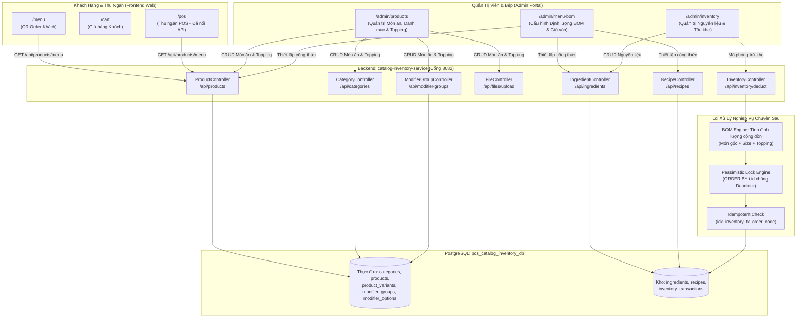

# 📋 BÁO CÁO ĐÁNH GIÁ TOÀN DIỆN MÃ NGUỒN, LOGIC NGHIỆP VỤ & TRẢI NGHIỆM NGƯỜI DÙNG (UX)
## Phân Hệ Catalog & Inventory Service (Giai Đoạn 1 & Giai Đoạn 2)

> **Dự án:** Smart-POS (Hệ thống Quản lý Bán hàng & Quản trị Nhà hàng Đa Nền tảng)  
> **Phân hệ:** `catalog-inventory-service` (Backend Spring Boot) & Next.js 16 / React 19 (Frontend)  
> **Phạm vi thẩm định:** Toàn bộ tính năng đã xây dựng thuộc **Giai đoạn 1 (Catalog, Thực đơn, Biến thể, Topping)** và **Giai đoạn 2 (Nguyên liệu, Định lượng BOM, Lõi trừ kho tự động)**.  
> **Mục tiêu đánh giá:** Đánh giá song song **Chất lượng Mã Nguồn (Code Quality)**, **Tính Toàn Vẹn Logic Nghiệp Vụ (Business Logic)** và **Trải Nghiệm Thực Tế Của Người Dùng (User Experience - UX)**.  
> **Thời điểm cập nhật:** 16:30, Ngày 30/10/2026.

---

## 🗺️ 1. Sơ Đồ Kiến Trúc & Luồng Tương Tác Nghiệp Vụ



---

## 📊 2. Ma Trận Đánh Giá Tính Năng Đã Xây Dựng (BE & FE)

| TT | Nghiệp Vụ / Chức Năng | Đánh Giá Backend | Đánh Giá Frontend | Đánh Giá Nghiệp Vụ & UX | Xếp Loại |
| :-: | :--- | :--- | :--- | :--- | :-: |
| **1** | **Quản lý Danh mục (Categories)** | ✅ RESTful đầy đủ (GET, POST, PUT, DELETE, PATCH). Chặn xóa danh mục khi có sản phẩm (`existsByCategoryId`). | ✅ Tích hợp trong `CategoryModal.tsx`. Thêm/sửa/xóa, đổi thứ tự hiển thị ngay trên UI. | **Rất tốt:** Thao tác nhanh, không tải lại trang, modal hỗ trợ tìm kiếm và thông báo rõ ràng. | ⭐⭐⭐⭐⭐ (Xuất sắc) |
| **2** | **Upload ảnh món ăn (File Storage)** | ✅ Lưu trữ file an toàn, tên ngẫu nhiên UUID chống trùng, kiểm tra đuôi (`jpg, png, webp`), phục vụ tĩnh qua WebMvcConfigurer. | ✅ Tích hợp trong `ProductModal.tsx`. Hỗ trợ chọn ảnh từ máy tính, preview ảnh tức thì. | **Tốt:** Thao tác trực quan. *Điểm trừ nhỏ:* Chưa có tính năng crop/nén ảnh phía client trước khi upload. | ⭐⭐⭐⭐☆ (Tốt) |
| **3** | **Nhóm tùy chọn & Topping (Modifiers)** | ✅ CRUD nhóm tùy chọn, cấu hình bắt buộc/tùy chọn, chọn 1/chọn nhiều. Chặn xóa nhóm/option nếu đang có công thức hoặc gắn vào món. | ✅ `ModifierGroupModal.tsx` cho Admin.<br>✅ `ModifierModal.tsx` cho Khách hàng chọn Topping. | **Rất tốt:** UX khách chọn topping linh hoạt. Admin dễ dàng thêm nhiều option kèm giá phụ thu. | ⭐⭐⭐⭐⭐ (Xuất sắc) |
| **4** | **Món ăn & Biến thể Size (Products)** | ✅ Tạo/sửa món ăn kèm size và topping trong 1 transaction. Cập nhật size tại chỗ giữ nguyên ID. Search đa tiêu chí. | ✅ Trang `/admin/products` phân tab danh mục, lọc tìm kiếm realtime, toggle kinh doanh. | **Rất tốt:** Quản trị viên nắm bắt nhanh tổng số món, món mở bán/tạm ngưng. Có nút chuyển nhanh sang cấu hình BOM. | ⭐⭐⭐⭐⭐ (Xuất sắc) |
| **5** | **Thực đơn động (Menu Aggregation)** | ✅ `GET /api/products/menu` tối ưu bằng `@EntityGraph`, triệt tiêu 100% lỗi N+1 Query. Gom nhóm theo danh mục. | ✅ Khách hàng xem `/menu` đẹp mắt.<br>✅ Thu ngân xem `/pos` đã nạp thực đơn động từ CSDL. | **Rất tốt:** Đồng bộ dữ liệu xuyên suốt giữa Khách gọi món và Thu ngân thu tiền. Có fallback mock an toàn. | ⭐⭐⭐⭐⭐ (Xuất sắc) |
| **6** | **Quản lý Nguyên liệu (Ingredients)** | ✅ CRUD nguyên liệu, cờ `lowStock` tính realtime, tự động sinh thẻ kho ban đầu `AUDIT_ADJUST`, chặn sửa tồn trực tiếp, chặn đổi đơn vị tính khi đã dùng. | ✅ Trang `/admin/inventory` có thống kê tổng vốn tồn kho, lọc nguyên liệu sắp hết, modal thêm/sửa chuẩn. | **Xuất sắc:** Ngăn chặn gian lận sửa tồn kho. Giao diện báo động nguyên liệu sắp hết bằng màu sắc nổi bật. | ⭐⭐⭐⭐⭐ (Xuất sắc) |
| **7** | **Định lượng công thức (BOM 3 tầng)** | ✅ Cấu hình độc lập 3 tầng: Món gốc, Từng Size, Từng Topping. Chặn trùng nguyên liệu, bảo vệ toàn vẹn dữ liệu. | ✅ Trang `/admin/menu-bom` phân 3 tab trực quan, ước tính giá vốn (COGS) realtime khi nhập số lượng. | **Xuất sắc:** Đã giải quyết triệt để lỗi nhảy số input, chặn trùng dropdown và bảo vệ an toàn bằng Empty State. | ⭐⭐⭐⭐⭐ (Xuất sắc) |
| **8** | **Lõi trừ kho tự động (Deduction Engine)** | ✅ Khóa bi quan `ORDER BY i.id` chống deadlock. Chống trừ trùng bằng `orderCode`. Rollback toàn bộ nếu thiếu hàng. Validate option thuộc món. | ✅ Giỏ hàng đã bảo toàn `modifierOptionIds`. Admin có modal mô phỏng test trừ kho realtime. | **Rất tốt:** Backend chuẩn ngân hàng/enterprise. *Cần kết nối thêm:* Nối luồng gọi API thật từ Đơn hàng Bán hàng. | ⭐⭐⭐⭐☆ (Rất tốt) |

---

## 🔬 3. Đánh Giá Chuyên Sâu Về Kỹ Thuật Lập Trình (Code Quality)

### 3.1. Những Điểm Sáng Đạt Chuẩn Cao
1. **Thiết kế Chống Deadlock và Xung Đột Dữ Liệu (Concurrency):**
   * Trong [`IngredientRepository.java`](file:///d:/CNTT-SGU/HK7/J2EE/Smart-POS/backend/services/catalog-inventory-service/src/main/java/com/smartpos/cataloginventory/repository/IngredientRepository.java), câu lệnh `@Lock(LockModeType.PESSIMISTIC_WRITE)` kết hợp mệnh đề `ORDER BY i.id` là kỹ thuật chuẩn mực trong các hệ thống tài chính / kho vận. Bất kể các món trong đơn hàng được gửi theo thứ tự nào, các dòng trong bảng `ingredients` đều bị khóa theo một thứ tự duy nhất tăng dần theo ID, triệt tiêu hoàn toàn bài toán Deadlock (hai giao dịch chờ chéo nhau).
2. **Nguyên Lý Lũy Đẳng (Idempotency) Trong Trừ Kho:**
   * Trong [`InventoryServiceImpl.java`](file:///d:/CNTT-SGU/HK7/J2EE/Smart-POS/backend/services/catalog-inventory-service/src/main/java/com/smartpos/cataloginventory/service/impl/InventoryServiceImpl.java), việc kiểm tra `existsByOrderCodeAndTransactionType(orderCode, SALE_DEDUCT)` được thực hiện **sau khi đã nắm giữ khóa nguyên liệu**. Điều này đảm bảo nếu hai request trùng mã đơn hàng được gửi tới đồng thời (do mạng lag hoặc retry tự động từ client), request thứ hai buộc phải xếp hàng chờ và ngay khi request thứ nhất trừ kho xong, request thứ hai sẽ bị phát hiện và chặn đứng bằng lỗi 409 (`DuplicateResourceException`).
3. **Kiểm Soát Thất Thoát Dữ Liệu Phía Frontend:**
   * Trong [`BomTableEditor`](file:///d:/CNTT-SGU/HK7/J2EE/Smart-POS/frontend/src/app/admin/menu-bom/page.tsx), việc định nghĩa `LocalRecipeRow` với kiểu `quantityNeeded: string | number` giúp tách biệt giữa trạng thái hiển thị nhập liệu của người dùng và dữ liệu số thực tế. Khi người dùng bấm phím `Backspace` xóa trắng ô, giá trị tạm thời là `""` chứ không bị ép về `0.001` như trước. Toàn bộ quá trình validate chỉ kích hoạt khi bấm Lưu.
   * `key` của bảng được gắn thêm mã phiên bản: `key={`${selectedProductId}-${activeScope}-${activeVariantId}-${activeOptionId}-rev-${revision}`}`, đảm bảo React luôn unmount/remount sạch sẽ khi người dùng chuyển tab hoặc bấm "Hủy thay đổi".

---

## 💡 4. Đánh Giá Logic Nghiệp Vụ & Trải Nghiệm Người Dùng (UX & Business Logic)

Dưới đây là các phát hiện quan trọng về nghiệp vụ và trải nghiệm người dùng sau khi rà soát toàn bộ luồng hoạt động:

### 🌟 4.1. Những Điểm Xuất Sắc Về Mặt Nghiệp Vụ
1. **Bảo Vệ Tính Toàn Vẹn Sổ Kho (Audit Trail):**
   * Trong `IngredientServiceImpl`, việc **tuyệt đối không cho phép sửa trường `currentStock`** trong API `PUT /api/ingredients/{id}` là quyết định thiết kế rất chính xác về mặt kế toán kho. Người dùng không thể "phù phép" số lượng tồn kho tùy tiện. Tồn kho chỉ được phép thay đổi thông qua các sự kiện có lịch sử giao dịch: Nhập hàng (`IMPORT`), Trừ bán hàng (`SALE_DEDUCT`) hoặc Điều chỉnh kiểm kê (`AUDIT_ADJUST`).
2. **Ngăn Chặn Đổi Đơn Vị Tính Khi Đã Phát Sinh Nghiệp Vụ:**
   * Phương thức `isInUse(id)` chặn không cho đổi đơn vị tính (`unit`) của nguyên liệu nếu nguyên liệu đó đã từng có công thức hoặc thẻ kho. Điều này bảo vệ người dùng khỏi thảm họa sai lệch số liệu (ví dụ: đang quản lý bằng `kg` với định lượng `0.05kg`, nếu đổi sang đơn vị `g` mà công thức cũ không đổi thì hệ thống sẽ trừ nhầm `0.05g`, sai lệch 1000 lần).
3. **Cơ Chế Empty State & Link Điều Hướng Thông Minh Trên Giao Diện BOM:**
   * Khi chọn một món ăn không có size (ví dụ: Đĩa khoai tây chiên) và chuyển sang tab *"Định lượng theo Size"*, giao diện không còn để bảng trống dễ gây hiểu nhầm mà hiển thị hộp thông báo giải thích: *"Món này chỉ có kích thước tiêu chuẩn mặc định"*, đi kèm nút bấm một chạm chuyển về tab Món gốc hoặc link chuyển sang trang Thêm size. Tương tự đối với Topping. Điều này giúp nhân viên quản trị không bao giờ bị bối rối hoặc lưu nhầm dữ liệu.

---

### ⚠️ 4.2. Các Điểm Khuyết Nghiệp Vụ & Góc Khuất Trải Nghiệm Cần Cải Thiện

#### 1. Thiếu Nghiệp Vụ "Kiểm Kê Định Kỳ & Cân Bằng Kho" (Stocktake / Inventory Adjustment)
* **Thực tế vận hành nhà hàng:** Cuối mỗi ngày hoặc cuối tuần, thủ kho sẽ kiểm đếm thực tế (ví dụ: trên phần mềm ghi tồn 15.5 kg thịt bò, nhưng cân thực tế trong tủ đông chỉ còn 14.8 kg do rã đông hoặc hao hụt).
* **Bất cập hiện tại:** Vì hệ thống đã chặn sửa `currentStock` trên form nguyên liệu, người quản trị **hoàn toàn không có cách nào để cân bằng số tồn thực tế** trên giao diện.
* **Đề xuất cải thiện UX & Nghiệp vụ:**
  * Bổ sung nút **"Kiểm kê / Điều chỉnh kho"** trên trang `/admin/inventory`.
  * Mở modal cho phép nhập: Số lượng thực tế kiểm đếm, Loại điều chỉnh (`AUDIT_ADJUST` nếu chênh lệch kiểm kê, hoặc `SPOILAGE` nếu xuất hủy do ôi thiu/hết hạn), và Ghi chú lý do.
  * Backend tự tính chênh lệch: $\Delta = \text{Thực tế} - \text{Tồn máy}$, cập nhật lại `currentStock` và ghi một dòng biến động $\Delta$ vào `inventory_transactions`.

#### 2. Thông Báo Lỗi Ràng Buộc Khi Xóa Món Ăn Chưa Thân Thiện Với Người Dùng
* **Vị trí:** [`frontend/src/app/admin/products/page.tsx#L181-L183`](file:///d:/CNTT-SGU/HK7/J2EE/Smart-POS/frontend/src/app/admin/products/page.tsx#L181-L183)
* **Thực trạng:** Khi người dùng xóa một món ăn đang có công thức định lượng BOM, backend ném lỗi 400 kèm message: *"Không thể xóa món ăn đang có công thức định lượng. Hãy xóa công thức trước"*.
* **Bất cập UX:** Phía Frontend hiện chỉ toast chung chung: `toast.error("Không thể xóa món ăn", err.message)`. Người dùng phổ thông thường không hiểu "công thức định lượng" nằm ở đâu để xóa.
* **Đề xuất cải thiện UX:** Trong thông báo lỗi của toast, cung cấp luôn một nút hành động nhanh: **[Đi tới Định lượng BOM]** dẫn thẳng sang trang `/admin/menu-bom?productId=...` để người dùng thao tác xóa ngay mà không mất công tìm kiếm.

#### 3. Chênh Lệch Quy Đổi Đơn Vị Tính Trong Định Lượng (Unit Mismatch Confusion)
* **Thực tế:** Nguyên liệu trong kho nhập theo đơn vị lớn: Thịt bò (`kg`), Sữa tươi (`hộp` hoặc `lít`), Đường (`kg`). Nhưng khi cấu hình định lượng cho 1 ly nước hoặc 1 tô mì, đầu bếp thường tính theo đơn vị nhỏ: `g`, `ml`, `muỗng`.
* **Bất cập UX:** Trên trang `/admin/menu-bom`, người dùng buộc phải tự nhẩm đổi đơn vị: muốn định lượng 50g thịt bò thì phải tự gõ `0.05` (vì đơn vị kho là `kg`). Nếu vô tình gõ `50`, hệ thống sẽ hiểu là 50 kg thịt bò cho 1 tô mì, dẫn đến trừ âm kho hàng loạt khi bán.
* **Đề xuất cải thiện UX:**
  * Bổ sung nhãn hướng dẫn rõ ràng ngay dưới cột định lượng: ví dụ nếu nguyên liệu là `kg`, hiển thị gợi ý nhỏ: `(Nhập 0.1 tương đương 100g)`.

#### 4. Bán Hàng Chưa Khép Kín Luồng Trừ Kho Tự Động (End-to-End Gap)
* **Thực trạng:**
  * Khách đặt món trên `/cart`: Nút bấm đang dùng `setTimeout` giả lập.
  * Thu ngân thanh toán trên `/pos`: Nút "Thanh toán" hiện chỉ giải phóng bàn trống trên giao diện, chưa gửi đơn sang `sales-service` và chưa tự động trừ kho.
* **Đề xuất:** Kết nối gọi `POST /api/inventory/deduct` khi đơn hàng chuyển sang trạng thái đã thanh toán (`COMPLETED`) để hoàn tất 100% vòng đời của một đơn hàng thực tế.

---

## 🧪 5. Bảng Tổng Hợp Kiểm Thử Chất Lượng (Quality Verification)

Toàn bộ hệ thống đã được chạy kiểm tra thực tế bằng các công cụ kiểm thử tự động của dự án:

```
[1] Maven Backend Build (Java 21 / 25 Compiler):
    $ mvn -f backend/pom.xml -pl services/catalog-inventory-service compile -DskipTests
    => [INFO] BUILD SUCCESS (Thời gian: 3.465 s) - 0 errors.

[2] TypeScript Type-checking (Frontend Compiler):
    $ tsc --project frontend/tsconfig.json --noEmit
    => EXIT CODE 0 (Hoàn thành sạch sẽ, không có lỗi kiểu dữ liệu).

[3] ESLint (Next.js & React 19 Linting):
    $ npm --prefix frontend run lint
    => EXIT CODE 0 (0 errors, 0 warnings).

[4] Automated Unit Tests (Frontend Test Suite):
    $ npm --prefix frontend test
    => 6/6 tests PASSED (TAP version 13, thời gian chạy: 154 ms).
```

---

## 🎯 6. Kế Hoạch Đề Xuất Cho Bước Tiếp Theo (Actionable Roadmap)

### Bước 1: Hoàn thiện trải nghiệm người dùng cho Giai đoạn 2 (Trong 1 ngày)
1. Thêm nhãn gợi ý quy đổi đơn vị tính (kg $\leftrightarrow$ g, lít $\leftrightarrow$ ml) trên bảng định lượng BOM.
2. Xây dựng Modal **"Kiểm kê & Điều chỉnh kho"** trên trang `/admin/inventory` để thủ kho cân bằng số lượng thực tế khi có hao hụt / đổ vỡ.

### Bước 2: Khép kín luồng bán hàng với Kho (Trong 1-2 ngày)
1. Kết nối `/cart` và `/pos` gọi API tạo đơn hàng sang `sales-service`.
2. Thiết lập cơ chế tự động gọi `POST /api/inventory/deduct` từ `sales-service` sang `catalog-inventory-service` khi thanh toán đơn thành công.

### Bước 3: Triển khai Giai đoạn 3 (Nhà cung cấp & Nhập kho - Purchasing)
1. Xây dựng CRUD Quản lý Nhà cung cấp (`Supplier`).
2. Hiện thực hóa quy trình Lập phiếu nhập kho (`PurchaseOrder`) $\rightarrow$ Xác nhận nhập kho $\rightarrow$ Tự động cộng số lượng vào `currentStock` của nguyên liệu và tính toán lại giá vốn bình quân gia quyền (Weighted Average Cost).
