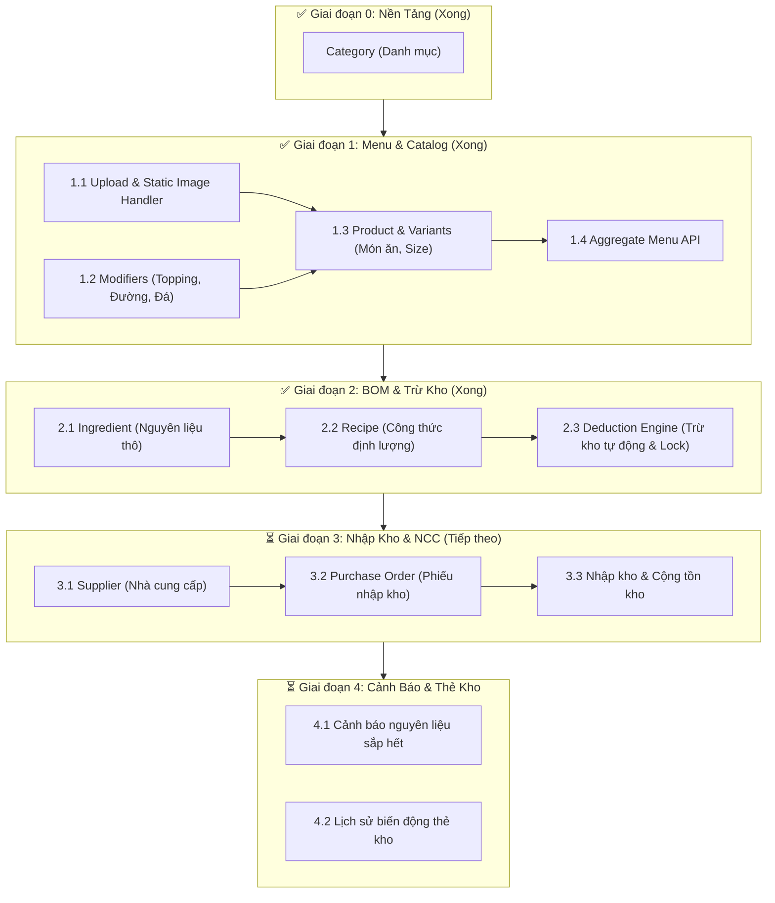

# 📋 Kế Hoạch Hoàn Thiện `catalog-inventory-service` (SmartPOS)

Tài liệu này đóng vai trò như kim chỉ nam (Roadmap & Checklist) để theo dõi và triển khai từng bước các phân hệ trong `catalog-inventory-service`.

---

## 🎯 Thông Tin & Phạm Vi Dự Án
* **Kiến trúc:** Single Store / Single Branch (1 Cửa hàng, đơn giản hóa và tập trung vào nghiệp vụ cốt lõi).
* **Package chuẩn:** `com.smartpos.cataloginventory`
* **Công nghệ cốt lõi:** Java 25 (tương thích build Java 21), Spring Boot 4.1.1, Spring Data JPA, PostgreSQL, MapStruct, Lombok.
* **Mục tiêu:** Cung cấp đầy đủ API phục vụ cho **Web POS (Thu ngân)**, **KDS (Bếp)**, **QR Order (Khách hàng)** và **Quản lý Kho định lượng tự động (BOM)**.
* **Quy chuẩn URL:** Toàn bộ API nghiệp vụ thống nhất tiền tố `/api/...` (bỏ `v1` để đồng bộ hệ thống).

---

## 🗺️ Sơ Đồ Tổng Thể Các Phân Hệ

---

## 📌 Bảng Tiến Độ & Checklist Chi Tiết

### ✅ Giai Đoạn 0: Nền Tảng & Danh Mục (Category) - *HOÀN THÀNH*
- [x] Thiết lập cấu hình Maven (`pom.xml`), Lombok, MapStruct.
- [x] Chuẩn hóa package `com.smartpos.cataloginventory`.
- [x] CRUD `Category` (Tạo, Xem theo ID, Xem danh sách, Cập nhật, Toggle trạng thái, Xóa).
- [x] Tối ưu hóa JPA: Dùng `productRepository.existsByCategoryId(...)` chống nạp thừa RAM khi xóa danh mục.
- [x] Xử lý ngoại lệ tập trung (`GlobalExceptionHandler`).

---

### ✅ Giai Đoạn 1: Quản Lý Thực Đơn, Biến Thể & Topping (Menu Catalog) - *HOÀN THÀNH*

#### 1.1. Cấu hình Upload & Phục vụ file ảnh tĩnh
- [x] `FileStorageService`: Lưu ảnh `uploads/products/`, tên ngẫu nhiên UUID, validate đuôi file.
- [x] `WebMvcConfigurer`: Ánh xạ URL tĩnh `/uploads/**`.
- [x] `FileController`: `POST /api/files/upload`.

#### 1.2. Phân hệ Nhóm Topping & Tùy chọn (`ModifierGroup` & `ModifierOption`)
- [x] `ModifierGroupRepository` & `ModifierOptionRepository`.
- [x] DTO Request/Response: `ModifierGroupCreateRequest`, `ModifierGroupUpdateRequest`, `ModifierOptionRequest`, `ModifierGroupResponse`, `ModifierOptionResponse`.
- [x] `ModifierMapper` (MapStruct).
- [x] `ModifierGroupService` & `ModifierGroupServiceImpl`.
- [x] `ModifierGroupController`: `POST|GET|PUT|DELETE /api/modifier-groups`, `POST|DELETE /api/modifier-groups/{id}/options`.
- [x] Ràng buộc khóa ngoại: Chặn xóa ModifierGroup / ModifierOption nếu đang được gắn vào món ăn hoặc có công thức.

#### 1.3. Phân hệ Món ăn & Biến thể Size (`Product` & `ProductVariant`)
- [x] `ProductRepository` & `ProductVariantRepository`.
- [x] DTO Request/Response: `ProductCreateRequest`, `ProductUpdateRequest`, `ProductVariantRequest`, `ProductVariantResponse`, `ProductSummaryResponse`, `ProductDetailResponse`.
- [x] `ProductMapper` (MapStruct).
- [x] `ProductService` & `ProductServiceImpl`:
  - Tạo món kèm Variants & ModifierGroups trong 1 `@Transactional`.
  - Validate duy nhất tên, mã món `code`, mã `sku`.
  - Cập nhật món: Cập nhật size tại chỗ theo `id`, thêm size mới, xóa size không còn trong request (chặn nếu size có công thức).
  - Chặn xóa món nếu đang có công thức định lượng (món gốc hoặc theo size).
- [x] `ProductController`: `POST|GET|PUT|DELETE /api/products`, `PATCH /api/products/{id}/status`.

#### 1.4. API Thực đơn tổng hợp (Menu POS & QR Order)
- [x] `GET /api/products/menu`: Gom nhóm theo Category (active), tải Product, Size và ModifierGroups tối ưu bằng `@EntityGraph`.

#### 1.5. Frontend Menu & Giỏ hàng
- [x] TypeScript contracts: `frontend/src/lib/types/menu.ts`.
- [x] API Client & fallback mock: `frontend/src/lib/api.ts`.
- [x] Giao diện menu: `/menu`, Modal tùy chọn món `ModifierModal.tsx`, Giỏ hàng theo bàn `guestCartStore.ts`, `/cart`.

---

### ✅ Giai Đoạn 2: Quản Lý Kho & Công Thức Định Lượng (BOM) - *HOÀN THÀNH*

#### 2.1. Phân hệ Nguyên liệu thô (`Ingredient`)
- [x] `IngredientRepository`: Bổ sung kiểm tra trùng tên/mã, tìm kiếm theo từ khóa, sắp xếp tên.
- [x] DTO:
  - `IngredientCreateRequest` (name, code, unit, currentStock, minThreshold, costPerUnit).
  - `IngredientUpdateRequest` (không cho sửa trực tiếp `currentStock`, chặn đổi `unit` khi đã phát sinh dữ liệu liên quan).
  - `IngredientResponse` (bổ sung cờ `lowStock` tính realtime).
- [x] `IngredientMapper` & `IngredientService` / `IngredientServiceImpl`.
- [x] Tự động ghi nhận thẻ kho ban đầu: Nếu `currentStock > 0` khi tạo nguyên liệu, tự động sinh bản ghi `AUDIT_ADJUST` (+) vào `inventory_transactions`.
- [x] Chặn xóa nguyên liệu nếu đã có trong `Recipe`, `PurchaseOrderItem` hoặc `InventoryTransaction`.
- [x] `IngredientController`: `POST|GET|PUT|DELETE /api/ingredients` (hỗ trợ query param `search`).

#### 2.2. Phân hệ Cấu hình Công thức món (`Recipe`)
- [x] DTO:
  - `RecipeItemRequest` (`ingredientId`, `quantityNeeded > 0`).
  - `ProductRecipeRequest` (`variantId`, `modifierOptionId`, `items` - gửi `[]` để xóa).
  - `RecipeItemResponse`, `RecipeResponse` (phân nhánh rõ: công thức gốc, công thức từng size, công thức từng topping).
- [x] `RecipeRepository`: Bổ sung query lấy công thức kèm nguyên liệu, xoá và kiểm tra tồn tại theo Product, Variant, ModifierOption.
- [x] `RecipeService` & `RecipeServiceImpl`:
  - Hỗ trợ định lượng linh hoạt: Món gốc, Biến thể Size cụ thể, hoặc Tùy chọn Topping.
  - Mỗi bản ghi `Recipe` trỏ đúng 1 đích để tránh nhân đôi khi tính toán.
  - Kiểm tra tính hợp lệ: Nguyên liệu tồn tại, không trùng lặp trong 1 request, size/option phải thuộc về món.
- [x] `RecipeController`:
  - `POST /api/recipes/product/{productId}`
  - `GET /api/recipes/product/{productId}`

#### 2.3. Core Engine: Trừ kho tự động (`Inventory Deduction Engine`)
- [x] `InventoryTransaction` entity: Bổ sung trường `orderCode` có đánh index để chống trừ trùng đơn.
- [x] `InventoryTransactionRepository`: Thêm method `existsByOrderCodeAndTransactionType(...)`.
- [x] `IngredientRepository`: Khóa bi quan chống deadlock bằng cách thêm `ORDER BY i.id` trong `findAllByIdWithLock`.
- [x] DTO:
  - `DeductItemRequest` (`productId`, `variantId`, `modifierOptionIds`, `quantity`).
  - `DeductInventoryRequest` (`orderCode`, `items`).
  - `DeductInventoryResponse` (chi tiết từng nguyên liệu bị trừ, tồn trước và sau).
- [x] `InventoryService` & `InventoryServiceImpl`:
  - Thuật toán trừ kho cộng dồn: $\text{Nhu cầu} = \sum (\text{BOM Món gốc} + \text{BOM Size} + \text{BOM Toppings}) \times \text{Số lượng bán}$.
  - Validate tính hợp lệ của toàn bộ Product, Variant, ModifierOption trước khi xử lý.
  - Khóa bi quan (`PESSIMISTIC_WRITE`) trên các nguyên liệu liên quan.
  - Kiểm tra Idempotent: Nếu `orderCode` đã trừ kho `SALE_DEDUCT`, trả về lỗi 409 (`DuplicateResourceException`).
  - Kiểm tra tồn kho trước khi trừ: Ném `InsufficientStockException` nếu thiếu hàng $\rightarrow$ Rollback toàn bộ transaction.
  - Trừ `currentStock` và ghi nhận lịch sử vào `inventory_transactions` với số lượng âm.
- [x] `InventoryController`:
  - `POST /api/inventory/deduct`

#### 2.4. Frontend Quản lý Kho & Định lượng BOM (Đã hoàn thiện)
- [x] **Data Contract & API Client:**
  - `frontend/src/lib/types/inventory.ts`: Đồng bộ DTOs cho Ingredient, Recipe và Inventory Deduction.
  - `frontend/src/lib/api.ts`: Bổ sung toàn bộ API CRUD nguyên liệu, lấy/lưu công thức món, mô phỏng trừ kho tự động.
- [x] **Quản lý Nguyên liệu & Tồn kho (`/admin/inventory`):**
  - Tải dữ liệu thật từ Backend, tìm kiếm realtime, lọc cảnh báo tồn thấp.
  - Thống kê tổng số nguyên liệu, số lượng sắp hết và ước tính tổng giá vốn hàng tồn kho.
  - Modal thêm mới / cập nhật nguyên liệu (`IngredientModal.tsx`), bảo vệ không sửa tồn trực tiếp.
  - Modal mô phỏng trừ kho tự động theo `orderCode` (kiểm tra trừ kho, thiếu hàng, và tính idempotent).
- [x] **Cấu hình Định lượng Món (`/admin/menu-bom`):**
  - Lựa chọn món ăn từ danh mục động.
  - Cấu hình 3 tầng trực quan: **Công thức Món gốc**, **Định lượng theo Size**, **Định lượng Topping**.
  - Tự động gợi ý đơn vị tính và tính ước tính giá vốn định lượng (COGS) realtime.
- [x] **Kiểm thử chất lượng Frontend:**
  - TypeScript & React 19 Compiler: 0 lỗi.
  - ESLint: 0 lỗi, 0 cảnh báo.
  - Unit tests: 6/6 tests PASS.

---

### ⏳ Giai Đoạn 3: Nhà Cung Cấp & Nhập Kho (Purchasing) - *CHƯA THỰC HIỆN*

#### 3.1. Phân hệ Nhà cung cấp (`Supplier`)
- [ ] Tạo `SupplierRepository` (kiểm tra trùng mã số thuế, số điện thoại, tên).
- [ ] Tạo DTO: `SupplierCreateRequest`, `SupplierUpdateRequest`, `SupplierResponse`.
- [ ] Tạo `SupplierMapper`, `SupplierService` & `SupplierController`:
  - `POST /api/suppliers`
  - `GET /api/suppliers` (tìm kiếm, lọc active)
  - `GET /api/suppliers/{id}`
  - `PUT /api/suppliers/{id}`
  - `DELETE /api/suppliers/{id}` (chặn xóa nếu nhà cung cấp đã có phiếu nhập)

#### 3.2. Lập Phiếu nhập kho (`PurchaseOrder`)
- [ ] Hoàn thiện `PurchaseOrderRepository` & `PurchaseOrderItemRepository`.
- [ ] Tạo DTO:
  - `PurchaseOrderItemRequest` (`ingredientId`, `quantity`, `unitPrice`, `expiryDate`).
  - `PurchaseOrderCreateRequest` (`supplierId`, `staffId`, `orderDate`, `items`, `note`).
  - `PurchaseOrderUpdateRequest` (chỉ cho phép sửa khi còn là `DRAFT`).
  - `PurchaseOrderResponse`, `PurchaseOrderItemResponse`.
- [ ] Tạo `PurchaseOrderService`:
  - Tạo phiếu nhập ở trạng thái `DRAFT`, tự động tính `totalPrice` từng dòng và tổng tiền phiếu nhập.
  - Sửa phiếu khi ở trạng thái `DRAFT`.
  - Hủy phiếu (`CANCELLED`).

#### 3.3. Hoàn tất nhập kho & Cộng tồn kho tự động
- [ ] Viết logic method `completePurchaseOrder(Long poId)`:
  - Kiểm tra trạng thái hiện tại (chỉ thực hiện khi đang là `DRAFT`).
  - Dùng khóa bi quan trên các nguyên liệu nhập kho.
  - Duyệt qua từng item:
    - Cộng `quantity` vào `currentStock` của `Ingredient`.
    - Tính lại giá vốn bình quân gia quyền:
      $$\text{Giá vốn mới} = \frac{(\text{Tồn cũ} \times \text{Giá vốn cũ}) + (\text{Số lượng nhập} \times \text{Đơn giá nhập})}{\text{Tồn cũ} + \text{Số lượng nhập}}$$
    - Ghi bản ghi vào `inventory_transactions` với `transaction_type = IMPORT` (số lượng dương), liên kết `purchase_order_item_id`.
  - Cập nhật trạng thái phiếu thành `COMPLETED`.
- [ ] Tạo `PurchaseOrderController`:
  - `POST /api/purchase-orders`
  - `GET /api/purchase-orders`
  - `GET /api/purchase-orders/{id}`
  - `PATCH /api/purchase-orders/{id}/complete`
  - `PATCH /api/purchase-orders/{id}/cancel`

---

### ⏳ Giai Đoạn 4: Cảnh Báo & Báo Cáo Thẻ Kho (Audit & Alerts) - *CHƯA THỰC HIỆN*

#### 4.1. Cảnh báo nguyên liệu sắp hết
- [ ] Tạo Endpoint: `GET /api/inventory/low-stock`:
  - Lấy danh sách từ query `findLowStockIngredients()`.
  - Tính toán tỷ lệ phần trăm thiếu hụt, sắp xếp theo mức độ ưu tiên cần nhập hàng.

#### 4.2. Báo cáo lịch sử thẻ kho (Sổ kho)
- [ ] Tạo Endpoint: `GET /api/inventory/transactions`:
  - Lọc biến động thẻ kho theo `ingredientId`, khoảng thời gian (`fromDate`, `toDate`), loại giao dịch (`IMPORT`, `SALE_DEDUCT`, `AUDIT_ADJUST`, `SPOILAGE`).
  - Trả về danh sách chi tiết phục vụ đối soát kế toán kho.

---

## 🎯 Bước Kế Tiếp Khuyến Nghị
Bắt đầu triển khai **Giai đoạn 3 - Bước 3.1: Phân hệ Nhà cung cấp (`Supplier`)** và **Bước 3.2: Lập Phiếu nhập kho (`PurchaseOrder`)**.
