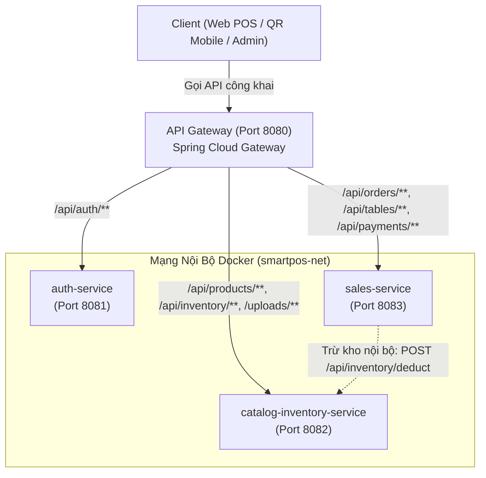

# 📋 TÀI LIỆU ĐẶC TẢ TÍCH HỢP LIÊN DỊCH VỤ: SALES-SERVICE & CATALOG-INVENTORY-SERVICE
## (Kèm Thiết Kế Điều Phối Qua Service Gateway & Cơ Chế Trừ Kho Tự Động)

> **Dự án:** Smart-POS (Hệ Thống Quản Lý Bán Hàng & Quản Trị Nhà Hàng Đa Nền Tảng)  
> **Người nhận tài liệu:** Quản trị dự án & Lập trình viên phụ trách `sales-service`  
> **Người lập:** Kỹ sư phụ trách `catalog-inventory-service`  
> **Phiên bản:** 1.0 - Ngày 01/11/2026  
> **Trạng thái:** Sẵn sàng kết nối (Ready for Integration)

---

## 🎯 1. BỐI CẢNH & MỤC TIÊU TÍCH HỢP

Trong mô hình kiến trúc Microservices của Smart-POS:
* **`catalog-inventory-service` (Port 8082):** Quản lý thực đơn (Món ăn, Size, Topping), định lượng công thức 3 tầng (BOM) và trừ kho nguyên liệu thô theo thời gian thực.
* **`sales-service` (Port 8083):** Quản lý tiếp nhận đơn hàng (POS thu ngân, Khách quét QR tại bàn), màn hình bếp KDS, thanh toán hóa đơn và khuyến mại.
* **`gateway` (Port 8080):** Đóng vai trò là điểm tiếp nhận duy nhất (Single Entry Point) từ Internet và Client (Web POS, Khách QR, Web Admin).



### Mục tiêu then chốt:
Khi khách hàng hoặc thu ngân xác nhận đơn hàng (hoặc sau khi thanh toán thành công tùy quy trình quán), `sales-service` cần gọi sang `catalog-inventory-service` để **tự động trừ tồn kho theo đúng định lượng nguyên liệu thô** (thịt, tôm, sữa, đường, trà...). Quá trình này phải đảm bảo:
1. **Chống trừ trùng (Idempotent):** Dù mạng chập chờn gửi lại 2-3 lần, kho chỉ trừ đúng 1 lần duy nhất theo `orderCode`.
2. **Khóa chống tranh chấp (Pessimistic Lock):** Không bị âm kho hay sai lệch số liệu khi hàng trăm đơn cùng gọi trừ kho đồng thời.
3. **Rollback toàn vẹn:** Nếu một nguyên liệu bị hết hàng, toàn bộ giao dịch trừ kho phải rollback an toàn và báo lỗi rõ ràng.

---

## 🌐 2. THIẾT KẾ ĐIỀU PHỐI QUA SERVICE GATEWAY

### 2.1. Bảng Định Tuyến Gateway (Gateway Routing Rules)
Trong file cấu hình của `backend/gateway/src/main/resources/application.yml`, các đường dẫn cần được cấu hình như sau:

```yaml
server:
  port: 8080

spring:
  application:
    name: smartpos-gateway
  cloud:
    gateway:
      routes:
        # 1. Định tuyến Auth & Người dùng
        - id: auth-service-route
          uri: http://auth-service:8081 # Hoặc http://localhost:8081 khi chạy local
          predicates:
            - Path=/api/auth/**

        # 2. Định tuyến Thực đơn, Định lượng & Kho hàng
        - id: catalog-inventory-route
          uri: http://catalog-inventory-service:8082 # Hoặc http://localhost:8082 khi chạy local
          predicates:
            - Path=/api/products/**, /api/categories/**, /api/modifier-groups/**, /api/ingredients/**, /api/recipes/**, /api/suppliers/**, /api/purchase-orders/**, /api/inventory/**, /uploads/**

        # 3. Định tuyến Bán hàng, Bếp & Bàn ăn
        - id: sales-service-route
          uri: http://sales-service:8083 # Hoặc http://localhost:8083 khi chạy local
          predicates:
            - Path=/api/orders/**, /api/tables/**, /api/payments/**, /api/promotions/**, /api/kds/**
```

### 2.2. Phương Thức Gọi Liên Dịch Vụ: Qua Gateway Hay Trực Tiếp Nội Bộ?
> [!IMPORTANT]
> **Khuyến nghị kiến trúc (Best Practice):**  
> Các cuộc gọi giữa các dịch vụ backend nội bộ (`sales-service` $\rightarrow$ `catalog-inventory-service`) **NÊN ĐI TRỰC TIẾP** qua mạng nội bộ Docker (`http://catalog-inventory-service:8082`) hoặc `http://localhost:8082` (khi dev local), **KHÔNG NÊN** vòng qua Gateway (`http://gateway:8080`).

* **Lý do:**
  1. Tránh tăng độ trễ (latency) mạng không cần thiết (không phải qua thêm 1 bước proxy hop).
  2. Gateway không bị nghẽn băng thông bởi các request giao dịch nội bộ có tần suất cao.
  3. Cho phép phân tách quyền truy cập: Endpoint `/api/inventory/deduct` có thể chặn client bên ngoài gọi trực tiếp từ Internet nếu cần, chỉ mở cho IP mạng nội bộ hoặc qua Service Secret Token.

### 2.3. Xử Lý Token & Xác Thực Giữa 2 Dịch Vụ
Khi `sales-service` gọi sang `catalog-inventory-service`:
* **Cách 1 (Token Propagation - Khuyến nghị):** Lấy Header `Authorization: Bearer <jwt_token>` từ request của người dùng (Thu ngân/Admin) và chuyển tiếp nguyên vẹn sang Header của request nội bộ.
* **Cách 2 (Internal Service Header):** Bổ sung thêm Header định danh dịch vụ:
  ```http
  X-Internal-Service: sales-service
  X-Correlation-Id: c8f3a9e2-45d1-4b2a-8ef0-9876543210ab
  ```
  Giúp hệ thống ghi vết nhật ký (Distributed Tracing) xuyên suốt từ lúc tạo đơn ở `sales-service` đến lúc trừ kho ở `catalog-inventory-service`.

---

## 🗄️ 3. YÊU CẦU NÂNG CẤP DÀNH CHO `SALES-SERVICE`

### 3.1. Vấn Đề Hiện Tại Trong `sales-service`
Hiện tại, bảng `order_items` trong `sales-service` đang lưu:
```java
// Hiện trạng trong entity OrderItem.java:
@Column(name = "item_id", nullable = false, length = 64)
private String itemId;

@Column(name = "toppings", length = 500)
private String toppings; // Chỉ lưu chuỗi text: "Trân châu đen, Thạch nha đam"

@Column(name = "sweetness", length = 50)
private String sweetness; // Chỉ lưu chuỗi text: "50% đường"
```
**Hậu quả:** Khi đơn hàng thanh toán thành công, `sales-service` không có:
* Mã ID số của biến thể Size (`variantId`).
* Danh sách mã ID số của các tùy chọn topping/đường/đá (`modifierOptionIds`).
$\rightarrow$ `catalog-inventory-service` **không thể biết cần trừ kho nguyên liệu nào** (vì hệ thống định lượng theo ID, không theo chuỗi text tiếng Việt).

---

### 3.2. Cấu Trúc Bảng Cần Bổ Sung Trong `sales-service`

#### Cập nhật bảng `order_items`:
Thành viên xây dựng `sales-service` cần bổ sung các cột sau vào bảng `order_items`:

```sql
-- Chuyển đổi hoặc bổ sung cột ID chuẩn số:
ALTER TABLE order_items ADD COLUMN IF NOT EXISTS product_id BIGINT;
ALTER TABLE order_items ADD COLUMN IF NOT EXISTS variant_id BIGINT;

-- Cột lưu mảng ID các tùy chọn Topping/Đường/Đá đã chọn:
-- Có thể lưu dưới dạng JSONB (PostgreSQL) hoặc mảng BIGINT[]
ALTER TABLE order_items ADD COLUMN IF NOT EXISTS modifier_option_ids JSONB DEFAULT '[]'::jsonb;
```

#### Cập nhật Entity `OrderItem.java`:
```java
@Entity
@Table(name = "order_items")
@Getter
@Setter
@NoArgsConstructor
@AllArgsConstructor
@Builder
public class OrderItem {

    @Id
    @GeneratedValue(strategy = GenerationType.IDENTITY)
    private Long id;

    @ManyToOne(fetch = FetchType.LAZY)
    @JoinColumn(name = "order_id", nullable = false)
    @JsonIgnore
    private Order order;

    // 1. Mã số món ăn (tham chiếu sang catalog-inventory-service)
    @Column(name = "product_id", nullable = false)
    private Long productId;

    // 2. Mã biến thể Size (ví dụ: Size L, Size M) - có thể null nếu món không phân size
    @Column(name = "variant_id")
    private Long variantId;

    // 3. Tên món hiển thị trên hóa đơn / KDS
    @Column(name = "name", nullable = false, length = 255)
    private String name;

    @Column(name = "quantity", nullable = false)
    private Integer quantity;

    @Column(name = "unit_price", nullable = false, precision = 12, scale = 2)
    private BigDecimal unitPrice;

    @Column(name = "modifier_total", precision = 12, scale = 2)
    @Builder.Default
    private BigDecimal modifierTotal = BigDecimal.ZERO;

    // 4. Danh sách các ID tùy chọn topping, đường, đá đã chọn
    // Khuyến nghị lưu List<Long> để truyền thẳng sang API trừ kho
    @Convert(converter = LongListJsonConverter.class)
    @Column(name = "modifier_option_ids", columnDefinition = "jsonb")
    @Builder.Default
    private List<Long> modifierOptionIds = new ArrayList<>();

    // Các trường ghi chú text vẫn giữ nguyên phục vụ in hóa đơn và KDS bếp:
    @Column(name = "toppings", length = 500)
    private String toppings;

    @Column(name = "sweetness", length = 50)
    private String sweetness;

    @Column(name = "note", columnDefinition = "TEXT")
    private String note;
}
```

---

## 📡 4. ĐẶC TẢ CHI TIẾT API TRỪ KHO CỦA `CATALOG-INVENTORY-SERVICE`

Endpoint này **đã được xây dựng sẵn, kiểm thử kỹ lưỡng và hoạt động ổn định** trong `catalog-inventory-service`.

### 4.1. Thông Tin Endpoint
* **HTTP Method:** `POST`
* **Đường dẫn nội bộ:** `http://catalog-inventory-service:8082/api/inventory/deduct`
* **Đường dẫn qua Gateway:** `http://localhost:8080/api/inventory/deduct`
* **Content-Type:** `application/json`

---

### 4.2. Cấu Trúc Request Payload

```json
{
  "orderCode": "ORD-20261101-1001",
  "items": [
    {
      "productId": 1,
      "variantId": 2,
      "modifierOptionIds": [1, 4],
      "quantity": 2
    },
    {
      "productId": 4,
      "variantId": 10,
      "modifierOptionIds": [7, 10, 13],
      "quantity": 1
    }
  ]
}
```

#### Giải thích các trường dữ liệu:
| Trường | Kiểu dữ liệu | Bắt buộc | Mô tả |
| :--- | :---: | :---: | :--- |
| `orderCode` | `String` (max 50) | **Có** | Mã đơn hàng duy nhất từ `sales-service` (dùng để chống trừ trùng). |
| `items` | `Array` | **Có** | Danh sách các món ăn trong đơn hàng cần trừ kho. |
| `items[].productId` | `Long` | **Có** | ID của món ăn trong catalog. |
| `items[].variantId` | `Long` | Không | ID của size đã chọn (nếu món không có size thì gửi `null`). |
| `items[].modifierOptionIds` | `Set<Long>` / `Array` | Không | Danh sách ID các topping, mức đường, mức đá đã chọn (gửi `[]` nếu không chọn). |
| `items[].quantity` | `Integer` | **Có** | Số lượng món đặt (phải $\ge 1$). |

---

### 4.3. Cấu Trúc Phản Hồi Thành Công (HTTP 200 OK)

```json
{
  "success": true,
  "message": "Trừ kho thành công",
  "data": {
    "orderCode": "ORD-20261101-1001",
    "deductedIngredients": [
      {
        "ingredientId": 1,
        "ingredientName": "Thịt bò Mỹ đông lạnh",
        "quantityDeducted": 0.200,
        "remainingStock": 25.300
      },
      {
        "ingredientId": 4,
        "ingredientName": "Mì sợi dai Hàn Quốc",
        "quantityDeducted": 2.000,
        "remainingStock": 148.000
      },
      {
        "ingredientId": 7,
        "ingredientName": "Phô mai sợi Mozzarella",
        "quantityDeducted": 0.060,
        "remainingStock": 8.440
      }
    ]
  }
}
```

---

### 4.4. Tính Năng Chống Trừ Trùng (Idempotency)
Nếu `sales-service` gặp sự cố mạng (timeout nhưng `catalog-inventory-service` đã trừ kho thành công) và gọi lại lần thứ 2 với cùng mã `orderCode`:
* `catalog-inventory-service` sẽ kiểm tra index `idx_inventory_tx_order_code`.
* Nếu phát hiện `orderCode` đã được trừ kho trước đó, hệ thống sẽ **bỏ qua việc trừ lại** và lập tức trả về phản hồi thành công `200 OK` kèm thông báo `"Đơn hàng đã được ghi nhận trừ kho trước đó"`.
* $\rightarrow$ **Tuyệt đối an toàn trước các cơ chế Retry tự động!**

---

### 4.5. Xử Lý Các Trường Hợp Lỗi (HTTP 4xx / 5xx)

#### 1. Lỗi Hết Hàng / Không Đủ Tồn Kho (HTTP 400 Bad Request):
Xảy ra khi một trong các nguyên liệu không đủ số lượng để phục vụ đơn:
```json
{
  "success": false,
  "message": "Nguyên liệu 'Thịt bò Mỹ đông lạnh' không đủ tồn kho (Còn lại: 0.050 kg, Yêu cầu: 0.200 kg)",
  "error": "INSUFFICIENT_STOCK",
  "status": 400
}
```
* Lúc này toàn bộ transaction bên `catalog-inventory-service` bị rollback hoàn toàn, **không có nguyên liệu nào bị trừ dở dang**.
* `sales-service` cần bắt mã lỗi này để:
  - Báo lên màn hình POS: *"Món ăn tạm hết nguyên liệu, vui lòng chọn món khác!"*.
  - Chuyển trạng thái đơn sang `REJECTED` hoặc thông báo khách chọn lại.

#### 2. Lỗi Dữ Liệu Không Hợp Lệ (HTTP 400 Bad Request):
Khi thiếu `orderCode` hoặc `quantity < 1`:
```json
{
  "success": false,
  "message": "Dữ liệu không hợp lệ",
  "detail": "Mã đơn hàng không được để trống; Số lượng phải lớn hơn 0",
  "status": 400
}
```

---

## 💻 5. MÃ NGUỒN MẪU TÍCH HỢP CHO `SALES-SERVICE`

Để phía `sales-service` tích hợp nhanh nhất, khuyến nghị lập trình viên `sales-service` tạo một FeignClient hoặc RestClient như sau:

### 5.1. Khai Báo Feign Client Trong `sales-service`:
```java
package com.smartpos.sales_service.client;

import org.springframework.cloud.openfeign.FeignClient;
import org.springframework.web.bind.annotation.PostMapping;
import org.springframework.web.bind.annotation.RequestBody;

@FeignClient(
    name = "catalog-inventory-service",
    url = "${app.services.catalog-inventory-url:http://catalog-inventory-service:8082}"
)
public interface InventoryClient {

    @PostMapping("/api/inventory/deduct")
    ApiResponse<DeductInventoryResponse> deductInventory(@RequestBody DeductInventoryRequest request);
}
```

### 5.2. Luồng Gọi Khi Hoàn Tất Đơn Hàng Trong `OrderServiceImpl`:
```java
@Transactional
public OrderResponse completeOrder(Long orderId) {
    Order order = orderRepository.findById(orderId)
        .orElseThrow(() -> new ResourceNotFoundException("Không tìm thấy đơn hàng"));

    // 1. Cập nhật trạng thái đơn sang COMPLETED
    order.setStatus(OrderStatus.COMPLETED);
    orderRepository.save(order);

    // 2. Chuẩn bị payload gửi sang catalog-inventory-service
    DeductInventoryRequest deductRequest = new DeductInventoryRequest();
    deductRequest.setOrderCode(order.getOrderCode());

    List<DeductItemRequest> items = order.getItems().stream().map(item -> {
        DeductItemRequest req = new DeductItemRequest();
        req.setProductId(item.getProductId());
        req.setVariantId(item.getVariantId());
        req.setModifierOptionIds(new HashSet<>(item.getModifierOptionIds()));
        req.setQuantity(item.getQuantity());
        return req;
    }).toList();

    deductRequest.setItems(items);

    // 3. Thực hiện trừ kho tự động
    try {
        inventoryClient.deductInventory(deductRequest);
        log.info("Trừ kho tự động thành công cho đơn hàng: {}", order.getOrderCode());
    } catch (FeignException.BadRequest e) {
        log.error("Lỗi tồn kho khi hoàn tất đơn {}: {}", order.getOrderCode(), e.getMessage());
        // Tùy chọn xử lý: Đưa ra cảnh báo cho thu ngân hoặc ghi log kiểm toán
        throw new BusinessException("Không thể hoàn tất đơn hàng: " + e.getMessage());
    }

    return mapToResponse(order);
}
```

---

## ✅ 6. BẢNG CHECKLIST CÔNG VIỆC DÀNH CHO LẬP TRÌNH VIÊN `SALES-SERVICE`

| STT | Hạng mục công việc | Mô tả chi tiết | Trạng thái |
| :---: | :--- | :--- | :---: |
| 1 | **Cập nhật Schema DB `pos_sales_db`** | Thêm cột `product_id`, `variant_id`, `modifier_option_ids` vào bảng `order_items`. | ✅ Đã hoàn thành |
| 2 | **Cập nhật Entity & DTO `sales-service`** | Bổ sung các trường tương ứng vào `OrderItem.java`, `CreateOrderItemRequest.java`, `OrderItemResponse.java`. | ✅ Đã hoàn thành |
| 3 | **Cập nhật API Tạo Đơn (`POST /api/orders`)** | Lưu đúng `productId`, `variantId` và danh sách `modifierOptionIds` khi khách/thu ngân gửi lên. | ✅ Đã hoàn thành |
| 4 | **Tích hợp FeignClient gọi trừ kho** | Thêm `InventoryClient` gọi sang `http://catalog-inventory-service:8082/api/inventory/deduct`. | ✅ Đã hoàn thành |
| 5 | **Kiểm thử liên dịch vụ (E2E Test)** | Tạo 1 đơn hàng mì cay + trà đào $\rightarrow$ Kiểm tra thẻ kho `inventory_transactions` bên Catalog xem có trừ đúng thịt bò, mì, đào hộp không. | ⏳ Sẵn sàng kiểm thử |

---

Tài liệu này được lưu vĩnh viễn tại [docs/SALES_CATALOG_INTEGRATION_SPEC.md](file:///d:/CNTT-SGU/HK7/J2EE/Smart-POS/docs/SALES_CATALOG_INTEGRATION_SPEC.md) để bàn giao cho đội ngũ phát triển. Mọi thắc mắc kỹ thuật vui lòng liên hệ kỹ sư phụ trách `catalog-inventory-service`.
