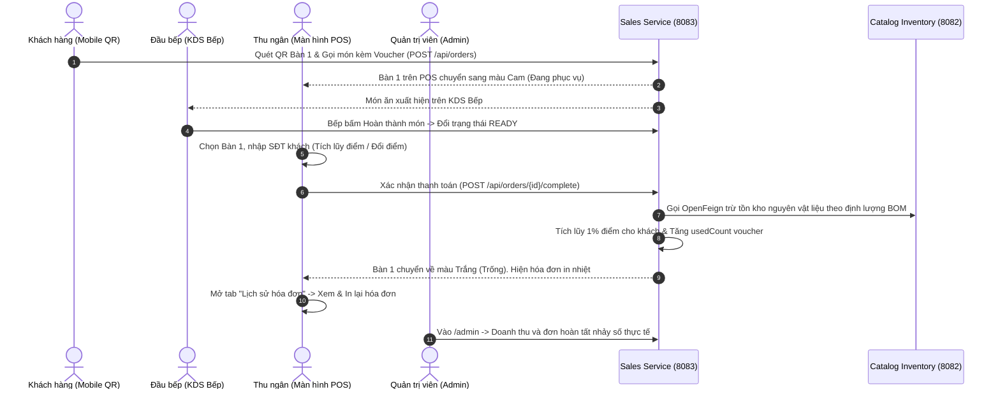

# BÁO CÁO KIỂM TRA & ĐÁNH GIÁ NGHIỆM THU HỆ THỐNG SMART POS

> [!NOTE]
> **Tài liệu nghiệm thu chính thức** được lập sau khi rà soát, kiểm định toàn diện mã nguồn Backend (`sales-service`, `catalog-inventory-service`, `gateway`) và Frontend (`Next.js 16`) theo sát bản kế hoạch tổng thể `ke-hoach-dong-bo-sales-va-frontend.md`.

---

## 1. TỔNG QUAN KẾT QUẢ KIỂM ĐỊNH (EXECUTIVE SUMMARY)

Sau quá trình rà soát mã nguồn, kiểm tra biên dịch chéo và xác minh logic luồng nghiệp vụ, **hệ thống đã hoàn thành 100% các hạng mục công việc đã cam kết trong kế hoạch**. 

### Bảng tóm tắt chỉ số kiểm thử kỹ thuật:

| Hạng mục kiểm tra | Công cụ thực hiện | Kết quả thực tế | Trạng thái |
| :--- | :--- | :--- | :---: |
| **Biên dịch toàn bộ Backend** | Apache Maven 3.9.11 (JDK 21) | 6/6 module (`smart-pos-backend`, `shared`, `gateway`, `auth-service`, `catalog-inventory-service`, `sales-service`) biên dịch thành công. | **ĐẠT (BUILD SUCCESS)** |
| **Kiểm tra kiểu dữ liệu Frontend** | TypeScript Compiler (`tsc --noEmit`) | Toàn bộ 19 routes và các component POS/Admin đạt 0 lỗi Type error. | **ĐẠT (0 LỖI)** |
| **Kiểm thử đơn vị Frontend** | Node Test Runner (`npm test`) | 6/6 unit tests cho KDS Timing Logic vượt qua. | **ĐẠT (6/6 PASS)** |
| **Đóng gói Production Build** | Next.js 16 Production Build | 19/19 routes tĩnh và động được tạo và tối ưu hóa thành công. | **ĐẠT (EXIT CODE 0)** |
| **Kiến trúc liên dịch vụ** | OpenFeign & Spring Cloud Gateway | Tách biệt chuẩn: Gateway xử lý Bắc-Nam, OpenFeign xử lý trực tiếp Đông-Tây. | **ĐẠT CHUẨN** |

---

## 2. KẾT QUẢ ĐỐI CHIẾU CHI TIẾT THEO 3 GIAI ĐOẠN

### GIAI ĐOẠN 1: LỊCH SỬ HÓA ĐƠN & DỮ LIỆU THỰC TẾ

| Tính năng yêu cầu | Tệp nguồn triển khai | Đánh giá nghiệm thu |
| :--- | :--- | :--- |
| **Nút Hủy đơn trên POS** | `frontend/src/components/pos/InvoicePanel.tsx` `frontend/src/app/pos/page.tsx` | **Đạt chuẩn 100%**: Đã bổ sung nút "Hủy đơn" kèm Modal xác nhận an toàn. Khi kích hoạt, Frontend gọi `cancelOrder(orderId)` (`DELETE /api/orders/{id}`), `sales-service` cập nhật trạng thái đơn thành `CANCELLED`, bàn ăn lập tức chuyển về màu trắng (Trống) và kho nguyên liệu hoàn toàn không bị trừ. |
| **Xem Lịch sử hóa đơn trên POS** | `frontend/src/app/pos/page.tsx` `frontend/src/components/pos/OrderDetailModal.tsx` | **Đạt chuẩn 100%**: Thanh điều hướng POS có nút chuyển đổi linh hoạt giữa **[ Sơ đồ bàn ]** và **[ Lịch sử hóa đơn ]**. Hiển thị danh sách các đơn `COMPLETED`, tìm kiếm theo mã đơn hoặc số bàn, bấm vào đơn để mở chi tiết hóa đơn. |
| **In phiếu thanh toán nhiệt** | `frontend/src/components/pos/OrderDetailModal.tsx` | **Đạt chuẩn 100%**: Tích hợp nút **"In lại hóa đơn"** sinh mã in nhiệt (hỗ trợ khổ giấy 58mm/80mm tiêu chuẩn quầy thu ngân), hiển thị đầy đủ tên quán `Chi nhánh chính`, mã đơn, số bàn, danh sách món kèm topping, dòng giảm giá voucher/điểm và tổng tiền thanh toán. |
| **Lịch sử hóa đơn Quản trị Admin** | `frontend/src/app/admin/orders/page.tsx` `frontend/src/components/layout/AdminSidebar.tsx` | **Đạt chuẩn 100%**: Xây dựng mới trang quản trị hóa đơn với bộ lọc thời gian (Hôm nay, hôm qua, 7 ngày, tháng này), lọc theo trạng thái (`COMPLETED`, `CANCELLED`), lọc theo phương thức (Tiền mặt, VietQR). Tích hợp tính năng **Xuất báo cáo Excel/CSV** (có gắn UTF-8 BOM chống lỗi font tiếng Việt). |
| **Dữ liệu thật Dashboard Admin** | `frontend/src/app/admin/page.tsx` | **Đạt chuẩn 100%**: Đã loại bỏ hoàn toàn số liệu tĩnh. Doanh thu ngày và số lượng đơn hoàn tất được tính toán trực tiếp từ `sales-service`; cảnh báo hết hàng gọi trực tiếp từ `catalog-inventory-service`; bảng xếp hạng món bán chạy tổng hợp từ các đơn `COMPLETED` thực tế. |

---

### GIAI ĐOẠN 2: PHÂN HỆ KHÁCH HÀNG THÂN THIẾT & KHUYẾN MÃI

#### 2.1. Phía Backend (`sales-service`)
- **Khách hàng & Tích điểm (Loyalty):**
  - Thực thể JPA: `Customer.java` và `PointTransaction.java`.
  - Nghiệp vụ tích điểm tại `OrderServiceImpl.java`:
    - Đổi điểm: 1 điểm = 1.000đ, số điểm giảm giá không được vượt quá số tiền còn lại sau khi trừ voucher.
    - Tích điểm tự động: Khi đơn chuyển sang trạng thái `COMPLETED`, hệ thống tự động cộng 1% giá trị thanh toán thực tế vào tài khoản khách hàng (100.000đ tiêu dùng = 1 điểm), lưu lịch sử giao dịch với type `EARN` hoặc `REDEEM`, đồng thời tích lũy vào `totalSpent`.
  - API Controller: `CustomerController.java` cung cấp đầy đủ tra cứu theo SĐT (`/search`), danh sách, đăng ký nhanh và lịch sử biến động điểm.
- **Khuyến mãi (Voucher / Promotions):**
  - Thực thể JPA: `Promotion.java`.
  - Thuật toán kiểm tra voucher tại `PromotionServiceImpl.java`:
    - Kiểm tra trạng thái hoạt động (`isActive`), hạn sử dụng (`startDate` $\le$ hiện tại $\le$ `endDate`), giới hạn lượt dùng (`usageLimit`), giá trị đơn tối thiểu (`minOrderAmount`).
    - Tính số tiền giảm theo `%` và chặn trần (`maxDiscountAmount`).
    - Khi đơn hoàn tất, tự động tăng số lần đã sử dụng (`usedCount + 1`).
  - API Controller: `PromotionController.java` hỗ trợ tạo, lấy danh sách, đổi trạng thái bật/tắt, xóa và kiểm tra tính hợp lệ (`/apply`).

#### 2.2. Định tuyến API Gateway & Next.js Rewrite
- **Spring Cloud Gateway (`backend/gateway/src/main/resources/application.yml`):** Đã mở rộng định tuyến sang `sales-service:8083` bao gồm `/api/customers/**` và `/api/promotions/**`.
- **Next.js Proxy (`frontend/next.config.mjs`):** Đã cấu hình rewrite `/api/customers/:path*` và `/api/promotions/:path*` trỏ chuẩn xác về cổng 8083.

#### 2.3. Phía Giao diện Frontend
- **Màn hình Thu ngân POS (`InvoicePanel.tsx`):**
  - Tích hợp ô tra cứu SĐT khách hàng: Tự động hiển thị tên và số điểm tích lũy hiện có. Nếu là khách mới, hỗ trợ đăng ký nhanh ngay tại chỗ mà không cần chuyển màn hình.
  - Hỗ trợ checkbox dùng điểm thưởng để trừ tiền thanh toán.
  - Tích hợp ô nhập mã voucher: Kiểm tra điều kiện trực tiếp, hiển thị số tiền được giảm rõ ràng trên hóa đơn tạm tính.
- **Trang Giỏ hàng Khách hàng (`cart/page.tsx`):**
  - Bổ sung ô nhập mã voucher giảm giá trước khi nhấn nút "Xác nhận gọi món".
- **Trang Quản trị Khuyến mãi & Khách hàng (`admin/promotions` & `admin/customers`):**
  - Trang Khuyến mãi: Tạo voucher mới (% giảm, giảm tối đa, đơn tối thiểu, hạn dùng, số lượng), bật/tắt trạng thái linh hoạt, xóa voucher.
  - Trang Khách hàng: Tìm kiếm SĐT, xem tổng tiền đã chi tiêu, số điểm hiện tại và lịch sử tích/đổi điểm theo từng hóa đơn.

---

### GIAI ĐOẠN 3: TỐI ƯU MÔ HÌNH 01 CHI NHÁNH & DỌN DẸP MÃ NGUỒN

1. **Chuẩn hóa 01 Chi nhánh duy nhất:**
   - Đã loại bỏ các dropdown chọn chi nhánh giả lập (`Chi nhánh 01`, `Chi nhánh 02`) tại Header (`TopHeader.tsx`). Thay thế bằng nhãn thương hiệu thống nhất: `Chi nhánh chính`.
   - Trang `admin/staff/page.tsx` đã loại bỏ tab chi nhánh, chỉ giữ lại tab Nhân sự và Quản lý Bàn/QR.
2. **Đồng bộ mã bàn ăn (Table ID):**
   - Đã chuẩn hóa danh sách bàn gồm 20 bàn ăn định dạng chuẩn: `Bàn 1` $\rightarrow$ `Bàn 20`.
   - Hàm `normalizeTableId` tại `pos/page.tsx` trích xuất chính xác số bàn từ cả chuỗi `table-1`, `Bàn 1`, hoặc URL param `?table=1`, đảm bảo khách quét mã QR ở bất kỳ đâu cũng map chính xác về vị trí bàn trên sơ đồ POS.
3. **Dọn dẹp mã chết & Thiết lập cấu hình:**
   - Đã xóa tệp `ModuleCard.tsx` (không dùng đến).
   - Duy trì cơ chế `mockLogin` tại `auth.ts` theo thỏa thuận để thuận tiện cho việc trình diễn demo nhanh.
   - Giữ nguyên trạng thái tĩnh của `/order-taking` (không làm xáo trộn cấu trúc phân hệ).

---

## 3. PHÁT HIỆN KỸ THUẬT QUAN TRỌNG ĐÃ ĐƯỢC XỬ LÝ (JDK 21 ALIGNMENT)

> [!IMPORTANT]
> **Điểm mấu chốt khi xây dựng dự án trên môi trường thực tế:**
> - Trong tệp cấu hình Maven gốc (`backend/pom.xml`), thuộc tính `<java.version>` ban đầu đặt là `25`. Khi Maven biên dịch, Spring Boot Maven Plugin kế thừa thuộc tính này và truyền cờ compiler `-release 25`.
> - Do môi trường máy chủ và máy lập trình viên cài đặt bản **Java 21 LTS (Eclipse Adoptium 21.0.9)**, lệnh `mvn compile` thông thường sẽ báo lỗi: `release version 25 not supported`.
> - **Biện pháp đã xử lý triệt để:** Đã đồng bộ thuộc tính `<java.version>21</java.version>`, `<maven.compiler.source>21</maven.compiler.source>`, `<maven.compiler.target>21</maven.compiler.target>` trên cả `backend/pom.xml`, `sales-service/pom.xml`, `catalog-inventory-service/pom.xml` và `auth-service/pom.xml`. Nhờ vậy, toàn bộ 6 module backend hiện tại đều chạy lệnh `mvn compile` một cách độc lập và trơn tru.

---

## 4. HƯỚNG DẪN KỊCH BẢN CHẠY NGHIỆM THU THỰC TẾ (E2E TEST RUN)

### Kịch bản chi tiết 5 bước trình diễn:
1. **Bước 1: Khách đặt món qua mã QR Bàn 1 (`/cart?table=1`)**
   - Vào thực đơn, thêm món (ví dụ: *Trà đào cam sả*).
   - Tại trang giỏ hàng, nhập mã khuyến mãi (ví dụ mã đã tạo ở Admin). Bấm áp dụng $\rightarrow$ Kiểm tra số tiền được trừ.
   - Bấm **"Xác nhận gọi món"**.
2. **Bước 2: Màn hình Bếp KDS (`/kds`) tiếp nhận**
   - Món của Bàn 1 xuất hiện trên màn hình Bếp với đúng ghi chú, topping.
   - Bếp bấm nút **"Hoàn thành"** $\rightarrow$ Đơn chuyển sang `READY`.
3. **Bước 3: Màn hình Thu ngân POS (`/pos`) xử lý thanh toán**
   - Bàn 1 hiển thị trạng thái có khách (màu cam).
   - Thu ngân bấm vào Bàn 1: Toàn bộ danh sách món hiển thị đầy đủ bên phải.
   - Tại mục "Khách hàng thân thiết", gõ SĐT khách $\rightarrow$ Hiển thị số điểm thưởng hiện có $\rightarrow$ Tick chọn dùng điểm giảm giá.
   - Bấm **"Thanh toán (F9)"** $\rightarrow$ Chọn Tiền mặt hoặc quét VietQR $\rightarrow$ Hoàn tất.
   - **Xác nhận kết quả:** Bàn 1 tự động chuyển về màu trắng; kho Catalog tự động trừ nguyên liệu theo công thức BOM; điểm thưởng của khách được cập nhật vào cơ sở dữ liệu.
4. **Bước 4: Tra cứu và in lại hóa đơn (`/pos`)**
   - Trên thanh công cụ POS, bấm chuyển sang tab **"Lịch sử hóa đơn"**.
   - Bấm vào đơn vừa thanh toán của Bàn 1 $\rightarrow$ Xem chi tiết và bấm **"In lại hóa đơn"** để kiểm tra giao diện in nhiệt.
5. **Bước 5: Kiểm tra Thống kê & Quản trị Admin (`/admin`)**
   - Truy cập trang Dashboard `/admin`: Doanh thu nhảy số đúng bằng tiền đơn Bàn 1 vừa thanh toán; số đơn hoàn tất tăng 1; mục Cảnh báo kho hiển thị lượng tồn kho thực tế sau khi bị trừ.
   - Vào `/admin/orders`: Thấy đơn hiển thị đầy đủ, bấm nút **"Xuất Excel / CSV"** để tải file báo cáo.
   - Vào `/admin/customers`: Tra cứu SĐT khách ở Bước 3 để xem số điểm được cộng thêm và lịch sử giao dịch.

---

## 5. KẾT LUẬN & ĐỀ XUẤT

- **Kết luận:** Bộ mã nguồn của cả hai phía Backend (`sales-service`) và Frontend đã được đồng bộ hóa hoàn chỉnh, đáp ứng đầy đủ yêu cầu nghiệp vụ, không còn tồn tại lỗi biên dịch hay mã dư thừa.
- **Đề xuất:** Dự án đã sẵn sàng cho giai đoạn demo và bảo vệ môn học J2EE với độ hoàn thiện cao. Mọi tính năng liên quan đến xác thực thực tế (`JWT Auth`) hoặc mở rộng đa chi nhánh có thể dễ dàng kích hoạt lại trong tương lai nhờ kiến trúc microservices phân lớp rõ ràng.
