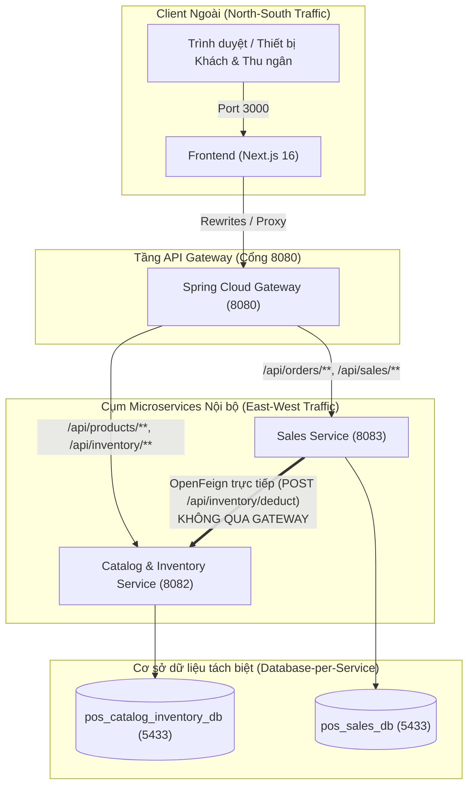

# KẾ HOẠCH TỔNG THỂ & BẢN ĐÁNH GIÁ KIẾN TRÚC HỆ THỐNG SMART POS

> [!NOTE]
> Tài liệu này là **Bản kế hoạch hoàn chỉnh và đánh giá chính thức** được chuẩn hóa sau các phiên phân tích và thống nhất yêu cầu với Trưởng nhóm phụ trách Catalog & Inventory Service. Tài liệu đóng vai trò kim chỉ nam cho việc phát triển, hoàn thiện mã nguồn và nghiệm thu hệ thống.

---

## PHẦN 1: BẢN ĐẶC TẢ KIẾN TRÚC & MÔ HÌNH VẬN HÀNH

### 1.1. Phạm vi & Tôn chỉ vận hành
- **Mô hình triển khai:** Hoạt động tại **01 Chi nhánh duy nhất (Single-branch POS)**.
- **Loại bỏ tính đa chi nhánh dư thừa:** Lược bỏ toàn bộ các bộ lọc, dropdown chi nhánh (`Chi nhánh 01`, `Chi nhánh 02`) đang xuất hiện rải rác trên giao diện Frontend để đơn giản hóa luồng vận hành, tránh gây nhầm lẫn khi nghiệm thu.

### 1.2. Cơ chế giao tiếp liên dịch vụ (Inter-Service Communication)



#### Phân định ranh giới Gateway vs OpenFeign:
1. **API Gateway (Port 8080) – Luồng Bắc Nam (North-South):**
   - Đóng vai trò Reverse Proxy duy nhất tiếp nhận request từ Client ngoài (Frontend Next.js).
   - Xử lý CORS, cân bằng tải và điều hướng routing URL:
     - `/api/orders/**`, `/api/sales/**` $\rightarrow$ `sales-service:8083`
     - `/api/products/**`, `/api/inventory/**`, v.v. $\rightarrow$ `catalog-inventory-service:8082`
2. **OpenFeign Client – Luồng Đông Tây (East-West):**
   - Khi `sales-service` cần trừ kho sau khi thanh toán, nó giao tiếp **TRỰC TIẾP** với `catalog-inventory-service` qua OpenFeign ([`InventoryClient.java`](file:///d:/CNTT-SGU/HK7/J2EE/Smart-POS/backend/services/sales-service/src/main/java/com/smartpos/sales_service/client/InventoryClient.java)), **tuyệt đối không đi vòng qua Gateway**.
   - **Lý do kỹ thuật:** Giảm thiểu độ trễ mạng (Network Latency), tránh thắt cổ chai Gateway khi lưu lượng bán hàng cao, và đảm bảo tính cô lập của mạng nội bộ microservices.

---

## PHẦN 2: BẢNG RÀ SOÁT HIỆN TRẠNG TOÀN DIỆN

### 2.1. Đối chiếu chức năng Backend `sales-service` vs Frontend

| Phân hệ / API | Backend (`sales-service`) | Frontend (`Next.js`) | Đánh giá & Hướng xử lý |
| :--- | :---: | :---: | :--- |
| **Tạo đơn hàng** (`POST /api/orders`) |  Hoàn thiện |  Hoàn thiện | Đã hoạt động tốt trên cả `/cart` (QR) và `/pos`. |
| **Lấy danh sách đơn** (`GET /api/orders`) |  Hoàn thiện | ⚠️ Bán phần | POS & KDS chỉ lọc đơn đang phục vụ (`PENDING`, `READY`), **chưa hiển thị đơn `COMPLETED`**. |
| **Chi tiết đơn hàng** (`GET /api/orders/{id}`) |  Hoàn thiện | ❌ Chưa dùng | Đã có hàm `fetchOrderDetail` trong [`api.ts`](file:///d:/CNTT-SGU/HK7/J2EE/Smart-POS/frontend/src/lib/api.ts#L662) nhưng chưa có UI xem lại chi tiết hóa đơn cũ. |
| **Hủy đơn hàng** (`DELETE /api/orders/{id}`) |  Hoàn thiện | ❌ Chưa có nút | Đã có hàm `cancelOrder` trong [`api.ts`](file:///d:/CNTT-SGU/HK7/J2EE/Smart-POS/frontend/src/lib/api.ts#L718), cần bổ sung nút hủy đơn trên POS. |
| **Tự động trừ kho** (`POST /api/orders/{id}/complete`) |  Hoàn thiện |  Hoàn thiện | Kết nối OpenFeign sang Catalog trừ kho theo công thức BOM thành công 100%. |
| **Khách hàng thân thiết (Loyalty)** | ⚠️ Chỉ có bảng DB | ❌ Chưa có | Đã có bảng `customers`, `point_transactions`; cần viết Java code và bổ sung UI nhập SĐT tích điểm. |
| **Khuyến mãi & Giảm giá (Vouchers)** | ⚠️ Chỉ có bảng DB | ❌ Chưa có | Đã có bảng `promotions`; cần viết Java code và bổ sung UI áp dụng voucher giảm giá. |

### 2.2. Rà soát lỗi, mã dư thừa & dữ liệu Mock trên Frontend

| Vị trí mã nguồn | Hiện trạng | Phân loại | Hướng xử lý theo thỏa thuận |
| :--- | :--- | :---: | :--- |
| [`/admin/page.tsx`](file:///d:/CNTT-SGU/HK7/J2EE/Smart-POS/frontend/src/app/admin/page.tsx) | Toàn bộ Dashboard là dữ liệu tĩnh: Doanh thu `12.450.000đ`, `BEST_SELLERS`, `HOURLY_REVENUE`, nút Xuất Excel giả lập. | **Dữ liệu Mock** | Kết nối trực tiếp với API của `sales-service` và `catalog-inventory-service`. |
| [`/login/page.tsx`](file:///d:/CNTT-SGU/HK7/J2EE/Smart-POS/frontend/src/app/login/page.tsx) & [`lib/auth.ts`](file:///d:/CNTT-SGU/HK7/J2EE/Smart-POS/frontend/src/lib/auth.ts) | Đang dùng `mockLogin` với danh sách tài khoản cố định trong file TS. | **Giữ nguyên** | **Tạm thời giữ nguyên mockLogin** theo quyết định của người dùng để phục vụ demo nhanh. |
| [`/order-taking/page.tsx`](file:///d:/CNTT-SGU/HK7/J2EE/Smart-POS/frontend/src/app/order-taking/page.tsx) | Trang trống (chỉ có 1 thẻ div tĩnh giới thiệu phân hệ phục vụ). | **Mã chưa hoàn thiện** | **Tạm thời bỏ qua** theo quyết định của người dùng, không đầu tư thời gian vào đây. |
| [`ModuleCard.tsx`](file:///d:/CNTT-SGU/HK7/J2EE/Smart-POS/frontend/src/components/portal/ModuleCard.tsx) | Component không được import hay sử dụng ở bất kỳ đâu trong dự án. | **Mã chết (Dead code)** | Loại bỏ hoặc đánh dấu lưu kho để tránh làm nặng bundle build. |
| Dropdown đa chi nhánh | Dropdown chọn `Chi nhánh 01`, `Chi nhánh 02` ở Header và các trang quản trị. | **Dư thừa logic** | Xóa bỏ hoặc chuyển thành text cố định tên quán (phục vụ mô hình 1 chi nhánh). |

---

## PHẦN 3: KẾ HOẠCH TRIỂN KHAI CHI TIẾT THEO TỪNG GIAI ĐOẠN

```mermaid
gantt
    title LỘ TRÌNH HOÀN THIỆN TOÀN BỘ HỆ THỐNG SMART POS
    dateFormat  YYYY-MM-DD
    section Giai đoạn 1 (Lịch sử & POS)
    Thêm nút Hủy đơn trên POS                 :active, p1_1, 2026-11-06, 1d
    Xây dựng Tab Lịch sử hóa đơn trên POS    :active, p1_2, after p1_1, 2d
    Xây dựng Trang Lịch sử hóa đơn Admin     :p1_3, after p1_2, 2d
    Kết nối dữ liệu thực tế cho Dashboard    :p1_4, after p1_3, 1d
    section Giai đoạn 2 (Khách hàng & Voucher)
    Backend: Java Entity, Repo, Service       :p2_1, after p1_4, 2d
    Backend: Tích hợp Loyalty & Voucher vào Order :p2_2, after p2_1, 2d
    Frontend: UI Nhập SĐT & Voucher trên POS/Cart :p2_3, after p2_2, 2d
    Frontend: Quản lý Voucher trên Admin     :p2_4, after p2_3, 1d
    section Giai đoạn 3 (Tối ưu & Nghiệm thu)
    Loại bỏ dropdown đa chi nhánh dư thừa     :p3_1, after p2_4, 1d
    Kiểm thử tích hợp End-to-End toàn diện   :p3_2, after p3_1, 2d
```

---

### GIAI ĐOẠN 1: HOÀN THIỆN LỊCH SỬ HÓA ĐƠN & DỮ LIỆU THỰC TẾ (ƯU TIÊN SỐ 1)

#### 1. Bổ sung tính năng Hủy đơn trên POS ([`InvoicePanel.tsx`](file:///d:/CNTT-SGU/HK7/J2EE/Smart-POS/frontend/src/components/pos/InvoicePanel.tsx))
- **Mục tiêu:** Cho phép thu ngân hủy các đơn khách gọi nhầm hoặc bàn bỏ về.
- **Cách thực hiện:**
  - Thêm nút "Hủy đơn" cạnh nút "Thanh toán (F9)".
  - Khi bấm, hiển thị Modal xác nhận $\rightarrow$ Gọi API `cancelOrder(orderId)` (`DELETE /api/orders/{id}`) $\rightarrow$ Sales Service chuyển trạng thái đơn sang `CANCELLED` $\rightarrow$ Giải phóng bàn về màu trắng trên sơ đồ POS.

#### 2. Xây dựng Giao diện Lịch sử Hóa đơn trên Màn hình Thu ngân POS ([`pos/page.tsx`](file:///d:/CNTT-SGU/HK7/J2EE/Smart-POS/frontend/src/app/pos/page.tsx))
- **Mục tiêu:** Phục vụ thu ngân kiểm tra lại các giao dịch trong ngày và in lại hóa đơn.
- **Cách thực hiện:**
  - Thêm một nút chuyển chế độ trên thanh công cụ POS: **[ Sơ đồ bàn ]** | **[ Lịch sử hóa đơn ]**.
  - Khi mở tab Lịch sử hóa đơn:
    - Gọi API `fetchOrders({ status: "COMPLETED" })` để tải danh sách các đơn đã thanh toán trong ngày.
    - Hiển thị danh sách dạng bảng: Mã đơn (`#ORD-...`), Số bàn, Thời gian thanh toán, Phương thức (Tiền mặt / VietQR), Tổng tiền.
    - Bấm vào đơn bất kỳ $\rightarrow$ Mở Modal chi tiết hóa đơn (danh sách món, topping, giảm giá, thành tiền) kèm nút **"In lại hóa đơn"**.

#### 3. Xây dựng Trang Lịch sử Bán hàng trên Trang Quản trị Admin
- **Mục tiêu:** Phục vụ chủ quán / kế toán tra cứu doanh thu và kiểm tra hóa đơn theo thời gian.
- **Cách thực hiện:**
  - Thêm mục menu **"Lịch sử hóa đơn"** trên [`AdminSidebar.tsx`](file:///d:/CNTT-SGU/HK7/J2EE/Smart-POS/frontend/src/components/layout/AdminSidebar.tsx).
  - Cho phép lọc nâng cao: Theo khoảng ngày (từ ngày - đến ngày), theo số bàn, theo phương thức thanh toán.
  - Hỗ trợ xuất dữ liệu hóa đơn ra file Excel/CSV.

#### 4. Kết nối Dữ liệu Thật cho Dashboard Tổng quan ([`admin/page.tsx`](file:///d:/CNTT-SGU/HK7/J2EE/Smart-POS/frontend/src/app/admin/page.tsx))
- **Doanh thu ngày & Tổng đơn hoàn tất:** Tính toán trực tiếp bằng cách tổng hợp các đơn có trạng thái `COMPLETED` trong ngày từ `sales-service`.
- **Cảnh báo tồn kho:** Gọi trực tiếp API `fetchLowStockAlerts()` từ `catalog-inventory-service`.
- **Top món bán chạy:** Gom nhóm số lượng bán ra theo từng `product_id` từ các đơn hoàn tất.

---

### GIAI ĐOẠN 2: TRIỂN KHAI PHÂN HỆ KHÁCH HÀNG THÂN THIẾT & KHUYẾN MÃI

#### 1. Thiết kế & Triển khai Backend (`sales-service`)
Cơ sở dữ liệu `pos_sales_db` đã có sẵn các bảng ([`01-init-all-databases.sql`](file:///d:/CNTT-SGU/HK7/J2EE/Smart-POS/init-scripts/01-init-all-databases.sql#L246-L260)):
- `customers` (`id`, `phone`, `full_name`, `current_points`, `total_spent`)
- `promotions` (`id`, `code`, `name`, `discount_type`, `discount_value`, `min_order_value`, `start_date`, `end_date`, `is_active`)
- `point_transactions` (`id`, `customer_id`, `order_id`, `points_change`, `type`)

**Các thành phần Backend cần lập trình mới:**
1. **Quản lý Khách hàng (`CustomerController` & `CustomerService`):**
   - `GET /api/customers/search?phone={phone}`: Tra cứu thông tin khách hàng và số điểm hiện tại.
   - `POST /api/customers`: Đăng ký nhanh khách hàng mới bằng SĐT ngay tại quầy POS.
2. **Quản lý Khuyến mãi (`PromotionController` & `PromotionService`):**
   - `GET /api/promotions`: Danh sách các mã khuyến mãi đang áp dụng.
   - `POST /api/promotions/apply`: Kiểm tra điều kiện mã giảm giá (áp dụng giảm theo `%` hoặc số tiền cố định).
3. **Nâng cấp Nghiệp vụ Tạo & Thanh toán Đơn hàng (`OrderServiceImpl`):**
   - Bổ sung vào `CreateOrderRequest` & `Order`:
     - `customerId`: Khách hàng gắn với đơn.
     - `promotionId`: Mã voucher áp dụng.
     - `pointsToRedeem`: Số điểm khách muốn trừ vào đơn hàng (Quy đổi: $1 \text{ điểm} = 1.000đ$).
   - Công thức tính tổng tiền hóa đơn:
     $$\text{totalAmount} = \max\Big(0, \; (\text{subtotal} - \text{discountAmount} - \text{pointsDiscountAmount})\Big)$$
   - Khi đơn chuyển sang `COMPLETED`:
     - Tự động tích điểm cho khách (Ví dụ: tích $1\%$ giá trị đơn hàng vào `current_points`).
     - Tự động ghi thẻ giao dịch điểm vào `point_transactions`.

#### 2. Triển khai Giao diện Frontend
1. **Tại Màn hình Thu ngân POS ([`InvoicePanel.tsx`](file:///d:/CNTT-SGU/HK7/J2EE/Smart-POS/frontend/src/components/pos/InvoicePanel.tsx)):**
   - Thêm ô **"Khách hàng thân thiết"**: Nhập SĐT khách $\rightarrow$ Tự động hiện tên và điểm khả dụng $\rightarrow$ Nút tick "Dùng điểm giảm giá".
   - Thêm ô **"Mã khuyến mãi"**: Nhập mã voucher $\rightarrow$ Nút "Áp dụng" $\rightarrow$ Hiển thị dòng giảm giá rõ ràng trên hóa đơn.
2. **Tại Trang Giỏ hàng Khách hàng ([`cart/page.tsx`](file:///d:/CNTT-SGU/HK7/J2EE/Smart-POS/frontend/src/app/cart/page.tsx)):**
   - Thêm ô nhập mã voucher giảm giá trước khi bấm "Xác nhận gọi món".
3. **Tại Trang Quản trị Admin:**
   - Thêm trang Quản lý Khuyến mãi (tạo mã mới, đặt hạn sử dụng, % giảm, giá trị đơn tối thiểu).
   - Thêm trang Danh sách Khách hàng & Lịch sử tích điểm.

---

### GIAI ĐOẠN 3: DỌN DẸP, TỐI ƯU MÔ HÌNH 1 CHI NHÁNH & NGHIỆM THU

1. **Chuẩn hóa Giao diện 1 Chi nhánh:**
   - Xóa bỏ dropdown chọn chi nhánh tại Header ([`TopHeader.tsx`](file:///d:/CNTT-SGU/HK7/J2EE/Smart-POS/frontend/src/components/layout/TopHeader.tsx)), thay bằng nhãn tĩnh `Chi nhánh chính` hoặc tên thương hiệu nhà hàng.
   - Ẩn hoàn toàn tab chi nhánh tại trang [`admin/staff/page.tsx`](file:///d:/CNTT-SGU/HK7/J2EE/Smart-POS/frontend/src/app/admin/staff/page.tsx).
2. **Dọn dẹp mã nguồn:**
   - Ẩn hoặc xóa đường dẫn tới `/order-taking`.
   - Xóa bỏ file `ModuleCard.tsx` không dùng.
   - Xóa bỏ file `.env` nằm nhầm trong thư mục `backend/.../src/main/`.

---

## PHẦN 4: MA TRẬN KIỂM THỬ NGHIỆM THU (ACCEPTANCE TEST MATRIX)

| Test Case | Các bước thực hiện | Kết quả kỳ vọng đạt chuẩn |
| :--- | :--- | :--- |
| **TC-01: Luồng Bán hàng Cơ bản** | Khách quét QR Bàn 1 $\rightarrow$ Gọi món $\rightarrow$ Bếp nhận $\rightarrow$ Hoàn thành $\rightarrow$ Thu ngân mở Bàn 1 $\rightarrow$ Thanh toán. | - Bàn 1 chuyển cam khi có đơn.<br/>- Sau khi thanh toán, Bàn 1 về trắng.<br/>- Kho Catalog tự động trừ nguyên liệu theo công thức BOM. |
| **TC-02: Kiểm tra Hủy đơn** | Khách gọi món Bàn 2 $\rightarrow$ Bàn 2 chuyển cam $\rightarrow$ Thu ngân bấm nút "Hủy đơn" trên POS. | - Bàn 2 trở về màu trắng (Trống).<br/>- Đơn hàng chuyển sang `CANCELLED`.<br/>- Kho nguyên liệu không bị trừ. |
| **TC-03: Xem Lịch sử Hóa đơn trên POS** | Sau khi hoàn tất đơn TC-01 $\rightarrow$ Thu ngân chuyển sang tab "Lịch sử hóa đơn" trên POS. | - Thấy đơn của Bàn 1 hiển thị đầu danh sách.<br/>- Mở xem chi tiết đúng các món đã gọi.<br/>- Bấm nút in lại hóa đơn hoạt động bình thường. |
| **TC-04: Xem Lịch sử & Thống kê Admin** | Truy cập trang Quản trị Admin (`/admin`). | - Doanh thu ngày nhảy số đúng với tổng tiền đơn TC-01.<br/>- Tổng số đơn hoàn tất tăng thêm 1.<br/>- Cảnh báo kho hiển thị đúng các nguyên liệu sắp hết. |
| **TC-05: Khuyến mãi & Tích điểm** | Thu ngân nhập mã giảm giá `GIAM10` và nhập SĐT khách quen khi thanh toán. | - Tiền thanh toán tự động trừ đúng % giảm giá.<br/>- Điểm tích lũy của khách hàng được cộng thêm sau khi thanh toán. |
