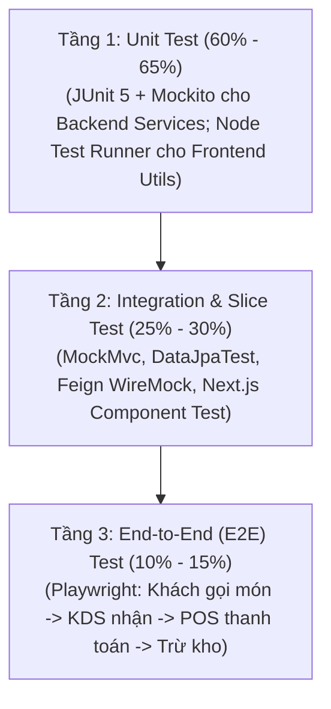
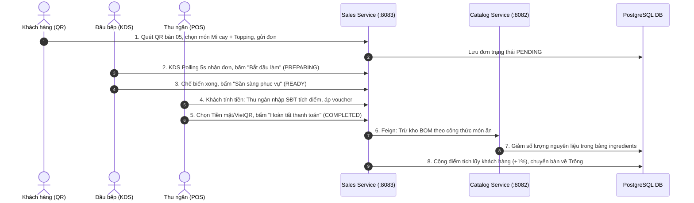
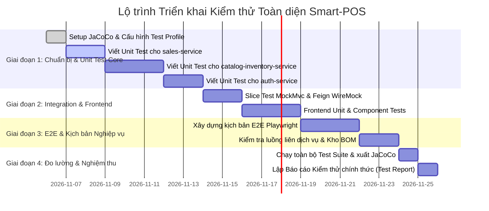

# KẾ HOẠCH KIỂM THỬ TOÀN DIỆN HỆ THỐNG SMART POS & KDS
**Master Test Plan — Dự án Đồ án Chuyên ngành SGU**
*Phiên bản: 1.0 | Ngày lập: 05/11/2026 | Áp dụng cho: Toàn bộ Backend, Frontend và Tích hợp CSDL*

---

## 1. TỔNG QUAN & MỤC TIÊU KIỂM THỬ

### 1.1. Bối cảnh dự án
Hệ thống **Smart POS & KDS** phục vụ mô hình 01 cửa hàng F&B độc lập (mô hình quán mì cay), gồm 3 dịch vụ Backend độc lập (`auth-service`, `catalog-inventory-service`, `sales-service`), 1 API Gateway, và ứng dụng Frontend Next.js 16 đa vai trò (QR Khách hàng, Thu ngân POS, Bếp KDS, Quản trị Admin).

Hiện tại, hệ thống mới chỉ có một số ít test rời rạc (1 file kiểm thử bộ đếm KDS tại frontend, 1 file kiểm thử cơ bản `OrderServiceImplTest` tại `sales-service`). Kế hoạch này được lập nhằm **chuẩn hóa quy trình kiểm thử, thiết lập bộ kiểm thử tự động toàn diện từ tầng Unit đến E2E**, đảm bảo chất lượng phần mềm phục vụ nghiệm thu chính thức.

### 1.2. Mục tiêu chất lượng (Quality Goals & Coverage)
- **Service Layer Code Coverage:** Đạt tối thiểu **80% line coverage** trên toàn bộ các lớp nghiệp vụ Backend.
- **Critical Business Paths:** Đạt **100% test coverage** cho các luồng nghiệp vụ xương sống:
  1. Đặt món qua QR và tạo đơn hàng.
  2. Đồng bộ thời gian thực trên màn hình bếp KDS.
  3. Hoàn tất đơn $\rightarrow$ tự động trừ kho nguyên liệu theo định lượng BOM.
  4. Quản lý tích điểm Khách hàng thân thiết (100.000đ = 1 điểm = 1.000đ giảm giá) và Voucher khuyến mãi.
  5. Đăng nhập JWT và kiểm soát phân quyền (RBAC).
- **Tính toàn vẹn dữ liệu (Data Integrity):** Ngăn chặn triệt để tình trạng trừ kho 2 lần (Idempotency), không để tồn kho bị âm, không cho phép hủy đơn đã hoàn tất.
- **Frontend Stability:** 0 lỗi Type error, 100% logic tiện ích (utils, formatters, validation) được kiểm thử tự động.

---

## 2. CHIẾN LƯỢC KIỂM THỬ THEO KIM TỰ THÁP (TESTING PYRAMID)



| Tầng kiểm thử | Đối tượng kiểm thử | Công cụ / Thư viện | Tỷ lệ số lượng | Tốc độ chạy |
| :--- | :--- | :--- | :---: | :---: |
| **Unit Test** | Từng hàm nghiệp vụ cô lập, DTO, Mapper, Utility, Entity logic | JUnit 5, Mockito, AssertJ, Node Test Runner | 60% – 65% | Cực nhanh (< 15s) |
| **Integration Test** | Repository JPA, REST Controller (MockMvc), Inter-Service Feign Client | `@WebMvcTest`, `@DataJpaTest`, WireMock, Testcontainers | 25% – 30% | Trung bình (1 – 2 phút) |
| **System & E2E Test** | Luồng nghiệp vụ xuyên suốt từ giao diện đến database | Playwright / Postman Newman CLI | 10% – 15% | 3 – 5 phút |

---

## 3. KẾ HOẠCH KIỂM THỬ BACKEND MICROSERVICES

### 3.1. Dịch vụ Xác thực & Phân quyền (`auth-service` :8081)

Hệ thống quản lý tài khoản, vai trò và phân quyền động dựa trên JWT Access Token + Refresh Token (HttpOnly Cookie).

#### A. Unit Tests (Mô phỏng cô lập bằng Mockito)
- **`JwtServiceTest`**:
  - Sinh token hợp lệ với đầy đủ claims (username, roleId, permissions).
  - Kiểm tra giải mã token, xác thực token hết hạn (`ExpiredJwtException`).
  - Xác thực token bị sai chữ ký bảo mật (`SignatureException`).
- **`AuthServiceImplTest`**:
  - `login()` thành công: Đúng username & password $\rightarrow$ trả về Access Token, Role, Permissions.
  - `login()` thất bại: Sai mật khẩu $\rightarrow$ ném `BadCredentialsException` hoặc `ResourceNotFoundException`.
  - `refreshToken()` thành công: Refresh token còn hạn $\rightarrow$ xoay vòng (rotate) refresh token mới.
  - `refreshToken()` thất bại: Token đã hết hạn hoặc đã bị thu hồi $\rightarrow$ chặn đứng truy cập.
- **`RoleServiceTest` & `UserServiceTest`**:
  - CRUD User/Role, gán quyền cho Role, kiểm tra ràng buộc không cho phép xóa Role hệ thống (`is_system = true`).

#### B. Slice & Integration Tests (MockMvc & Spring Security Test)
- **`AuthControllerIntegrationTest`**:
  - `POST /api/auth/login`: Trả về HTTP 200, kiểm tra Set-Cookie chứa `refreshToken` với thuộc tính `HttpOnly; SameSite=Strict`.
  - `POST /api/auth/logout`: Xóa cookie, vô hiệu hóa token trong database.
- **`SecurityRbacIntegrationTest`**:
  - Gửi request không có Header `Authorization` $\rightarrow$ Trả về HTTP 401 Unauthorized.
  - User có Role `STAFF` truy cập endpoint Admin `/api/users` $\rightarrow$ Trả về HTTP 403 Forbidden.
  - User có Role `ADMIN` truy cập $\rightarrow$ Trả về HTTP 200 OK.

---

### 3.2. Dịch vụ Thực đơn & Kho nguyên liệu (`catalog-inventory-service` :8082)

Đây là dịch vụ cốt lõi xử lý định lượng món ăn (BOM) và trừ kho nguyên liệu.

#### A. Unit Tests
- **`ProductServiceTest` & `CategoryServiceTest`**:
  - Thêm, sửa, xóa danh mục và món ăn; kiểm tra ràng buộc tên món duy nhất.
  - Bật/tắt trạng thái món ăn (`isAvailable`), cập nhật ảnh món.
- **`RecipeServiceTest` (BOM - Bill of Materials)**:
  - Thiết lập công thức định lượng cho món: Món chính (VD: Mì cay) + Biến thể cấp độ cay + Topping.
  - Tra cứu nguyên liệu cấu thành của một món (`getRecipeByProductId`).
- **`InventoryServiceTest` (Nghiệp vụ Trừ kho - Cực kỳ quan trọng)**:
  - Trừ kho thành công: Khi tồn kho nguyên liệu đủ đáp ứng định lượng $\rightarrow$ số lượng tồn giảm chính xác, ghi log `inventory_transactions`.
  - Trừ kho thất bại: Khi một trong các nguyên liệu không đủ tồn $\rightarrow$ ném `BusinessException("Nguyên liệu X không đủ tồn kho")`, toàn bộ giao dịch bị rollback, không nguyên liệu nào bị trừ dở dang.
  - Tính bất biến (Idempotency): Gửi 2 lần cùng `orderCode` $\rightarrow$ không trừ kho lặp lại.
- **`PurchaseOrderServiceTest` (Nhập hàng)**:
  - Tạo đơn nhập hàng từ nhà cung cấp (`Supplier`).
  - Hoàn tất nhập kho $\rightarrow$ tự động cộng dồn số lượng nguyên liệu vào bảng `ingredients`.

#### B. Repository & DataJpa Tests (`@DataJpaTest`)
- **`IngredientRepositoryTest`**: Kiểm tra câu truy vấn trừ tồn an toàn (Atomic update) chống Race Condition khi nhiều đơn hàng đặt cùng lúc:
  ```sql
  UPDATE ingredients SET current_stock = current_stock - :qty WHERE id = :id AND current_stock >= :qty
  ```
- **`ProductRepositoryTest`**: Lấy danh sách thực đơn phân trang và lọc theo danh mục.

#### C. Controller Integration Tests (MockMvc)
- `GET /api/products/menu`: Trả về cây thực đơn đầy đủ kèm modifier options.
- `POST /api/inventory/deduct`: Kiểm thử các mã HTTP trả về: 200 OK khi đủ kho, 400 Bad Request kèm chi tiết nguyên liệu thiếu khi hết kho.

---

### 3.3. Dịch vụ Bán hàng & Đơn hàng (`sales-service` :8083)

Dịch vụ quản lý đơn bàn ăn, tích hợp gọi Feign sang Catalog để trừ kho, tích điểm và voucher.

#### A. Unit Tests
- **`OrderServiceImplTest` (Mở rộng từ file hiện có)**:
  - `createOrder()`: Khởi tạo đơn mới, tính tổng tiền món + topping chuẩn xác.
  - `cancelOrder()`: Hủy đơn hàng ở trạng thái `PENDING`/`CONFIRMED` $\rightarrow$ cập nhật trạng thái `CANCELLED`, bàn ăn giải phóng, **tuyệt đối không gọi sang trừ kho**.
  - `cancelOrder_Failure()`: Không thể hủy đơn hàng đã ở trạng thái `COMPLETED`.
  - `updateOrderStatus()`: Kiểm tra máy trạng thái đơn hàng (State Machine):
    $$\text{PENDING} \rightarrow \text{CONFIRMED} \rightarrow \text{PREPARING} \rightarrow \text{READY} \rightarrow \text{SERVED} \rightarrow \text{COMPLETED}$$
    Chặn các bước chuyển trạng thái phi logic (ví dụ: từ `PENDING` nhảy thẳng sang `COMPLETED`).
- **`PromotionServiceImplTest` (Khuyến mãi)**:
  - Áp dụng voucher hợp lệ: Giảm theo `%` và kiểm tra trần giảm giá tối đa (`maxDiscountAmount`).
  - Voucher hết lượt dùng (`usedCount >= usageLimit`) $\rightarrow$ Báo lỗi `BusinessException`.
  - Voucher chưa đến ngày bắt đầu hoặc đã hết hạn $\rightarrow$ Báo lỗi `BusinessException`.
  - Giá trị đơn hàng chưa đạt mức tối thiểu (`totalAmount < minOrderAmount`) $\rightarrow$ Báo lỗi.
- **`CustomerServiceImplTest` (Khách hàng thân thiết)**:
  - Tra cứu khách hàng theo số điện thoại chuẩn hóa.
  - Đăng ký nhanh khách hàng mới ngay tại quầy thu ngân.
  - Tích điểm tự động: Khi đơn `COMPLETED`, cộng điểm = 1% số tiền thực trả sau giảm giá.
  - Đổi điểm: Kiểm tra quy đổi 1 điểm = 1.000đ; chặn trường hợp đổi số điểm vượt quá số tiền của hóa đơn.

#### B. Feign Client & Fault Tolerance Integration Test
- **`SalesToCatalogIntegrationTest` (Dùng WireMock hoặc Mockito)**:
  - Kịch bản `catalog-inventory-service` bị sập (503 Service Unavailable) hoặc timeout khi gọi trừ kho $\rightarrow$ `sales-service` bắt lỗi an toàn, hoàn tác trạng thái đơn, không để đơn hàng bị treo ở trạng thái lấp lửng.

---

## 4. KẾ HOẠCH KIỂM THỬ FRONTEND (NEXT.JS 16 & REACT 19)

### 4.1. Unit Tests (Logic nghiệp vụ thuần túy tại Client)
- **`timeFormat.test.ts` (Mở rộng)**: Tiếp tục duy trì và bổ sung các ca biên cho thời gian chế biến món KDS.
- **`tableUtils.test.ts`**: Kiểm tra hàm `normalizeTableId`:
  - `normalizeTableId("Bàn 5")` $\rightarrow$ `5`
  - `normalizeTableId("table-12")` $\rightarrow$ `12`
  - `normalizeTableId("?table=08")` $\rightarrow$ `8`
  - Input không hợp lệ $\rightarrow$ trả về giá trị mặc định an toàn.
- **`priceCalculation.test.ts`**: Kiểm tra hàm tính tổng tiền giỏ hàng (Cart):
  $$\text{Tổng tiền} = \sum (\text{Giá gốc} + \sum \text{Topping}) \times \text{Số lượng} - \text{Voucher} - \text{Điểm thưởng}$$
  Đảm bảo tổng tiền không bao giờ âm kể cả khi giảm giá lớn hơn giá trị đơn.

### 4.2. Component Tests (React Testing Library)
- **`InvoicePanel.test.tsx` (Màn hình Thu ngân POS)**:
  - Nhập SĐT khách hàng $\rightarrow$ render số điểm hiện có.
  - Checkbox "Dùng điểm" $\rightarrow$ tự động trừ trực tiếp vào tổng tiền thanh toán.
  - Nhập mã voucher hợp lệ $\rightarrow$ hiển thị dòng giảm giá màu xanh; nhập mã sai $\rightarrow$ báo lỗi màu đỏ.
  - Bấm nút "Thanh toán Tiền mặt" $\rightarrow$ hiển thị modal xác nhận và tính tiền thối cho khách.
  - Bấm nút "Hủy đơn" $\rightarrow$ bật Modal xác nhận cảnh báo nguy hiểm.
- **`KdsCard.test.tsx` (Màn hình Bếp KDS)**:
  - Đơn dưới 70% thời gian mục tiêu $\rightarrow$ hiển thị viền/tag màu xanh (`safe`).
  - Đơn từ 70% đến 100% thời gian $\rightarrow$ hiển thị màu vàng cảnh báo (`warning`).
  - Đơn quá thời gian mục tiêu $\rightarrow$ nhấp nháy màu đỏ (`danger`).
  - Bấm nút "Hoàn thành món" $\rightarrow$ gọi API cập nhật trạng thái món.
- **`OrderDetailModal.test.tsx`**: Kiểm tra định dạng bản in nhiệt (58mm/80mm), có đầy đủ tên quán, mã đơn, danh sách món, topping và ngày giờ.

---

## 5. KỊCH BẢN KIỂM THỬ TÍCH HỢP TOÀN TRÌNH (END-TO-END - E2E)

Các kịch bản này mô phỏng hành vi người dùng thật trên môi trường chạy đồng thời cả Frontend và Backend:



### Kịch bản E2E chi tiết:
1. **E2E-01: Luồng hoàn chỉnh Đặt món $\rightarrow$ Chế biến $\rightarrow$ Thanh toán $\rightarrow$ Trừ kho $\rightarrow$ Tích điểm**
   - **Bước 1:** Mở trình duyệt giả lập khách tại bàn: `http://localhost:3000/menu?table=05`.
   - **Bước 2:** Chọn món mì cay cấp 3, thêm topping bò, gửi đơn hàng. Kiểm tra mã phản hồi HTTP 201 Created.
   - **Bước 3:** Màn hình KDS (`/kds`) lập tức nhận đơn tại Bàn 5 sau tối đa 5 giây.
   - **Bước 4:** Đầu bếp bấm hoàn tất $\rightarrow$ đơn chuyển sang `READY`.
   - **Bước 5:** Mở POS (`/pos`), bàn 5 đổi màu cam (Có khách). Bấm thanh toán, áp mã voucher `GIAM10`, nhập SĐT tích điểm.
   - **Bước 6:** Bấm hoàn tất thanh toán $\rightarrow$ kiểm tra CSDL bảng `orders` có trạng thái `COMPLETED`, bảng `ingredients` bị trừ đúng số gam thịt bò/mì, bảng `customers` được cộng điểm tích lũy.

2. **E2E-02: Luồng Hủy đơn an toàn tại POS**
   - **Bước 1:** Bàn 3 có đơn đang chờ phục vụ.
   - **Bước 2:** Thu ngân bấm nút "Hủy đơn" trên giao diện POS, nhập lý do hủy.
   - **Bước 3:** Kiểm tra trạng thái đơn đổi thành `CANCELLED`, sơ đồ bàn 3 chuyển về màu trắng (Trống), kiểm tra CSDL kho nguyên liệu hoàn toàn không bị suy giảm.

3. **E2E-03: Chống gian lận giá từ Client (Security E2E)**
   - Khách hàng cố tình can thiệp request gửi giá món ăn `price = 0đ` hoặc số lượng âm `-5`.
   - Backend `sales-service` kiểm tra độc lập với giá tại CSDL Catalog và từ chối đơn hàng với mã HTTP 400 Bad Request.

---

## 6. MA TRẬN TEST CASE & MỨC ĐỘ ƯU TIÊN (TEST MATRIX)

| Mã TC | Phân hệ | Tầng kiểm thử | Tóm tắt kịch bản kiểm thử | Dữ liệu đầu vào / Điều kiện | Kết quả mong đợi | Mức độ ưu tiên |
| :--- | :--- | :---: | :--- | :--- | :--- | :---: |
| **TC-AUTH-01** | Auth | Unit | Đăng nhập đúng thông tin | `admin` / `12345678` | Trả về Access Token & danh sách permissions | **P0** |
| **TC-AUTH-02** | Auth | Unit | Đăng nhập sai mật khẩu | `admin` / `sai_mat_khau` | Báo lỗi 401 Unauthorized | **P0** |
| **TC-AUTH-03** | Auth | Integration | Refresh token hết hạn | Cookie chứa refresh token quá hạn | Trả về 401, xóa cookie rác | **P1** |
| **TC-AUTH-04** | Auth | Slice | RBAC: Nhân viên vào trang quản trị | Request có Role `STAFF` gọi API User | Trả về 403 Forbidden | **P1** |
| **TC-CAT-01** | Catalog | Unit | Tạo món mới hợp lệ | DTO món ăn có categoryId hợp lệ | Lưu món thành công, trả về HTTP 201 | **P1** |
| **TC-CAT-02** | Catalog | Unit | Lấy định lượng BOM của món | `productId = 1` | Trả về danh sách nguyên liệu và định lượng | **P0** |
| **TC-INV-01** | Inventory | Unit | Trừ kho thành công | Số lượng nguyên liệu trong kho đủ | Tồn kho giảm, tạo bản ghi log giao dịch | **P0** |
| **TC-INV-02** | Inventory | Unit | Trừ kho khi thiếu nguyên liệu | Tồn kho = 0.1kg, yêu cầu trừ 0.5kg | Ném `BusinessException`, rollback giao dịch | **P0** |
| **TC-INV-03** | Inventory | Unit | Idempotency trừ kho | Gọi 2 lần cùng 1 `orderCode` | Lần 2 bỏ qua, không trừ tiếp | **P0** |
| **TC-SALE-01** | Sales | Unit | Tạo đơn hàng mới qua QR | Request bàn 01, danh sách món hợp lệ | Đơn tạo thành công, mã `ORD-...`, status `PENDING` | **P0** |
| **TC-SALE-02** | Sales | Unit | Chuyển trạng thái sang COMPLETED | Gọi `completeOrder(id)` | Gọi Feign sang Catalog trừ kho, status = `COMPLETED` | **P0** |
| **TC-SALE-03** | Sales | Unit | Hủy đơn hàng tại POS | Gọi `cancelOrder(id)` cho đơn PENDING | Status = `CANCELLED`, bàn trống, không trừ kho | **P0** |
| **TC-SALE-04** | Sales | Unit | Không thể hủy đơn COMPLETED | Gọi `cancelOrder(id)` cho đơn COMPLETED | Báo lỗi không cho phép hủy | **P1** |
| **TC-PROM-01** | Sales | Unit | Áp dụng Voucher hợp lệ | Đơn 200k, voucher giảm 10% tối đa 15k | Giảm đúng 15.000đ | **P1** |
| **TC-PROM-02** | Sales | Unit | Voucher hết hạn / hết lượt dùng | Voucher có `usedCount >= usageLimit` | Báo lỗi voucher không khả dụng | **P1** |
| **TC-CUST-01** | Sales | Unit | Tích điểm tự động khi xong đơn | Đơn thanh toán thực tế 250.000đ | Khách được cộng +2.5 điểm | **P1** |
| **TC-CUST-02** | Sales | Unit | Đổi điểm tích lũy thanh toán | Khách có 10 điểm, chọn dùng 5 điểm | Tổng hóa đơn giảm 5.000đ | **P1** |
| **TC-FE-01** | Frontend | Unit | Hàm chuẩn hóa số bàn `normalizeTableId` | `"Bàn 07"`, `"table-7"`, `"?table=7"` | Đều chuẩn hóa về số `7` | **P0** |
| **TC-FE-02** | Frontend | Unit | Tính toán tổng tiền giỏ hàng | Món 50k + Topping 10k x 2, Voucher 15k | Kết quả 105.000đ | **P0** |
| **TC-FE-03** | Frontend | Component | Bộ đếm KDS hiển thị đổi màu trễ | Đơn chạy quá 10 phút mục tiêu | Tag chuyển sang màu đỏ `danger` | **P1** |
| **TC-FE-04** | Frontend | Component | POS in lại hóa đơn nhiệt | Bấm "In lại hóa đơn" trong lịch sử | Mở lệnh in khổ 58mm/80mm đúng thông tin | **P2** |
| **TC-E2E-01** | Toàn hệ thống | E2E | Luồng trọn vẹn: Đặt $\rightarrow$ Bếp $\rightarrow$ POS $\rightarrow$ Kho | Chạy kịch bản 5 bước qua UI & CSDL | Toàn bộ luồng thông suốt, dữ liệu DB nhất quán | **P0** |

*Ghi chú:*
- **P0 (Critical):** Luồng bắt buộc phải chạy đúng để hoàn thành nghiệm thu đồ án.
- **P1 (High):** Các chức năng nghiệp vụ trọng tâm (khuyến mãi, tích điểm, phân quyền).
- **P2 (Medium):** Các tiện ích giao diện và định dạng in ấn.

---

## 7. CÔNG CỤ, THƯ VIỆN & CẤU HÌNH MÔI TRƯỜNG KIỂM THỬ

### 7.1. Backend Testing Stack
- **Framework kiểm thử:** JUnit 5 (Jupiter), AssertJ.
- **Mocking:** Mockito (`@Mock`, `@InjectMocks`, `ArgumentCaptor`).
- **Web MVC Slicing:** Spring Boot Test (`@WebMvcTest`, `MockMvc`, `@AutoConfigureMockMvc`).
- **HTTP Mocking cho OpenFeign:** WireMock (`wiremock-spring-boot`) hoặc Feign Mock để giả lập Catalog khi test Sales.
- **Đo lường độ bao phủ (Code Coverage):** **JaCoCo Plugin** tích hợp trực tiếp vào Maven parent `pom.xml`:
  ```xml
  <plugin>
      <groupId>org.jacoco</groupId>
      <artifactId>jacoco-maven-plugin</artifactId>
      <version>0.8.12</version>
      <executions>
          <execution>
              <goals><goal>prepare-agent</goal></goals>
          </execution>
          <execution>
              <id>report</id>
              <phase>test</phase>
              <goals><goal>report</goal></goals>
          </execution>
      </executions>
  </plugin>
  ```

### 7.2. Frontend Testing Stack
- **Unit & Logic Runner:** Node Test Runner tích hợp sẵn (`node --test`) hoặc Vitest.
- **Component Testing:** `@testing-library/react`, `@testing-library/jest-dom`.
- **E2E Automation:** Playwright (`@playwright/test`) - Chạy headless kiểm thử trên Chromium.

### 7.3. Thiết lập CSDL riêng biệt cho Kiểm thử (Test Database)
Để tránh làm ô nhiễm dữ liệu thật đang demo trong PostgreSQL:
- Phương án A (Khuyến nghị cho CI/CD độc lập): Dùng **H2 In-Memory Database** với profile `test` (`application-test.yml`), mô phỏng PostgreSQL dialect.
- Phương án B (Khuyến nghị cho Integration Test trung thực): Dùng schema test riêng trong PostgreSQL hoặc Docker container tạm thời.

---

## 8. LỘ TRÌNH THỰC HIỆN 4 GIAI ĐOẠN (ROADMAP & TIMELINE)



### Chi tiết 4 giai đoạn:

#### Giai đoạn 1: Chuẩn bị hạ tầng & Hoàn thiện Unit Test Core Backend (3–4 ngày)
- Cấu hình plugin JaCoCo vào `backend/pom.xml`.
- Tạo file cấu hình `application-test.yml` cho từng service.
- Viết trọn bộ Unit Test cho `sales-service`: Bổ sung kiểm thử cho `cancelOrder`, `PromotionServiceImpl`, `CustomerServiceImpl`.
- Viết trọn bộ Unit Test cho `catalog-inventory-service`: Tập trung vào `InventoryServiceImpl` (nghiệp vụ trừ kho, kiểm tra thiếu hàng, idempotent), `RecipeServiceImpl` (BOM) và `ProductServiceImpl`.
- Viết Unit Test cho `auth-service`: `JwtService`, `AuthServiceImpl`.

#### Giai đoạn 2: Kiểm thử tích hợp Slice Test & Frontend (3–4 ngày)
- Viết MockMvc Test cho các Controller trọng yếu: `OrderController`, `CustomerController`, `InventoryController`, `AuthController`.
- Viết WireMock test kiểm tra khả năng phục hồi lỗi khi `sales-service` gọi `catalog-inventory-service`.
- Viết Unit/Component Test cho Frontend: `priceCalculation`, `tableUtils`, `InvoicePanel`, `KdsCard`.

#### Giai đoạn 3: Tích hợp Toàn trình (End-to-End) & Luồng nghiệp vụ liên hoàn (2–3 ngày)
- Cài đặt Playwright để tự động hóa kịch bản E2E:
  - Khách quét QR $\rightarrow$ KDS $\rightarrow$ POS $\rightarrow$ Cập nhật CSDL.
  - Hủy đơn hàng tại POS $\rightarrow$ Giải phóng bàn.
- Thực hiện kiểm thử thủ công có checklist (Exploratory Testing) kết hợp lưu ảnh chụp bằng chứng cho từng ca kiểm thử từ TC-01 đến TC-12 theo bảng mục 8 trong `README.md`.

#### Giai đoạn 4: Tổng hợp Báo cáo Kiểm thử & Nghiệm thu (1–2 ngày)
- Chạy toàn bộ test suite bằng một lệnh: `mvn clean test` và `npm test`.
- Xuất báo cáo độ bao phủ mã nguồn HTML của JaCoCo và Node test runner.
- Lập tài liệu **Báo cáo Kết quả Kiểm thử (Test Execution Report)** kèm bảng Pass/Fail, tỉ lệ Coverage thực tế và video minh chứng chạy test phục vụ bảo vệ đồ án trước Hội đồng.

---

## 9. QUY ƯỚC HOÀN THÀNH (DEFINITION OF DONE - DOD)

Một module hoặc tính năng được coi là **"Đạt chuẩn kiểm thử"** khi thỏa mãn tất cả các điều kiện:
1. Toàn bộ mã kiểm thử được biên dịch không có cảnh báo hoặc lỗi (`BUILD SUCCESS`).
2. Tỷ lệ vượt qua là **100% (0 Failed, 0 Error)** trên tất cả các ca kiểm thử tự động.
3. Độ bao phủ mã nguồn lớp Service của module đạt **$\ge 80\%$** theo báo cáo JaCoCo.
4. Mọi ca kiểm thử đều có mô tả rõ ràng bằng tiếng Việt thông qua annotation `@DisplayName("...")` (đối với Java) hoặc `test("...")` (đối với Frontend).
5. Không có dữ liệu rác tồn đọng trong CSDL sau khi chạy xong kiểm thử (mỗi test case đều tự động rollback hoặc chạy trên môi trường test cô lập).
