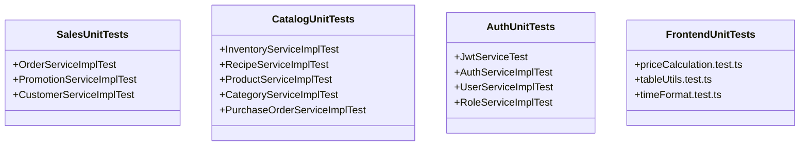
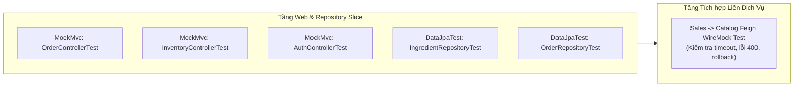

# KẾ HOẠCH TRIỂN KHAI UNIT TEST & INTEGRATION TEST
**Hệ thống Quản lý Nhà hàng & Gọi món Thông minh Smart POS & KDS**
*Phiên bản: 2.0 (Thu gọn E2E, tập trung chuyên sâu Unit & Integration)*

---

## 1. MỤC TIÊU & QUY ƯỚC KỸ THUẬT

### 1.1. Mục tiêu trọng tâm
* **Tập trung tuyệt đối vào 2 tầng:** **Unit Test (Kiểm thử đơn vị)** và **Integration Test (Kiểm thử tích hợp)**.
* Đảm bảo tính toàn vẹn của logic nghiệp vụ cốt lõi: định lượng món (BOM), trừ kho nguyên liệu, tính toán hóa đơn, áp dụng voucher, tích điểm và phân quyền bảo mật.
* Đạt chỉ số độ bao phủ mã nguồn (**Line Coverage**):
  * Tầng Nghiệp vụ (`Service Layer`): **$\ge 80\%$**
  * Tầng Giao tiếp (`Controller / Web Layer`): **$\ge 75\%$**
  * Tầng Dữ liệu (`Repository Queries`): **100%** các custom queries / atomic update queries.
  * Tầng Tiện ích Frontend (`Utils / Calculation`): **$\ge 90\%$**

### 1.2. Quy ước đặt tên & Cấu trúc Test Case
* **Mẫu đặt tên hàm:** `test<MethodName>_<Condition>_<ExpectedResult>`
  * *Ví dụ:* `testDeductInventory_InsufficientStock_ThrowsBusinessException`
* **Mô tả tường minh:** Luôn dùng `@DisplayName("...")` bằng tiếng Việt có dấu.
* **Cấu trúc triển khai 3A:**
  * **Arrange (Given):** Khởi tạo dữ liệu giả lập, thiết lập behavior cho Mock.
  * **Act (When):** Gọi phương thức cần kiểm thử.
  * **Assert (Then):** Kiểm tra kết quả trả về, bắt exception, xác minh tương tác (`verify`).

---

## 2. PHẦN I: KẾ HOẠCH CHI TIẾT UNIT TEST (KIỂM THỬ ĐƠN VỊ)

> [!NOTE]
> **Đặc điểm Unit Test:** Chạy cực nhanh (< 100ms/test), sử dụng **JUnit 5 + Mockito** (không nạp Spring context, không kết nối DB), cô lập hoàn toàn các dependency bên ngoài bằng `@Mock`.



---

### 2.1. Backend: `sales-service`

#### File 1: `com.smartpos.sales_service.service.OrderServiceImplTest` *(Mở rộng file hiện có)*
| Tên ca kiểm thử | Điều kiện kiểm thử | Kết quả mong đợi |
| :--- | :--- | :--- |
| `testCreateOrder_ValidDineIn_Success` | Đơn bàn 01, 2 món kèm topping | Lưu đơn `PENDING`, mã đơn `ORD-...`, tổng tiền đúng. |
| `testCreateOrder_EmptyItems_ThrowsBadRequest` | Danh sách món rỗng | Báo lỗi `BusinessException` / không tạo đơn. |
| `testCancelOrder_PendingStatus_Success` | Đơn đang `PENDING` | Status đổi sang `CANCELLED`, **không gọi trừ kho**. |
| `testCancelOrder_ConfirmedStatus_Success` | Đơn đang `CONFIRMED` | Status đổi sang `CANCELLED`, **không gọi trừ kho**. |
| `testCancelOrder_AlreadyCompleted_ThrowsException` | Đơn đang `COMPLETED` | Báo lỗi không cho phép hủy đơn đã hoàn tất. |
| `testUpdateOrderStatus_PendingToPreparing` | Đơn chuyển trạng thái hợp lệ | Status cập nhật thành `PREPARING`. |
| `testUpdateOrderStatus_InvalidTransition_ThrowsException` | Đơn `CANCELLED` muốn chuyển sang `COMPLETED` | Báo lỗi chuyển trạng thái phi logic. |
| `testCompleteOrder_CallsInventoryClient_Success` | Đơn chuyển sang `COMPLETED` | Gọi Feign sang Catalog trừ kho thành công. |
| `testCompleteOrder_AlreadyCompleted_DoesNotDeductAgain` | Đơn đã `COMPLETED` trước đó | Cơ chế Idempotency: không gọi Feign trừ kho lần 2. |
| `testCompleteOrder_InsufficientStock_ThrowsException` | Catalog báo lỗi thiếu nguyên liệu | Bắt `FeignException`, ném `BusinessException`, rollback đơn. |

#### File 2: `com.smartpos.sales_service.service.PromotionServiceImplTest` *(Tạo mới)*
| Tên ca kiểm thử | Điều kiện kiểm thử | Kết quả mong đợi |
| :--- | :--- | :--- |
| `testApplyPromotion_ValidPercentage_Success` | Đơn 200k, voucher 10% tối đa 30k | Giảm đúng 20.000đ, trạng thái `isValid = true`. |
| `testApplyPromotion_CapMaxDiscount_Success` | Đơn 500k, voucher 10% tối đa 30k | Giảm đúng trần 30.000đ (thay vì 50.000đ). |
| `testApplyPromotion_MinOrderAmountNotMet_ThrowsException` | Đơn 80k, voucher yêu cầu tối thiểu 100k | Ném `BusinessException("Chưa đạt giá trị đơn tối thiểu")`. |
| `testApplyPromotion_ExpiredVoucher_ThrowsException` | Voucher có `endDate` nhỏ hơn ngày hiện tại | Báo lỗi voucher đã hết hạn sử dụng. |
| `testApplyPromotion_UsageLimitExceeded_ThrowsException` | Voucher có `usedCount >= usageLimit` | Báo lỗi voucher đã hết lượt sử dụng. |
| `testApplyPromotion_InactiveVoucher_ThrowsException` | Voucher có `isActive = false` | Báo lỗi voucher đang bị vô hiệu hóa. |
| `testIncrementUsedCount_Success` | Đơn thanh toán hoàn tất | Trường `usedCount` tăng lên 1 đơn vị. |

#### File 3: `com.smartpos.sales_service.service.CustomerServiceImplTest` *(Tạo mới)*
| Tên ca kiểm thử | Điều kiện kiểm thử | Kết quả mong đợi |
| :--- | :--- | :--- |
| `testFindOrCreateCustomer_ExistingPhone_ReturnsCustomer` | SĐT `0901234567` đã có trong DB | Trả về thông tin khách hàng và số điểm hiện có. |
| `testFindOrCreateCustomer_NewPhone_CreatesQuickly` | SĐT mới chưa từng có | Tự động tạo khách mới với số điểm = 0. |
| `testEarnPointsOnCompletedOrder_Success` | Đơn thanh toán thực tế 250.000đ | Cộng 2.5 điểm (1%), lưu giao dịch loại `EARN`. |
| `testRedeemPoints_ValidPoints_DeductsSuccessfully` | Khách có 10 điểm, dùng 5 điểm | Trừ 5 điểm, giảm 5.000đ vào hóa đơn, lưu log `REDEEM`. |
| `testRedeemPoints_ExceedCurrentPoints_ThrowsException` | Khách có 3 điểm nhưng đòi dùng 5 điểm | Báo lỗi số điểm tích lũy không đủ. |
| `testRedeemPoints_ExceedOrderTotal_ThrowsException` | Hóa đơn 4.000đ nhưng đòi dùng 5 điểm (5.000đ) | Chặn không cho số tiền giảm lớn hơn hóa đơn. |

---

### 2.2. Backend: `catalog-inventory-service`

#### File 4: `com.smartpos.cataloginventory.service.InventoryServiceImplTest` *(Tạo mới - Trọng yếu)*
| Tên ca kiểm thử | Điều kiện kiểm thử | Kết quả mong đợi |
| :--- | :--- | :--- |
| `testDeductInventory_SufficientStock_Success` | Tồn kho thịt bò: 5kg, đơn cần 0.4kg | Tồn kho cập nhật còn 4.6kg, tạo log `OUT`. |
| `testDeductInventory_InsufficientStock_RollbackAll` | Mì đủ, nhưng thịt bò thiếu (cần 0.5kg, còn 0.1kg) | Ném `BusinessException`, không nguyên liệu nào bị trừ. |
| `testDeductInventory_DuplicateOrderCode_Idempotent` | Gửi request trừ kho 2 lần với cùng `orderCode` | Lần 2 phát hiện đã trừ, trả về kết quả thành công ngay. |
| `testDeductInventory_WithModifiers_DeductsCorrectly` | Món có thêm Topping (Trứng, Xúc xích) | Trừ cả nguyên liệu của món chính và của topping. |
| `testDeductInventory_ProductWithoutRecipe_SkipsDeduct` | Món không có định lượng (VD: Khăn lạnh) | Bỏ qua bước trừ kho an toàn, không báo lỗi. |

#### File 5: `com.smartpos.cataloginventory.service.RecipeServiceImplTest` *(Tạo mới)*
| Tên ca kiểm thử | Điều kiện kiểm thử | Kết quả mong đợi |
| :--- | :--- | :--- |
| `testGetRecipeByProductId_Success` | Món Mì cay Bò | Trả về danh sách gồm Mì gói (1 gói), Bò (100g), Nước lèo (500ml). |
| `testCreateRecipeItem_ValidQuantity_Success` | Thiết lập định lượng nguyên liệu cho món | Lưu thành công công thức vào bảng `recipes`. |
| `testCreateRecipeItem_NegativeQuantity_ThrowsException` | Định lượng có số lượng $\le 0$ | Báo lỗi định lượng không hợp lệ. |

#### File 6: `com.smartpos.cataloginventory.service.ProductServiceImplTest` *(Tạo mới)*
| Tên ca kiểm thử | Điều kiện kiểm thử | Kết quả mong đợi |
| :--- | :--- | :--- |
| `testCreateProduct_ValidCategory_Success` | Tạo món kèm `categoryId` hợp lệ | Lưu món thành công, trạng thái khả dụng = true. |
| `testCreateProduct_CategoryNotFound_ThrowsException` | `categoryId` không tồn tại | Ném `ResourceNotFoundException`. |
| `testUpdateProductStatus_ToggleAvailable` | Đổi trạng thái món từ Hết hàng sang Còn hàng | Lưu trạng thái mới vào CSDL. |
| `testDeleteProduct_ProductInOrders_SoftDeleteOrPrevent` | Xóa món ăn đang bán | Chuyển trạng thái `is_deleted = true` hoặc kiểm tra ràng buộc. |

#### File 7: `com.smartpos.cataloginventory.service.PurchaseOrderServiceImplTest` *(Tạo mới)*
| Tên ca kiểm thử | Điều kiện kiểm thử | Kết quả mong đợi |
| :--- | :--- | :--- |
| `testCompletePurchaseOrder_IncreasesStock_Success` | Nhập 10kg thịt bò từ nhà cung cấp | Tồn kho tăng thêm 10kg, tạo log `IN`. |
| `testCancelPurchaseOrder_PendingOrder_Success` | Hủy phiếu nhập đang chờ | Chuyển trạng thái `CANCELLED`, kho không thay đổi. |

---

### 2.3. Backend: `auth-service`

#### File 8: `com.smartpos.auth_service.service.JwtServiceTest` *(Tạo mới)*
| Tên ca kiểm thử | Điều kiện kiểm thử | Kết quả mong đợi |
| :--- | :--- | :--- |
| `testGenerateToken_ContainsClaims` | User `cashier`, Role `CASHIER` | Sinh chuỗi JWT hợp lệ chứa username, role và permissions. |
| `testValidateToken_ValidToken_ReturnsTrue` | Token vừa sinh còn hạn | Kết quả trả về `true`. |
| `testValidateToken_ExpiredToken_ReturnsFalseOrThrows` | Token có thời gian sinh ở quá khứ | Bắt lỗi token hết hạn. |
| `testValidateToken_TamperedSignature_ReturnsFalse` | Token bị sửa đổi payload bằng tay | Bắt lỗi sai chữ ký bảo mật. |

#### File 9: `com.smartpos.auth_service.service.AuthServiceImplTest` *(Tạo mới)*
| Tên ca kiểm thử | Điều kiện kiểm thử | Kết quả mong đợi |
| :--- | :--- | :--- |
| `testLogin_CorrectCredentials_Success` | Username & password khớp BCrypt | Trả về `AuthResponse` gồm Token & thông tin người dùng. |
| `testLogin_WrongPassword_ThrowsException` | Sai mật khẩu | Ném lỗi `BadCredentialsException`. |
| `testLogin_UserNotFound_ThrowsException` | Username không tồn tại | Ném lỗi không tìm thấy tài khoản. |
| `testRefreshToken_ValidToken_ReturnsNewToken` | Refresh Token hợp lệ | Thu hồi token cũ, cấp cặp Access/Refresh Token mới. |

---

### 2.4. Frontend: Unit Test Logic (`frontend/tests`)

#### File 10: `frontend/tests/priceCalculation.test.ts` *(Tạo mới)*
| Tên ca kiểm thử | Dữ liệu đầu vào | Kết quả mong đợi |
| :--- | :--- | :--- |
| `testCalculateSubtotal_SingleItemWithModifiers` | Món 45k + 2 Topping 10k $\times$ 2 phần | Đúng 130.000đ. |
| `testCalculateTotal_WithVoucherAndPoints` | Subtotal 150k, Voucher 15k, Dùng 5 điểm (5k) | Đúng 130.000đ. |
| `testCalculateTotal_DiscountExceedsTotal_ClampsToZero` | Subtotal 50k, Giảm giá 60k | Kết quả trả về 0đ (không bị âm tiền). |

#### File 11: `frontend/tests/tableUtils.test.ts` *(Tạo mới)*
| Tên ca kiểm thử | Dữ liệu đầu vào | Kết quả mong đợi |
| :--- | :--- | :--- |
| `testNormalizeTableId_StandardInputs` | `"Bàn 01"`, `"table-1"`, `"?table=1"`, `"1"` | Đều chuẩn hóa chính xác về số `1`. |
| `testNormalizeTableId_InvalidInputs` | `""`, `"abc"`, `null`, `undefined` | Trả về giá trị fallback an toàn (VD: `null` hoặc bàn mặc định). |

---

## 3. PHẦN II: KẾ HOẠCH CHI TIẾT INTEGRATION TEST (KIỂM THỬ TÍCH HỢP)

> [!IMPORTANT]
> **Đặc điểm Integration Test:** Kiểm thử sự kết hợp giữa nhiều thành phần (Controller + Validation + Mapper + Exception Handler, hoặc Service + Spring Data JPA + Database Dialect, hoặc Inter-Service Feign Communication).



---

### 3.1. Web Controller Slice Tests (`@WebMvcTest` & `MockMvc`)

Các test này kiểm tra việc bind tham số, xác thực dữ liệu đầu vào (`@Valid`), mã HTTP Status và cấu trúc `ApiResponse<T>`.

#### File 12: `com.smartpos.sales_service.controller.OrderControllerIntegrationTest`
* **Test cases:**
  1. `POST /api/orders` với body hợp lệ $\rightarrow$ Trả về **HTTP 201 Created**, body chứa `orderCode`.
  2. `POST /api/orders` với body thiếu `items` hoặc số lượng $\le 0$ $\rightarrow$ Trả về **HTTP 400 Bad Request** với danh sách trường lỗi validation.
  3. `GET /api/orders/{id}` tồn tại $\rightarrow$ Trả về **HTTP 200 OK**.
  4. `GET /api/orders/9999` không tồn tại $\rightarrow$ Trả về **HTTP 404 Not Found**.
  5. `DELETE /api/orders/{id}` hủy đơn thành công $\rightarrow$ Trả về **HTTP 200 OK**, trạng thái `CANCELLED`.

#### File 13: `com.smartpos.sales_service.controller.PromotionControllerIntegrationTest`
* **Test cases:**
  1. `POST /api/promotions/apply` với mã hợp lệ $\rightarrow$ Trả về **HTTP 200 OK**, số tiền giảm đúng.
  2. `POST /api/promotions/apply` với mã không tồn tại $\rightarrow$ Trả về **HTTP 400 Bad Request** kèm message chi tiết.

#### File 14: `com.smartpos.cataloginventory.controller.InventoryControllerIntegrationTest`
* **Test cases:**
  1. `POST /api/inventory/deduct` khi đủ kho $\rightarrow$ Trả về **HTTP 200 OK**, message `"Trừ kho thành công"`.
  2. `POST /api/inventory/deduct` khi thiếu kho $\rightarrow$ Trả về **HTTP 400 Bad Request**, json phản hồi chứa `error: "INSUFFICIENT_STOCK"` và tên nguyên liệu thiếu.

#### File 15: `com.smartpos.auth_service.controller.AuthControllerIntegrationTest`
* **Test cases:**
  1. `POST /api/auth/login` đúng thông tin $\rightarrow$ Trả về **HTTP 200 OK**, Header `Set-Cookie` có cờ `HttpOnly; Path=/api/auth`.
  2. `POST /api/auth/login` sai mật khẩu $\rightarrow$ Trả về **HTTP 401 Unauthorized**.

---

### 3.2. Data JPA Repository Tests (`@DataJpaTest`)

Kiểm thử trực tiếp trên tầng truy vấn dữ liệu (sử dụng H2 database hoặc test container) để đảm bảo câu lệnh SQL / JPQL hoạt động chuẩn xác:

#### File 16: `com.smartpos.cataloginventory.repository.IngredientRepositoryTest`
* **Mục tiêu:** Kiểm tra truy vấn cập nhật trừ tồn an toàn (Atomic Update):
  ```java
  @Modifying
  @Query("UPDATE Ingredient i SET i.currentStock = i.currentStock - :qty WHERE i.id = :id AND i.currentStock >= :qty")
  int deductStockIfSufficient(@Param("id") Long id, @Param("qty") BigDecimal qty);
  ```
* **Test cases:**
  1. `deductStockIfSufficient` khi tồn kho = 10, trừ 3 $\rightarrow$ update thành công, trả về số dòng ảnh hưởng = `1`.
  2. `deductStockIfSufficient` khi tồn kho = 2, đòi trừ 5 $\rightarrow$ update không thực hiện, trả về số dòng ảnh hưởng = `0` (ngăn chặn triệt để tồn kho âm).

#### File 17: `com.smartpos.sales_service.repository.OrderRepositoryTest`
* **Test cases:**
  1. Lưu đơn hàng dạng Cascade: Lưu `Order` tự động lưu danh sách `OrderItem`.
  2. Tìm kiếm đơn theo số bàn và danh sách trạng thái: `findByTableNumberAndStatusIn(...)`.

---

### 3.3. Inter-Service Feign Integration Test (Sales $\longleftrightarrow$ Catalog)

#### File 18: `com.smartpos.sales_service.integration.SalesToCatalogFeignIntegrationTest`
* **Mục tiêu:** Kiểm tra hành vi tích hợp giữa `sales-service` và `catalog-inventory-service` thông qua OpenFeign.
* **Môi trường giả lập:** Dùng `wiremock-spring-boot` hoặc `feign.mock.FeignMock` để đóng giả service Catalog tại cổng giả lập.
* **Kịch bản kiểm thử:**
  1. **Thành công (Happy Path):** Sales gọi `POST /api/inventory/deduct`, Catalog Mock trả về `200 OK` $\rightarrow$ Sales cập nhật đơn thành `COMPLETED`.
  2. **Kho thiếu hàng (Business Error):** Catalog Mock trả về `400 Bad Request` kèm body lỗi hết thịt bò $\rightarrow$ Sales bắt `FeignException.BadRequest`, ném `BusinessException`, rollback đơn hàng và giữ nguyên trạng thái cũ.
  3. **Dịch vụ Catalog sập / Timeout (Network Failure):** Catalog Mock trả về `503 Service Unavailable` hoặc phản hồi chậm quá 5 giây $\rightarrow$ Sales xử lý timeout an toàn, báo lỗi hệ thống, không để giao dịch bị treo.

---

### 3.4. Security & RBAC Integration Test (`auth-service`)

#### File 19: `com.smartpos.auth_service.security.RbacSecurityIntegrationTest`
* **Test cases (sử dụng `@WithMockUser`):**
  1. Người dùng chưa đăng nhập gọi API riêng tư `/api/users` $\rightarrow$ Trả về **HTTP 401 Unauthorized**.
  2. Người dùng mang Role `CASHIER` cố tình gọi API xóa nhân viên `/api/users/{id}` $\rightarrow$ Trả về **HTTP 403 Forbidden**.
  3. Người dùng mang Role `ADMIN` gọi API quản lý hệ thống $\rightarrow$ Trả về **HTTP 200 OK**.

---

## 4. DANH MỤC TẤT CẢ CÁC TỆP TEST CẦN TRIỂN KHAI (CHECKLIST)

| STT | Tên tệp kiểm thử | Tầng kiểm thử | Phân hệ | Mức độ ưu tiên | Trạng thái hiện tại |
| :---: | :--- | :---: | :---: | :---: | :---: |
| 1 | `OrderServiceImplTest.java` *(mở rộng)* | Unit Test | `sales-service` | **P0** | Đã có 4 test, cần thêm 6 test |
| 2 | `PromotionServiceImplTest.java` | Unit Test | `sales-service` | **P0** | Chưa có (Cần tạo mới) |
| 3 | `CustomerServiceImplTest.java` | Unit Test | `sales-service` | **P1** | Chưa có (Cần tạo mới) |
| 4 | `InventoryServiceImplTest.java` | Unit Test | `catalog-inventory` | **P0** | Chưa có (Cần tạo mới) |
| 5 | `RecipeServiceImplTest.java` | Unit Test | `catalog-inventory` | **P0** | Chưa có (Cần tạo mới) |
| 6 | `ProductServiceImplTest.java` | Unit Test | `catalog-inventory` | **P1** | Chưa có (Cần tạo mới) |
| 7 | `PurchaseOrderServiceImplTest.java` | Unit Test | `catalog-inventory` | **P2** | Chưa có (Cần tạo mới) |
| 8 | `JwtServiceTest.java` | Unit Test | `auth-service` | **P0** | Chưa có (Cần tạo mới) |
| 9 | `AuthServiceImplTest.java` | Unit Test | `auth-service` | **P0** | Chưa có (Cần tạo mới) |
| 10 | `priceCalculation.test.ts` | Unit Test | `frontend` | **P0** | Chưa có (Cần tạo mới) |
| 11 | `tableUtils.test.ts` | Unit Test | `frontend` | **P1** | Chưa có (Cần tạo mới) |
| 12 | `OrderControllerIntegrationTest.java` | Integration | `sales-service` | **P1** | Chưa có (Cần tạo mới) |
| 13 | `InventoryControllerIntegrationTest.java` | Integration | `catalog-inventory` | **P1** | Chưa có (Cần tạo mới) |
| 14 | `AuthControllerIntegrationTest.java` | Integration | `auth-service` | **P1** | Chưa có (Cần tạo mới) |
| 15 | `IngredientRepositoryTest.java` | Integration | `catalog-inventory` | **P0** | Chưa có (Cần tạo mới) |
| 16 | `SalesToCatalogFeignIntegrationTest.java` | Integration | Inter-Service | **P0** | Chưa có (Cần tạo mới) |
| 17 | `RbacSecurityIntegrationTest.java` | Integration | `auth-service` | **P1** | Chưa có (Cần tạo mới) |

---

## 5. THIẾT LẬP KỸ THUẬT & CÁC BƯỚC THỰC THI (EXECUTION GUIDE)

### Bước 1: Bổ sung JaCoCo Maven Plugin vào Parent POM
Mở file `backend/pom.xml` và thêm cấu hình đo độ bao phủ vào thẻ `<build><plugins>`:
```xml
<plugin>
    <groupId>org.jacoco</groupId>
    <artifactId>jacoco-maven-plugin</artifactId>
    <version>0.8.12</version>
    <executions>
        <execution>
            <goals>
                <goal>prepare-agent</goal>
            </goals>
        </execution>
        <execution>
            <id>report</id>
            <phase>test</phase>
            <goals>
                <goal>report</goal>
            </goals>
        </execution>
    </executions>
</plugin>
```

### Bước 2: Tạo cấu hình Test Profile cho Backend
Trong từng module backend (`sales-service`, `catalog-inventory-service`, `auth-service`), tạo tệp `src/test/resources/application-test.yml`:
* Sử dụng H2 database hoặc mock credentials để khi chạy lệnh `mvn test` không bị phụ thuộc vào database PostgreSQL thật.

### Bước 3: Lệnh chạy kiểm thử và xem kết quả

* **Chạy toàn bộ Unit Test & Integration Test Backend:**
  ```powershell
  mvn -f backend/pom.xml clean test
  ```
* **Chạy riêng test của từng service:**
  ```powershell
  # Kiểm thử riêng sales-service
  mvn -f backend/services/sales-service/pom.xml test

  # Kiểm thử riêng catalog-inventory-service
  mvn -f backend/services/catalog-inventory-service/pom.xml test

  # Kiểm thử riêng auth-service
  mvn -f backend/services/auth-service/pom.xml test
  ```
* **Chạy kiểm thử Frontend:**
  ```powershell
  cd frontend
  npm test
  ```
* **Xem báo cáo Code Coverage HTML sinh bởi JaCoCo:**
  Mở trình duyệt xem tệp:
  `backend/services/<service-name>/target/site/jacoco/index.html`

---

## 6. TIÊU CHÍ NGHIỆM THU TEST (DEFINITION OF DONE)
1. **100% các ca kiểm thử đạt kết quả PASS (0 Failures, 0 Errors).**
2. **Không có bất kỳ kiểm thử nào bị phụ thuộc thứ tự chạy** (chạy độc lập hoặc chạy theo cụm đều có cùng kết quả).
3. **Thời gian chạy bộ Unit Test toàn dự án không quá 30 giây.**
4. **Báo cáo JaCoCo xác nhận Service Layer đạt tối thiểu 80% Line Coverage.**
