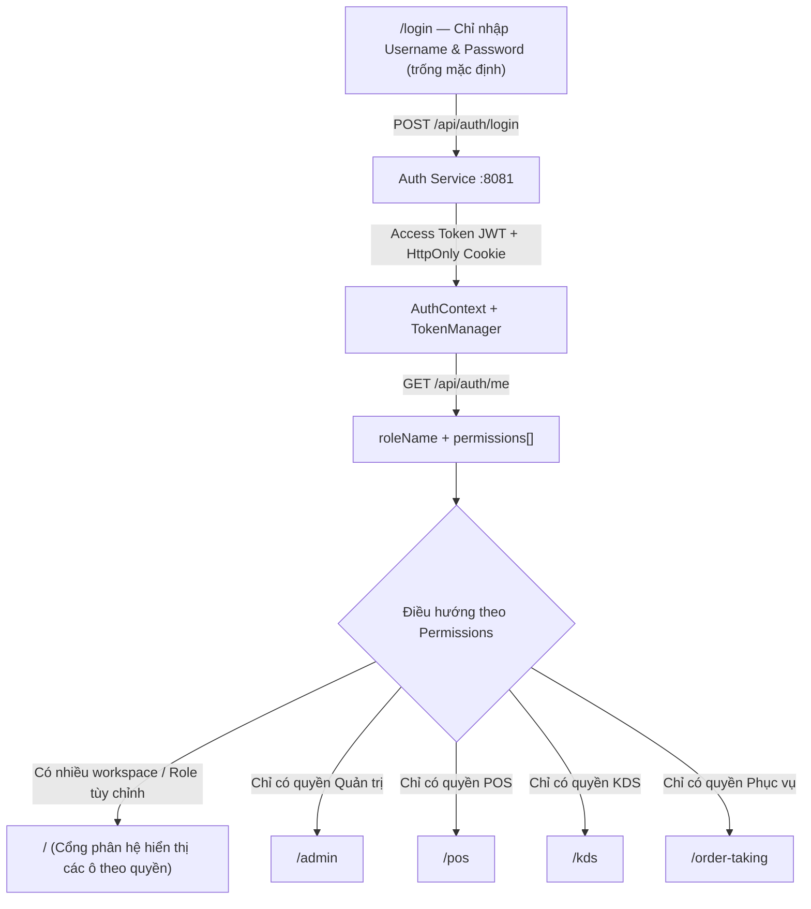

# KẾ HOẠCH CHUẨN HÓA ĐĂNG NHẬP THỰC TẾ & PHÂN QUYỀN ĐỘNG TOÀN DIỆN (PHASE 2)

> **Dự án:** Smart POS & KDS (Hệ thống Quản lý Nhà hàng & Gọi món Thông minh)  
> **Phạm vi:** Hoàn thiện UX Đăng nhập thuần túy (`username` + `password`), đồng bộ Seed Data & chuyển đổi phân quyền Frontend từ **Role cố định** sang **Dynamic Permissions**  
> **Tài liệu liên quan:** [KE_HOACH_HOAN_THIEN_AUTH_SERVICE.md](./KE_HOACH_HOAN_THIEN_AUTH_SERVICE.md)  
> **Trạng thái:** Sẵn sàng triển khai (Ready for Implementation)

---

## 1. BỐI CẢNH & CÁC VẤN ĐỀ PHÁT HIỆN SAU ĐỢT REVIEW

Sau khi kiểm tra mã nguồn hiện tại của `auth-service` và `frontend`, luồng xác thực JWT nền tảng đã hoạt động và vượt qua toàn bộ bộ test trước đó. Tuy nhiên, còn **5 điểm bất cập** khiến trải nghiệm đăng nhập và tính chất **"phân quyền linh động"** chưa thật sự trọn vẹn:

| Mã vấn đề | Vị trí trong code | Mô tả chi tiết vấn đề | Mức độ |
| :--- | :--- | :--- | :--- |
| **UX-01** | `frontend/src/components/auth/LoginForm.tsx` | Vẫn hiển thị khối **"Chọn nhanh tài khoản Demo"** (`DEMO_ACCOUNTS`) với 5 nút Role ở cột trái và điền sẵn `admin` / `12345678` vào form, gây hiểu nhầm là đăng nhập cố định theo Role và làm lộ mật khẩu ở client. | **Cao** |
| **RBAC-01** | `RoleGate.tsx`, `pos/layout.tsx`, `kds/layout.tsx`, `order-taking/layout.tsx`, `admin/layout.tsx` | Các trang vẫn đang khóa cứng theo tên Role (`["cashier"]`, `["chef"]`, `["waiter"]`). Nếu Admin tạo một Role mới trên hệ thống (ví dụ `SHIFT_LEAD` có quyền vừa POS vừa KDS), nhân viên giữ Role đó **vẫn bị chặn** khi vào `/pos` hoặc `/kds`. | **Nghiêm trọng** |
| **RBAC-02** | `frontend/src/app/page.tsx` & `RoleGate.tsx` | Khi người dùng đã đăng nhập nhưng thiếu quyền truy cập một trang, `RoleGate` đẩy về `/`. Nhưng `app/page.tsx` hiện chỉ `redirect("/login")`, làm người dùng bị văng ngược về màn hình Login thay vì thấy cổng phân hệ hoặc trang báo lỗi `403`. | **Cao** |
| **SEED-01** | `init-scripts/02-seed-data.sql`, `DataInitializer.java`, `application.yaml` | 1) `02-seed-data.sql` nạp `admin` và `cashier01` với hash BCrypt cũ không khớp `12345678`, khiến `DataInitializer` bỏ qua 2 user này.<br>2) `application.yaml` đang comment `profiles.active: dev` nên nếu quên truyền env khi chạy, `DataInitializer` không nạp bảng `permissions` và `role_permissions` (gây lỗi `403`).<br>3) `assignPermissions()` cộng dồn quyền mỗi lần khởi động lại, có thể ghi đè lại thay đổi quyền Admin vừa chỉnh sửa. | **Nghiêm trọng** |
| **UI-01** | `AdminSidebar.tsx`, `WorkspaceSidebar.tsx`, `admin/staff/page.tsx` | 1) Nút **Đăng xuất** ở 2 Sidebar mới chỉ `router.push("/login")`, chưa gọi `await logout()` để thu hồi Refresh Token.<br>2) Trang `/admin/staff` mới có CRUD nhân viên & gán Role, **chưa có giao diện tạo/sửa Role và tick chọn Permission động** (`PUT /api/roles/{id}/permissions`). | **Trung bình** |

---

## 2. KIẾN TRÚC LUỒNG ĐĂNG NHẬP & PHÂN QUYỀN ĐỘNG MỤC TIÊU



---

## 3. KẾ HOẠCH TRIỂN KHAI CHI TIẾT (4 GIAI ĐOẠN)

### GIAI ĐOẠN A: Chuẩn hóa Seed Data & Quyền Hạt Nhân (Backend)
> **Mục tiêu:** Mọi tài khoản khởi tạo đồng nhất mật khẩu, có quyền phân tách rõ từng màn hình nghiệp vụ, và không ghi đè cấu hình quyền động khi restart.

- [ ] **A.1. Bổ sung mã Permission phân tách rõ từng phân hệ trong `DataInitializer.java`**
  - Giữ nguyên 26 quyền hiện có và bổ sung các quyền truy cập màn hình / nghiệp vụ chuyên biệt để `RoleGate` kiểm tra độc lập với tên Role:
    - `ADMIN_DASHBOARD` (module `REPORT` hoặc `SYSTEM`): Truy cập khu vực quản trị `/admin`.
    - `POS_ACCESS` & `PAYMENT_PROCESS` (module `ORDER`): Truy cập quầy thu ngân `/pos` và xử lý thanh toán.
    - `KDS_VIEW` & `KDS_UPDATE` (module `KDS`): Truy cập màn hình bếp `/kds` và cập nhật trạng thái chế biến.
    - `ORDER_TAKING_ACCESS` (module `ORDER`): Truy cập màn hình phục vụ gọi món tại bàn `/order-taking`.
  - Cập nhật gán quyền mặc định cho 5 Role:
    - `ADMIN`: Toàn bộ quyền.
    - `MANAGER`: Toàn bộ quyền nghiệp vụ (`ADMIN_DASHBOARD`, `POS_ACCESS`, `PAYMENT_PROCESS`, `KDS_VIEW`, `MENU_*`, `ORDER_*`, `INVENTORY_*`, `REPORT_VIEW`, `USER_READ`, `ROLE_READ*`).
    - `CASHIER`: `MENU_READ`, `POS_ACCESS`, `PAYMENT_PROCESS`, `ORDER_CREATE`, `ORDER_READ`, `ORDER_UPDATE`, `ORDER_CANCEL`, `REPORT_VIEW`.
    - `CHEF`: `MENU_READ`, `KDS_VIEW`, `KDS_UPDATE`, `ORDER_READ`, `ORDER_UPDATE`, `INVENTORY_VIEW`.
    - `WAITER`: `MENU_READ`, `ORDER_TAKING_ACCESS`, `ORDER_CREATE`, `ORDER_READ`, `ORDER_UPDATE`.

- [ ] **A.2. Sửa cơ chế Idempotent trong `DataInitializer.assignPermissions()`**
  - Chỉ gán quyền mặc định khi Role đó **chưa có quyền nào** (`if (role.getPermissions().isEmpty())`) hoặc dùng cờ khởi tạo lần đầu, để tránh việc Admin vừa bỏ tick 1 quyền trên UI nhưng restart backend lại tự động cộng lại quyền đó.
  - Với các permission mới được thêm vào hệ thống sau này, cân nhắc chỉ tự gán cho `ADMIN`.

- [ ] **A.3. Đồng bộ `init-scripts/02-seed-data.sql` và `application.yaml`**
  - **Trong `02-seed-data.sql`:** Xóa bỏ phần chèn 2 user `admin` và `cashier01` dùng hash BCrypt cũ (hoặc thay đúng hash BCrypt của `12345678` và nạp đủ `permissions` / `role_permissions`), tránh xung đột mật khẩu với `DataInitializer`. Khuyến nghị để `DataInitializer` tự seed user & quyền khi CSDL trống.
  - **Trong `backend/services/auth-service/src/main/resources/application.yaml`:** Đặt `spring.profiles.default: dev` (hoặc bỏ comment `profiles.active: dev` cho cấu hình local) để khi chạy service không bị quên profile khiến bảng quyền bị trống.

---

### GIAI ĐOẠN B: Chuẩn hóa Màn hình Đăng nhập Thuần túy (Frontend)
> **Mục tiêu:** Giao diện đăng nhập không còn gợi ý/chọn Role cố định hay hardcode mật khẩu.

- [ ] **B.1. Gỡ bỏ khối "Chọn nhanh tài khoản Demo" trong `LoginForm.tsx`**
  - Xóa mảng `DEMO_ACCOUNTS`, interface `DemoAccount`, hàm `handleSelectDemo` và phần render `DEMO_ACCOUNTS.map(...)` ở cột trái.
  - Giữ cột trái thuần túy làm phần nhận diện thương hiệu SmartPOS và mô tả ngắn gọn quy trình đăng nhập bằng tài khoản nhân viên do quản lý cấp.
  - Đặt trạng thái khởi tạo form thành rỗng:
    ```ts
    const [username, setUsername] = useState("");
    const [password, setPassword] = useState("");
    ```
  - Xử lý liên kết `"Quên mật khẩu?"`: Thay bằng modal/thông báo ngắn hướng dẫn *"Vui lòng liên hệ Quản lý / Quản trị viên để được cấp lại mật khẩu qua trang Quản lý nhân sự"* (do hệ thống nội bộ nhà hàng không dùng OTP email).

- [ ] **B.2. Xây dựng hàm điều hướng thông minh sau đăng nhập (`resolveLandingRoute`)**
  - Tạo helper dùng chung (ví dụ trong `frontend/src/lib/auth-routing.ts`):
    - Kiểm tra theo **Permissions** (và fallback Role nếu cần):
      - Nếu user có từ **2 phân hệ trở lên** (ví dụ `ADMIN`, `MANAGER`, hoặc Role tùy chỉnh `SHIFT_LEAD` có cả `POS_ACCESS` và `KDS_VIEW`) → điều hướng về `"/"` (Trang Cổng phân hệ) hoặc `/admin` (nếu có `ADMIN_DASHBOARD`).
      - Nếu chỉ có `POS_ACCESS` → `/pos`.
      - Nếu chỉ có `KDS_VIEW` → `/kds`.
      - Nếu chỉ có `ORDER_TAKING_ACCESS` → `/order-taking`.
      - Nếu không có quyền phân hệ nào → `"/"` (hiển thị thông báo liên hệ Admin cấp quyền).

---

### GIAI ĐOẠN C: Nâng cấp Trang Chủ Portal & Bảo vệ Route theo Dynamic Permission
> **Mục tiêu:** Bất kỳ Role tùy biến nào có đủ Permission đều truy cập đúng phân hệ và không bị redirect vòng lặp về `/login`.

- [ ] **C.1. Biến trang chủ `frontend/src/app/page.tsx` thành Workspace Portal động**
  - Khi `isLoading === true`: hiển thị spinner kiểm tra phiên.
  - Khi `!isAuthenticated`: điều hướng sang `/login`.
  - Khi đã đăng nhập (`isAuthenticated === true`):
    - Hiển thị thông tin nhân viên đang đăng nhập (`fullName`, `username`, `roleName`) và nút **Đăng xuất** + **Đổi mật khẩu**.
    - Hiển thị các **Card phân hệ được phép truy cập** dựa trên `hasPermission(...)`:
      - Card **Quản trị hệ thống (`/admin`)**: hiện khi có `ADMIN_DASHBOARD` hoặc `REPORT_VIEW` / `USER_READ`.
      - Card **Quầy Thu ngân (`/pos`)**: hiện khi có `POS_ACCESS` hoặc `ORDER_CREATE`.
      - Card **Điều phối Bếp (`/kds`)**: hiện khi có `KDS_VIEW`.
      - Card **Phục vụ Gọi món (`/order-taking`)**: hiện khi có `ORDER_TAKING_ACCESS`.
      - Card **Thực đơn khách (`/menu`)**: luôn truy cập được.

- [ ] **C.2. Nâng cấp `RoleGate.tsx` hỗ trợ `requiredPermissions`**
  - Cập nhật props của `RoleGate`:
    ```ts
    interface RoleGateProps {
      allowedRoles?: readonly string[];
      requiredPermissions?: readonly string[];
      requireAllPermissions?: boolean; // mặc định false (chỉ cần 1 trong các quyền)
      children: ReactNode;
    }
    ```
  - Logic kiểm tra:
    - Nếu `!isAuthenticated` → `router.replace("/login")`.
    - Nếu `hasRole("ADMIN")` → cho phép.
    - Nếu có `requiredPermissions` → kiểm tra qua `hasPermission(...)`.
    - Nếu có `allowedRoles` → giữ hỗ trợ tương thích ngược qua `hasRole(...)`.
    - **Khi đã đăng nhập nhưng KHÔNG đủ quyền:** Thay vì gọi `router.replace("/")` một cách im lặng, hiển thị giao diện **403 - Không có quyền truy cập** kèm nút quay về `"/"` (Cổng phân hệ) hoặc nút quay lại trang trước.

- [ ] **C.3. Cập nhật `layout.tsx` của các phân hệ sang kiểm tra theo Permission**
  - `frontend/src/app/admin/layout.tsx`: `requiredPermissions={["ADMIN_DASHBOARD", "USER_READ", "REPORT_VIEW", "MENU_CREATE", "INVENTORY_VIEW"]}` (hoặc `ADMIN_DASHBOARD`).
  - `frontend/src/app/pos/layout.tsx`: `requiredPermissions={["POS_ACCESS"]}`.
  - `frontend/src/app/kds/layout.tsx`: `requiredPermissions={["KDS_VIEW"]}`.
  - `frontend/src/app/order-taking/layout.tsx`: `requiredPermissions={["ORDER_TAKING_ACCESS"]}`.

- [ ] **C.4. Sửa nút Đăng xuất tại `AdminSidebar.tsx` và `WorkspaceSidebar.tsx`**
  - Import `useAuth()` từ `@/lib/auth-context`.
  - Đổi sự kiện `onClick` của nút "Đăng xuất" ở cả 2 Sidebar thành:
    ```ts
    await logout();
    router.push("/login");
    ```

---

### GIAI ĐOẠN D: Giao diện Quản trị Role & Phân quyền Động + Đổi mật khẩu Cá nhân
> **Mục tiêu:** Admin tạo được Role mới và tick chọn Permission trực tiếp trên UI; nhân viên tự đổi được mật khẩu của mình.

- [ ] **D.1. Bổ sung API Role & Permission vào `frontend/src/lib/api.ts`**
  - `fetchPermissions(module?: string)` → `GET /api/permissions`
  - `fetchRoleDetail(roleId: number)` / `fetchRolePermissions(roleId: number)` → `GET /api/roles/{roleId}/permissions`
  - `createRole(data: { name: string; description: string })` → `POST /api/roles`
  - `updateRole(id: number, data: { name: string; description: string })` → `PUT /api/roles/{id}`
  - `deleteRole(id: number)` → `DELETE /api/roles/{id}`
  - `replaceRolePermissions(roleId: number, permissionIds: number[])` → `PUT /api/roles/{roleId}/permissions`

- [ ] **D.2. Bổ sung Tab "Vai trò & Phân quyền" tại `frontend/src/app/admin/staff/page.tsx`**
  - Thêm tab `"roles"` cạnh tab `"staff"` (ẩn/disable theo quyền `ROLE_READ` và `ROLE_MANAGE_PERMISSIONS`).
  - Danh sách Roles hiển thị badge `Hệ thống` (`isSystem = true`, khóa sửa tên/xóa) và `Tùy chỉnh` (`isSystem = false`, cho phép sửa/xóa).
  - Bảng/Modal cấu hình **Ma trận Quyền (Permissions Matrix)** gom nhóm theo `module` (`USER`, `ROLE`, `MENU`, `ORDER`, `KDS`, `INVENTORY`, `REPORT`), cho phép Admin tick/bỏ tick từng quyền và bấm **Lưu phân quyền** (`PUT /api/roles/{id}/permissions`).

- [ ] **D.3. Giao diện Đổi mật khẩu cho người dùng hiện tại**
  - Thêm modal `ChangePasswordModal.tsx` gọi hàm `changePassword(oldPassword, newPassword)` đã có sẵn trong `frontend/src/lib/api.ts` (nối với `PUT /api/auth/change-password`), gắn nút mở từ trang Portal `/` hoặc từ `TopHeader`.
  - Sau khi đổi mật khẩu thành công, thông báo rõ và điều hướng về `/login` để đăng nhập lại bằng mật khẩu mới (do backend thu hồi toàn bộ refresh token cũ).

---

## 4. KẾ HOẠCH KIỂM THỬ BỔ SUNG (KHÔNG CẦN E2E TEST)

### 4.1. Backend (`auth-service`)
- [ ] **`DataInitializerTest`** *(mới)*:
  - Test chạy `DataInitializer.run()` lần 1 tạo đủ 5+ roles, các permissions mới (`ADMIN_DASHBOARD`, `POS_ACCESS`, `KDS_VIEW`, `KDS_UPDATE`, `ORDER_TAKING_ACCESS`, `PAYMENT_PROCESS`) và 10 users.
  - Test tính idempotent: nếu Admin đã thay đổi permissions của một role (không còn rỗng), chạy lại `DataInitializer` không ghi đè mất cấu hình tùy chỉnh.
- [ ] **`JwtServiceTest` & `AuthControllerIntegrationTest`** *(cập nhật)*:
  - Xác minh Access Token và `GET /api/auth/me` trả về đầy đủ danh sách permissions mới theo role.

### 4.2. Frontend (`node --test`)
- [ ] **`auth-routing.test.ts`** *(mới)*:
  - Test `resolveLandingRoute()` với user chỉ có `KDS_VIEW` → `/kds`.
  - Test với user chỉ có `POS_ACCESS` → `/pos`.
  - Test với user chỉ có `ORDER_TAKING_ACCESS` → `/order-taking`.
  - Test với Role tùy chỉnh (ví dụ `SHIFT_LEAD` có cả `POS_ACCESS` + `KDS_VIEW`) → `/` (Portal).
  - Test với `ADMIN` / `MANAGER` → `/admin` (hoặc `/`).
- [ ] **`role-gate-logic.test.ts`** *(mới)*:
  - Tách helper thuần `evaluateGateAccess({ isAuthenticated, roleName, permissions, allowedRoles, requiredPermissions, requireAllPermissions })` để unit test trực tiếp bằng `node --test`:
    - Chưa đăng nhập → trả trạng thái `redirect_login`.
    - `ADMIN` luôn trả `allowed`.
    - Role tùy chỉnh không nằm trong `allowedRoles` nhưng có quyền khớp `requiredPermissions` → trả `allowed`.
    - Đã đăng nhập nhưng thiếu cả role lẫn permission → trả `forbidden` (hiển thị màn hình 403, không đá về `/login`).
- [ ] **Kiểm tra Build & Typecheck**:
  - Chạy `npx tsc -p frontend/tsconfig.json --noEmit` đạt 0 lỗi.
  - Chạy `npm --prefix frontend test` và `mvn -f backend/services/auth-service/pom.xml test` đạt 100% Pass.

---

## 5. TIÊU CHÍ NGHIỆM THU CHO PHASE 2

- [ ] Trang `/login` chỉ gồm 2 ô nhập `Tên đăng nhập` và `Mật khẩu` (rỗng mặc định), không còn nút chọn Role demo cố định.
- [ ] Đăng nhập bằng bất kỳ tài khoản nào (kể cả tài khoản mới tạo ở `/admin/staff` hoặc gán Role tùy chỉnh) đều tự động nhận đúng Role và Permissions từ backend.
- [ ] Khi Admin tạo Role mới (ví dụ `SHIFT_LEAD`) và tick chọn quyền `POS_ACCESS` + `KDS_VIEW` trên giao diện `/admin/staff`, tài khoản giữ Role đó đăng nhập xong sẽ thấy cả 2 phân hệ trên Portal `/` và vào được cả `/pos` lẫn `/kds`.
- [ ] Bấm **Đăng xuất** ở bất kỳ đâu (`TopHeader`, `AdminSidebar`, `WorkspaceSidebar`) đều thu hồi Refresh Token phía backend.
- [ ] Các tài khoản `admin`, `cashier01` và toàn bộ tài khoản seed còn lại đều đăng nhập được đồng nhất bằng mật khẩu `12345678` ngay sau khi chạy `scripts/reset-db.ps1` và khởi động `auth-service`.
