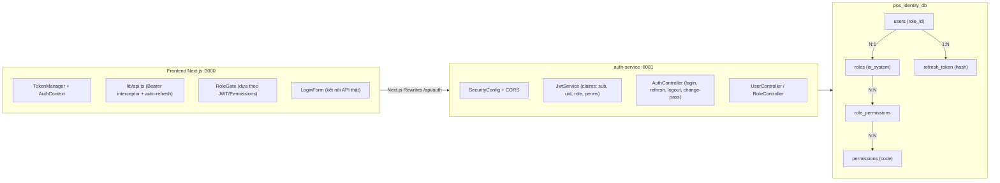
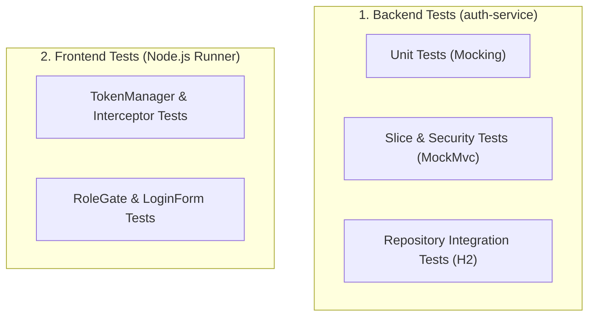

# BẢN KẾ HOẠCH HOÀN THIỆN TOÀN DIỆN AUTH SERVICE
**Hệ thống:** Smart POS & KDS (Quản lý Nhà hàng & Gọi món Thông minh)  
**Học phần:** Đồ án Chuyên ngành (DACN) · Nhóm 2B  
**Mô hình Phân quyền đã chốt:** **1-N giữa Role và User** (`users.role_id`) & **N-N giữa Role và Permission** (`role_permissions`).  
**Trạng thái kế hoạch:** ĐÃ CHỐT KIẾN TRÚC & SẴN SÀNG THỰC THI

---

## MỤC LỤC
1. [Khung Kiến trúc Đã Thống nhất](#1-khung-kiến-trúc-đã-thống-nhất)
2. [Ma trận Khắc phục Lỗ hổng (GAP Analysis)](#2-ma-trận-khắc-phục-lỗ-hổng-gap-analysis)
3. [Lộ trình Triển khai 6 Giai đoạn](#3-lộ-trình-triển-khai-6-giai-đoạn)
   - [Giai đoạn 1: Chuẩn hóa CSDL & Dữ liệu Seed (Backend)](#giai-đoạn-1-chuẩn-hóa-csdl--dữ-liệu-seed-backend)
   - [Giai đoạn 2: Hoàn thiện Backend Core (JWT, Security, Endpoints)](#giai-đoạn-2-hoàn-thiện-backend-core-jwt-security-endpoints)
   - [Giai đoạn 3: Tích hợp Định tuyến Proxy & Gateway](#giai-đoạn-3-tích-hợp-định-tuyến-proxy--gateway)
   - [Giai đoạn 4: Hoàn thiện Frontend Auth & Tích hợp UI](#giai-đoạn-4-hoàn-thiện-frontend-auth--tích-hợp-ui)
   - [Giai đoạn 5: Hệ thống Kiểm thử Toàn diện (Unit & Integration Tests)](#giai-đoạn-5-hệ-thống-kiểm-thử-toàn-diện-unit--integration-tests)
   - [Giai đoạn 6: Đóng băng & Thu thập Minh chứng Nghiệm thu](#giai-đoạn-6-đóng-băng--thu-thập-minh-chứng-nghiệm-thu)
4. [Kế hoạch Phân công Công việc & Tiến độ](#4-kế-hoạch-phân-công-công-việc--tiến-độ)
5. [Tiêu chuẩn Nghiệm thu (Definition of Done - DoD)](#5-tiêu-chuẩn-nghiệm-thu-definition-of-done---dod)

---

## 1. Khung Kiến trúc Đã Thống nhất

Hệ thống triển khai mô hình **Dynamic RBAC phân tầng**:
- **Tầng Quản lý Nhân sự (1 - N):** 1 nhân viên chỉ giữ 1 vai trò chính tại một thời điểm (`users.role_id`). Nếu nhân viên kiêm nhiệm, Admin tạo Role kiêm nhiệm (ví dụ: `SHIFT_LEAD` - Trưởng ca gồm quyền Bếp + Thu ngân).
- **Tầng Phân quyền Nghiệp vụ (N - N):** Mỗi Role là một tập hợp các quyền hạt nhân (`role_permissions`). Admin có thể thêm/bớt quyền trực tiếp từ UI mà không cần sửa code.



---

## 2. Ma trận Khắc phục Lỗ hổng (GAP Analysis)

| Mã lỗi | Mức độ | Hiện trạng tồn đọng | Giải pháp xử lý cụ thể |
| :--- | :--- | :--- | :--- |
| **GAP-01** | **P0** | File SQL `01-init-all-databases.sql` dùng `user_roles`, thiếu `roles.is_system`, thiếu bảng `refresh_token`. Hibernate chạy `ddl-auto: validate` sẽ crash app khi boot. | Viết migration `05-migration-identity-db.sql`, cập nhật trực tiếp `01-init-all-databases.sql` sang quan hệ 1-N (`users.role_id`) và tạo bảng `refresh_token`. |
| **GAP-02** | **P0** | `application.yaml` của Auth đặt mặc định `AUTH_DB_NAME: auth_db` và `AUTH_DB_USER: auth_user` (lệch với Docker). | Đổi giá trị fallback mặc định sang `pos_identity_db` và user `pos_admin`. |
| **GAP-03** | **P0** | `LoginForm.tsx` dùng `setTimeout` và mảng tĩnh `DEMO_ACCOUNTS`. Ô nhập là Email trong khi backend nhận Username. | Kết nối API `POST /api/auth/login`, sửa nhãn ô nhập thành "Tên đăng nhập", lưu Access Token vào bộ nhớ, nhận HttpOnly cookie. |
| **GAP-04** | **P0** | `RoleGate.tsx` đọc `localStorage` lỏng lẻo. `lib/api.ts` không truyền Bearer Token và không tự động refresh token khi nhận 401. | Viết `AuthProvider` + `token-manager.ts`. Nâng cấp `api.ts` tự động chèn header Authorization và phát lại request khi token hết hạn. |
| **GAP-05** | **P1** | `JwtService` sinh Access Token chỉ có `role`, thiếu mảng `permissions` khiến downstream (`sales-service`) không trích xuất được quyền. | Thêm claim `permissions` (List chuỗi) và `fullName` vào Access Token. |
| **GAP-06** | **P1** | `SecurityConfig` thiếu cấu hình CORS; `CookieUtil` đặt cứng `secure=true` gây lỗi lưu cookie trên `http://localhost:3000`. | Cấu hình `CorsConfigurationSource` cho phép cổng 3000 (`allowCredentials: true`). Đọc cấu hình `cookie-secure` từ biến môi trường (mặc định `false` cho dev). |
| **GAP-07** | **P1** | `next.config.mjs` và `backend/gateway` thiếu route `/api/auth/**`, `/api/users/**`, `/api/roles/**`. | Thêm rewrite trong Next.js và khai báo route trong Spring Cloud Gateway. |
| **GAP-08** | **P1** | Chưa có API đổi mật khẩu cho chính người dùng (`change-password`). | Viết endpoint `PUT /api/auth/change-password` kiểm tra mật khẩu cũ và thu hồi toàn bộ token cũ. |
| **GAP-09** | **P1** | Seed data chỉ có 1 user `admin`. Trang `/admin/staff` dùng mảng tĩnh `INITIAL_STAFF`. | Mở rộng `DataInitializer` nạp tối thiểu 2 tài khoản cho mỗi vai trò trong 5 vai trò. Nối API thật cho trang nhân viên. |
| **GAP-10** | **P2** | Chạy `mvn test` trên Windows bị nghẽn do Mockito dynamic agent self-attach trên Java 21. | Thêm `-XX:+EnableDynamicAgentLoading` vào `argLine` của `maven-surefire-plugin`. |

---

## 3. Lộ trình Triển khai 6 Giai đoạn

### GIAI ĐOẠN 1: Chuẩn hóa CSDL & Dữ liệu Seed (Backend)
> **Mục tiêu:** CSDL sạch, hoàn toàn tương thích với entity JPA, chạy trơn tru với `ddl-auto: validate`.

- [ ] **Nhiệm vụ 1.1: Tạo file Migration `init-scripts/05-migration-identity-db.sql`**
  ```sql
  \c pos_identity_db;

  -- 1. Thêm is_system vào roles
  ALTER TABLE roles ADD COLUMN IF NOT EXISTS is_system BOOLEAN NOT NULL DEFAULT false;
  UPDATE roles SET is_system = true WHERE name IN ('ADMIN', 'MANAGER', 'STAFF', 'CHEF', 'CASHIER', 'WAITER');

  -- 2. Thêm role_id vào users và tạo ràng buộc khóa ngoại RESTRICT
  ALTER TABLE users ADD COLUMN IF NOT EXISTS role_id BIGINT;
  DO $$
  BEGIN
      IF NOT EXISTS (SELECT 1 FROM pg_constraint WHERE conname = 'fk_users_role') THEN
          ALTER TABLE users ADD CONSTRAINT fk_users_role FOREIGN KEY (role_id) REFERENCES roles(id) ON DELETE RESTRICT;
      END IF;
  END $$;

  -- 3. Chuyển đổi dữ liệu cũ từ user_roles sang role_id (nếu có dữ liệu)
  UPDATE users u SET role_id = ur.role_id 
  FROM user_roles ur 
  WHERE u.id = ur.user_id AND u.role_id IS NULL;

  -- 4. Tạo bảng refresh_token
  CREATE TABLE IF NOT EXISTS refresh_token (
      id BIGINT GENERATED BY DEFAULT AS IDENTITY PRIMARY KEY,
      user_id BIGINT NOT NULL,
      token_hash VARCHAR(64) UNIQUE NOT NULL,
      expires_at TIMESTAMP WITH TIME ZONE NOT NULL,
      revoked_at TIMESTAMP WITH TIME ZONE,
      created_at TIMESTAMP WITH TIME ZONE NOT NULL DEFAULT CURRENT_TIMESTAMP,
      CONSTRAINT fk_refresh_token_user FOREIGN KEY (user_id) REFERENCES users(id) ON DELETE CASCADE
  );
  CREATE INDEX IF NOT EXISTS idx_refresh_token_hash ON refresh_token(token_hash);
  CREATE INDEX IF NOT EXISTS idx_refresh_token_user_id ON refresh_token(user_id);
  ```

- [ ] **Nhiệm vụ 1.2: Đồng bộ trực tiếp vào `init-scripts/01-init-all-databases.sql`**
  - Sửa bảng `roles`: thêm `is_system BOOLEAN NOT NULL DEFAULT false`.
  - Sửa bảng `users`: thêm `role_id BIGINT NOT NULL`, bỏ định nghĩa bảng `user_roles`.
  - Thêm định nghĩa bảng `refresh_token`.

- [ ] **Nhiệm vụ 1.3: Cập nhật `application.yaml` trong `auth-service`**
  - Đổi mặc định `AUTH_DB_NAME: pos_identity_db` và `AUTH_DB_USER: pos_admin`.
  - Bổ sung cấu hình: `app.jwt.cookie-secure: ${JWT_COOKIE_SECURE:false}`.

- [ ] **Nhiệm vụ 1.4: Mở rộng `DataInitializer.java` cho 5 vai trò thực tế & tài khoản kiểm thử**
  - Khởi tạo 5 Roles chuẩn:
    1. `ADMIN` (Toàn quyền hệ thống).
    2. `MANAGER` (Quản lý toàn bộ menu, kho, nhân viên, báo cáo doanh thu).
    3. `CHEF` (Xem màn hình bếp KDS, đổi trạng thái món ăn, cảnh báo nguyên liệu).
    4. `CASHIER` (Mở/đóng ca, tạo đơn POS, thanh toán hóa đơn, in phiếu).
    5. `WAITER` (Mở bàn, ghi nhận món tại bàn, gửi order về bếp).
  - Khởi tạo sẵn ít nhất 2 tài khoản cho mỗi vai trò (mật khẩu mặc định: `12345678`):
    - Admin: `admin`
    - Quản lý: `manager01`, `manager02`
    - Bếp: `chef01`, `chef02`
    - Thu ngân: `cashier01`, `cashier02`
    - Phục vụ: `waiter01`, `waiter02`

- [ ] **Nhiệm vụ 1.5: Tạo tiện ích reset CSDL 1-click `scripts/reset-db.ps1`**
  ```powershell
  docker compose down -v
  docker compose up -d
  Write-Host "Cơ sở dữ liệu Smart-POS đã được làm sạch và nạp lại cấu trúc mới nhất!" -ForegroundColor Green
  ```

---

### GIAI ĐOẠN 2: Hoàn thiện Backend Core (JWT, Security, Endpoints)
> **Mục tiêu:** Cung cấp đầy đủ tính năng xác thực, phân quyền mạnh mẽ và giao tiếp chuẩn xác.

- [ ] **Nhiệm vụ 2.1: Bổ sung claims trong `JwtService.java`**
  - Cập nhật hàm `generateAccessToken(User user)`:
    ```java
    List<String> permissions = user.getRole().getPermissions().stream()
            .map(Permission::getCode)
            .toList();

    return Jwts.builder()
            .subject(user.getUsername())
            .claim("userId", user.getId())
            .claim("fullName", user.getFullName())
            .claim("role", user.getRole().getName())
            .claim("permissions", permissions)
            .issuedAt(Date.from(now))
            .expiration(Date.from(expiration))
            .signWith(signingKey)
            .compact();
    ```
  - Bổ sung helper method `extractPermissions(String token)`.

- [ ] **Nhiệm vụ 2.2: Cấu hình CORS & Cookie trong `SecurityConfig` và `CookieUtil`**
  - Trong `SecurityConfig.java`:
    - Thêm Bean `CorsConfigurationSource` cho phép `allowedOrigins` từ `http://localhost:3000`, hỗ trợ các phương thức `GET, POST, PUT, PATCH, DELETE, OPTIONS`, `allowedHeaders: *`, và `allowCredentials: true`.
    - Dọn dẹp cấu hình permit thừa `/api/auth/forgot-password` và `/api/auth/reset-password`.
  - Trong `CookieUtil.java`:
    - Inject biến `@Value("${app.jwt.cookie-secure:false}") boolean cookieSecure`.
    - Đặt `.secure(cookieSecure)` và `.sameSite("Lax")` để hỗ trợ truyền cookie trên trình duyệt môi trường dev.

- [ ] **Nhiệm vụ 2.3: Xây dựng API Đổi mật khẩu (`change-password`)**
  - Tạo DTO `ChangePasswordRequest(@NotBlank String oldPassword, @NotBlank @Size(min=8) String newPassword)`.
  - Trong `AuthService.java`:
    - So khớp mật khẩu cũ qua `passwordEncoder.matches(request.oldPassword(), user.getPasswordHash())`. Nếu sai, ném `BadRequestException("Mật khẩu cũ không chính xác")`.
    - Mã hóa mật khẩu mới và lưu vào CSDL.
    - Gọi `refreshTokenService.revokeAllByUserId(user.getId())` để vô hiệu hóa toàn bộ các phiên đăng nhập cũ trên các thiết bị khác.
  - Trong `AuthController.java`:
    - Tạo endpoint `PUT /api/auth/change-password` (yêu cầu `@AuthenticationPrincipal` hoặc `Authentication`).

- [ ] **Nhiệm vụ 2.4: Khắc phục cấu hình Maven Surefire trên Java 21**
  - Cập nhật `pom.xml` của `auth-service`:
    ```xml
    <plugin>
        <groupId>org.apache.maven.plugins</groupId>
        <artifactId>maven-surefire-plugin</artifactId>
        <configuration>
            <argLine>@{argLine} -XX:+EnableDynamicAgentLoading -Dfile.encoding=UTF-8</argLine>
        </configuration>
    </plugin>
    ```

---

### GIAI ĐOẠN 3: Tích hợp Định tuyến Proxy & Gateway
> **Mục tiêu:** Định tuyến trong suốt từ Client tới Service Auth và truyền nhận User Context đồng bộ.

- [ ] **Nhiệm vụ 3.1: Cấu hình Next.js Proxy (`frontend/next.config.mjs`)**
  - Thêm các quy tắc rewrite trong hàm `rewrites()`:
    ```javascript
    {
      source: "/api/auth/:path*",
      destination: "http://localhost:8081/api/auth/:path*",
    },
    {
      source: "/api/users/:path*",
      destination: "http://localhost:8081/api/users/:path*",
    },
    {
      source: "/api/roles/:path*",
      destination: "http://localhost:8081/api/roles/:path*",
    },
    {
      source: "/api/permissions/:path*",
      destination: "http://localhost:8081/api/permissions/:path*",
    }
    ```

- [ ] **Nhiệm vụ 3.2: Khai báo route trong Spring Cloud Gateway (`backend/gateway/src/main/resources/application.yml`)**
  - Bổ sung route:
    ```yaml
    - id: auth-service-route
      uri: ${AUTH_SERVICE_URL:http://localhost:8081}
      predicates:
        - Path=/api/auth/**, /api/users/**, /api/roles/**, /api/permissions/**
    ```

---

### GIAI ĐOẠN 4: Hoàn thiện Frontend Auth & Tích hợp UI
> **Mục tiêu:** Loại bỏ hoàn toàn mock data, tích hợp đăng nhập và phân quyền thật.

- [ ] **Nhiệm vụ 4.1: Tạo `token-manager.ts` (`frontend/src/lib/token-manager.ts`)**
  - Quản lý Access Token trong bộ nhớ ứng dụng (Memory) để phòng chống tấn công XSS.
  - Cung cấp: `getAccessToken()`, `setAccessToken(token)`, `clearAccessToken()`.

- [ ] **Nhiệm vụ 4.2: Xây dựng `AuthProvider` & `useAuth` hook (`frontend/src/lib/auth-context.tsx`)**
  - Quản lý trạng thái: `currentUser` (`CurrentUserResponse`), `isAuthenticated`, `isLoading`.
  - Cung cấp hàm:
    - `login(username, password)`: Gọi API `POST /api/auth/login`, lưu token, gọi tiếp `/api/auth/me` để nạp thông tin quyền.
    - `logout()`: Gọi `POST /api/auth/logout`, xóa token, dọn dẹp state và chuyển hướng về `/login`.
    - `hasRole(roles: string[])`: Kiểm tra vai trò của user.
    - `hasPermission(permission: string)`: Kiểm tra user có quyền chi tiết tương ứng hay không.

- [ ] **Nhiệm vụ 4.3: Nâng cấp HTTP Client Interceptor (`frontend/src/lib/api.ts`)**
  - Mọi request gửi đi tự động chèn header: `Authorization: Bearer <accessToken>`.
  - Bật `credentials: "include"` để gửi kèm cookie refresh token.
  - Xử lý mã lỗi `401 Unauthorized`:
    - Khi API trả về 401, tạm hoãn các request và tự động gọi `POST /api/auth/refresh`.
    - Nếu refresh thành công: Lưu access token mới và phát lại (retry) request ban đầu.
    - Nếu refresh thất bại: Kích hoạt `logout()` và điều hướng về `/login`.

- [ ] **Nhiệm vụ 4.4: Tái cấu trúc `LoginForm.tsx`**
  - Chuyển ô nhập liệu từ "Email" sang "Tên đăng nhập" (hỗ trợ nhập `admin`, `cashier01`, `chef01`...).
  - Xóa toàn bộ logic mock `setTimeout` và mảng `DEMO_ACCOUNTS`.
  - Sau khi login thành công: Dựa vào role trả về từ backend để chuyển hướng chuẩn:
    - `ROLE_ADMIN` / `ROLE_MANAGER` -> `/admin`
    - `ROLE_CASHIER` -> `/pos`
    - `ROLE_CHEF` -> `/kds`
    - `ROLE_WAITER` -> `/order-taking`

- [ ] **Nhiệm vụ 4.5: Nâng cấp `RoleGate.tsx`**
  - Thay thế việc đọc `localStorage` bằng việc kiểm tra trạng thái từ `useAuth()`.
  - Kiểm tra `hasRole(allowedRoles)`. Nếu không hợp lệ, redirect về `/login` hoặc trang thông báo 403 Forbidden.

- [ ] **Nhiệm vụ 4.6: Kết nối API thật cho trang Quản trị Nhân sự (`/admin/staff/page.tsx`)**
  - Xóa mảng tĩnh `INITIAL_STAFF`.
  - Gọi API `GET /api/users` và `GET /api/roles` để hiển thị danh sách nhân viên thật trong CSDL.
  - Bổ sung modal tạo nhân viên mới (`POST /api/users`), đổi vai trò (`PATCH /api/users/{id}/role`), đổi trạng thái kích hoạt (`PATCH /api/users/{id}/status`), và reset mật khẩu (`PATCH /api/users/{id}/password-reset`).

---

### GIAI ĐOẠN 5: Hệ thống Kiểm thử Toàn diện (Unit & Integration Tests)
> **Mục tiêu:** Không cần E2E test, tập trung vào Unit Tests và Integration Tests cho cả Backend và Frontend với độ bao phủ cao.



#### 5.1. Danh mục Kiểm thử Backend (`auth-service`)

1. **Unit Tests (Tầng Dịch vụ & Tiện ích):**
   - [ ] `JwtServiceTest` *(mở rộng)*:
     - Test sinh token chứa đủ 4 claims (`username`, `userId`, `role`, `permissions`).
     - Test token hết hạn trả về `isTokenValid() = false`.
     - Test token bị chỉnh sửa chữ ký hoặc payload trả về `isTokenValid() = false`.
   - [ ] `RefreshTokenServiceTest` *(mới)*:
     - Test sinh refresh token ngẫu nhiên, mã hóa SHA-256 lưu chính xác vào DB.
     - Test kiểm tra token hợp lệ: trả về entity `RefreshToken`.
     - Test token bị thu hồi (`revoked_at != null`): bắn `BadCredentialsException`.
     - Test token quá hạn (`expires_at < now`): bắn `BadCredentialsException`.
     - Test `revokeAllByUserId`: cập nhật chính xác toàn bộ token chưa thu hồi của user.
   - [ ] `CookieUtilTest` *(mới)*:
     - Test tạo cookie refresh token: đúng tên, path `/api/auth`, `httpOnly = true`.
     - Test tạo clean cookie: `maxAge = 0`.
     - Test trích xuất giá trị token từ HttpServletRequest cookies.
   - [ ] `AuthUserDetailsServiceTest` *(mới)*:
     - Test load user thành công: nạp đủ GrantedAuthority dạng `ROLE_<name>` và từng mã permission.
     - Test load user không tồn tại: ném `UsernameNotFoundException`.
     - Test user bị vô hiệu hóa (`is_active = false`): trả về `UserDetails.isEnabled() = false`.
   - [ ] `UserServiceTest` *(mới)*:
     - Test tạo user mới: mật khẩu được mã hóa BCrypt, gán đúng `role_id`.
     - Test tạo user với username đã tồn tại: ném `DuplicateResourceException`.
     - Test đổi vai trò: chặn không cho đổi vai trò của `ADMIN`, chặn gán vai trò `ADMIN` cho user thường.
     - Test reset password: mã hóa mật khẩu mới và gọi revoke refresh tokens.
   - [ ] `RoleServiceTest` *(mới)*:
     - Test tạo role mới, cập nhật role, chuẩn hóa tên viết hoa.
     - Test chặn sửa hoặc xóa role có cờ `is_system = true` (ném `BusinessException`).
     - Test gán permissions cho role (`replacePermissions`).

2. **WebMvc Slice & Security Tests (Tầng Controller & Bảo mật):**
   - [ ] `AuthControllerIntegrationTest` *(mở rộng)*:
     - `POST /api/auth/login` đúng thông tin -> HTTP 200 OK, trả `TokenResponse`, set header `Set-Cookie`.
     - `POST /api/auth/login` sai mật khẩu -> HTTP 401 Unauthorized kèm body `ApiErrorResponse`.
     - `GET /api/auth/me` có Bearer token hợp lệ -> HTTP 200 OK kèm thông tin user và mảng quyền.
     - `GET /api/auth/me` không có token -> HTTP 401 Unauthorized.
     - `POST /api/auth/refresh` có cookie hợp lệ -> HTTP 200 OK, trả token mới và set cookie mới.
     - `POST /api/auth/refresh` không có cookie -> HTTP 401 Unauthorized.
     - `POST /api/auth/logout` -> HTTP 204 No Content và trả cookie maxAge=0.
     - `PUT /api/auth/change-password` đúng mật khẩu cũ -> HTTP 200/204; sai mật khẩu cũ -> HTTP 400 Bad Request.
   - [ ] `UserControllerSecurityTest` *(mới)*:
     - Chưa đăng nhập gọi `GET /api/users` -> HTTP 401 Unauthorized.
     - User có role `CASHIER` gọi `POST /api/users` -> HTTP 403 Forbidden.
     - User có quyền `USER_CREATE` gọi `POST /api/users` -> HTTP 201 Created.
   - [ ] `RoleControllerSecurityTest` *(mới)*:
     - User không có quyền `ROLE_MANAGE_PERMISSIONS` gọi `PUT /api/roles/{id}/permissions` -> HTTP 403 Forbidden.

3. **DataJpa Repository Tests (Tầng CSDL với H2 in-memory mode PostgreSQL):**
   - [ ] `UserRepositoryTest` *(mới)*:
     - Test `findByUsername`, `existsByUsername`.
     - Test `findAllByRole_Id` phân trang.
   - [ ] `RefreshTokenRepositoryTest` *(mới)*:
     - Test `findByTokenHashAndRevokedAtIsNull`.
     - Test custom `@Modifying` query `revokeAllByUserId`.

---

#### 5.2. Danh mục Kiểm thử Frontend

- [ ] **`token-manager.test.ts`**:
  - Test set, get, clear access token trong bộ nhớ.
  - Test trích xuất claims từ access token (giải mã Base64 payload).
  - Test kiểm tra `hasRole` và `hasPermission`.
- [ ] **`api-interceptor.test.ts`**:
  - Test request tự động chèn header `Authorization: Bearer <token>`.
  - Test khi nhận HTTP 401: Tự động gọi endpoint refresh, lưu token mới và retry request gốc.
  - Test khi refresh thất bại (401): Xóa token và kích hoạt sự kiện logout.
- [ ] **`role-gate.test.tsx` / `login-form.test.tsx`**:
  - Test `RoleGate` chặn truy cập khi chưa đăng nhập và khi không đúng vai trò.
  - Test `LoginForm` hiển thị lỗi validate khi bỏ trống username/password và xử lý lỗi khi API trả 401.

---

### GIAI ĐOẠN 6: Đóng băng & Thu thập Minh chứng Nghiệm thu
> **Mục tiêu:** Tổng hợp đầy đủ hồ sơ minh chứng kỹ thuật phục vụ báo cáo Đồ án.

1. **Minh chứng CSDL:** Chụp ảnh màn hình pgAdmin / DBeaver kiểm đếm số lượng bản ghi thực tế:
   - `SELECT COUNT(*) FROM roles;` (Đạt tối thiểu 5 roles chuẩn).
   - `SELECT COUNT(*) FROM permissions;` (Đạt 20+ permissions).
   - `SELECT COUNT(*) FROM users;` (Đạt tối thiểu 10 users: 2 user/role).
   - `SELECT COUNT(*) FROM refresh_token;` (Có bản ghi token sau khi đăng nhập).
2. **Minh chứng API (Swagger / Postman):**
   - Request & Response `POST /api/auth/login` thành công (HTTP 200, JWT, Set-Cookie).
   - Request & Response đăng nhập sai (HTTP 401).
   - Request gọi tài nguyên cấm (HTTP 403 Forbidden).
   - Request đổi mật khẩu thành công và kiểm tra refresh token cũ bị thu hồi.
3. **Minh chứng Test:**
   - Chạy lệnh `mvn -f backend/services/auth-service/pom.xml test` đạt 100% Pass.
   - Xuất báo cáo JaCoCo HTML tại `target/site/jacoco/index.html`.
   - Chạy lệnh `npm test` bên frontend đạt 100% Pass.

---

## 4. Kế hoạch Phân công Công việc & Tiến độ

| Hạng mục công việc | Người phụ trách đề xuất | Hạn hoàn thành | Ghi chú kỹ thuật |
| :--- | :--- | :--- | :--- |
| **CSDL, SQL Migration & Seed Data** | Thành viên Backend 1 | Ngày 1 | Tạo file `05-migration-identity-db.sql`, sửa `01-init`, nạp đủ 5 roles và 10 users. |
| **Backend Security, JWT Claims & APIs** | Thành viên Backend 2 | Ngày 2 | Sửa `JwtService`, `SecurityConfig` (CORS), `CookieUtil`, viết API `change-password`. |
| **Backend Unit & Integration Tests** | Thành viên Backend 1 + 2 | Ngày 3 | Viết bộ test JUnit 5, MockMvc, JPA Repositories; kiểm tra `mvn test` đạt 100% Pass. |
| **Gateway & Next.js Proxy Rewrite** | Thành viên Frontend 1 | Ngày 2 | Cập nhật `next.config.mjs` và `gateway/application.yml`. |
| **Frontend Token Manager & Interceptor** | Lead Frontend | Ngày 3 | Xây dựng `token-manager.ts`, `AuthProvider`, cơ chế auto-refresh trên HTTP 401. |
| **Frontend UI (LoginForm, RoleGate, Staff)** | Thành viên Frontend 2 | Ngày 4 | Chuyển `LoginForm` gọi API thật, kết nối API cho trang `/admin/staff`. |
| **Frontend Tests & Thu thập Minh chứng** | Cả nhóm | Ngày 5 | Chạy kiểm thử toàn hệ thống, chụp ảnh CSDL, Swagger và xuất test report. |

---

## 5. Tiêu chuẩn Nghiệm thu (Definition of Done - DoD)

- [ ] Docker Compose chạy sạch sẽ bằng một lệnh `docker compose up -d`, các bảng `pos_identity_db` được tạo chuẩn xác.
- [ ] Backend `auth-service` khởi động ở chế độ `ddl-auto: validate` thành công không có ngoại lệ.
- [ ] Đăng nhập từ giao diện Next.js gọi API thật `POST /api/auth/login`, nhận JWT và HttpOnly cookie.
- [ ] Giao diện tự động phân hướng đúng vai trò (`/kds` cho bếp, `/pos` cho thu ngân, `/admin` cho quản lý).
- [ ] `RoleGate` bảo vệ trang chặt chẽ dựa trên token xác thực; không dùng `localStorage` giả lập.
- [ ] Khi access token hết hạn sau 15 phút, người dùng vẫn tiếp tục thao tác bình thường nhờ cơ chế refresh ngầm.
- [ ] Đăng xuất gọi `POST /api/auth/logout` và vô hiệu hóa thành công token trong CSDL.
- [ ] Toàn bộ các ca kiểm thử Unit và Integration Tests của Backend và Frontend đều vượt qua (100% Pass).
