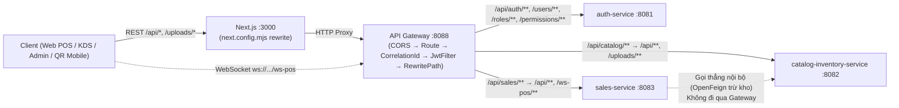
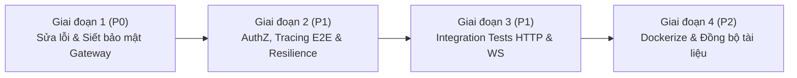

# KẾ HOẠCH REVIEW CODE & HOÀN THIỆN API GATEWAY (`backend/gateway`)

> **Dự án:** Smart-POS (Hệ thống Quản lý Bán hàng, Gọi món QR & Điều phối Bếp KDS)  
> **Phân hệ trọng tâm:** `backend/gateway` (Spring Cloud Gateway Server WebFlux · Java 21 · Spring Boot 4.1.1 · Port `8088`)  
> **Vai trò:** Lên kế hoạch & Review mã nguồn (không chỉnh sửa mã nguồn trực tiếp)  
> **Ngày lập:** 11/11/2026  
> **Trạng thái hiện tại:** Hoàn thiện mức MVP chạy dev/E2E (**11/11** unit/config tests PASS); cần siết bảo mật, sửa lệch cấu hình, bổ sung integration tests và hoàn thiện hạ tầng trước khi lên production.

---

## MỤC LỤC
1. [Tổng quan hiện trạng & Đánh giá chung](#1-tổng-quan-hiện-trạng--đánh-giá-chung)
2. [Kiến trúc & Luồng xử lý qua Gateway](#2-kiến-trúc--luồng-xử-lý-qua-gateway)
3. [Bảng kết quả Code Review chi tiết (GAP Analysis)](#3-bảng-kết-quả-code-review-chi-tiết-gap-analysis)
4. [Lộ trình hoàn thiện 4 giai đoạn](#4-lộ-trình-hoàn-thiện-4-giai-đoạn)
   - [Giai đoạn 1: Sửa lỗi cấu hình & Siết bảo mật cốt lõi (P0)](#giai-đoạn-1-sửa-lỗi-cấu-hình--siết-bảo-mật-cốt-lõi-p0)
   - [Giai đoạn 2: Hoàn thiện phân quyền AuthZ, Tracing & Resilience (P1)](#giai-đoạn-2-hoàn-thiện-phân-quyền-authz-tracing--resilience-p1)
   - [Giai đoạn 3: Kiểm thử tích hợp HTTP & WebSocket thực tế (P1)](#giai-đoạn-3-kiểm-thử-tích-hợp-http--websocket-thực-tế-p1)
   - [Giai đoạn 4: Đóng gói Docker & Đồng bộ tài liệu (P2)](#giai-đoạn-4-đóng-gói-docker--đồng-bộ-tài-liệu-p2)
5. [Tiêu chí nghiệm thu (Definition of Done)](#5-tiêu-chí-nghiệm-thu-definition-of-done)

---

## 1. Tổng quan hiện trạng & Đánh giá chung

### 1.1. Những gì đã triển khai tốt
Qua rà soát toàn bộ mã nguồn trong `backend/gateway` và kiểm chứng chạy lệnh `mvn -f backend/gateway/pom.xml test -o` (**11/11 tests PASS**):
1. **Định tuyến 7 routes đầy đủ (`backend/gateway/src/main/resources/application.yml`):**
   * `auth-service` (`:8081`): `/api/auth/**`, `/api/users/**`, `/api/roles/**`, `/api/permissions/**`.
   * `sales-service` (`:8083`): `/api/sales/health` (`order: 1`), `/api/sales/**` (`order: 2`, `RewritePath` về `/api/...`), `/api/orders/**`, `/api/customers/**`, `/api/promotions/**` (`order: 3`), và WebSocket `/ws-pos/**`.
   * `catalog-inventory-service` (`:8082`): `/api/catalog/**` (`order: 1`, `RewritePath` về `/api/...`), các route trực tiếp `/api/products/**`, `/api/categories/**`, `/api/modifier-groups/**`, `/api/ingredients/**`, `/api/recipes/**`, `/api/inventory/**`, `/api/suppliers/**`, `/api/purchase-orders/**`, `/api/files/**`, `/uploads/**` (`order: 2`).
2. **Xác thực & Chống giả mạo (`JwtAuthenticationFilter.java`):**
   * Xóa sạch 4 header `X-User-Id`, `X-User-Role`, `X-User-Name`, `X-User-Permissions` do client gửi vào trước khi xử lý (chống Header Spoofing).
   * Giải mã JWT đồng bộ chuẩn Base64 HMAC-SHA với `auth-service` (`JwtService.java`), trả JSON `401` cho route bảo mật khi thiếu/sai/hết hạn token, và gắn lại 4 header `X-User-*` đã xác thực xuống downstream (đã khớp với `UserContextFilter.java` của `sales-service`).
3. **Quan sát & Xử lý lỗi (`CorrelationIdAndLoggingFilter.java`, `GlobalGatewayExceptionHandler.java`):**
   * Tự động sinh/giữ `X-Correlation-Id` và ghi log độ trễ xử lý tại Gateway.
   * Chuẩn hóa các lỗi `404`, `503` (downstream chưa bật), `504` (quá thời gian chờ `15s`) thành JSON thống nhất thay vì trang lỗi mặc định.
4. **Kết nối Frontend (`frontend/next.config.mjs`, `frontend/src/lib/websocket.ts`):**
   * Đã trỏ toàn bộ Next.js REST rewrites và WebSocket STOMP (`ws://localhost:8088/ws-pos`) về cổng `8088` của Gateway.

### 1.2. Đánh giá tổng quát các tồn đọng cần hoàn thiện
Tuy đã đủ để chạy dev và thử nghiệm E2E, Gateway hiện vẫn còn **các lỗ hổng bảo mật ở nhóm route QR**, **khoảng trống phân quyền AuthZ phía sau Gateway**, **một vài điểm lệch cấu hình route/tracing/CORS**, **chưa có HTTP/WebSocket integration test thực tế**, và **chưa đóng gói Docker/tài liệu đồng bộ**.

---

## 2. Kiến trúc & Luồng xử lý qua Gateway

**Thứ tự xử lý request thực tế trong Gateway:**
1. `CorsWebFilter` (`globalcors`) xử lý `OPTIONS` preflight và gắn header CORS.
2. `RoutePredicateHandlerMapping` khớp đường dẫn vào 1 trong 7 routes (nếu không khớp $\rightarrow$ ném `404` sang `GlobalGatewayExceptionHandler`).
3. `CorrelationIdAndLoggingFilter` (`GlobalFilter`, `HIGHEST_PRECEDENCE`) sinh/giữ `X-Correlation-Id` và đo thời gian xử lý.
4. `JwtAuthenticationFilter` (`GlobalFilter`, `order = -1`) xóa `X-User-*` giả, kiểm tra `isPublicEndpoint(method, path)`, xác thực JWT nếu là protected hoặc có Bearer token hợp lệ, rồi bơm lại `X-User-*`.
5. `RewritePath` (cho `/api/sales/**`, `/api/catalog/**`) và `NettyRoutingFilter` / `WebsocketRoutingFilter` chuyển tiếp request xuống downstream (`:8081`, `:8082`, `:8083`), `DedupeResponseHeader` lọc trùng header CORS khi trả về.

---

## 3. Bảng kết quả Code Review chi tiết (GAP Analysis)

| Mã | Mức độ | Vấn đề phát hiện | Vị trí trong mã nguồn | Rủi ro / Hậu quả | Hướng xử lý khuyến nghị |
| :--- | :---: | :--- | :--- | :--- | :--- |
| **GW-01** | **P0 (Critical)** | **`GET /api/orders` và `GET /api/sales/orders` mở public không điều kiện** | `JwtAuthenticationFilter.java` (`isPublicEndpoint`, L200–205) | Bất kỳ ai không đăng nhập đều có thể gọi `GET /api/sales/orders?page=0&size=100` để lấy toàn bộ danh sách đơn hàng, doanh thu, dữ liệu khách hàng. Thực tế QR (`/cart`) chỉ cần lọc theo `tableNumber`. | Chỉ cho phép public khi có query param `tableNumber` hợp lệ và không kèm tham số phân trang/lọc lịch sử (`page`, `startDate`, `endDate`); mọi truy vấn khác bắt buộc JWT (`401`). |
| **GW-02** | **P0 (High)** | **Public endpoint tra cứu & thêm món theo ID số (`IDOR`)** | `JwtAuthenticationFilter.java` (`ORDER_BY_ID_PATTERN`, `ORDER_ADD_ITEMS_PATTERN`, `/orders/code/`, L55–56, L202–213) | Khách lạ có thể đoán ID đơn (`1`, `2`, `3`...) để đọc thông tin đơn hoặc `POST` chèn món vào đơn của bàn khác. (Ghi chú: `/cart` hiện có gọi `addItemsToOrder` sau khi lấy `activeOrder`). | Ngắn hạn: rà soát bỏ public các endpoint không dùng ở QR (`/{id}`, `/code/{orderCode}` nếu chưa dùng). Dài hạn: yêu cầu khớp `tableNumber` hoặc cấp QR Table Token có chữ ký. |
| **GW-03** | **P0 (High)** | **CORS mở `allowedOriginPatterns: "*"` kèm `allowCredentials: true`** | `gateway/src/main/resources/application.yml` (L18–30) | Giá trị `"- *"` vô hiệu hóa giới hạn `localhost:*` và `127.0.0.1:*`, cho phép mọi domain bất kỳ gửi credentialed request (kèm cookie `refreshToken`) tới Gateway. | Xóa `"- *"`, cấu hình qua biến môi trường `${CORS_ALLOWED_ORIGIN_PATTERNS:http://localhost:*,http://127.0.0.1:*}`. |
| **GW-04** | **P1 (Medium)** | **Route `/api/catalog/uploads/**` bị gãy giữa Filter và Routing** | `JwtAuthenticationFilter.java` (L184) `application.yml` (L75–81) | Filter whitelist `GET /api/catalog/uploads/`, nhưng route `catalog-inventory-frontend-route` (`order: 1`) rewrite nó thành `/api/uploads/...`, gây `404` vì `catalog-inventory-service` (`WebMvcConfig`) chỉ phục vụ `/uploads/products/**`. | Hoặc gỡ `/api/catalog/uploads/` khỏi whitelist để thống nhất 1 đường `/uploads/**`, hoặc thêm route `order: 0` rewrite `/api/catalog/uploads/(?<segment>.*)` $\rightarrow$ `/uploads/$\{segment}`. |
| **GW-05** | **P1 (Medium)** | **Whitelist Swagger nhưng chưa có route proxy OpenAPI** | `JwtAuthenticationFilter.java` (L178–179) `application.yml` | Cho phép `/v3/api-docs` và `/swagger-ui` đi qua filter, nhưng `application.yml` không định nghĩa route nào trỏ tới Swagger của 3 service (`404` khi gọi qua `:8088`). | Chốt 1 phương án: thêm route `/docs/{service}/**` (hoặc Springdoc aggregator) nếu cần xem Swagger qua Gateway, hoặc xóa khỏi `isPublicEndpoint` nếu chỉ dùng ở port riêng từng service. |
| **GW-06** | **P1 (Medium)** | **Mất `X-Correlation-Id` khi request bị `404` & chưa nối xuống backend** | `CorrelationIdAndLoggingFilter.java` (L20) `GlobalGatewayExceptionHandler.java` (L65–66) `InventoryClient.java` | `CorrelationIdAndLoggingFilter` là `GlobalFilter`, chỉ chạy khi khớp route. Request sai đường dẫn (`404`) bị từ chối ở `RoutePredicateHandlerMapping` trước khi filter chạy nên `cid=null`. Các service con cũng chưa đọc/truyền tiếp `X-Correlation-Id`. | Chuyển `CorrelationIdAndLoggingFilter` thành `WebFilter` (chạy sau `CorsWebFilter`) hoặc sinh fallback UUID trong `GlobalGatewayExceptionHandler`; thêm MDC + Feign `RequestInterceptor` ở 3 service con. |
| **GW-07** | **P0/P1 (High)** | **Thiếu AuthZ (`403`) ở tầng API cho `sales` và `catalog-inventory`** | `JwtAuthenticationFilter.java` `sales-service` (`UserContextFilter`) `catalog-inventory-service` | Gateway mới làm AuthN (`401`) và chuyển tiếp `X-User-Role`/`X-User-Permissions`. Hiện chỉ `auth-service` chặn `403` (`@PreAuthorize`); `sales-service` chưa kiểm tra quyền, `catalog-inventory-service` chưa đọc `X-User-*`. | Bổ sung kiểm tra `X-User-Role` / `X-User-Permissions` (`403 Forbidden`) tại `sales-service` và `catalog-inventory-service`; cân nhắc chặn `/api/inventory/deduct` từ client ngoài nếu chỉ dành cho nội bộ. |
| **GW-08** | **P1 (Medium)** | **WebSocket `/ws-pos/**` mở công khai toàn bộ topic** | `JwtAuthenticationFilter.java` (L177) `sales-service` (`WebSocketConfig.java`) | Bất kỳ client nào không đăng nhập đều có thể kết nối `ws://localhost:8088/ws-pos` và subscribe `/topic/orders`, `/topic/kds` để nghe toàn bộ đơn của quán. | Đánh giá tách/bảo vệ STOMP destination: ẩn danh chỉ được subscribe `/topic/tables/{tableNumber}`, còn `/topic/orders` và `/topic/kds` yêu cầu xác thực JWT khi `CONNECT`. |
| **GW-09** | **P1 (Medium)** | **Rủi ro lệch `JWT_SECRET` & bất nhất `pom.xml`** | `backend/gateway/.env` (0 byte) .env gốc (0 byte) `backend/pom.xml` (L23) `backend/gateway/pom.xml` (L38–71) | `auth-service/.env` có `JWT_SECRET`, còn `gateway/.env` rỗng (cả hai đang dựa vào fallback mặc định). `backend/pom.xml` khai báo `jjwt.version=0.12.6`, nhưng `gateway/pom.xml` hardcode `0.13.0` và đường dẫn `byte-buddy-agent-1.18.11.jar`. | Đồng bộ `jjwt.version` lên `0.13.0` ở `backend/pom.xml` và dùng `${jjwt.version}`; rà soát bỏ hardcode đường dẫn `byte-buddy-agent`; chuẩn hóa biến môi trường dùng chung trong `.env.example`. |
| **GW-10** | **P1 (High)** | **Thiếu Integration Test HTTP/WebSocket thực tế qua toàn bộ filter chain** | `backend/gateway/src/test/...` | `GatewayConfigLoadTest` mới assert 7 route definitions và bean được nạp; chưa kiểm chứng thực tế `RewritePath`, forwarding `Set-Cookie`, WS upgrade, `404`/`503`/`504` thực tế qua Netty/WebFlux. | Viết bộ Integration Tests dùng `WebTestClient` + mock HTTP/WS server kiểm thử end-to-end toàn bộ pipeline của Gateway. |
| **GW-11** | **P1/P2** | **Thiếu Rate Limit, Circuit Breaker, `Dockerfile` & Tài liệu bị cũ** | `docker-compose.yml` `README.md` (L85, L127) `SALES_CATALOG_INTEGRATION_SPEC.md` | Dễ bị brute-force `/api/auth/login` hoặc spam tạo đơn QR; chưa có `Dockerfile` và entry `gateway` trong `docker-compose.yml`; `catalog-inventory-service` chưa có Actuator; tài liệu vẫn ghi cổng `8080`. | Bổ sung Rate Limit & Circuit Breaker (Resilience4j), thêm `Dockerfile` + compose + Actuator cho Catalog, và cập nhật tài liệu về cổng `8088`. |

> **Lưu ý phụ đã ghi nhận khi review:**
> * `POST /api/auth/logout` yêu cầu JWT còn hạn ở Gateway (khớp với `auth-service/SecurityConfig`), nên nếu access token (15 phút) đã hết hạn khi user bấm đăng xuất thì Gateway trả `401` trước khi xóa cookie `refreshToken` — cần đảm bảo Frontend refresh trước khi logout hoặc xử lý thu hồi cookie an toàn.
> * Trong `JwtAuthenticationFilter` (L138–143), nếu claim `sub` bị rỗng và fallback sang `fullName` chứa tiếng Việt có dấu để ghi vào header `X-User-Name`, HTTP header chuẩn ISO-8859-1 có thể làm lỗi ký tự Unicode (nên luôn ưu tiên `username` ASCII hoặc encode nếu cần).
> * Cần kiểm chứng header CORS vẫn được giữ nguyên trên các response lỗi do Gateway tự sinh (`401` từ `JwtAuthenticationFilter` và `404`/`503`/`504` từ `GlobalGatewayExceptionHandler`).

---

## 4. Lộ trình hoàn thiện 4 giai đoạn

---

### Giai đoạn 1: Sửa lỗi cấu hình & Siết bảo mật cốt lõi (P0)
**Mục tiêu:** Đóng các lỗ hổng public endpoint, sửa lệch route/CORS/tracing và chuẩn hóa cấu hình Maven/Env.

- [x] **1.1. Siết `isPublicEndpoint` trong `JwtAuthenticationFilter.java`:**
  - `GET /api/orders` và `GET /api/sales/orders`: chỉ cho phép truy cập ẩn danh khi có query param `tableNumber` hợp lệ và **không** chứa tham số truy vấn quản trị (`page`, `size`, `sort`, `startDate`, `endDate`, `search`); mọi trường hợp còn lại bắt buộc JWT (`401`).
  - Đóng public `GET /api/orders/{id}`, `GET /api/orders/code/{orderCode}`, `GET /api/products`, `GET /api/products/{id}`, `GET /api/categories`, `GET /api/modifier-groups`, `/actuator/gateway/**` (chỉ giữ `/api/products/menu`, `/api/catalog/products/menu`, `/actuator/health`, `/actuator/info`, và `POST /api/(sales/)orders/{id}/items` cho `/cart` hiện tại).
  - Xử lý `logout` phía Frontend qua `customFetch` để tự refresh nếu access token hết hạn trước khi thu hồi cookie `refreshToken`.
- [x] **1.2. Xử lý route `/api/catalog/uploads/**` và Swagger:**
  - Gỡ `/api/catalog/uploads/` khỏi `isPublicEndpoint` để thống nhất đường dẫn `/uploads/**`.
  - Gỡ whitelist `/v3/api-docs` & `/swagger-ui` khỏi `JwtAuthenticationFilter` (dùng trực tiếp ở port riêng từng service).
- [x] **1.3. Siết cấu hình CORS trong `application.yml`:**
  - Loại bỏ `"- *"` khỏi `allowedOriginPatterns` khi `allowCredentials: true`; đọc từ biến `${CORS_ALLOWED_ORIGIN_PATTERNS:http://localhost:*,http://127.0.0.1:*}` và đăng ký `GatewayCorsConfig` (`CorsWebFilter`).
- [x] **1.4. Khắc phục `X-Correlation-Id` cho lỗi `404` & kiểm tra CORS trên response lỗi:**
  - Chuyển `CorrelationIdAndLoggingFilter` thành `WebFilter` (chạy sau `CorsWebFilter`) kèm fallback UUID trong `GlobalGatewayExceptionHandler`.
  - Đã kiểm chứng response `401`, `404`, `429`, `503`, `504` đều mang `X-Correlation-Id` và header CORS hợp lệ.
- [x] **1.5. Chuẩn hóa `pom.xml` và biến môi trường:**
  - Cập nhật `<jjwt.version>0.13.0</jjwt.version>` ở `backend/pom.xml`, dùng `${jjwt.version}` ở `gateway` / `auth-service` / `sales-service`, chuẩn hóa Java 21 ở `backend/shared/pom.xml`, và dùng `maven-dependency-plugin` (`properties`) thay cho hardcode đường dẫn `byte-buddy-agent`.
  - Cập nhật `.env.example` đầy đủ biến môi trường cho DB, Auth, Sales, Catalog, Gateway và Frontend.

---

### Giai đoạn 2: Hoàn thiện phân quyền AuthZ, Tracing & Resilience (P1)
**Mục tiêu:** Đảm bảo chuỗi xác thực + phân quyền hoàn chỉnh (`401` + `403`), truy vết end-to-end và chống quá tải.

- [x] **2.1. Hoàn thiện kiểm tra phân quyền (AuthZ `403 Forbidden`) dựa trên `X-User-*`:**
  - Tại `sales-service`: bổ sung `@RequirePermissions` + `AuthorizationInterceptor` kiểm tra `X-User-Role` / `X-User-Permissions` từ `UserContextHolder`.
  - Tại `catalog-inventory-service`: bổ sung `UserContextFilter` + `@RequirePermissions` + `AuthorizationInterceptor`.
  - Bảo vệ `POST /api/inventory/deduct`: giữ yêu cầu JWT tại Gateway (phục vụ `/admin/inventory`), tại `catalog-inventory-service` yêu cầu quyền `INVENTORY_EXPORT` hoặc `X-Internal-Service` + `X-Internal-Secret` từ `sales-service`.
- [x] **2.2. Bảo vệ WebSocket STOMP (`/ws-pos`):**
  - Bổ sung `StompAuthChannelInterceptor` tại `sales-service` xác thực JWT khi `CONNECT` và kiểm tra quyền khi `SUBSCRIBE` `/topic/orders`, `/topic/kds` (vẫn cho phép khách QR subscribe `/topic/tables/{tableNumber}` ẩn danh).
  - Cập nhật `frontend/src/lib/websocket.ts`, `auth-context.tsx` và `api.ts` (`customFetch` silent refresh) để đồng bộ token JWT mới nhất vào STOMP (kể cả khi reconnect đồng thời).
- [x] **2.3. Truyền tiếp `X-Correlation-Id` xuyên suốt 3 service:**
  - Bổ sung `CorrelationIdFilter` đưa `X-Correlation-Id` vào SLF4J MDC tại `auth-service`, `catalog-inventory-service`, `sales-service`.
  - Bổ sung `FeignTraceAndInternalInterceptor` cho `InventoryClient` (`sales-service` $\rightarrow$ `catalog-inventory-service`).
- [x] **2.4. Bổ sung Rate Limiting & Circuit Breaker:**
  - Triển khai `InMemoryRateLimitFilter` cho `POST /api/auth/login` và `POST /api/(sales/)orders` (không phụ thuộc Redis, mặc định lấy IP từ `remoteAddress` và chỉ đọc `X-Forwarded-For` khi `trust-forwarded-headers: true`).
  - Tích hợp Resilience4j Circuit Breaker (`spring-cloud-starter-circuitbreaker-reactor-resilience4j`) cho route đọc menu (`GET /api/catalog/products/menu`, `GET /api/products/menu`) kèm `GatewayFallbackController` (`/fallback/catalog`).

---

### Giai đoạn 3: Kiểm thử tích hợp HTTP & WebSocket thực tế (P1)
**Mục tiêu:** Bổ sung integration tests kiểm chứng luồng request chạy thật qua toàn bộ filter chain của Gateway.

- [x] **3.1. Cập nhật unit tests theo rule bảo mật mới:**
  - Cập nhật `JwtAuthenticationFilterTest`, `CorrelationIdAndLoggingFilterTest`, `GlobalGatewayExceptionHandlerTest`, `GatewayConfigLoadTest` và thêm `InMemoryRateLimitFilterTest`.
- [x] **3.2. Xây dựng Integration Tests bằng `WebTestClient` + Mock Backend Server:**
  - Tạo `GatewayIntegrationTest` kiểm chứng `RewritePath`, chống spoofing `X-User-*`, forwarding `Set-Cookie`/`Cookie`, `401`, `404`, `429`, `503`, `504`, `DedupeResponseHeader` và `CircuitBreaker` fallback.
- [x] **3.3. Kiểm thử WebSocket Upgrade qua Gateway:**
  - Đã kiểm thử bắt tay và truyền/nhận WebSocket qua `/ws-pos` trong `GatewayIntegrationTest`, cùng test STOMP authz tại `SalesWebSocketIntegrationTest` và `StompAuthChannelInterceptorTest`.
- [ ] **3.4. Phối hợp xác nhận trên E2E Playwright (`Suite 6` trong `docs/testing/ke-hoach-e2e-test.md`):**
  - Chờ triển khai thư mục `e2e/` Playwright để chạy xác nhận full stack với Frontend + 3 microservices + PostgreSQL.

---

### Giai đoạn 4: Đóng gói Docker & Đồng bộ tài liệu (P2)
**Mục tiêu:** Sẵn sàng dựng toàn bộ stack qua Docker/CI và đồng bộ tài liệu dự án.

- [x] **4.1. Dockerize Gateway & Healthcheck đồng nhất:**
  - Tạo `backend/gateway/Dockerfile` (multi-stage build JDK 21, khai báo `HEALTHCHECK` gọi `/actuator/health`).
  - Tạo `docker-compose.full.yml` (kết hợp `postgres`, `pgadmin`, `gateway` cổng `8088`, giữ nguyên `docker-compose.yml`).
  - Bổ sung `spring-boot-starter-actuator` cho `catalog-inventory-service` (và `sales-service`), cấu hình `server.forward-headers-strategy: ${FORWARD_HEADERS_STRATEGY:none}` tại Gateway (chỉ chuyển sang `framework` khi đặt sau reverse proxy tin cậy).
- [x] **4.2. Cập nhật tài liệu kiến trúc:**
  - Cập nhật `README.md` (mục 3.1, 3.2, 3.3, 4, 5.4, 5.5) phản ánh `gateway` cổng `8088` đã hoạt động.
  - Cập nhật `docs/architecture/SALES_CATALOG_INTEGRATION_SPEC.md` đồng bộ cổng từ `8080` sang `8088`, bổ sung routes và tracing/internal secret.

---

## 5. Tiêu chí nghiệm thu (Definition of Done)

1. Toàn bộ unit test và HTTP/WebSocket integration test trong `backend/gateway` pass 100% (`mvn -f backend/gateway/pom.xml test`).
2. Không còn endpoint đọc danh sách đơn hàng/dữ liệu quản trị nào bị mở công khai thiếu điều kiện; cấu hình CORS không còn cho phép `"*"` đi kèm `allowCredentials: true`.
3. Mọi lỗi `401`, `404`, `503`, `504` trả từ Gateway đều đúng format JSON chuẩn Smart-POS, có `X-Correlation-Id` và giữ nguyên header CORS hợp lệ.
4. Các vai trò (`ADMIN`, `MANAGER`, `CHEF`, `CASHIER`, `WAITER`) bị kiểm soát chặt cả AuthN (`401`) lẫn AuthZ (`403`) khi gọi API qua Gateway.
5. Toàn bộ luồng nghiệp vụ Frontend (`login`, `refresh`, `POS`, `KDS`, `Admin`, `QR Menu/Cart`, `uploads`, `WebSocket /ws-pos`) vận hành ổn định qua `http://localhost:8088` và `ws://localhost:8088/ws-pos`.
