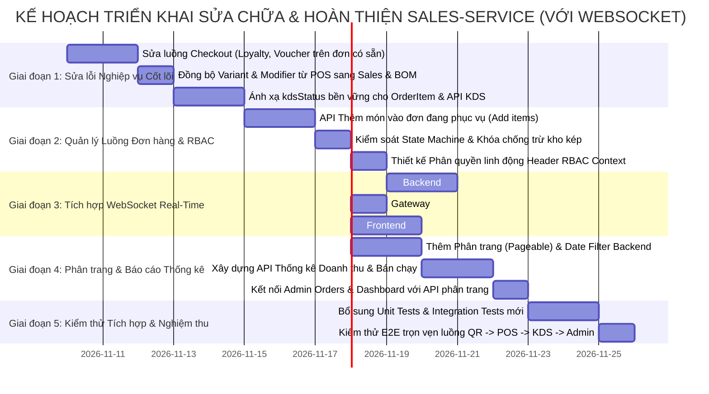
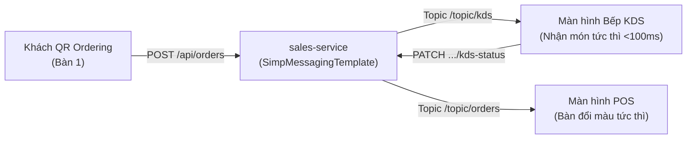

# KẾ HOẠCH TOÀN DIỆN: REVIEW, SỬA CHỮA & HOÀN THIỆN SALES-SERVICE VÀ FRONTEND TƯƠNG ỨNG

> **Dự án**: Smart-POS (Hệ thống Quản lý Bán hàng, Gọi món QR & Điều phối Bếp KDS)  
> **Phân hệ trọng tâm**: `sales-service` (Spring Boot 3.x / Java 21) & Frontend tương ứng (Next.js 16 / TypeScript / Tailwind CSS)  
> **Người lập kế hoạch**: AI Lead Architect & Senior Code Reviewer  
> **Ngày lập**: 09/11/2026  
> **Trạng thái**: Sẵn sàng triển khai (Ready for Implementation)

---

## 1. TỔNG QUAN HIỆN TRẠNG & ĐÁNH GIÁ CHUNG (EXECUTIVE SUMMARY)

Dịch vụ `sales-service` là trái tim trong luồng vận hành bán hàng của hệ thống Smart-POS, chịu trách nhiệm tiếp nhận đơn hàng (từ QR Ordering của khách và POS của thu ngân), điều phối sang màn hình Bếp KDS, tích hợp chương trình Khách hàng thân thiết (Loyalty & Điểm thưởng), áp dụng Khuyến mãi (Voucher) và tự động gọi OpenFeign sang `catalog-inventory-service` để trừ tồn kho nguyên liệu theo định lượng BOM khi hoàn tất đơn hàng.

### Điểm mạnh hiện tại đã đạt được:
1. **Biên dịch & Kiểm thử đơn vị**: Đã cấu hình đồng bộ JDK 21 trên Maven POM, toàn bộ 41 unit/integration test trong `sales-service` vượt qua 100%.
2. **Cơ chế trừ kho liên dịch vụ (East-West)**: Kết nối trực tiếp giữa `sales-service` và `catalog-inventory-service` qua OpenFeign (`InventoryClient.java`) độc lập, không đi vòng qua Gateway.
3. **Mô hình hóa dữ liệu**: Đã có đầy đủ thực thể JPA cho `Order`, `OrderItem`, `Customer`, `Promotion`, `PointTransaction`.
4. **Giao diện người dùng**: Đã xây dựng các màn hình POS thu ngân (`/pos`), Bếp KDS (`/kds`), Giỏ hàng QR (`/cart`), Quản lý hóa đơn Admin (`/admin/orders`), Khách hàng (`/admin/customers`), Khuyến mãi (`/admin/promotions`) và Bảng tổng quan (`/admin`).

### Tuy nhiên, qua quá trình rà soát chi tiết mã nguồn sâu (Deep Code Review), hệ thống vẫn còn tồn tại **5 lỗ hổng logic nghiêm trọng (Critical Bugs)** và **4 điểm thiếu hụt kiến trúc (Architectural Gaps)** cần phải khắc phục để đảm bảo hệ thống vận hành thực tế không bị sai lệch số liệu tài chính, kho hàng và trải nghiệm người dùng.

---

### 1.1. Hiện trạng cơ chế thời gian thực & Quyết định nâng cấp WebSocket
> [!IMPORTANT]
> **Hiện trạng**: Hệ thống Smart-POS hiện tại đang sử dụng 100% **HTTP Polling** (`setInterval(..., 5000)` tại KDS và `setInterval(..., 6000)` tại POS).  
> **Quyết định nâng cấp chính thức theo yêu cầu**: **NÂNG CẤP LÊN WEBSOCKET (STOMP over WebSocket)** để chuyển đổi toàn bộ cơ chế đồng bộ sang Real-time Event-Driven:
> - Khi khách quét QR đặt món hoặc gọi thêm món $\rightarrow$ Màn hình Bếp KDS và Thu ngân POS nhận dữ liệu tức thì (< 100ms) kèm âm báo (ring tone).
> - Khi đầu bếp bấm hoàn tất món $\rightarrow$ POS nhận thông báo món đã xong ngay lập tức.
> - Khi thu ngân thanh toán xong đơn $\rightarrow$ Sơ đồ bàn POS đổi trạng thái sang "Trống" tức thì, không cần đợi chu kỳ 6 giây.
> - Cơ chế Polling cũ sẽ được hạ cấp thành Heartbeat kiểm tra định kỳ (30s - 60s) đóng vai trò Fallback dự phòng khi mất kết nối mạng.

---

## 2. BẢNG PHÂN TÍCH LỖI VÀ ĐIỂM THIẾU HỤT CHI TIẾT

| STT | Vấn đề / Lỗ hổng | Phân loại | Vị trí phát hiện | Hậu quả thực tế |
| :---: | :--- | :---: | :--- | :--- |
| **01** | **Mất dữ liệu Loyalty & Voucher khi thanh toán đơn đã gửi bếp hoặc từ QR** | **CRITICAL BUG** | `pos/page.tsx` (`handlePaymentSuccess`)<br/>`OrderServiceImpl.java` (`updatePayment`) | Khi bàn đã có đơn (từ QR hoặc bấm "Gửi bếp"), thu ngân nhập SĐT tích điểm và Voucher. Khi bấm thanh toán, Frontend chỉ gọi `updateOrderPayment(status=PAID)` rồi `completeOrder()`. Toàn bộ thông tin khách hàng, điểm thưởng và voucher bị **bỏ rơi hoàn toàn**! Tiền thu trong DB vẫn là giá gốc, khách không được cộng/trừ điểm, voucher không tính lượt dùng. |
| **02** | **Mất biến thể Size (`variantId`) và Topping (`modifierOptionIds`) khi tạo đơn trên POS** | **CRITICAL BUG** | `pos/page.tsx` (`handleSendToKitchen`, `handlePaymentSuccess`)<br/>`InvoicePanel.tsx` (`OrderItem` type) | POS chọn được Size L, Trân châu qua `PosItemModal`, nhưng interface `OrderItem` trong POS lại bỏ quên `variantId` và `modifierOptionIds`. Khi gửi đơn sang `sales-service`, các trường này bị `null`. Dẫn tới `catalog-inventory-service` **không trừ kho đúng định lượng của Topping và Biến thể Size** theo BOM! |
| **03** | **Trạng thái từng món trên KDS chỉ lưu tạm trong RAM trình duyệt** | **CRITICAL GAP** | `sales-service` (`OrderItem.java`)<br/>`frontend/src/app/kds/page.tsx` | Bảng DB `order_items` có cột `kds_status` nhưng entity `OrderItem` không ánh xạ, backend không có API cập nhật trạng thái món. Frontend KDS phải dùng `completedTaskIds` dạng `Set` trong RAM. **Khi F5 tải lại trang KDS, toàn bộ món đã nấu xong bị hiện lại như cũ**! Nhiều màn hình bếp không đồng bộ được. |
| **04** | **Xung đột khi 1 bàn gọi món nhiều lần (Multiple Orders per Table)** | **HIGH BUG** | `OrderServiceImpl.java`<br/>`pos/page.tsx` (`loadActiveOrders`) | Khi khách tại 1 bàn gọi món lần 2 qua QR, hệ thống sinh ra đơn hàng thứ 2. Trên POS chỉ hiển thị đè 1 đơn duy nhất trên ô bàn. Thu ngân bấm thanh toán chỉ thanh toán được 1 đơn, đơn kia bị kẹt vĩnh viễn ở trạng thái `PENDING`. Hệ thống thiếu API gộp đơn hoặc thêm món vào đơn đang phục vụ. |
| **05** | **Thiếu cơ chế kiểm soát chuyển trạng thái & chống trừ kho trùng lặp (Concurrency)** | **HIGH BUG** | `OrderServiceImpl.java` (`updateOrderStatus`, `completeOrder`, `cancelOrder`) | Đơn đã `CANCELLED` vẫn có thể bấm `completeOrder` để trừ kho; đơn đã `COMPLETED` vẫn có thể bấm `cancelOrder` (nhưng không rollback kho và điểm). Click chuột nhanh 2 lần vào nút Hoàn tất có nguy cơ kích hoạt gọi Feign trừ kho 2 lần và cộng điểm 2 lần do thiếu Optimistic Locking. |
| **06** | **Thiếu Phân trang (Pagination) & Bộ lọc ngày phía Backend** | **PERFORMANCE GAP** | `OrderController.java`<br/>`OrderServiceImpl.java`<br/>`admin/orders/page.tsx` | `GET /api/orders` gọi `orderRepository.findAll()` trả về toàn bộ đơn trong lịch sử. Trang Admin Orders và Dashboard tải hàng nghìn đơn về trình duyệt rồi mới dùng JS lọc ngày. Khi chạy lâu dài sẽ gây tràn bộ nhớ (OOM) và đơ trình duyệt. |
| **07** | **Thiếu API Thống kê/Báo cáo Doanh thu Máy chủ (Analytics API)** | **FEATURE GAP** | `OrderController.java`<br/>`admin/page.tsx` (Dashboard) | Toàn bộ các chỉ số Dashboard: Doanh thu theo ngày, số đơn hoàn thành, thời gian chế biến trung bình, top món bán chạy đều tính thủ công ở client. Thiếu API `GET /api/orders/statistics` tổng hợp bằng SQL Query (`SUM`, `COUNT`, `GROUP BY`). |
| **08** | **Lệch cấu trúc CSDL giữa Script SQL và Java Entity** | **DATABASE MISMATCH** | `pos_sales_db`<br/>`Order.java`, `OrderItem.java` | Thiếu `staff_id`, `table_id` trong `Order.java`. Thiếu `kds_status`, `created_at` trong `OrderItem.java`. Trong `OrderItem`, vừa dùng `@JdbcTypeCode(SqlTypes.JSON)` vừa dùng `@Convert` gây dư thừa và tiềm ẩn lỗi mapping trên Postgres. |
| **09** | **Độ trễ đồng bộ do sử dụng HTTP Polling thay vì WebSocket** | **REALTIME UPGRADE** | `kds/page.tsx` (`setInterval 5s`)<br/>`pos/page.tsx` (`setInterval 6s`) | Dữ liệu đơn hàng và trạng thái món ăn có độ trễ từ 1-6 giây; tạo ra nhiều request lặp vô nghĩa lên máy chủ dù không có đơn mới. Cần nâng cấp lên WebSocket STOMP để truyền nhận sự kiện tức thì (<100ms). |

---

## 3. LỘ TRÌNH TRIỂN KHAI 5 GIAI ĐOẠN (IMPLEMENTATION ROADMAP)



---

## 4. KẾ HOẠCH CHI TIẾT THEO TỪNG GIAI ĐOẠN

### GIAI ĐOẠN 1: KHẮC PHỤC CÁC LỖI NGHIỆP VỤ CỐT LÕI (CRITICAL FIXES)

#### Mục tiêu:
Đảm bảo tính chính xác 100% của tiền tệ, điểm thưởng khách hàng, khuyến mãi voucher và trừ kho BOM khi đơn hàng được thanh toán.

#### Nhiệm vụ 1.1: Hoàn thiện luồng Thanh toán (Checkout Flow) cho đơn hàng đã tồn tại
- **Backend (`sales-service`)**:
  - Mở rộng DTO `UpdatePaymentRequest.java` hoặc tạo mới `CheckoutOrderRequest.java`:
    ```java
    public class CheckoutOrderRequest {
        @NotNull
        private PaymentMethod paymentMethod;
        private Long customerId;
        private String customerPhone;
        private String promotionCode;
        private Integer pointsToRedeem;
    }
    ```
  - Bổ sung phương thức `OrderResponse checkoutOrder(Long id, CheckoutOrderRequest request)` vào `OrderService`:
    - Nếu đơn có `promotionCode`: Kiểm tra và áp dụng giảm giá, lưu thông tin voucher vào `order`.
    - Nếu đơn có `customerId` hoặc `customerPhone`: Gắn khách hàng vào đơn, tính toán số điểm quy đổi (`pointsToRedeem * 1000đ`).
    - Cập nhật lại `subtotal`, `discountAmount`, `pointsDiscountAmount`, `totalAmount`.
    - Cập nhật `paymentMethod` và `paymentStatus = PAID`.
    - Đổi trạng thái sang `COMPLETED`, tự động trừ kho qua Feign và kích hoạt tích điểm/cộng lượt dùng voucher.
  - Bổ sung API `POST /api/orders/{id}/checkout` trong `OrderController.java`.
- **Frontend (`Next.js`)**:
  - Bổ sung hàm `checkoutOrder(orderId, request)` trong `frontend/src/lib/api.ts`.
  - Cập nhật `handlePaymentSuccess` trong `frontend/src/app/pos/page.tsx`:
    - Khi có `existingBackendOrder`: Gọi ngay `checkoutOrder(existingBackendOrder.id, {...})` truyền đầy đủ `customer`, `promotionCode`, `pointsToRedeem`, `paymentMethod`.
    - Không tách rời 2 bước `updatePayment` và `completeOrder` làm mất thông tin giảm giá.

#### Nhiệm vụ 1.2: Bảo toàn Biến thể (`variantId`) và Topping (`modifierOptionIds`) từ POS
- **Frontend (`InvoicePanel.tsx` & `pos/page.tsx`)**:
  - Mở rộng interface `OrderItem`:
    ```typescript
    export interface OrderItem {
      id: string;
      menuItemId: string;
      productId: number;
      variantId?: number;
      modifierOptionIds?: number[];
      name: string;
      price: number;
      quantity: number;
      sizeName?: string;
      toppings?: string[];
      note?: string;
      sweetness?: string;
    }
    ```
  - Tại `handleConfirmModalSelection` trong `pos/page.tsx`:
    - Lưu trực tiếp `productId: selection.product.id`, `variantId: selection.variant?.id`, `modifierOptionIds: selection.modifiers.map(m => m.optionId)`.
  - Tại `handleSendToKitchen` và `handlePaymentSuccess`:
    - Gửi nguyên vẹn `productId`, `variantId`, `modifierOptionIds` sang `CreateOrderItemRequest`.
- **Backend (`sales-service`)**:
  - Đảm bảo khi tạo `OrderItem`, các giá trị `variantId` và `modifierOptionIds` được lưu chuẩn vào bảng `order_items` và chuyển đúng sang `InventoryClient.deductInventory`.

#### Nhiệm vụ 1.3: Lưu trữ bền vững trạng thái từng món KDS (`kdsStatus`)
- **Backend (`sales-service`)**:
  - Cập nhật entity `OrderItem.java`:
    ```java
    @Enumerated(EnumType.STRING)
    @Column(name = "kds_status", nullable = false, length = 30)
    @Builder.Default
    private ItemKdsStatus kdsStatus = ItemKdsStatus.PENDING; // PENDING, COOKING, READY, SERVED
    ```
  - Thêm enum `ItemKdsStatus` gồm các trạng thái: `PENDING`, `COOKING`, `READY`, `SERVED`.
  - Cập nhật `OrderItemResponse.java` có trường `kdsStatus`.
  - Viết API `PATCH /api/orders/{orderId}/items/{itemId}/kds-status?status=READY` trong `OrderController`:
    - Cập nhật trạng thái của món ăn đó trong CSDL.
    - Kiểm tra nếu toàn bộ món trong đơn đều đã `READY` $\rightarrow$ Tự động chuyển `Order.status` sang `READY`.
    - Nếu có ít nhất 1 món đang `COOKING` $\rightarrow$ Tự động chuyển `Order.status` sang `PREPARING`.
- **Frontend (`kds/page.tsx`)**:
  - Bỏ biến lưu tạm `completedTaskIds` trong React state.
  - Bộ lọc món hiển thị trên KDS chỉ lấy các `OrderItem` có `kdsStatus !== 'READY' && kdsStatus !== 'SERVED'`.
  - Khi đầu bếp bấm hoàn tất món: Gọi API `updateOrderItemKdsStatus(orderId, itemId, 'READY')`.
  - Khi F5 hoặc mở trên nhiều màn hình khác nhau, dữ liệu luôn đồng bộ chính xác 100%.

---

### GIAI ĐOẠN 2: QUẢN LÝ LUỒNG ĐƠN HÀNG, THÊM MÓN & CONCURRENCY CONTROL

#### Mục tiêu:
Giải quyết triệt để vấn đề 1 bàn gọi nhiều lần, thêm món vào đơn đang phục vụ và bảo vệ dữ liệu trước các thao tác đồng thời.

#### Nhiệm vụ 2.1: API Thêm món vào đơn hàng đang phục vụ (Add Items to Order)
- **Backend (`sales-service`)**:
  - Thêm phương thức vào `OrderService`:
    ```java
    OrderResponse addItemsToOrder(Long orderId, List<CreateOrderItemRequest> newItems);
    ```
  - Nghiệp vụ:
    - Kiểm tra đơn hàng phải đang ở trạng thái chưa hoàn tất (`PENDING`, `CONFIRMED`, `PREPARING`, `READY`, `SERVED`). Đơn `COMPLETED` hoặc `CANCELLED` sẽ ném ngoại lệ `BusinessException`.
    - Thêm các `OrderItem` mới vào danh sách món của đơn.
    - Tính toán lại `subtotal`, tính lại giá trị giảm giá voucher (nếu có voucher theo %) và cập nhật lại `totalAmount`.
    - Chuyển `order.status` về `PREPARING` nếu đơn đang `READY` (vì có món mới cần chế biến).
  - Bổ sung API: `POST /api/orders/{id}/items`.
- **Frontend (`cart/page.tsx` & `pos/page.tsx`)**:
  - Trong `cart/page.tsx` (QR Ordering):
    - Trước khi gửi đơn, kiểm tra xem bàn hiện tại đã có đơn hàng nào đang hoạt động chưa (`activeOrder = activeOrders.find(o => o.tableNumber === tableId)`).
    - Nếu đã có đơn hoạt động: Gọi `addItemsToOrder(activeOrder.id, newItems)` thay vì tạo đơn mới.
    - Nhờ đó, một bàn chỉ có duy nhất 1 hóa đơn xuyên suốt bữa ăn.

#### Nhiệm vụ 2.3: Thiết kế Phân quyền linh động (Dynamic RBAC Architecture)
Để đón đầu và sẵn sàng tích hợp khi `auth-service` hoàn thiện mà không làm đứt gãy luồng vận hành hiện tại:
- **Mô hình Header Context Propagation (Chuẩn Microservices)**:
  - Khi người dùng gửi request qua Gateway (hoặc Frontend demo), các thông tin xác thực được truyền qua HTTP Headers:
    - `X-User-Id`: ID của nhân viên thao tác (vd: `1`, `2` hoặc `u-002`).
    - `X-User-Role`: Vai trò người dùng (`ADMIN`, `MANAGER`, `CASHIER`, `CHEF`, `WAITER`).
    - `X-User-Permissions`: Danh sách quyền động (vd: `ORDER_CREATE`, `ORDER_CANCEL`, `ORDER_CHECKOUT`, `REPORT_VIEW`).
- **Cơ chế xử lý tại `sales-service`**:
  - Xây dựng `UserContextHolder` (ThreadLocal) và `UserContextFilter`: Tự động đọc và lưu giữ thông tin user context trong suốt vòng đời của request.
  - Xây dựng Annotation `@RequirePermission` hoặc helper `SecurityUtils`:
    - Cho phép Thu ngân (`CASHIER`), Quản lý (`MANAGER`), Quản trị (`ADMIN`) được phép hủy đơn hàng (`ORDER_CANCEL`).
    - Khách hàng vãng lai (Guest) quét QR không có header vẫn được phép tạo đơn (`ORDER_CREATE`) và gọi thêm món.
    - **Fallback an toàn**: Nếu chưa có Auth Token/Header (chế độ dev hoặc demo), hệ thống tự động gán vai trò mặc định hợp lệ, ghi log cảnh báo thay vì chặn đứng (chống lỗi 401/403 khi Auth Service chưa chạy).
  - **Lưu vết kiểm toán (Audit Trail)**:
    - Gắn `staff_id` (trích xuất từ `X-User-Id`) vào đơn hàng khi tạo, checkout hoặc hủy đơn.
    - Bổ sung trường `cancelReason` và `cancelledBy` vào đơn hàng khi có thao tác hủy đơn.
- **Backend (`sales-service`)**:
  - Thêm trường `@Version private Long version;` vào thực thể `Order.java` để kích hoạt Optimistic Locking của JPA.
  - Quy tắc chuyển đổi trạng thái (State Transition Matrix):
    - `PENDING` $\rightarrow$ `CONFIRMED`, `CANCELLED`
    - `CONFIRMED` $\rightarrow$ `PREPARING`, `CANCELLED`
    - `PREPARING` $\rightarrow$ `READY`, `CANCELLED` (có cảnh báo)
    - `READY` $\rightarrow$ `SERVED`, `COMPLETED`
    - `SERVED` $\rightarrow$ `COMPLETED`
    - `COMPLETED` $\rightarrow$ Trạng thái cuối (Terminal State), **cấm chuyển sang bất kỳ trạng thái nào khác**.
    - `CANCELLED` $\rightarrow$ Trạng thái cuối, **cấm chuyển sang `COMPLETED`**.
  - Xử lý hủy đơn an toàn trong `cancelOrder(Long id, String reason)`:
    - Nếu đơn đã `COMPLETED`: Ném `BusinessException("Không thể hủy đơn hàng đã hoàn tất và thanh toán.")`.
    - Lưu lý do hủy đơn vào trường `note` hoặc cột `cancel_reason`.

---

### GIAI ĐOẠN 3: TÍCH HỢP WEBSOCKET REAL-TIME (THAY THẾ POLLING)

#### Mục tiêu:
Chuyển đổi toàn bộ cơ chế đồng bộ giữa QR Ordering, Bếp KDS và Thu ngân POS từ HTTP Polling (5-6 giây) sang WebSocket thời gian thực (< 100ms) theo kiến trúc Pub/Sub STOMP.



#### Nhiệm vụ 3.1: Cấu hình Spring Boot WebSocket STOMP Broker (`sales-service`)
- Bổ sung starter vào `backend/services/sales-service/pom.xml`:
  ```xml
  <dependency>
      <groupId>org.springframework.boot</groupId>
      <artifactId>spring-boot-starter-websocket</artifactId>
  </dependency>
  ```
- Tạo lớp cấu hình `WebSocketConfig.java`:
  - Kích hoạt `@EnableWebSocketMessageBroker`.
  - Cấu hình simple broker: `/topic`.
  - Cấu hình endpoint kết nối: `/ws-pos` (hỗ trợ cả SockJS và Native WebSocket).
- Định nghĩa các Channel / Topic phát sóng sự kiện:
  1. `/topic/orders`: Phát sự kiện đơn hàng (tạo mới, checkout thành công, hủy đơn) cho POS và Admin.
  2. `/topic/kds`: Phát sự kiện món cần nấu hoặc cập nhật trạng thái món cho màn hình Bếp KDS.
  3. `/topic/tables/{tableNumber}`: Phát trạng thái đơn hàng riêng cho khách tại bàn đó.

#### Nhiệm vụ 3.2: Phát sóng sự kiện thời gian thực từ Service Layer (`sales-service`)
- Tiêm `SimpMessagingTemplate` vào `OrderServiceImpl`:
  - Khi tạo đơn mới hoặc cộng thêm món:
    - Bắn thông điệp sang `/topic/orders` (POS nhận đơn tức thì).
    - Bắn thông điệp sang `/topic/kds` (Bếp hiện món mới kèm âm báo tức thì).
  - Khi đầu bếp cập nhật trạng thái món (ví dụ: `READY`):
    - Bắn thông điệp sang `/topic/kds` và `/topic/orders`.
  - Khi hoàn tất thanh toán (Checkout) hoặc Hủy đơn:
    - Bắn thông điệp sang `/topic/orders` (Sơ đồ bàn trên POS tự động chuyển trạng thái trống tức thì).

#### Nhiệm vụ 3.3: Định tuyến WebSocket qua API Gateway (`gateway`)
- Cấu hình route WebSocket trong `backend/gateway/src/main/resources/application.yml`:
  ```yaml
  - id: sales-service-websocket
    uri: ${SALES_WS_URL:ws://localhost:8083}
    predicates:
      - Path=/ws-pos/**
  ```

#### Nhiệm vụ 3.4: Tích hợp WebSocket Client phía Frontend (`Next.js`)
- Cài đặt thư viện `@stomp/stompjs` trong `frontend/package.json`.
- Xây dựng client kết nối `frontend/src/lib/websocket.ts`: Quản lý kết nối STOMP, tự động reconnect khi mất mạng.
- Cập nhật **Màn hình Bếp KDS** (`frontend/src/app/kds/page.tsx`):
  - Subscribe vào `/topic/kds`. Khi có tin nhắn mới, tự động đẩy thẻ món vào danh sách và phát âm thanh thông báo cho đầu bếp.
  - Hạ tần suất `setInterval` từ 5s xuống thành 60s (chỉ chạy dự phòng khi mất kết nối).
- Cập nhật **Màn hình Thu ngân POS** (`frontend/src/app/pos/page.tsx`):
  - Subscribe vào `/topic/orders`. Cập nhật trạng thái màu sắc bàn ăn và danh sách đơn hàng tức thời.
  - Hạ tần suất `setInterval` từ 6s xuống thành 60s.

---

### GIAI ĐOẠN 4: PHÂN TRANG (PAGINATION), DATE FILTER & BÁO CÁO THỐNG KÊ (ANALYTICS)

#### Mục tiêu:
Tối ưu hóa hiệu năng máy chủ và trải nghiệm người dùng trang Admin, không tải toàn bộ CSDL về trình duyệt.

#### Nhiệm vụ 4.1: Bổ sung Phân trang và Lọc thời gian cho API danh sách đơn hàng
- **Backend (`sales-service`)**:
  - Cập nhật `OrderRepository` kế thừa `JpaSpecificationExecutor<Order>` hoặc viết truy vấn động `@Query`:
    ```java
    @GetMapping
    public ResponseEntity<ApiResponse<PageResponse<OrderResponse>>> getOrders(
            @RequestParam(required = false) OrderStatus status,
            @RequestParam(required = false) String tableNumber,
            @RequestParam(required = false) @DateTimeFormat(iso = DateTimeFormat.ISO.DATE_TIME) LocalDateTime startDate,
            @RequestParam(required = false) @DateTimeFormat(iso = DateTimeFormat.ISO.DATE_TIME) LocalDateTime endDate,
            @RequestParam(required = false) String search,
            @RequestParam(defaultValue = "0") int page,
            @RequestParam(defaultValue = "20") int size,
            @RequestParam(defaultValue = "createdAt,desc") String sort)
    ```
  - Đảm bảo tương thích ngược: Nếu client không truyền `page` / `size` (như trang POS lấy đơn hoạt động), hệ thống vẫn trả về danh sách đầy đủ các đơn active.
- **Frontend (`admin/orders/page.tsx`)**:
  - Chuyển việc lọc thời gian (`today`, `yesterday`, `week`, `month`) và tìm kiếm sang các query params truyền lên backend.
  - Thêm thanh điều khiển chuyển trang (Pagination Controls: Trang trước, Trang sau, Chọn số lượng bản ghi/trang).

#### Nhiệm vụ 4.2: Xây dựng API Báo cáo Thống kê Doanh thu (Analytics API)
- **Backend (`sales-service`)**:
  - Tạo DTO `SalesStatisticsResponse.java`:
    - `totalRevenue`: Tổng doanh thu thực tế.
    - `totalOrders`: Tổng số hóa đơn thành công.
    - `averageOrderValue`: Giá trị trung bình mỗi đơn.
    - `topSellingItems`: Danh sách top món ăn bán chạy nhất (tên, số lượng đã bán, doanh thu món).
    - `hourlyRevenue`: Biểu đồ doanh thu theo các khung giờ trong ngày.
  - Tạo API `GET /api/orders/statistics?period=today|yesterday|week|month`:
    - Truy vấn trực tiếp bằng câu lệnh SQL Native hoặc JPQL tổng hợp (`SELECT SUM(o.totalAmount), COUNT(o.id)... WHERE o.status = 'COMPLETED' AND o.createdAt >= :start`).
- **Frontend (`admin/page.tsx`)**:
  - Thay thế toàn bộ logic tính toán bằng JavaScript ở Client bằng việc gọi API `fetchSalesStatistics(period)`.
  - Hiển thị trực tiếp các con số chính xác tức thì, tải trang cực nhanh.

---

### GIAI ĐOẠN 5: ĐỒNG BỘ CSDL, KIỂM THỬ TỰ ĐỘNG & NGHIỆM THU E2E

#### Nhiệm vụ 5.1: Đồng bộ CSDL và Entity
- Bổ sung `staffId`, `tableId` vào `Order.java`.
- Bổ sung `kdsStatus`, `createdAt` vào `OrderItem.java`.
- Chuẩn hóa cấu trúc cột `modifier_option_ids`: Giữ `@JdbcTypeCode(SqlTypes.JSON)` và loại bỏ `@Convert` thừa để tránh xung đột dialect.
- Tạo script migration `init-scripts/04-migration-sales-kds-and-version.sql` bổ sung cột `version` cho bảng `orders` và đảm bảo index cho `orders.created_at`.

#### Nhiệm vụ 5.2: Mở rộng Bộ Test Suites
- **Unit Tests**:
  - `OrderServiceImplTest`: Bổ sung test case cho `checkoutOrder`, `addItemsToOrder`, kiểm tra ràng buộc chuyển đổi trạng thái không hợp lệ, kiểm tra không thể hủy đơn `COMPLETED`.
  - Test case kiểm tra tính toán lại tiền khi thêm món vào đơn đang phục vụ.
- **Integration Tests**:
  - `OrderControllerIntegrationTest`: Kiểm tra endpoint `/api/orders/{id}/checkout`, `/api/orders/{id}/items`, `/api/orders/{id}/items/{itemId}/kds-status`, `/api/orders/statistics`.
  - `SalesToCatalogFeignIntegrationTest`: Kiểm tra kịch bản trừ kho có chứa đầy đủ `variantId` và `modifierOptionIds`.

#### Nhiệm vụ 5.3: Kiểm thử luồng khép kín (End-to-End User Journeys)
1. **Luồng Khách QR $\rightarrow$ KDS $\rightarrow$ Thu ngân POS**:
   - Quét QR tại Bàn 5 $\rightarrow$ Chọn món có Size và Topping $\rightarrow$ Đặt món $\rightarrow$ WebSocket bắn sang KDS & POS tức thì (<100ms).
   - KDS nhận món, bấm "Hoàn tất" từng món $\rightarrow$ Trạng thái lưu bền vững trong DB $\rightarrow$ WebSocket bắn sang POS báo món đã xong.
   - Khách gọi thêm món $\rightarrow$ Hệ thống cộng dồn vào đơn Bàn 5 và thông báo tức thì sang KDS.
   - Thu ngân mở Bàn 5 $\rightarrow$ Nhập SĐT khách tích điểm $\rightarrow$ Nhập mã Voucher $\rightarrow$ Bấm "Thanh toán".
   - Kiểm tra: Kho trừ đúng số lượng theo BOM, điểm khách hàng tăng, voucher tăng `usedCount`, bàn chuyển về màu trắng tức thì trên tất cả màn hình.
2. **Luồng Thu ngân POS tạo đơn $\rightarrow$ Gửi Bếp $\rightarrow$ Thanh toán**:
   - Nhân viên chọn món tại bàn $\rightarrow$ Bấm "Gửi bếp" $\rightarrow$ Món sang KDS theo thời gian thực.
   - Khi thanh toán $\rightarrow$ Áp dụng thẻ thành viên và voucher $\rightarrow$ Hóa đơn in ra thể hiện đúng số tiền thực thu.

---

## 5. KẾT LUẬN & KIẾN NGHỊ HÀNH ĐỘNG

Dịch vụ `sales-service` và giao diện tương ứng hiện tại đã có nền tảng rất vững chắc về mặt công nghệ và giao diện. Việc thực hiện kế hoạch sửa chữa và nâng cấp 4 giai đoạn nêu trên sẽ:
1. **Khắc phục 100% các lỗ hổng sai sót về tiền tệ, điểm thưởng và trừ kho**.
2. **Nâng cao tính bền vững và khả năng chịu tải của hệ thống**.
3. **Đưa hệ thống đạt tiêu chuẩn vận hành thực tế (Production-ready)** cho mô hình nhà hàng / quán cà phê hiện đại.

Kế hoạch này được khuyến nghị triển khai tuần tự từ Giai đoạn 1 đến Giai đoạn 4. Mọi thay đổi mã nguồn sẽ được kiểm tra chéo bằng việc chạy `mvn test` và `npm test` ở từng bước.
