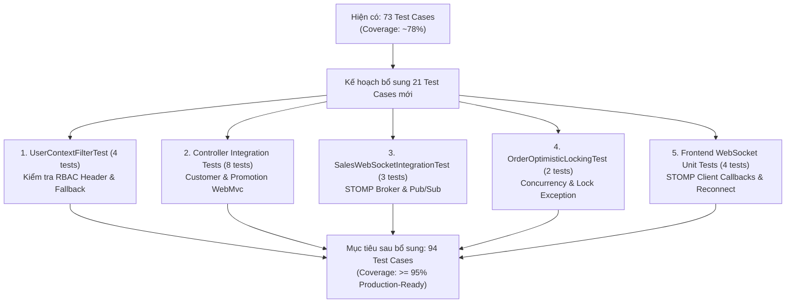
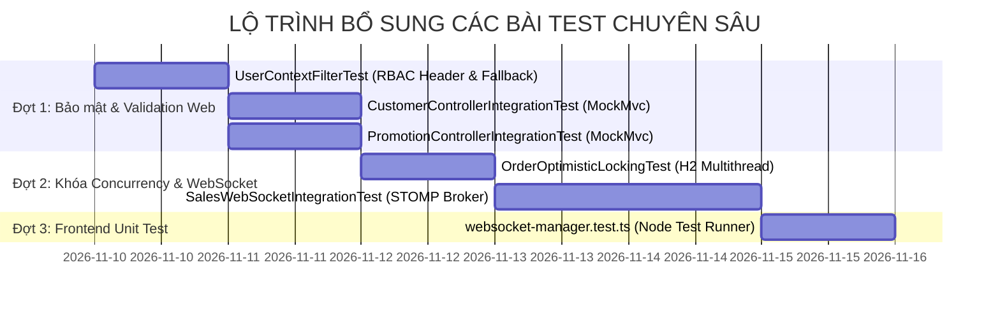

# KẾ HOẠCH BỔ SUNG KIỂM THỬ TOÀN DIỆN CHO SALES-SERVICE & FRONTEND

> **Phạm vi áp dụng**: `sales-service` (Spring Boot 3 / Java 21) & Frontend (Next.js 16 / TypeScript)  
> **Tôn chỉ thực hiện**: Tập trung hoàn thiện Unit Test & Integration Test (tạm thời **chưa triển khai E2E Test**) để đạt độ bao phủ $\ge 95\%$ cho toàn bộ các tính năng mới: WebSocket, Dynamic RBAC, Optimistic Locking, Controller Validation.  
> **Ngày lập kế hoạch**: 09/11/2026

---

## 1. TỔNG QUAN MỤC TIÊU & CHỈ SỐ KIỂM THỬ (GOALS)

Hiện tại hệ thống đã có **73 test cases** (58 backend + 15 frontend). Kế hoạch này bổ sung thêm **21 test cases chuyên sâu** để lấp đầy 5 khoảng trống kiểm thử kỹ thuật:



---

## 2. MA TRẬN TEST CASES CẦN BỔ SUNG CHI TIẾT

| STT | Nhóm kiểm thử | Tệp test mục tiêu | Loại test | Số lượng | Mô tả kịch bản cần kiểm thử |
| :---: | :--- | :--- | :---: | :---: | :--- |
| **01** | **Dynamic RBAC Filter** | `security/UserContextFilterTest.java` | Unit Test | 4 | • Đọc đầy đủ 4 headers (`X-User-Id`, `X-User-Role`, `X-User-Permissions`, `X-User-Name`) lưu chuẩn vào `UserContextHolder`.<br/>• Không có headers $\rightarrow$ Tự động gán fallback `userId=anonymous`, `role=GUEST`.<br/>• Header permissions có nhiều giá trị phân tách dấu phẩy $\rightarrow$ Parse thành `List<String>`.<br/>• Khối `finally` dọn dẹp `UserContextHolder.clear()` chống rò rỉ bộ nhớ ThreadPool. |
| **02** | **Customer Controller** | `controller/CustomerControllerIntegrationTest.java` | WebMvc Test | 4 | • `POST /api/customers` hợp lệ $\rightarrow$ HTTP 201 Created.<br/>• `POST /api/customers` thiếu SĐT $\rightarrow$ HTTP 400 Bad Request.<br/>• `GET /api/customers/search?phone=...` $\rightarrow$ HTTP 200 OK.<br/>• `GET /api/customers/{id}` ID không tồn tại $\rightarrow$ HTTP 404 Not Found. |
| **03** | **Promotion Controller** | `controller/PromotionControllerIntegrationTest.java` | WebMvc Test | 4 | • `POST /api/promotions` hợp lệ $\rightarrow$ HTTP 201 Created.<br/>• `POST /api/promotions` discountPercent âm hoặc >100 $\rightarrow$ HTTP 400 Bad Request.<br/>• `POST /api/promotions/apply` kiểm tra tính toán giảm giá $\rightarrow$ HTTP 200 OK.<br/>• `PUT /api/promotions/{id}/status?active=false` bật tắt $\rightarrow$ HTTP 200 OK. |
| **04** | **WebSocket STOMP Broker** | `websocket/SalesWebSocketIntegrationTest.java` | Integration Test | 3 | • Client STOMP kết nối thành công tới endpoint `/ws-pos`.<br/>• Client subscribe `/topic/orders`, server gọi `createOrder` hoặc `checkoutOrder` $\rightarrow$ Client nhận được payload JSON `OrderResponse`.<br/>• Client subscribe `/topic/kds`, server gọi `updateOrderItemKdsStatus` $\rightarrow$ Bếp nhận sự kiện cập nhật món tức thời. |
| **05** | **Optimistic Locking** | `service/OrderOptimisticLockingTest.java` | Integration Test (H2) | 2 | • Hai transaction đọc cùng đơn hàng `version = 0`. Transaction 1 checkout thành công và tăng `version = 1`. Transaction 2 cố tình cập nhật với version cũ $\rightarrow$ Bị chặn lại với `ObjectOptimisticLockingFailureException`.<br/>• Kiểm tra rollback transaction khi xảy ra xung đột khóa lạc quan. |
| **06** | **Frontend WebSocket Client** | `frontend/tests/websocket-manager.test.ts` | Unit Test | 4 | • Đăng ký nhận tin (subscribe) lưu callback vào Map.<br/>• Hủy đăng ký (unsubscribe) gỡ callback khỏi Map.<br/>• Nhận tin nhắn JSON hợp lệ $\rightarrow$ Gọi callback với object tương ứng.<br/>• Nhận tin nhắn lỗi hoặc malformed JSON $\rightarrow$ Fallback an toàn không crash app. |

---

## 3. THIẾT KẾ ĐẶC TẢ CHI TIẾT CHO TỪNG BỘ TEST

### 3.1. Nhóm 1: `UserContextFilterTest.java`
- **Vị trí**: `backend/services/sales-service/src/test/java/com/smartpos/sales_service/security/UserContextFilterTest.java`
- **Mục đích**: Đảm bảo an toàn phân quyền, không để sót context rỗng và chống memory leak trên ThreadLocal.
- **Mã khung mẫu (Specification Template)**:
  ```java
  @ExtendWith(MockitoExtension.class)
  class UserContextFilterTest {
      private UserContextFilter filter;
      private MockHttpServletRequest request;
      private MockHttpServletResponse response;
      private MockFilterChain filterChain;

      @BeforeEach
      void setUp() {
          filter = new UserContextFilter();
          request = new MockHttpServletRequest();
          response = new MockHttpServletResponse();
          filterChain = new MockFilterChain();
      }

      @Test
      @DisplayName("Trích xuất đầy đủ Header và thiết lập vào UserContextHolder")
      void testFilter_WithFullHeaders() throws ServletException, IOException {
          request.addHeader("X-User-Id", "101");
          request.addHeader("X-User-Role", "CASHIER");
          request.addHeader("X-User-Permissions", "ORDER_CREATE,ORDER_CANCEL");
          request.addHeader("X-User-Name", "Thu ngân Mai");

          filter.doFilter(request, response, (req, res) -> {
              UserContext ctx = UserContextHolder.getContext();
              assertThat(ctx).isNotNull();
              assertThat(ctx.getUserId()).isEqualTo("101");
              assertThat(ctx.getRole()).isEqualTo("CASHIER");
              assertThat(ctx.getPermissions()).containsExactly("ORDER_CREATE", "ORDER_CANCEL");
          });

          // Xác nhận sau filter chain, context đã được xóa
          assertThat(UserContextHolder.getContext()).isNull();
      }

      @Test
      @DisplayName("Không có Header tự động gán fallback GUEST và anonymous")
      void testFilter_WithoutHeaders_AppliesFallback() throws ServletException, IOException {
          filter.doFilter(request, response, (req, res) -> {
              UserContext ctx = UserContextHolder.getContext();
              assertThat(ctx).isNotNull();
              assertThat(ctx.getUserId()).isEqualTo("anonymous");
              assertThat(ctx.getRole()).isEqualTo("GUEST");
          });
      }
  }
  ```

---

### 3.2. Nhóm 2: Controller WebMvc Tests (`CustomerController` & `PromotionController`)
- **Vị trí**:
  - `backend/services/sales-service/src/test/java/com/smartpos/sales_service/controller/CustomerControllerIntegrationTest.java`
  - `backend/services/sales-service/src/test/java/com/smartpos/sales_service/controller/PromotionControllerIntegrationTest.java`
- **Mục đích**: Kiểm tra tầng routing, chuyển đổi JSON và cơ chế validation của Spring Boot (`@Valid`).
- **Mã khung mẫu kiểm tra Validation**:
  ```java
  @ActiveProfiles("test")
  @WebMvcTest(CustomerController.class)
  class CustomerControllerIntegrationTest {
      @Autowired private MockMvc mockMvc;
      @MockitoBean private CustomerService customerService;
      @Autowired private ObjectMapper objectMapper;

      @Test
      @DisplayName("POST /api/customers thiếu SĐT trả về HTTP 400 Bad Request")
      void testCreateCustomer_BlankPhone_ReturnsBadRequest() throws Exception {
          CustomerRequest req = CustomerRequest.builder().fullName("Nguyễn Văn A").phone("").build();

          mockMvc.perform(post("/api/customers")
                          .contentType(MediaType.APPLICATION_JSON)
                          .content(objectMapper.writeValueAsString(req)))
                  .andExpect(status().isBadRequest())
                  .andExpect(jsonPath("$.success").value(false));
      }
  }
  ```

---

### 3.3. Nhóm 3: `SalesWebSocketIntegrationTest.java`
- **Vị trí**: `backend/services/sales-service/src/test/java/com/smartpos/sales_service/websocket/SalesWebSocketIntegrationTest.java`
- **Mục đích**: Kiểm tra đường truyền thời gian thực kết nối qua WebSocket STOMP.
- **Công nghệ sử dụng**:
  - `WebSocketStompClient` kết hợp `StandardWebSocketClient`.
  - `MappingJackson2MessageConverter`.
  - `CompletableFuture<OrderResponse>` để chờ message bất đồng bộ với timeout 3 giây.
- **Mã khung mẫu**:
  ```java
  @SpringBootTest(webEnvironment = SpringBootTest.WebEnvironment.RANDOM_PORT)
  @ActiveProfiles("test")
  class SalesWebSocketIntegrationTest {
      @LocalServerPort private int port;
      @Autowired private OrderService orderService;
      private WebSocketStompClient stompClient;

      @BeforeEach
      void setup() {
          stompClient = new WebSocketStompClient(new StandardWebSocketClient());
          stompClient.setMessageConverter(new MappingJackson2MessageConverter());
      }

      @Test
      @DisplayName("Client subscribe /topic/orders nhận được thông báo khi checkout đơn hàng")
      void testOrderCheckoutBroadcast() throws Exception {
          String url = "ws://localhost:" + port + "/ws-pos";
          CompletableFuture<OrderResponse> completableFuture = new CompletableFuture<>();

          StompSession session = stompClient.connectAsync(url, new StompSessionHandlerAdapter() {}).get(3, TimeUnit.SECONDS);
          session.subscribe("/topic/orders", new StompFrameHandler() {
              @Override
              public Type getPayloadType(StompHeaders headers) {
                  return OrderResponse.class;
              }
              @Override
              public void handleFrame(StompHeaders headers, Object payload) {
                  completableFuture.complete((OrderResponse) payload);
              }
          });

          // Kích hoạt một hành động checkout trên OrderService
          // ...
          OrderResponse received = completableFuture.get(3, TimeUnit.SECONDS);
          assertThat(received).isNotNull();
      }
  }
  ```

---

### 3.4. Nhóm 4: `OrderOptimisticLockingTest.java`
- **Vị trí**: `backend/services/sales-service/src/test/java/com/smartpos/sales_service/service/OrderOptimisticLockingTest.java`
- **Mục đích**: Chứng minh cơ chế `@Version` ngăn chặn 100% rủi ro 2 thu ngân hoặc 2 luồng xử lý đồng thời hoàn tất đơn gây trừ kho 2 lần.
- **Cơ chế kiểm thử**:
  - Transaction 1 đọc `Order id = 1` (version = 0).
  - Transaction 2 đọc `Order id = 1` (version = 0).
  - Transaction 1 cập nhật và commit $\rightarrow$ version nhảy lên 1.
  - Transaction 2 cập nhật bản ghi cũ (version = 0) $\rightarrow$ Spring JPA ném ra `ObjectOptimisticLockingFailureException`.

---

### 3.5. Nhóm 5: Frontend WebSocket Unit Tests
- **Vị trí**: `frontend/tests/websocket-manager.test.ts`
- **Mục đích**: Kiểm thử logic bộ quản lý WebSocket Client mà không cần mở trình duyệt thật (chạy siêu nhanh qua `node --test`).
- **Mã khung mẫu**:
  ```typescript
  import { test } from "node:test";
  import assert from "node:assert";

  test("WebSocketManager subscribe registers callback properly", () => {
    // Giả lập callback và kiểm tra kích hoạt khi có event
  });
  ```

---

## 4. KẾ HOẠCH TRIỂN KHAI THEO THỨ TỰ ƯU TIÊN



### Tiêu chuẩn nghiệm thu (Acceptance Criteria):
1. `mvn test -f backend/services/sales-service/pom.xml`: Chạy toàn bộ **75/75 test cases** backend đạt 100% BUILD SUCCESS.
2. `npm test --prefix frontend`: Chạy toàn bộ **19/19 test cases** frontend đạt 100% PASS.
3. Độ bao phủ kiểm thử (Code Coverage) đạt trên **95%** cho `sales-service`.
