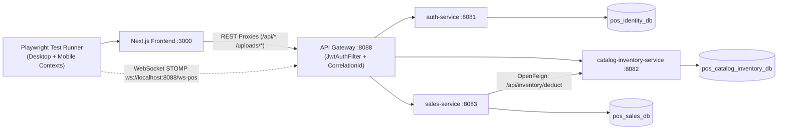

# KẾ HOẠCH XÂY DỰNG KIỂM THỬ END-TO-END (E2E) — HỆ THỐNG SMART POS & KDS

> **Phiên bản:** 2.0 (Cập nhật sau khi hoàn thiện API Gateway, mở rộng Seed Data & bổ sung GitHub Actions CI)  
> **Phạm vi dự án:** Toàn hệ thống Smart POS & KDS (Frontend Next.js + API Gateway + 3 Backend Microservices + PostgreSQL)  
> **Tính chất tài liệu:** Bản kế hoạch thiết kế & chuẩn bị triển khai (chưa bao gồm mã nguồn kiểm thử)  
> **Ngày cập nhật:** 11/11/2026

---

## 1. BỐI CẢNH, ĐÁNH GIÁ GATEWAY & HIỆN TRẠNG HỆ THỐNG

### 1.1. Kết quả kiểm tra API Gateway (`backend/gateway`)
Qua rà soát mã nguồn và chạy bộ test của module `gateway` (`mvn -f backend/gateway/pom.xml test -o` — **11/11 tests PASS**), tầng Gateway đã đạt các yêu cầu cốt lõi để đưa vào kiểm thử E2E:
- **Định tuyến đầy đủ (7 routes trong `application.yml`, cổng mặc định `8088`):**
  - `auth-service` (`:8081`): `/api/auth/**`, `/api/users/**`, `/api/roles/**`, `/api/permissions/**`.
  - `sales-service` (`:8083`): `/api/sales/health`, `/api/sales/**` (rewrite về `/api/...`), `/api/orders/**`, `/api/customers/**`, `/api/promotions/**`, và WebSocket `/ws-pos/**` (hỗ trợ cả native WS qua `WebsocketRoutingFilter` lẫn SockJS HTTP).
  - `catalog-inventory-service` (`:8082`): `/api/catalog/**` (rewrite về `/api/...`), `/api/products/**`, `/api/categories/**`, `/api/modifier-groups/**`, `/api/ingredients/**`, `/api/recipes/**`, `/api/inventory/**`, `/api/suppliers/**`, `/api/purchase-orders/**`, `/api/files/**`, `/uploads/**`.
- **Xác thực & Chống giả mạo (`JwtAuthenticationFilter`):**
  - Xóa sạch mọi header `X-User-*` gửi từ client để chống Header Spoofing.
  - Xác thực Bearer JWT cho các route bảo mật và trả JSON `401` thống nhất (kèm `X-Correlation-Id`); mở đúng các route public phục vụ Đăng nhập/Refresh và Khách QR Ordering (`/api/catalog/products/**`, `POST /api/sales/orders`, `POST /api/sales/orders/{id}/items`, `POST /api/sales/promotions/apply`, `/ws-pos/**`, `/uploads/**`).
  - Bảo vệ các endpoint nhạy cảm (`/api/sales/orders/statistics`, `/checkout`, `/inventory/**`, `/users/**`, `/roles/**`, v.v.).
- **Observability & Xử lý lỗi (`CorrelationIdAndLoggingFilter`, `GlobalGatewayExceptionHandler`):** Tự động sinh/giữ `X-Correlation-Id`, log latency, chuẩn hóa JSON `404`, `503`, `504`.
- **Kết nối từ Frontend:** `frontend/next.config.mjs` đã trỏ toàn bộ rewrites sang `API_GATEWAY_URL` (`http://localhost:8088`), và `frontend/src/lib/websocket.ts` đã trỏ mặc định sang `ws://localhost:8088/ws-pos`.

### 1.2. Các lưu ý kỹ thuật còn tồn đọng quanh Gateway & Tích hợp (Cần biết khi làm E2E)
1. **AuthN (401) vs AuthZ (403) ở tầng API:** Gateway kiểm tra xác thực JWT (401) và bơm `X-User-Id`, `X-User-Role`, `X-User-Name`, `X-User-Permissions` xuống downstream. `auth-service` có `@PreAuthorize` trả `403` đầy đủ, nhưng `sales-service` và `catalog-inventory-service` chưa siết `@PreAuthorize` / kiểm tra quyền ở controller (chỉ UI `RoleGate` chặn 403 trên trình duyệt). Vì vậy, các bài test chặn `403` trên `/pos`, `/kds`, `/admin` chủ yếu xác minh `RoleGate` + API thuộc `auth-service`, còn Gateway kiểm tra chặn `401` khi thiếu/hết hạn token.
2. **Endpoint `GET /api/sales/orders` đang public:** Phục vụ luồng khách QR kiểm tra bàn đang có đơn chưa (`fetchOrders({ tableNumber })` ở `/cart`). E2E sẽ test đúng luồng này; về bảo mật dài hạn có thể siết bắt buộc truyền `tableNumber` khi không đăng nhập.
3. **Healthcheck giữa các service chưa đồng bộ:** `gateway` (`:8088`) và `auth-service` (`:8081`) có `/actuator/health`, `sales-service` có `/api/sales/health`, riêng `catalog-inventory-service` (`:8082`) chưa bật Actuator nên trong script/CI sẽ healthcheck qua `GET http://localhost:8088/api/catalog/products/menu`.
4. **Đồng bộ `JWT_SECRET`:** Khi chạy local nhiều terminal hoặc chạy trên GitHub CI, `auth-service` và `gateway` phải nhận cùng giá trị `JWT_SECRET` (hiện `backend/services/auth-service/.env` đang khớp giá trị mặc định của `gateway/application.yml`, còn `backend/gateway/.env` và `.env` gốc đang trống).

### 1.3. Cập nhật hiện trạng Seed Data phục vụ E2E
Dữ liệu khởi tạo tự động (`init-scripts/` + `DataInitializer` ở 3 service khi chạy ngoài profile `test`) hiện đã rất phong phú và cần được tính đến khi thiết kế test:
- **Bàn ăn (`02-seed-data.sql`):** Đã chuẩn hóa đủ **20 bàn (`1`..`20`)** khớp hoàn toàn với sơ đồ 20 bàn trên POS và QR Generator.
- **Tài khoản & Vai trò (`auth-service` `DataInitializer`):** Đã seed **6 vai trò** (`ADMIN`, `MANAGER`, `CHEF`, `CASHIER`, `WAITER`, và vai trò custom `PART_TIME` có `isSystem = false`) cùng **15 tài khoản** (mật khẩu `12345678`), bao gồm sẵn **`locked_staff`** (`active = false`) cho test case đăng nhập thất bại do tài khoản bị khóa.
- **Đơn hàng mẫu (`sales-service` `DataInitializer`):**
  - Có sẵn **6 đơn đang hoạt động** chiếm các bàn: **`Bàn 1` (`PENDING`), `Bàn 2` (`CONFIRMED`), `Bàn 3` (`PREPARING`), `Bàn 5` (`READY`), `Bàn 8` (`SERVED`)**, và 1 đơn `TAKEAWAY` (`PREPARING`).
  - Có sẵn **8 đơn `COMPLETED`** (trải đều hôm nay, hôm qua, tuần, tháng) và **2 đơn `CANCELLED`**.
  - **Hệ quả cho thiết kế E2E:** Các test tạo đơn mới (QR Ordering / POS) **không dùng `Bàn 1, 2, 3, 5, 8`** mà sử dụng các **bàn đang trống** (như `Bàn 11`..`Bàn 20` hoặc `Bàn 4, 6, 7, 9, 10`). Ngược lại, `Bàn 1, 2, 3, 5, 8` được tận dụng để test kiểm chứng trạng thái bàn có sẵn hoặc gọi thêm món.
- **Khuyến mãi & Khách hàng (`sales-service` `DataInitializer`):** Có sẵn 10 khách hàng (như `0988777666` có 250 điểm, `0909090909` có 0 điểm) và 6 mã voucher, gồm cả **`LIMITED10`** (hết lượt `10/10`) và **`EXPIRED_OLD`** (hết hạn & `isActive = false`) phục vụ trực tiếp cho test case biên.
- **Kho & Thực đơn (`catalog-inventory-service` `DataInitializer`):** Đầy đủ danh mục, món ăn, biến thể, modifier, 22 nguyên liệu (gồm `NL-GA` đang dưới ngưỡng `minThreshold` để test cảnh báo tồn thấp), công thức BOM 3 tầng, 3 nhà cung cấp và 2 phiếu nhập mẫu (`COMPLETED` và `DRAFT`).

---

## 2. KIẾN TRÚC LUỒNG CHẠY E2E QUA GATEWAY

*Lưu ý về WebSocket trong E2E:* Cả luồng REST lẫn luồng WebSocket (`/ws-pos`) đều đi qua **API Gateway (`:8088`)**, cho phép test đồng bộ thời gian thực `< 2 giây` giữa Khách QR $\rightarrow$ Bếp KDS $\rightarrow$ Thu ngân POS mà không chờ fallback polling 60 giây.

---

## 3. CÔNG CỤ & CẤU TRÚC THƯ MỤC PLAYWRIGHT

### 3.1. Bộ công cụ đã chốt
- **Framework:** **Playwright (`@playwright/test`)** với TypeScript.
- **Lý do phù hợp:** Hỗ trợ nhiều `BrowserContext` độc lập trong cùng 1 test case (chạy song song Khách QR trên Mobile viewport + Bếp KDS + Thu ngân POS với cookie/JWT riêng), cơ chế auto-wait chống flaky, hỗ trợ trace/video/screenshot phục vụ debug cả trên local lẫn GitHub Actions CI.
- **Vị trí đề xuất:** Thư mục **`e2e/`** độc lập ở gốc repository (tách bạch khỏi `frontend/tests/` vốn đang chạy `node --test` cho Unit Test thuần).

### 3.2. Cấu trúc thư mục quy hoạch
- `e2e/package.json` & `e2e/playwright.config.ts` — Khai báo project `desktop-chromium`, `mobile-qr`, timeout, retries trên CI, reporters (`html`, `github` khi chạy CI, `list`).
- `e2e/fixtures/` — Auth `storageState` theo vai trò (`admin`, `manager`, `cashier`, `chef`, `waiter`), helper kiểm tra API/DB hậu điều kiện, helper tạo/dọn dữ liệu test.
- `e2e/pages/` — Page Object Model (POM) cho từng phân hệ:
  - `LoginPage`, `PortalPage`
  - `MenuQrPage`, `CartPage`
  - `PosPage`, `KdsPage`
  - `AdminDashboardPage`, `AdminOrdersPage`, `AdminProductsPage`, `AdminBomPage`, `AdminInventoryPage`, `AdminPurchasingPage`, `AdminPromotionsPage`, `AdminCustomersPage`, `AdminStaffPage`
- `e2e/tests/` — Chia 6 suite theo nghiệp vụ:
  - `01-auth-rbac/`
  - `02-qr-ordering/`
  - `03-core-pos-kds-bom/`
  - `04-inventory-purchasing/`
  - `05-admin-catalog-crm-promo/`
  - `06-gateway-concurrency-errors/`
- `e2e/scripts/` — Script khởi động / healthcheck toàn stack (`5433/5434`, `8081`, `8082`, `8083`, `8088`, `3000`) dùng chung cho local PowerShell và GitHub CI.

---

## 4. CHIẾN LƯỢC DATABASE CHO E2E (PHÂN TÍCH & KHUYẾN NGHỊ)

### 4.1. So sánh các phương án Database

| Phương án | Cách hoạt động | Ưu điểm | Nhược điểm | Kết luận |
| :--- | :--- | :--- | :--- | :--- |
| **1. H2 In-Memory** | Chạy DB giả lập trên RAM như Unit/Integration Test | Nhanh, không cần Docker | Sai khác dialect với PostgreSQL, không chạy được `init-scripts/`, không chứng minh được E2E trên DB thật | **Không dùng cho E2E** |
| **2. Dùng chung PostgreSQL Dev (`:5433`)** | E2E kết nối thẳng container Postgres hiện tại | Không cần cấu hình thêm port | Test sẽ thay đổi tồn kho, tạo đơn hàng, trừ/cộng điểm khách hàng thật; nếu reset sẽ mất dữ liệu bạn đang test tay | Chỉ phù hợp nếu dùng dữ liệu tiền tố riêng và chấp nhận DB dev bị phát sinh dữ liệu test |
| **3. PostgreSQL 16 riêng cho E2E** | **Trên CI:** Container `postgres:16-alpine` mới tinh mỗi lần chạy. **Trên Local:** Compose file/container E2E riêng (VD: cổng `5434`) hoặc reset trước khi chạy suite | Dữ liệu chuẩn 100% như production, tái lập được (`repeatable`), không ảnh hưởng DB dev | Tốn thêm 1 bước cấu hình port/compose cho bản E2E local | **Khuyến nghị số 1** |

### 4.2. Kiến trúc dữ liệu đề xuất (Kết hợp Isolation + Clean Seed)
1. **Trên GitHub Actions CI:** Mặc định chạy `postgres:16-alpine` sạch trong service/container của job CI $\rightarrow$ nạp `init-scripts/` $\rightarrow$ 3 microservices tự chạy `DataInitializer` tạo bộ dữ liệu chuẩn đầy đủ. Không bao giờ xung đột với máy local.
2. **Trên máy Local:** Khuyến nghị tách một `docker-compose.e2e.yml` (cổng `5434`, volume tạm hoặc dễ `down -v`) để bảo vệ DB dev `5433`, hoặc chạy qua một profile/script riêng trước khi chạy Playwright.
3. **Cô lập giữa các Test Case (Test Isolation):**
   - Mỗi test case tạo đơn hàng mới dùng **một bàn trống riêng biệt** trong dải `Bàn 11`..`Bàn 20` (không đụng `Bàn 1, 2, 3, 5, 8` đã có đơn seed).
   - Các test CRUD (tạo món, tạo NCC, tạo khuyến mãi, tạo nhân viên, tạo role, tạo khách hàng) đều gắn hậu tố unique (VD: `E2E_<timestamp>`) và không phụ thuộc vào dữ liệu do test khác sinh ra.
   - Các test làm thay đổi tồn kho lớn (như test thiếu nguyên liệu `E2E-INV-01`) chỉ thao tác trên **một nguyên liệu tách biệt** (VD: nguyên liệu tạo mới hoặc `NL-GA` / khôi phục tồn kho ngay trong khối `afterEach`).

---

## 5. DANH MỤC KỊCH BẢN KIỂM THỬ E2E (CẬP NHẬT THEO SEED & GATEWAY)

### 5.1. Suite 1: Xác thực JWT, Refresh Cookie, Gateway AuthN & RBAC (`01-auth-rbac`)

| Mã TC | Mức | Kịch bản kiểm thử | Dữ liệu / Điều kiện (theo seed mới) | Kết quả mong đợi |
| :--- | :---: | :--- | :--- | :--- |
| **E2E-AUTH-01** | P0 | Đăng nhập & điều hướng theo vai trò + giữ phiên | `admin` (`/admin`), `manager01` (`/admin`), `cashier01` (`/pos`), `chef01` (`/kds`), `waiter01` (`/order-taking`), `parttime01` (`/order-taking`). | Điều hướng đúng route đích; cookie `refreshToken` HttpOnly được cấp qua Gateway; F5 reload trang vẫn giữ nguyên phiên qua `/api/auth/refresh` + `/api/auth/me`. |
| **E2E-AUTH-02** | P0 | Đăng nhập sai mật khẩu & tài khoản bị khóa | Thử sai mật khẩu của `cashier01`; thử đăng nhập bằng tài khoản seed `locked_staff` (`active = false`). | Hiển thị lỗi trên `LoginForm`, không cấp token, giữ nguyên ở `/login`. |
| **E2E-AUTH-03** | P0 | Bảo vệ route UI (`RoleGate`) & Gateway `401` | Chưa đăng nhập vào `/pos`, `/kds`, `/admin`; `cashier01` mở `/admin` và `/kds`; gọi API protected qua Gateway `:8088` không kèm token. | UI chuyển về `/login` hoặc hiện `HTTP 403 • Forbidden`; Gateway trả `401` JSON chuẩn khi thiếu/hỏng JWT. |
| **E2E-AUTH-04** | P1 | Phân quyền động & Role tùy chỉnh (`PART_TIME` / mới) | `admin` vào `/admin/staff`, cấp thêm quyền `KDS_VIEW` hoặc tạo role đa phân hệ gán cho user mới; user đăng nhập lại. | User thấy đúng các phân hệ được cấp trên Cổng phân hệ (`/`), truy cập được các màn hình tương ứng; bảo vệ role hệ thống (`isSystem = true`) không cho xóa. |
| **E2E-AUTH-05** | P1 | Đổi mật khẩu, đăng xuất & Admin reset mật khẩu | `cashier03` đổi mật khẩu $\rightarrow$ đăng xuất $\rightarrow$ kiểm tra mật khẩu cũ/mới; `admin` reset lại mật khẩu cho `cashier03`. | Mật khẩu cũ không đăng nhập được sau khi đổi; đăng xuất vô hiệu hóa phiên; mật khẩu reset hoạt động bình thường. |

### 5.2. Suite 2: Khách hàng gọi món qua QR (`02-qr-ordering`)

| Mã TC | Mức | Kịch bản kiểm thử | Dữ liệu / Điều kiện | Kết quả mong đợi |
| :--- | :---: | :--- | :--- | :--- |
| **E2E-QR-01** | P0 | Tải thực đơn thật, lọc danh mục & tìm kiếm (Mobile) | Mở `/menu?table=11` trên Mobile viewport; lọc danh mục (`Mì Cay`, `Trà & Thức Uống`...), tìm `"Bò Mỹ"` / `"MC-BO"`. | Tải đúng menu qua Gateway (`/api/catalog/products/menu`), lọc và tìm kiếm chính xác. |
| **E2E-QR-02** | P0 | Tùy chọn Biến thể & Topping, giỏ hàng bền vững | Chọn `Mì Cay Bò Mỹ` (75.000đ) + `Cấp 7 (Siêu cay)` (+5.000đ) + `Thịt bò thêm` (+25.000đ) + ghi chú; mở `/cart?table=11`, chỉnh số lượng, F5. | Giá đúng 105.000đ/phần; `localStorage` giữ đúng giỏ của bàn 11 khi reload. |
| **E2E-QR-03** | P0 | Gửi đơn gọi món mới từ QR | Tại `/cart?table=11` (bàn đang trống), bấm **Xác nhận gọi món**. | `POST /api/sales/orders` trả `201`, hiện mã `#ORD-...`, giỏ hàng bàn 11 được xóa sạch. |
| **E2E-QR-04** | P1 | Gọi thêm món vào bàn đang có đơn seed sẵn | Mở `/menu?table=5` (đang có đơn seed `ORD-DEMO-ACT-04` ở trạng thái `READY`), thêm `Trà Đào Cam Sả` và gửi. | Gọi `POST /api/sales/orders/{id}/items` gộp vào đơn cũ (không tạo đơn trùng bàn); tổng tiền đơn tăng và trạng thái quay lại `PREPARING` để bếp làm món mới. |
| **E2E-QR-05** | P1 | Áp dụng voucher hợp lệ & voucher hết lượt/hết hạn tại QR | Ở `/cart?table=12`, thử nhập `LIMITED10` (hết lượt), `EXPIRED_OLD` (hết hạn), rồi áp `OPENING` (10%) và gửi đơn. | `LIMITED10` và `EXPIRED_OLD` bị từ chối với thông báo rõ ràng; `OPENING` giảm 10% (tối đa 50k) và lưu vào đơn. |
| **E2E-QR-06** | P1 | Truy cập `/menu` không có `?table=` | Mở `/menu` và `/cart` không truyền tham số bàn. | Chỉ xem thực đơn, khóa nút xác nhận gọi món ở `/cart`. |

### 5.3. Suite 3: Luồng Xuyên suốt QR $\rightarrow$ KDS $\rightarrow$ POS $\rightarrow$ Trừ kho BOM (`03-core-pos-kds-bom`)

| Mã TC | Mức | Kịch bản kiểm thử | Dữ liệu / Điều kiện | Kết quả mong đợi |
| :--- | :---: | :--- | :--- | :--- |
| **E2E-CORE-01** | P0 | **Luồng vàng đa phiên (QR $\rightarrow$ KDS $\rightarrow$ POS $\rightarrow$ BOM $\rightarrow$ Loyalty)** | Mở song song 3 BrowserContext: Khách (`/menu?table=16`), `chef01` (`/kds`), `cashier01` (`/pos`). Khách đặt `1x Mì Cay Bò Mỹ` (Cấp 7 + `Thịt bò thêm`) và `1x Trà Đào Cam Sả` (Size L); KDS hoàn tất từng món; POS nhập SĐT `0988777666`, dùng 10 điểm, áp `OPENING`, thanh toán **Tiền mặt**. | • WebSocket `/ws-pos` qua Gateway đẩy sự kiện realtime về KDS và POS (`< 2–3s`). • KDS tách đúng trạm **Bếp nóng** và **Quầy bar**; POS chuyển `Bàn 16` từ `Chờ bếp` $\rightarrow$ `Bếp đã xong` $\rightarrow$ `Trống`. • Nguyên liệu trong kho giảm đúng định lượng BOM 3 tầng và ghi nhận `SALE_DEDUCT` gắn `orderCode`. • Khách `0988777666` bị trừ 10 điểm (`REDEEM`) và cộng điểm mới (`EARN` = `floor(totalAmount / 100000)`). |
| **E2E-CORE-02** | P0 | Thu ngân tạo đơn tại POS $\rightarrow$ Gửi bếp $\rightarrow$ Thanh toán VietQR (theo luồng hiện có) | `cashier01` chọn bàn trống `Bàn 17` trên `/pos`, thêm món, bấm **Gửi bếp**, kiểm tra xuất hiện trên `/kds`, mở modal thanh toán **VietQR** và bấm xác nhận theo UI hiện có. | Đơn gửi KDS thành công; bàn về `Trống`; hóa đơn lưu `COMPLETED` (`VIETQR` / `PAID`), xuất hiện ở Lịch sử hóa đơn và tự động trừ kho BOM. *(Ghi chú: sẽ cập nhật test khi nâng cấp đối soát VietQR tự động sau).* |
| **E2E-CORE-03** | P0 | Hủy đơn đang phục vụ tại POS | `cashier01` chọn bàn đang có đơn chưa thanh toán (VD: `Bàn 18` mới tạo hoặc `Bàn 2`), bấm **Hủy đơn** và xác nhận. | Đơn chuyển `CANCELLED`, bàn về `Trống`, task biến mất khỏi `/kds`, **tồn kho nguyên liệu giữ nguyên không đổi**. |

### 5.4. Suite 4: Kho, BOM, Nhà cung cấp & Nhập hàng (`04-inventory-purchasing`)

| Mã TC | Mức | Kịch bản kiểm thử | Dữ liệu / Điều kiện | Kết quả mong đợi |
| :--- | :---: | :--- | :--- | :--- |
| **E2E-INV-01** | P0 | **Chặn thanh toán & rollback khi thiếu nguyên liệu** | Tạo món + nguyên liệu test có tồn kho thấp hơn định lượng (hoặc điều chỉnh tồn tạm thời thấp hơn BOM rồi khôi phục trong teardown), đặt đơn cho `Bàn 19` và bấm thanh toán trên `/pos`. | Báo lỗi thiếu nguyên liệu; đơn không chuyển `COMPLETED`; không trừ dở các nguyên liệu khác; không cộng/trừ điểm hay tăng `usedCount` voucher. |
| **E2E-INV-02** | P1 | Nhập kho từ Nhà cung cấp (`/admin/purchasing`) | `manager01` tạo phiếu nhập `DRAFT` (hoặc hoàn tất phiếu `PO-20261030-1002` / phiếu mới) $\rightarrow$ bấm hoàn tất nhập kho. | Phiếu chuyển `COMPLETED`, tồn kho ở `/admin/inventory` tăng đúng số lượng nhập, sinh giao dịch `IMPORT`. |
| **E2E-INV-03** | P1 | Kiểm kê (`AUDIT_ADJUST`), Xuất hủy (`SPOILAGE`) & Cảnh báo tồn thấp | Kiểm tra cảnh báo sẵn có (`NL-GA` = 2.5kg < 5.0kg) và thực hiện kiểm kê/xuất hủy trên nguyên liệu test. | Tồn kho cập nhật chính xác, chặn xuất hủy vượt tồn, cảnh báo low-stock đồng bộ trên `/admin`, `/admin/inventory` và tab **Kho nguyên liệu** của `/kds`. |
| **E2E-BOM-01** | P1 | Cấu hình BOM 3 tầng (`/admin/menu-bom`) | Cập nhật định lượng BOM cho món test $\rightarrow$ reload kiểm tra lưu bền vững $\rightarrow$ bán 1 đơn món đó. | Khi thanh toán, kho trừ đúng theo định lượng vừa cập nhật. |

### 5.5. Suite 5: Quản trị Thực đơn, Khuyến mãi, Khách hàng, Báo cáo & Màn hình tối giản (`05-admin-catalog-crm-promo`)

| Mã TC | Mức | Kịch bản kiểm thử | Dữ liệu / Điều kiện | Kết quả mong đợi |
| :--- | :---: | :--- | :--- | :--- |
| **E2E-ADM-01** | P1 | CRUD Món ăn & Danh mục (`/admin/products`) | Tạo danh mục + món test (kèm upload ảnh `/api/catalog/files/upload`, biến thể, modifier) $\rightarrow$ kiểm tra hiển thị ở `/menu` và `/pos` $\rightarrow$ tắt `isActive`. | Ảnh load qua `/uploads/**` trên Gateway; món ẩn khỏi `/menu` khi `isActive = false`. |
| **E2E-ADM-02** | P1 | Quản lý Khuyến mãi (`/admin/promotions`) | Tạo mã voucher test với `minOrderAmount` và `maxDiscountAmount` $\rightarrow$ kiểm tra áp dụng ở `/pos` & `/cart` $\rightarrow$ tạm dừng mã. | Đơn chưa đủ tối thiểu bị từ chối; đơn lớn chặn đúng trần giảm giá; mã tạm dừng không áp dụng được. |
| **E2E-ADM-03** | P1 | Khách hàng, Lịch sử hóa đơn & Thống kê (`/admin`, `/admin/orders`, `/admin/customers`) | Đăng ký khách mới trên `/pos` và thanh toán đơn ở `Bàn 20`; kiểm tra `/admin` (biểu đồ/KPI), `/admin/orders` (lọc, phân trang, xem & in, xuất CSV) và `/admin/customers` (lịch sử điểm). | Số liệu doanh thu/đơn hàng tăng khớp; xuất CSV thành công; khách mới hiển thị đủ lịch sử `EARN`. |
| **E2E-ADM-04** | P2 | Sinh QR theo bàn, tab Chi nhánh & màn hình Waiter hiện có | Kiểm tra tab QR & Chi nhánh ở `/admin/staff`; kiểm tra đăng nhập `waiter01` vào `/order-taking` bấm mở `/menu`. | Link QR mở đúng `/menu?table={n}`; thao tác lưu chi nhánh hiện thông báo trên UI; `/order-taking` điều hướng sang `/menu` không lỗi. *(Cập nhật sau nếu nâng cấp UI phục vụ/chi nhánh).* |

### 5.6. Suite 6: Gateway Resilience, Concurrency & Idempotency (`06-gateway-concurrency-errors`)

| Mã TC | Mức | Kịch bản kiểm thử | Dữ liệu / Điều kiện | Kết quả mong đợi |
| :--- | :---: | :--- | :--- | :--- |
| **E2E-EDGE-01** | P1 | Chống trừ kho kép & Optimistic Locking | Mở 2 tab `/pos` cùng chọn một bàn đang có đơn, bấm thanh toán liên tiếp hoặc gần như đồng thời ở 2 tab. | Chỉ 1 tab thanh toán thành công; chỉ sinh **1 bộ thẻ kho `SALE_DEDUCT`** cho `orderCode`; tab còn lại nhận lỗi xung đột/đơn đã hoàn tất. |
| **E2E-EDGE-02** | P1 | Header Spoofing & Bảo mật Gateway | Gửi request qua Gateway `:8088` tới route protected với header giả `X-User-Role: ADMIN` nhưng không kèm JWT. | Gateway xóa header giả và trả về `401 Unauthorized` JSON có `correlationId`. |
| **E2E-EDGE-03** | P2 | Xử lý lỗi mạng / `503` từ Gateway | Giả lập lỗi `503` / abort request trên Playwright khi gửi đơn ở `/cart` hoặc cập nhật KDS. | UI hiển thị cảnh báo lỗi rõ ràng, giữ giỏ hàng / hoàn tác UI KDS, không báo thành công giả. |

---

## 6. KẾ HOẠCH TRIỂN KHAI TRÊN GITHUB ACTIONS CI

### 6.1. Cấu hình Workflow đề xuất (`.github/workflows/e2e.yml`)
- **Sự kiện kích hoạt:** `pull_request`, `push` (nhánh `main`/`dev`), và `workflow_dispatch` (chạy thủ công khi cần).
- **Môi trường Runner:** `ubuntu-latest` (chạy Docker `postgres:16-alpine` nhanh và ổn định hơn Windows runner), cài **JDK 21**, **Node.js 24 LTS**, **Playwright Chromium**.
- **Caching:** Cache `~/.m2/repository`, `frontend` npm cache và Playwright browsers để rút ngắn thời gian chạy CI.

### 6.2. Trình tự thực thi trong Job CI
1. **Khởi động PostgreSQL 16 (service container hoặc Docker):** Map cổng `5433`, mount `init-scripts/` (`01`..`05`) và chờ `pg_isready`.
2. **Build & Chuẩn bị Backend:**
   - Cài đặt parent POM và `shared`: `mvn -f backend/pom.xml -N install` và `mvn -f backend/pom.xml -pl shared -am install -DskipTests`.
   - Build hoặc chạy tuần tự 4 ứng dụng nền: `auth-service` (`:8081`), `catalog-inventory-service` (`:8082`), `sales-service` (`:8083`), `gateway` (`:8088`) với **cùng `JWT_SECRET`** và `SPRING_PROFILES_ACTIVE=dev`.
3. **Healthcheck Backend + Gateway:** Chờ `http://localhost:8088/actuator/health`, `http://localhost:8081/actuator/health`, `http://localhost:8088/api/sales/health`, và `http://localhost:8088/api/catalog/products/menu` đều trả HTTP 200.
4. **Build & Chạy Frontend (`:3000`):** Thiết lập `API_GATEWAY_URL=http://localhost:8088` và `NEXT_PUBLIC_WS_URL=ws://localhost:8088/ws-pos`, chạy `npm ci && npm run build && npm run start`, chờ `http://localhost:3000/login` sẵn sàng.
5. **Chạy Playwright E2E:** Chạy toàn bộ test suite (`headless`) và xuất báo cáo.
6. **Thu thập Artifacts (`if: always()`):** Upload `playwright-report/`, `test-results/` (trace, video, screenshot khi lỗi) và file log của 4 backend services + frontend để debug trực tiếp trên GitHub.

---

## 7. LỘ TRÌNH THỰC HIỆN ĐỀ XUẤT (4 GIAI ĐOẠN)

1. **Giai đoạn 1 — Thiết lập khung Playwright & Hạ tầng chạy stack (1–2 ngày):**
   - Khởi tạo `e2e/` với Playwright + TypeScript.
   - Chốt cấu hình DB E2E cho local (tách biệt với DB dev hoặc reset script) và chuẩn hóa biến môi trường `.env` mẫu (đồng bộ `JWT_SECRET`, `API_GATEWAY_URL`, `NEXT_PUBLIC_WS_URL`).
   - Xây dựng script khởi động/healthcheck stack dùng được cho cả local Windows và Linux CI.
2. **Giai đoạn 2 — Xây dựng Fixtures, POM & Luồng Xương sống P0 (2–3 ngày):**
   - Triển khai `storageState` auth fixtures và POM cho Login, QR Menu/Cart, KDS, POS.
   - Hoàn thiện và chạy pass ổn định `Suite 1` (Auth P0), `Suite 2` (QR P0), `Suite 3` (`E2E-CORE-01..03`), `E2E-INV-01` (Rollback thiếu kho).
3. **Giai đoạn 3 — Mở rộng P1/P2 & Tích hợp GitHub Actions CI (2–3 ngày):**
   - Triển khai `Suite 4`, `Suite 5`, `Suite 6` (bao gồm kiểm tra WebSocket qua Gateway, chống Header Spoofing, Concurrency).
   - Thiết lập `.github/workflows/e2e.yml` và chạy kiểm chứng trên GitHub Actions (chỉnh timeout/retry nếu runner chậm).
4. **Giai đoạn 4 — Chống Flaky & Đóng gói Nghiệm thu (1 ngày):**
   - Chạy lặp lại 3 lần liên tiếp từ DB sạch đạt **0% flaky**.
   - Xuất Playwright HTML Report và lưu minh chứng phục vụ bảo vệ đồ án.

### Tiêu chí nghiệm thu (Definition of Done)
- **100% test P0, P1, P2 PASS** qua **API Gateway (`:8088`)** nối thật Frontend + 3 Microservices + PostgreSQL 16.
- Chạy thành công cả trên **Local Windows** và **GitHub Actions CI**, tự động đính kèm HTML Report / Trace khi thất bại.

---

## 8. CÂU HỎI CHỐT CUỐI TRƯỚC KHI BẮT ĐẦU CODE E2E

1. **Về DB chạy E2E trên máy Local:** Bạn muốn tách **một container PostgreSQL riêng cho E2E** (VD: cổng `5434` hoặc file `docker-compose.e2e.yml`) để **không ảnh hưởng dữ liệu dev** ở `5433`, hay chấp nhận chạy chung trên Postgres `5433`? *(Trên GitHub Actions CI thì chắc chắn sẽ dùng Postgres container sạch hoàn toàn cho mỗi lần chạy).*
2. **Về vị trí thư mục `e2e/`:** Bạn đồng ý đặt bộ Playwright E2E ở thư mục `e2e/` ngay tại gốc dự án (`Smart-POS/e2e/`), tách biệt khỏi `frontend/tests/`?
