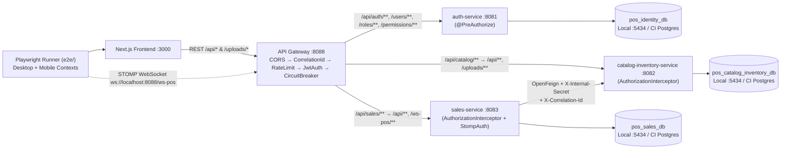
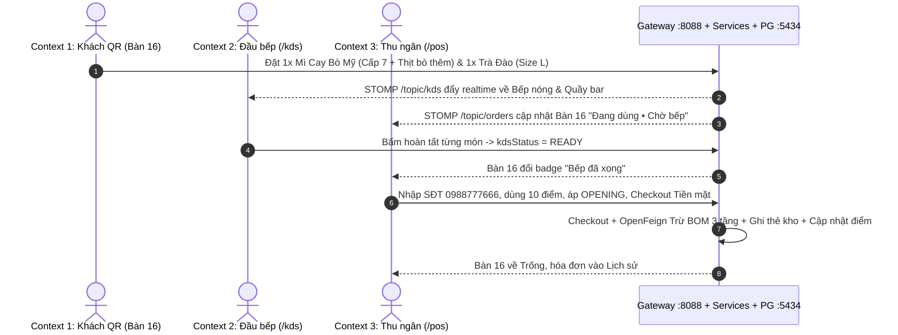

# KẾ HOẠCH XÂY DỰNG KIỂM THỬ END-TO-END (E2E) — HỆ THỐNG SMART POS & KDS

> **Phiên bản:** 3.0 (Chính thức — Đã chốt kiến trúc, công cụ, DB riêng cổng `5434` & CI GitHub Actions)  
> **Phạm vi dự án:** Toàn hệ thống Smart POS & KDS (Frontend Next.js + API Gateway + 3 Microservices + PostgreSQL 16)  
> **Tính chất tài liệu:** Bản kế hoạch thiết kế & chuẩn bị triển khai (chưa bao gồm mã nguồn kiểm thử)  
> **Ngày cập nhật:** 11/11/2026

---

## 1. CÁC QUYẾT ĐỊNH KIẾN TRÚC ĐÃ CHỐT

1. **Công cụ & Vị trí:** Sử dụng **Playwright (`@playwright/test`)** với TypeScript, đặt tại thư mục **`e2e/`** ở gốc dự án (`Smart-POS/e2e/`), tách biệt khỏi `frontend/tests/` (đang dùng `node --test`).
2. **Định tuyến qua API Gateway (`:8088`):** Mọi luồng REST (`/api/*`, `/uploads/*`) và WebSocket STOMP (`/ws-pos`) đi xuyên qua **API Gateway (`:8088`)** theo cấu hình hiện tại của `frontend/next.config.mjs` và `frontend/src/lib/websocket.ts`.
3. **Database E2E tách biệt hoàn toàn với DB Dev:**
   - **Local Windows:** Dựng `docker-compose.e2e.yml` chạy container `postgres:16-alpine` riêng ở cổng **`5434`** (`smartpos-postgres-e2e`), tách khỏi DB dev cổng **`5433`** (`postgres_data`).
   - **GitHub Actions CI:** Chạy `postgres:16-alpine` container sạch hoàn toàn cho mỗi workflow run.
4. **Triển khai cả Local & GitHub Actions CI:** Xây dựng script dùng chung để chạy E2E trên local Windows và workflow `.github/workflows/e2e.yml` trên `ubuntu-latest`.
5. **Phạm vi các tính năng đang giữ theo hiện trạng:**
   - Thanh toán POS kiểm thử theo UI/API hiện tại (**Tiền mặt** và xác nhận **VietQR** trên `PaymentQRModal`); khi nâng cấp đối soát tự động sẽ cập nhật test tương ứng.
   - Màn hình `/order-taking` (Waiter) và tab **Chi nhánh** trong `/admin/staff` kiểm thử theo hành vi hiện có.

---

## 2. HIỆN TRẠNG HỆ THỐNG & CÁC CƠ CHẾ MỚI CẦN BAO PHỦ

### 2.1. Sơ đồ kiến trúc thực tế khi chạy E2E

### 2.2. Các cơ chế bảo mật & vận hành mới vừa hoàn thiện ở Backend/Gateway
Ngoài luồng nghiệp vụ cơ bản, Gateway và các microservice hiện đã bổ sung đầy đủ các cơ chế sau — bộ E2E cần kiểm chứng và tuân thủ:
1. **Phân quyền 2 lớp (`401` tại Gateway + `403` tại cả 3 Microservice):**
   - Gateway (`JwtAuthenticationFilter`): Xóa header giả `X-User-*` và `X-Internal-*`, kiểm tra JWT (`401` nếu thiếu/hết hạn), mở đúng endpoint public: `POST /api/auth/login|refresh`, `GET /api/catalog/products/menu`, `GET /uploads/**`, `GET /api/sales/orders?tableNumber=...` (chỉ tra cứu bàn, chặn tham số quản trị `page`, `size`, `sort`, `startDate`, `endDate`, `search`), `POST /api/sales/orders`, `POST /api/sales/orders/{id}/items`, `POST /api/sales/promotions/apply`, `/ws-pos/**`, `/actuator/health`, `/api/sales/health`.
   - `catalog-inventory-service` & `sales-service`: Đã có `UserContextFilter` + `@RequirePermissions` + `AuthorizationInterceptor` trả **`403 Forbidden`** khi user đăng nhập đúng nhưng thiếu quyền, và kiểm tra `X-Internal-Service` + `X-Internal-Secret` cho API nội bộ `/api/inventory/deduct`.
2. **Bảo vệ STOMP WebSocket (`StompAuthChannelInterceptor` + `wsManager.setAuthToken`):**
   - Kết nối ẩn danh chỉ được subscribe `/topic/tables/{tableNumber}`.
   - Subscribe `/topic/orders` (POS) và `/topic/kds` (KDS) bắt buộc gửi Bearer JWT trong STOMP `CONNECT` và có đúng quyền (`POS_ACCESS`/`ORDER_READ`/`ADMIN_DASHBOARD` hoặc `KDS_VIEW`/`KDS_UPDATE`/`ADMIN_DASHBOARD`).
3. **Rate Limiting tại Gateway (`InMemoryRateLimitFilter`):**
   - `POST /api/auth/login`: mặc định tối đa **15 requests / 60 giây** mỗi IP (`429 Too Many Requests`).
   - `POST /api/(sales/)orders`: mặc định tối đa **30 requests / 60 giây** mỗi IP.
   - **Tác động tới thiết kế E2E:** Khi chạy test tuần tự trên `localhost`, nếu mỗi test đều login qua UI `/login`, suite sẽ vượt ngưỡng 15 lần/phút và bị Gateway chặn `429`. Do đó, bộ E2E **bắt buộc dùng `storageState` / token cache** khởi tạo 1 lần ở `globalSetup`, chỉ để `Suite 1` thực hiện thao tác login/logout trực tiếp (hoặc tăng `RATE_LIMIT_LOGIN_MAX_REQUESTS` khi chạy full suite và giữ ngưỡng mặc định ở test case kiểm chứng `429`).
4. **Circuit Breaker & Correlation ID:**
   - `catalogMenuCB` (Resilience4j) bảo vệ `GET /api/catalog/products/menu` và fallback về `/fallback/catalog`.
   - `X-Correlation-Id` được tạo từ Gateway (`CorrelationIdAndLoggingFilter`) và truyền qua MDC + OpenFeign tới 3 service.
5. **Healthcheck đồng bộ ở cả 4 service:**
   - Gateway (`:8088`), Auth (`:8081`), Catalog-Inventory (`:8082`), Sales (`:8083`) đều đã mở `/actuator/health` (riêng Sales có thêm `/api/sales/health`).

### 2.3. Quy hoạch sử dụng Seed Data cho E2E
Từ `init-scripts/02-seed-data.sql` và `DataInitializer` của 3 service:
- **Bàn ăn (20 bàn `1`..`20`):**
  - Các bàn **đã có đơn seed đang hoạt động** trong `sales-service`: **`Bàn 1` (`PENDING`), `Bàn 2` (`CONFIRMED`), `Bàn 3` (`PREPARING`), `Bàn 5` (`READY`), `Bàn 8` (`SERVED`)**.
  - Các bàn **trống ban đầu** dùng cho các test tạo đơn mới: **`Bàn 11`..`Bàn 20`** (mỗi test dùng bàn riêng để không va chạm trạng thái).
- **Tài khoản mẫu (15 user, mật khẩu `12345678`):** `admin`, `admin02`, `manager01/02`, `chef01/02/03`, `cashier01/02/03`, `waiter01/02/03`, `parttime01` (role `PART_TIME`, `isSystem=false`), `locked_staff` (`active=false`).
- **Khuyến mãi & Khách hàng:** Có sẵn `OPENING` (10%), `VIP5` (5%), `SUMMER20` (20%), `HAPPYHOUR15` (15%), `LIMITED10` (hết lượt `10/10`), `EXPIRED_OLD` (hết hạn & tắt), khách hàng `0988777666` (250 điểm), `0909090909` (0 điểm).

---

## 3. CẤU TRÚC THƯ MỤC `e2e/` ĐỀ XUẤT

- `e2e/package.json` — Khai báo `@playwright/test`, `typescript`, scripts chạy local & CI (`test:e2e`, `test:e2e:headed`, `test:e2e:p0`, `report`).
- `e2e/playwright.config.ts` — Cấu hình `workers: 1` (tránh tranh chấp DB/bàn/rate-limit), `baseURL: http://localhost:3000`, `projects` (`setup`, `desktop-chromium` 1280×800, `mobile-qr` 390×844), `trace: "retain-on-failure"`, `screenshot: "only-on-failure"`, `video: "retain-on-failure"`.
- `e2e/global-setup.ts` — Chờ healthcheck, login 1 lần lấy `storageState` cho các vai trò (`admin`, `manager`, `cashier`, `chef`, `waiter`, `parttime`) lưu vào `e2e/.auth/` (gitignored).
- `e2e/fixtures/` — Custom Playwright fixtures (`authContexts.ts` tạo nhiều BrowserContext cùng lúc cho Khách + Bếp + Thu ngân, `apiHelper.ts` gọi API qua Gateway với token hoặc helper kiểm tra DB/API sau thao tác UI).
- `e2e/pages/` — Page Object Model (POM) cho từng màn hình (`LoginPage`, `PortalPage`, `MenuQrPage`, `CartPage`, `KdsPage`, `PosPage`, `AdminOrdersPage`, `AdminProductsPage`, `AdminBomPage`, `AdminInventoryPage`, `AdminPurchasingPage`, `AdminPromotionsPage`, `AdminCustomersPage`, `AdminStaffPage`).
- `e2e/tests/` — Chia thành 6 suite:
  - `01-auth-rbac.spec.ts`
  - `02-qr-ordering.spec.ts`
  - `03-core-qr-kds-pos-bom.spec.ts`
  - `04-inventory-bom-purchasing.spec.ts`
  - `05-admin-management.spec.ts`
  - `06-gateway-security-concurrency.spec.ts`
- `e2e/scripts/` — Script khởi động & kiểm tra môi trường (`wait-for-stack.*`, `run-local-e2e.ps1`).
- File hạ tầng gốc dự án đi kèm (sẽ bổ sung khi triển khai): `docker-compose.e2e.yml` (Postgres `5434`) và `.github/workflows/e2e.yml`.

---

## 4. CHIẾN LƯỢC DATABASE & MÔI TRƯỜNG (LOCAL `:5434` VS GITHUB CI)

### 4.1. Cách ly Database Local (`:5434`) khỏi DB Dev (`:5433`)
- **`docker-compose.yml` / `docker-compose.full.yml` (Dev):** Giữ nguyên cổng `5433` và volume `postgres_data`. Dữ liệu bạn tự nhập/demo không bao giờ bị E2E chạm tới.
- **`docker-compose.e2e.yml` (Local E2E):** Chạy container `smartpos-postgres-e2e` (`postgres:16-alpine`) tại cổng **`5434:5432`**, gắn `init-scripts/` để khởi tạo 3 DB (`pos_identity_db`, `pos_catalog_inventory_db`, `pos_sales_db`), sử dụng volume riêng hoặc `tmpfs` để mỗi lần chạy `down -v && up -d` khôi phục nguyên trạng 100%.
- **Truyền cấu hình DB cổng `5434` khi khởi động 3 service cho E2E local:**
  - `auth-service`: `AUTH_DB_PORT=5434`
  - `sales-service`: `SALES_DB_URL=jdbc:postgresql://127.0.0.1:5434/pos_sales_db`
  - `catalog-inventory-service`: `SPRING_DATASOURCE_URL=jdbc:postgresql://localhost:5434/pos_catalog_inventory_db` *(hoặc cập nhật `application.yml` hỗ trợ `${CATALOG_DB_URL:jdbc:postgresql://localhost:5433/pos_catalog_inventory_db}` cho đồng bộ)*
  - Đồng bộ chung `JWT_SECRET` và `INTERNAL_SERVICE_SECRET` cho `auth-service`, `catalog-inventory-service`, `sales-service`, và `gateway`.

### 4.2. Chuẩn bị & Cô lập dữ liệu giữa các Test Case
- **Chạy tuần tự (`workers: 1`):** Tránh 2 test sửa cùng tồn kho hoặc ghi đè trạng thái bàn.
- **Phân vùng bàn trống:** Các test tạo đơn mới sử dụng các bàn riêng trong dải `Bàn 11`..`Bàn 20` (không đụng `Bàn 1, 2, 3, 5, 8` đã có đơn seed).
- **Dữ liệu CRUD có hậu tố duy nhất:** Món ăn, nguyên liệu, danh mục, khuyến mãi, nhà cung cấp, khách hàng, vai trò/nhân viên tạo mới trong test đều gắn suffix (VD: `E2E_<timestamp>`) và không phụ thuộc thứ tự chạy.

---

## 5. DANH MỤC KỊCH BẢN KIỂM THỬ E2E CHI TIẾT

### 5.1. Suite 1: Xác thực JWT, Refresh Token & Phân quyền (`01-auth-rbac.spec.ts`)

| Mã TC | Mức | Kịch bản | Dữ liệu / Thao tác | Kết quả mong đợi |
| :--- | :---: | :--- | :--- | :--- |
| **E2E-AUTH-01** | P0 | Đăng nhập & điều hướng theo vai trò + giữ phiên | Đăng nhập lần lượt `admin`, `manager01`, `cashier01`, `chef01`, `waiter01`, `parttime01` (`12345678`); F5 reload trang đích. | Điều hướng đúng `/admin`, `/pos`, `/kds`, `/order-taking`; Gateway forward cookie `refreshToken` `HttpOnly`; reload trang vẫn giữ phiên qua `/api/auth/refresh` + `/api/auth/me`. |
| **E2E-AUTH-02** | P0 | Đăng nhập sai mật khẩu & tài khoản bị khóa | Nhập sai mật khẩu cho `cashier01`; đăng nhập bằng `locked_staff` (`active=false`). | Hiện thông báo lỗi trên `LoginForm`, giữ ở `/login`, không cấp access token. |
| **E2E-AUTH-03** | P0 | Chặn truy cập trái phân hệ (`RoleGate`) | Chưa đăng nhập mở `/pos`, `/kds`, `/admin`, `/order-taking`; `cashier01` mở `/admin` và `/kds`. | Chưa đăng nhập bị chuyển về `/login`; `cashier01` thấy màn hình `HTTP 403 • Forbidden` với nút về `/`. |
| **E2E-AUTH-04** | P1 | Phân quyền động (`PART_TIME` / Role mới) | `admin` vào `/admin/staff`, chỉnh quyền hoặc tạo role đa phân hệ (VD: `POS_ACCESS` + `KDS_VIEW`) gán cho nhân viên mới; nhân viên đó đăng nhập. | Sau đăng nhập nhân viên được đưa tới `/` (Portal) thấy đúng các thẻ phân hệ được cấp, vào được `/pos` & `/kds` và bị chặn ở `/admin`; không cho xóa system role (`isSystem=true`). |
| **E2E-AUTH-05** | P1 | Đổi mật khẩu, Đăng xuất & Admin reset mật khẩu | `cashier03` đổi mật khẩu $\rightarrow$ đăng xuất $\rightarrow$ kiểm tra mật khẩu cũ/mới; `admin` reset lại mật khẩu cho `cashier03`. | Mật khẩu cũ bị từ chối; đăng xuất xóa session (F5 về `/login`); mật khẩu sau reset đăng nhập thành công. |

### 5.2. Suite 2: Khách hàng gọi món qua QR (`02-qr-ordering.spec.ts`)

| Mã TC | Mức | Kịch bản | Dữ liệu / Thao tác | Kết quả mong đợi |
| :--- | :---: | :--- | :--- | :--- |
| **E2E-QR-01** | P0 | Tải thực đơn thật, lọc & tìm kiếm (Mobile) | Mở `/menu?table=11` trên Mobile viewport; lọc danh mục, tìm `"Bò Mỹ"` / `"MC-BO"`. | Tải menu qua Gateway (`/api/catalog/products/menu`), hiển thị đầy đủ sản phẩm `isActive=true`. |
| **E2E-QR-02** | P0 | Chọn Biến thể & Topping, giữ giỏ `localStorage` | Chọn `Mì Cay Bò Mỹ` (75k) + `Cấp 7` (+5k) + `Thịt bò thêm` (+25k) + ghi chú $\rightarrow$ mở `/cart?table=11`, tăng/giảm SL, F5 reload. | Đơn giá đúng 105.000đ; giỏ hàng bàn 11 không mất khi F5; tổng tiền tự cập nhật. |
| **E2E-QR-03** | P0 | Gửi đơn gọi món mới từ QR | Tại `/cart?table=11`, bấm **Xác nhận gọi món**. | `POST /api/sales/orders` trả `201`, hiện mã `#ORD-...`, giỏ hàng bàn 11 được làm trống. |
| **E2E-QR-04** | P1 | Gọi thêm món vào bàn đang có đơn seed sẵn | Mở `/menu?table=5` (đang có `ORD-DEMO-ACT-04` trạng thái `READY`), thêm `Trà Đào Cam Sả` và gửi. | Gọi `POST /api/sales/orders/{id}/items` gộp vào đơn hiện hữu của Bàn 5; trạng thái đơn chuyển lại `PREPARING` để bếp nhận món mới. |
| **E2E-QR-05** | P1 | Áp dụng voucher hợp lệ & voucher hết lượt/hết hạn | Ở `/cart?table=12`, thử `LIMITED10` (hết lượt), `EXPIRED_OLD` (hết hạn), sau đó áp `OPENING` (10%) và gửi đơn. | Hai mã lỗi bị từ chối với thông báo rõ ràng; `OPENING` giảm 10% (trần 50k) và lưu vào đơn. |
| **E2E-QR-06** | P1 | Truy cập `/menu` không có tham số bàn | Mở `/menu` và `/cart` không kèm `?table=...`. | Chỉ xem thực đơn; nút xác nhận ở `/cart` bị vô hiệu hóa. |

### 5.3. Suite 3: Luồng Xuyên suốt QR $\rightarrow$ KDS $\rightarrow$ POS $\rightarrow$ Trừ kho BOM (`03-core-qr-kds-pos-bom.spec.ts`)

| Mã TC | Mức | Kịch bản | Dữ liệu / Thao tác | Kết quả mong đợi |
| :--- | :---: | :--- | :--- | :--- |
| **E2E-CORE-01** | P0 | **Luồng vàng đa phiên (QR $\rightarrow$ KDS $\rightarrow$ POS $\rightarrow$ BOM $\rightarrow$ Loyalty)** | Mở song song 3 BrowserContext: Khách (`/menu?table=16`), `chef01` (`/kds`), `cashier01` (`/pos`). Khách đặt `1x Mì Cay Bò Mỹ` (Cấp 7 + `Thịt bò thêm`) và `1x Trà Đào Cam Sả` (Size L); KDS bấm hoàn tất từng món; POS nhập SĐT `0988777666`, dùng 10 điểm, áp `OPENING`, thanh toán **Tiền mặt** (kiểm tra tính tiền thối). | • WebSocket STOMP qua `:8088` cập nhật realtime trên KDS & POS không cần chờ polling 60s. • KDS tách đúng trạm **Bếp nóng** và **Quầy bar**. • `Bàn 16` đổi `Chờ bếp` $\rightarrow$ `Bếp đã xong` $\rightarrow$ `Trống`. • Tồn kho nguyên liệu giảm đúng định lượng BOM 3 tầng (Base + Variant + Modifier), sinh thẻ kho `SALE_DEDUCT` gắn `orderCode`. • Điểm khách `0988777666` ghi nhận cả `REDEEM` (-10) và `EARN` (+1% thực trả). |
| **E2E-CORE-02** | P0 | Tạo đơn trực tiếp tại POS $\rightarrow$ KDS $\rightarrow$ Thanh toán VietQR | `cashier01` chọn `Bàn 17` trên `/pos`, thêm món, bấm **Gửi bếp**, kiểm tra `/kds` nhận món, sau đó mở modal **VietQR** và bấm xác nhận theo UI hiện có. | Đơn lưu và hiển thị trên KDS; sau thanh toán đơn thành `COMPLETED` (`VIETQR` / `PAID`), bàn trống và kho trừ đúng BOM. |
| **E2E-CORE-03** | P0 | Hủy đơn tại POS không trừ kho | Tạo đơn cho `Bàn 18` gửi bếp $\rightarrow$ thu ngân bấm **Hủy đơn** trên `/pos` và xác nhận. | Đơn chuyển `CANCELLED`, `Bàn 18` về `Trống`, task biến mất khỏi `/kds`, **tồn kho các nguyên liệu giữ nguyên không đổi**. |

### 5.4. Suite 4: Kho, BOM 3 tầng & Nhập hàng (`04-inventory-bom-purchasing.spec.ts`)

| Mã TC | Mức | Kịch bản | Dữ liệu / Thao tác | Kết quả mong đợi |
| :--- | :---: | :--- | :--- | :--- |
| **E2E-INV-01** | P0 | **Chặn thanh toán & rollback khi thiếu nguyên liệu** | Tạo nguyên liệu + món test với tồn kho nhỏ hơn định lượng BOM, tạo đơn ở `Bàn 19` và bấm thanh toán trên `/pos`. | Báo lỗi thiếu nguyên liệu; đơn không chuyển `COMPLETED`; không nguyên liệu nào bị trừ dở; không cộng/trừ điểm hay tăng `usedCount` voucher. |
| **E2E-INV-02** | P1 | Nhập kho từ Nhà cung cấp (`/admin/purchasing`) | `manager01` tạo phiếu nhập `DRAFT` (hoặc hoàn tất phiếu `PO-20261030-1002` / phiếu mới) $\rightarrow$ hoàn tất nhập kho. | Phiếu chuyển `COMPLETED`, tồn kho tăng đúng số lượng, ghi thẻ kho `IMPORT`. |
| **E2E-INV-03** | P1 | Kiểm kê (`AUDIT_ADJUST`), Xuất hủy (`SPOILAGE`) & Cảnh báo tồn thấp | Kiểm tra cảnh báo sẵn có (`NL-GA` = 2.5kg < 5.0kg) và thao tác kiểm kê / xuất hủy trên nguyên liệu test. | Tồn kho cập nhật đúng, chặn xuất hủy vượt tồn, cảnh báo low-stock đồng bộ trên `/admin`, `/admin/inventory` và tab **Kho nguyên liệu** của `/kds`. |
| **E2E-BOM-01** | P1 | Cấu hình BOM 3 tầng (`/admin/menu-bom`) | Cập nhật định lượng BOM cho món test, reload kiểm tra lưu bền vững rồi đặt và thanh toán 1 đơn món đó. | Kho trừ chính xác theo công thức vừa lưu. |

### 5.5. Suite 5: Quản trị Thực đơn, Khuyến mãi, Khách hàng & Báo cáo (`05-admin-management.spec.ts`)

| Mã TC | Mức | Kịch bản | Dữ liệu / Thao tác | Kết quả mong đợi |
| :--- | :---: | :--- | :--- | :--- |
| **E2E-ADM-01** | P1 | CRUD Món ăn, Upload ảnh & Ẩn/Hiện thực đơn (`/admin/products`) | Tạo danh mục + món test kèm upload ảnh (`/api/catalog/files/upload`), biến thể, modifier $\rightarrow$ kiểm tra hiển thị ở `/menu` $\rightarrow$ tắt `isActive`. | Ảnh load qua `/uploads/**` trên Gateway; món ẩn khỏi `/menu` khi `isActive=false`. |
| **E2E-ADM-02** | P1 | Quản lý Khuyến mãi (`/admin/promotions`) | Tạo mã voucher test có `minOrderAmount` và `maxDiscountAmount` $\rightarrow$ kiểm tra áp dụng ở `/pos` & `/cart` $\rightarrow$ tạm dừng mã. | Chặn đơn dưới mức tối thiểu, chặn trần giảm giá tối đa, mã tạm dừng không áp dụng được. |
| **E2E-ADM-03** | P1 | Khách hàng, Lịch sử hóa đơn & Thống kê (`/admin`, `/admin/orders`, `/admin/customers`) | Đăng ký nhanh khách mới ở `/pos` khi thanh toán `Bàn 20`; kiểm tra KPI `/admin`, lọc/xem chi tiết/xuất CSV ở `/admin/orders` và lịch sử điểm ở `/admin/customers`. | Số liệu doanh thu/đơn hàng khớp; file CSV xuất được; khách mới ghi nhận giao dịch `EARN`. |
| **E2E-ADM-04** | P2 | Tab QR, Chi nhánh (`/admin/staff`) & Waiter (`/order-taking`) | Tạo QR theo bàn tại `/admin/staff`; thao tác tab Chi nhánh; đăng nhập `waiter01` mở `/order-taking` bấm chuyển sang `/menu`. | Link QR mở đúng `/menu?table={n}`; thao tác hiện trạng hoạt động không lỗi runtime. |

### 5.6. Suite 6: Gateway Security, STOMP Auth, Rate Limit & Concurrency (`06-gateway-security-concurrency.spec.ts`)

*(Lưu ý: Các test API bảo mật/Gateway trong suite này dùng Playwright `APIRequestContext` gọi trực tiếp qua `http://localhost:8088` và kết hợp BrowserContext)*

| Mã TC | Mức | Kịch bản | Thao tác | Kết quả mong đợi |
| :--- | :---: | :--- | :--- | :--- |
| **E2E-GW-01** | P0 | Chống Header Spoofing, Internal Secret & `401` | Gửi request thiếu JWT kèm header giả `X-User-Role: ADMIN`, `X-Internal-Secret` tới `/api/sales/orders/statistics`, `/api/catalog/inventory/deduct`, `/api/users`; thử gọi `GET /api/sales/orders?page=0`. | Gateway xóa header giả, trả `401 Unauthorized` JSON có `X-Correlation-Id` và header CORS hợp lệ. |
| **E2E-GW-02** | P1 | Phân quyền API `403 Forbidden` sau Gateway | Dùng token của `waiter01`/`cashier01` gọi các API vượt quyền qua Gateway: `DELETE /api/users/1` (`auth`), `POST /api/catalog/ingredients` (`catalog`), `POST /api/sales/orders/{id}/checkout` bằng token `chef01` (`sales`). | Cả 3 service sau Gateway đều trả về **`403 Forbidden`** (xác minh `AuthorizationInterceptor` + `@PreAuthorize`). |
| **E2E-GW-03** | P1 | Bảo vệ WebSocket STOMP (`/ws-pos`) | Thử subscribe `/topic/kds` và `/topic/orders` ẩn danh hoặc với token `waiter01` (thiếu quyền `KDS_VIEW`/`POS_ACCESS`) so với token `chef01`/`cashier01` và kênh public `/topic/tables/11`. | Kênh `/topic/tables/11` nhận bình thường; kết nối thiếu quyền bị `StompAuthChannelInterceptor` từ chối subscribe kênh nội bộ. |
| **E2E-EDGE-01** | P1 | Chống trừ kho kép & Optimistic Locking | Mở 2 tab `/pos` cùng chọn 1 bàn đang có đơn, thanh toán gần như đồng thời ở 2 tab. | Chỉ 1 tab hoàn tất; chỉ sinh **1 bộ bản ghi `SALE_DEDUCT`** cho `orderCode`; tab 2 báo lỗi xung đột/đơn đã hoàn tất. |
| **E2E-EDGE-02** | P2 | Rate Limiting (`429`) & Lỗi mạng (`503`) | Chạy cuối suite: gửi vượt ngưỡng login (`> 15` lần/phút) tới `POST /api/auth/login` qua Gateway; giả lập lỗi `503` khi submit giỏ hàng `/cart`. | Gateway trả `429 Too Many Requests` kèm `Retry-After` & `X-Correlation-Id`; UI `/cart` hiện lỗi thật và giữ nguyên giỏ hàng. *(Trên CI có thể tách hoặc cấu hình ngưỡng test để không làm chậm các suite trước).* |

---

## 6. KẾ HOẠCH TRIỂN KHAI TRÊN LOCAL & GITHUB ACTIONS CI

### 6.1. Quy trình chạy trên Local Windows (`:5434`)
1. Khởi động Postgres E2E độc lập: `docker compose -f docker-compose.e2e.yml up -d` (cổng `5434`, không đụng DB dev `5433`).
2. Script `e2e/scripts/run-local-e2e.ps1` khởi động (hoặc kiểm tra nếu đã chạy) 4 backend services (`8081`, `8082`, `8083`, `8088`) trỏ về DB `5434` với cùng `JWT_SECRET` & `INTERNAL_SERVICE_SECRET`, cùng Next.js `:3000` (`API_GATEWAY_URL=http://localhost:8088`, `NEXT_PUBLIC_WS_URL=ws://localhost:8088/ws-pos`).
3. Chờ healthcheck `/actuator/health` trên cả 4 cổng backend + `http://localhost:3000/login` $\rightarrow$ chạy `npx playwright test` $\rightarrow$ xuất HTML report.

### 6.2. Quy trình chạy trên GitHub Actions (`.github/workflows/e2e.yml`)
- **Trigger:** `pull_request`, `push` (nhánh `main`/`dev`), và `workflow_dispatch`.
- **Runner & Services:** `ubuntu-latest` + service container `postgres:16-alpine` (hoặc `docker compose -f docker-compose.e2e.yml up -d`) + JDK 21 + Node 24 LTS + Playwright Chromium.
- **Caching:** Cache `~/.m2/repository`, `frontend` & `e2e` npm dependencies, và Playwright browsers.
- **Thứ tự thực thi trong Job:**
  1. Khởi tạo PostgreSQL sạch + nạp `init-scripts/`.
  2. Build backend (`mvn -f backend/pom.xml -DskipTests package` hoặc install `shared` + chạy 4 module) với `SPRING_PROFILES_ACTIVE=dev` và cùng `JWT_SECRET`, `INTERNAL_SERVICE_SECRET`.
  3. Healthcheck `8081`, `8082`, `8083`, `8088` (`/actuator/health`) và `frontend` (`:3000`, `npm run build && npm run start`).
  4. Chạy toàn bộ Playwright E2E tests (`workers: 1`).
  5. Upload artifacts (`if: always()`): `e2e/playwright-report/`, `e2e/test-results/` (trace, screenshot, video) và log 4 backend services + frontend để dễ chẩn đoán khi fail trên CI.

---

## 7. LỘ TRÌNH THỰC HIỆN (4 GIAI ĐOẠN) & TIÊU CHÍ NGHIỆM THU

1. **Giai đoạn 1 — Hạ tầng tách DB & Khung Playwright (`1–2 ngày`):**
   - Tạo `docker-compose.e2e.yml` (cổng `5434`), chuẩn hóa `${CATALOG_DB_URL:...}` (hoặc override env) cho `catalog-inventory-service`.
   - Khởi tạo `e2e/` (`package.json`, `playwright.config.ts`, `global-setup.ts`, `storageState`), script khởi động & healthcheck stack cho Windows local.
2. **Giai đoạn 2 — Page Objects & Bộ P0 Smoke/Core (`2 ngày`):**
   - Xây dựng POM cốt lõi và triển khai toàn bộ test **P0** (`E2E-AUTH-01..03`, `E2E-QR-01..03`, `E2E-CORE-01..03`, `E2E-INV-01`, `E2E-GW-01`).
3. **Giai đoạn 3 — Mở rộng P1/P2 & Tích hợp GitHub Actions (`2–3 ngày`):**
   - Hoàn thiện `Suite 4`, `Suite 5`, `Suite 6` (RBAC `403`, STOMP Auth, Concurrency, Rate Limit `429`, Fallback).
   - Tạo `.github/workflows/e2e.yml` và chạy kiểm chứng xanh toàn bộ trên GitHub Actions.
4. **Giai đoạn 4 — Chống Flaky & Nghiệm thu (`1 ngày`):**
   - Chạy lặp lại 3 lần liên tiếp từ DB sạch đạt **0% flaky**.
   - Xuất báo cáo Playwright HTML làm minh chứng đồ án.

### Tiêu chí nghiệm thu (Definition of Done)
- **100% test P0, P1, P2 PASS** qua **API Gateway (`:8088`)** nối thật Frontend + 3 Microservices + PostgreSQL 16.
- Chạy trên **Local Windows (DB cổng `5434`)** không làm thay đổi bất kỳ bản ghi nào trên DB dev (`5433`).
- Workflow **GitHub Actions** chạy tự động xanh hoàn toàn và đính kèm report/trace khi có lỗi.
